# 第1章 绪论

- 教材位置：`02.系统架构设计师第二版-教材.pdf` PDF 第 13～33 页（书页 3～23）
- 复习状态：已完成
- 复习日期：2026-11-05
- 本章地位：全书总纲。直接考选择题的分值不高，但**架构定义、五种典型架构、4+1 视角、架构设计师职责与成长路径**是后续各章和论文写作的概念根基。

## 一、大纲考点

对照 `01.系统架构第二版-大纲.pdf`（2022 年审定通过），本章内容主要落在**考试说明**与**考试科目 1「系统架构设计综合知识」第 6 部分「系统架构设计基础知识」**（大纲书页 40～43，PDF 第 50～53 页）。

考试目标（摘）：能够根据系统需求规格说明书，结合应用领域和技术发展的实际情况，考虑有关约束条件，**设计正确、合理的软件架构**，确保系统架构具有良好的特性；能够对项目的系统架构进行**描述、分析、设计与评估**；能够编写设计文档；具有高级工程师的实际工作能力和业务水平。

| 大纲条目 | 大纲要求（考点） | 教材对应小节 |
| --- | --- | --- |
| 6.1.1 软件架构的定义 | ⭐软件架构的定义、发展历程以及作用；架构设计分类（数据设计和体系结构设计） | 1.1.1 |
| 6.1.2 软件架构设计与生命周期 | ⭐Use Case 图、体系结构描述语言 ADL、**4+1 模型**和 UML 语言；**IEEE 1471—2000 标准**；软件架构生命周期六阶段 | 1.1.1、1.1.2（生命周期六阶段在第 7 章展开） |
| 6.1.3 软件架构的重要性 | 架构在系统开发中的关键作用 | 1.1.1、1.1.3 |
| 考试说明·考试要求 | 掌握系统架构的开发、验证和评估过程及方法；掌握软件系统建模、系统架构设计、演化及其评估等基本技术 | 全书，本章建立概念 |
| 考试说明·岗位能力 | 系统架构设计师的定义、职责、任务与应具备的素质 | 1.2、1.3 |

补充说明：本章 1.1.2 的**五种典型架构模型**（分层、事件驱动、微核、微服务、云）与大纲 6.3「软件架构风格」相关，但大纲 6.3 的经典五类风格（数据流、调用/返回、以数据为中心、虚拟机、独立构件）及 ABSD、架构复用、DSSA 均在**第 7 章**系统展开，本章只需建立初步印象。

## 二、知识点笔记

### 2.1 系统架构的定义及发展历程（1.1.1）

#### 1. 架构的定义 ⭐【重点】【高频考点】

> 教材原文（IEEE 1471-2000《软件密集系统架构描述推荐实践》）：**架构是体现在组件中的一个系统的基本组织、它们彼此的关系与环境的关系及指导它的设计和发展的原则。**

定义中四个关键词必须记牢：**组件**（系统由哪些部分构成）、**组件之间的关系**（怎么连接协作）、**组件与环境的关系**（系统不是孤立的）、**指导设计和发展的原则**（架构不只管现在，还管演化）。

与定义配套的三个术语：

| 术语 | 含义 | 通俗理解 |
| --- | --- | --- |
| 系统 | 组织起来完成某一特定功能或一组功能的**组件集**，可指应用、子系统、系统之系统、产品线乃至整个企业 | 要造的那个「整体」 |
| 环境（上下文） | 决定对系统开发、运作、政策等造成影响的环境和设置 | 系统所处的「外部世界」 |
| 任务 | 一个或多个**利益相关者**通过系统达到某些目标的用途或操作 | 各方「用系统来干什么」 |

通俗地说，**系统架构（System Architecture）是系统的一种整体的高层次的结构表示，是系统的骨架和根基**，包括**组件、连接件、约束规范**以及指导这些内容**设计与演化的原理**，它决定了系统的健壮性和生命周期的长短。

举例：盖楼时，架构设计相当于主体结构设计——决定楼能盖多高、抗几级地震、以后能不能加层；具体编码相当于装修。装修再精美，主体结构错了整栋楼也不合格。这就是「架构决定系统的健壮性和生命周期」的含义。

架构设计的位置与作用：架构设计通常作为**需求分析阶段之后、系统设计之前**的关键步骤，是连接用户需求和系统进一步设计与实现的**桥梁**，也是系统**早期阶段质量保证**的关键。架构设计的作用包括五点 ⭐：

1. 解决相对复杂的**需求分析**问题；
2. 解决**非功能属性**在系统占据重要位置的设计问题；
3. 解决**生命周期长、扩展性需求高**的系统整体结构问题；
4. 解决系统**基于组件需要的集成**问题；
5. 解决**业务流程再造难**的问题。

> 助记：架构设计五大作用——「复杂需求、非功能、长命扩展、组件集成、流程再造」。

#### 2. 发展历程 ⭐【重点】

**源头（与第 2 章呼应）**：1946 年第一台计算机 ENIAC 诞生；冯·诺伊曼提出 EDVAC，由**运算器、控制器、存储器、输入设备、输出设备**五部分组成，内部采用**二进制**，程序存放在存储器中（存储程序思想），当今计算机仍称冯·诺伊曼结构计算机。

**两次软件危机推动架构诞生**：

| 时间 | 事件 | 结果/启示 |
| --- | --- | --- |
| 20 世纪 60 年代中期 | 第一次软件危机：效率低、质量差，手工作坊式开发 | 1968、1969 年两次 **NATO 会议**提出「**软件工程**」概念 |
| 1995 年 | Standish Group 调查 8000 个软件项目：**84%** 无法按时按需完成，超 **30%** 夭折，耗费超预算 **189%** | **软件重用与组件化**成为解困方案，软件架构应运而生 |
| 20 世纪 90 年代 | 基础研究：架构风格、架构描述语言、架构文档、形式化方法 | Mary Shaw 与 David Garlan 提出架构是「**组件、连接件和风格的集合**」 |

软件架构概念演进的几个标志：1991 年 Royce 父子首次定义软件架构；1992 年 Perry 与 Wolf 提出 {elements, forms, rationale} 三要素；1996 年 Shaw 与 Garlan 的专著系统阐述概念内涵外延；**2000 年 IEEE 1471-2000 标准发布，第一次定义了软件架构的形式化标准**，标志理论体系基本建立。

软件架构自概念诞生以来大致经历**四个发展阶段** ⭐【高频考点】：

| 阶段 | 时间 | 标志性内容 |
| --- | --- | --- |
| ① 基础研究阶段 | 1968—1994 年 | 1968 年 NATO 会议首提「软件架构」术语；模块化开发方法逐步采用，形成架构雏形 |
| ② 概念体系和核心技术形成阶段 | 1999—2000 年 | 概念体系成熟；**IEEE 1471-2000 发布**；最重要成果之一是**软件组件化技术** |
| ③ 理论体系完善与发展阶段 | 1996 年至今 | 架构描述与表示、分析设计测试、发现演化与重用、基于架构的开发方法、架构风格、动态架构等成为研究重点 |
| ④ 普及应用阶段 | 2000 年至今 | 1999 年第一届 IFIP 软件架构会议；Open Group 提出基于 XML 的 **ADML**；**软件产品线**成为重要分支 |

【易错】四个阶段的年份在教材中本就**相互交叉重叠**（如②为 1999—2000、③从 1996 年起），考试应记「阶段名称 + 标志事件」，不要死抠年份边界。

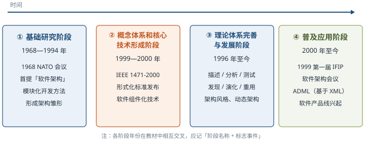

**模块化开发方法**：把软件分解成若干小而简单的部分，分而治之；每个模块可独立开发与测试，最后组装成完整软件。分解方法有数据结构设计法、功能分解法、数据流设计、面向对象设计等。将系统分解成模块时应遵循六条规则 ⭐：

1. **最高模块内聚**：模块内部元素最大限度关联，只实现一种功能的模块是高内聚，具有三种以上功能的模块是低内聚；
2. **最低耦合**：不同模块之间关系尽可能弱，利于升级和扩展；
3. **模块大小适度**：过大则内部维护困难，过小则模块间耦合增加；
4. 模块**调用链深度**（嵌套层次）不可过多；
5. **接口简单、精炼**（扇入扇出数不宜太大），具有**信息隐蔽**能力；
6. 尽可能地**复用已有模块**。

> 助记：模块分解六规则——「高内聚、低耦合、大小适度、调用别太深、接口精简能隐蔽、旧模块多复用」。

**组件化、模块化、应用集成的区别** ⭐【易错】：

| 对比项 | 模块化 | 组件化 | 应用集成 |
| --- | --- | --- | --- |
| 实质 | 逻辑上切分，物理（代码）上通常**没有真正隔离** | 组件**可组装、可插拔**，运行仅依赖平台或容器 | 把不同平台/方案的应用集成为无缝、并列、易访问的单一系统 |
| 相互关系 | 模块间可存在较强耦合 | 组件间**不存在直接耦合**，但组装后可进行业务交互 | 各应用仍相对独立，强调整合访问 |
| 一句话 | 切得开 | 拔得下、插得上、组得起 | 连得拢 |

三者关系结论：**组件化比模块化更独立，但比应用集成结合得更加紧密**。

**软件架构影响软件生命周期的各个阶段**：需求阶段——保证需求规约与系统设计之间的**可追踪性和一致性**；设计阶段——架构描述、模型设计与分析、经验总结与复用（研究最早、最多）；实现阶段——用程序设计语言实现设计，满足架构与需求；维护阶段——通过规定**可扩展性、可替换性**等属性保证可维护性。

教材图 1-1 给出了传统 MIS 系统的软件架构：各业务系统（CRM、MIS、资金管理、资产风险等）的业务流程调用**业务构件**，构件运行在**面向构件的 SOA 中间件（EOS）**之上，底层通过 **ESB**（服务路由目录库、传输/事件/中转服务）连接主机、网上银行、基金交易等既有系统。它体现了「**业务与数据处理分离的分层思想 + 基于 SOA 的构件复用与集成**」，是软件架构初步雏形的典型代表，理解其分层思想即可。

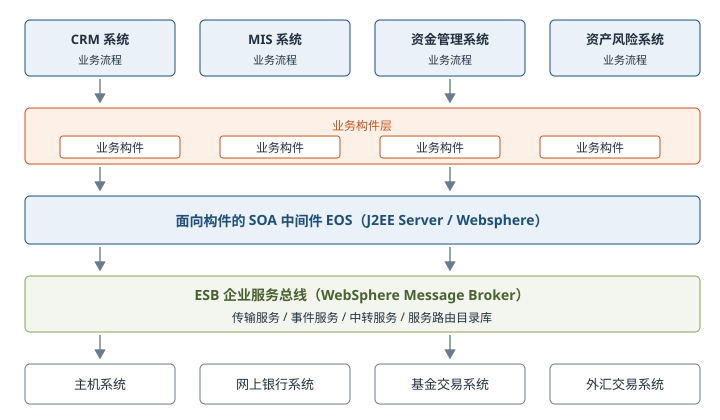

### 2.2 软件架构的常用分类——五种典型架构模型（1.1.2）⭐【重点】【高频考点】

教材给出的典型架构模型包括**分层架构、事件驱动架构、微核架构、微服务架构和云架构**五类；C/S、B/S、管道-过滤器、PAC 等架构也被广泛使用。

#### 1. 分层架构（Layered Architecture）

**最常见的软件架构，也是事实上的标准架构**。将软件分成若干水平层，每层都有清晰的角色和分工，**不需要知道其他层的细节**，层与层之间通过**接口**通信。最常见的是**四层结构** ⭐：

| 层次 | 英文 | 职责 | 餐厅类比 |
| --- | --- | --- | --- |
| 表现层 | Presentation Layer | 用户界面，负责视觉和用户互动 | 服务员：接待点菜、上菜 |
| 业务层 | Business Layer | 实现业务逻辑 | 厨师：按菜谱烹饪 |
| 持久层 | Persistence Layer | 提供数据，**SQL 语句就放在这一层** | 配菜员：按单备料 |
| 数据库层 | Database Layer | 保存数据 | 食材仓库 |

两个细节常考：有的项目在业务层和持久层之间加**服务层（Service）**，提供不同业务逻辑需要的通用接口；**用户请求依次通过各层处理，不能跳过其中任何一层**。

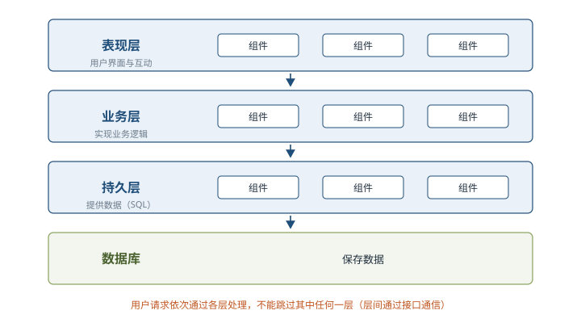

#### 2. 事件驱动架构（Event-driven Architecture）

**事件（Event）是状态发生变化时软件发出的通知**。事件驱动架构是通过事件进行通信的软件架构，分成四个部分 ⭐：

| 组成 | 英文 | 职责 |
| --- | --- | --- |
| 事件队列 | Event Queue | **接收事件的入口** |
| 分发器 | Event Mediator | 将不同的事件**分发到不同的业务逻辑单元** |
| 事件通道 | Event Channel | 分发器与处理器之间的**联系渠道** |
| 事件处理器 | Event Processor | **实现业务逻辑**，处理完成后会**发出事件，触发下一步操作** |

对于简单的项目，事件队列、分发器和事件通道可以合为一体，整个软件就分成**事件代理**和**事件处理器**两部分。

举例：快递分拣中心。包裹（事件）先送到收件口（事件队列），分拣员（分发器）按目的地把包裹放上传送带（事件通道），各区工人（事件处理器）完成本区处理后贴上下一站单据（发出新事件，触发下一步）。

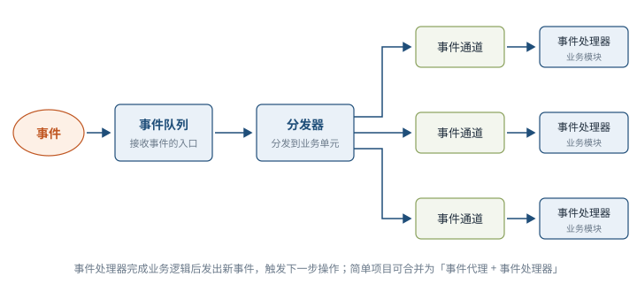

#### 3. 微核架构（Microkernel Architecture）

又称**插件架构（Plug-in Architecture）**：软件的**内核相对较小，主要功能和业务逻辑都通过插件实现**。内核（Core）通常只包含**系统运行的最小功能**；**插件互相独立**，插件之间的通信应减少到最低，避免互相依赖。

举例：VS Code 编辑器核心只提供文本编辑、界面框架等最小功能；Python 调试、Git 集成、主题皮肤都做成扩展插件，装不装某个插件互不影响，也不会因卸掉一个插件导致编辑器崩溃。

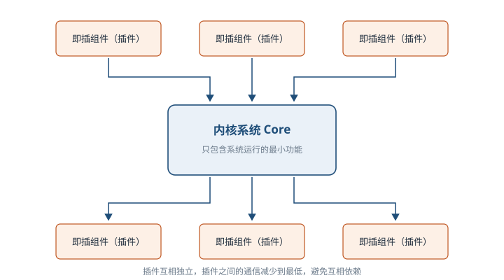

#### 4. 微服务架构（Microservices Architecture）

微服务架构是**服务导向架构（SOA）的升级**：**每一个服务就是一个独立的部署单元**（Separately Deployed Unit），这些单元都是**分布式的、互相解耦**的，通过**远程通信协议（如 REST、SOAP）**联系。三种实现模式 ⭐：

| 实现模式 | 要点 | 备注 |
| --- | --- | --- |
| RESTful API 模式 | 服务通过 API 提供 | **云服务就属于这一类** |
| RESTful 应用模式 | 服务通过传统网络协议或应用协议提供，背后通常是多功能应用程序 | 常见于**企业内部** |
| 集中消息模式 | 采用**消息代理（Message Broker）**实现消息队列、负载均衡、统一日志和异常处理 | 缺点是**单点失败**，消息代理可能要做成**集群** |

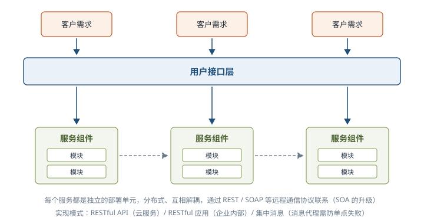

#### 5. 云架构（Cloud Architecture）

云架构**主要解决扩展性和并发的问题，是最容易扩展的架构**。其做法是：将数据都**复制到内存**中，变成可复制的内存数据单元，把业务处理能力封装成一个个**处理单元（Processing Unit）**；访问量增加就新建处理单元，减少就关闭处理单元。由于**没有中央数据库**，扩展性的最大瓶颈消失；但每个处理单元的数据都在内存里，**需要进行数据持久化**。云架构主要分成两部分 ⭐：

| 组成 | 职责 |
| --- | --- |
| 处理单元（Processing Unit） | **实现业务逻辑** |
| 虚拟中间件（Virtualized Middleware） | 负责通信、保持会话控制、数据复制、分布式处理和处理单元的部署 |

虚拟中间件又包含四个组件 ⭐【易错】：

| 组件 | 职责 |
| --- | --- |
| 消息中间件 Messaging Grid | 管理用户请求和**会话控制**，决定请求分配给哪一个处理单元 |
| 数据中间件 Data Grid | 将数据**复制（同步）到每一个处理单元**，保证各处理单元得到同样的数据 |
| 处理中间件 Processing Grid | **可选**；一个请求涉及不同类型处理单元时负责**协调** |
| 部署中间件 Deployment Manager | 负责处理单元的**启动和关闭**，监控负载和响应时间，负载增加就新启动、减少就关闭 |

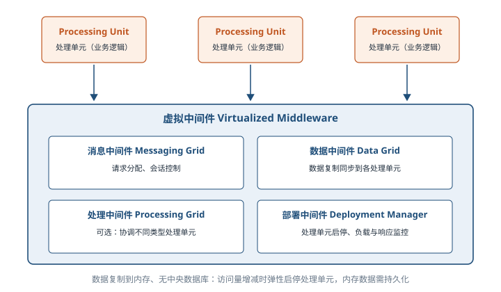

五种典型架构对比速记：

| 架构 | 一句话核心 | 突出特点 |
| --- | --- | --- |
| 分层架构 | 水平分层、接口通信、逐层调用 | 事实上的标准架构，结构清晰 |
| 事件驱动架构 | 用事件通知串起处理流程 | 松耦合、异步触发 |
| 微核架构 | 小内核 + 独立插件 | 可插拔、易扩展功能 |
| 微服务架构 | 服务即独立部署单元 | SOA 升级，分布式解耦 |
| 云架构 | 内存数据 + 弹性处理单元 | 最易扩展，解决并发 |

> 助记：五种典型架构——「分、事、核、微、云」：分层稳、事件松、微核插、微服拆、云弹扩。

### 2.3 系统架构的常用建模方法（1.1.2）⭐【重点】

根据建模侧重点不同，软件架构模型分成 **4 种**：

| 模型 | 建模侧重点 | 要点 |
| --- | --- | --- |
| 结构模型 | 以**构件、连接件**等刻画结构 | 最直观、最普遍；反映配置、约束、隐含假设、风格和性质；**研究核心是架构描述语言（ADL）** |
| 框架模型 | 侧重**整体结构**而非细节 | 以特殊问题为目标，建立只针对和适应问题的结构 |
| 动态模型 | 系统的「**大颗粒**」行为 | 描述重新配置或演化，如建立/拆除通信或计算的过程，常是激励型的 |
| 过程模型 | 构造系统的**步骤和过程** | 结构是遵循某些过程脚本的结果 |

四种模型并不完全独立，**有机结合**才能形成完整模型，准确、全面地反映软件架构。

**「4+1」视角模型** ⭐【高频考点】：Philippe Kruchten 于 **1995 年**提出，从 5 个不同视角描述软件架构，每个视角只关心系统的一个侧面，5 个视角结合才能反映软件架构的全部内容。

| 视角 | 关注的问题（通俗解释） |
| --- | --- |
| 逻辑（Logical）视角 | 系统提供哪些功能、由哪些对象/模块构成，即「系统是什么结构」 |
| 过程（Process）视角 | 系统运行时有哪些进程/线程、如何并发与同步，即「跑起来怎么协同」 |
| 物理（Physical）视角 | 软件部署到哪些硬件/节点上、如何联网，即「装在哪里」 |
| 开发（Development）视角 | 代码如何分包、分模块、由谁开发，即「怎么组织开发」 |
| 场景（Scenarios）视角 | 用典型用例/场景把前四个视角**串联验证**，即「拿真实使用故事检验设计」 |

举例：把系统想象成一栋住宅——逻辑视角看户型与功能分区，开发视角看施工图纸怎么分包给各班组，过程视角看入住后水电暖各系统如何并行运转，物理视角看房子落在哪个地块、怎么接市政管网，场景视角则用几个典型家庭的入住故事，把前面所有图纸串起来检验是否好住。

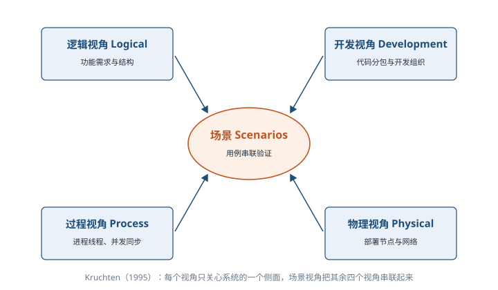

### 2.4 软件架构的应用场景与未来发展（1.1.3、1.1.4）

不同架构风格各有优缺点和适用场景 ⭐（常考「风格—场景」配对）：

| 架构风格 | 适用场景 |
| --- | --- |
| 管道-过滤器 | 将系统分成若干**独立的步骤** |
| 主程序/子系统、面向对象 | 对**组件内部**进行设计 |
| 虚拟机风格 | 构造**解释器或专家系统** |
| C/S、B/S | 数据和处理分布在一定范围，通过**网络连接**构成系统 |
| 平台/插件 | 具有**插件扩展**功能的应用程序 |
| MVC | **用户交互**程序的设计 |
| SOA | **企业集成** |
| C2 | **GUI 软件**开发，构建灵活可扩展的应用系统 |

现代大型软件**很少使用单一架构风格**，而是混合多种风格，从不同视角描述系统，保证可靠性、可扩展性、可维护性等非功能属性的正确描述。

未来发展：架构发展主线可归纳为**模块化编程/面向对象编程 → 构件技术 → 面向服务开发技术 → 云技术**；同时架构描述、建模和验证技术始终扮演重要角色。微服务架构、数据驱动架构、智能架构等新技术新思想不断融入，教材图 1-7 的技术发展路线记住这条主线即可。

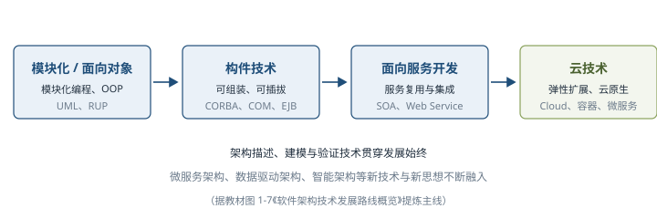

### 2.5 系统架构设计师概述（1.2）⭐【重点】

#### 1. 定义与分类

**架构设计师是负责系统架构的人、团队或组织（IEEE 1471-2000）**，是系统或产品线的**设计责任人**：负责理解、管理并最终**确认和评估非功能性系统需求**（如可维护性、性能、复用性、可靠性、有效性、可测试性等），给出开发规范，搭建系统实现的核心构架，对整个软件架构、关键构件和接口进行**总体设计**并澄清关键技术细节。

架构设计师、架构设计、架构三者关系：**架构设计师执行架构设计，架构设计生成架构，架构设计师的成果是创建架构**。系统开发中，架构设计师是整个系统的核心。

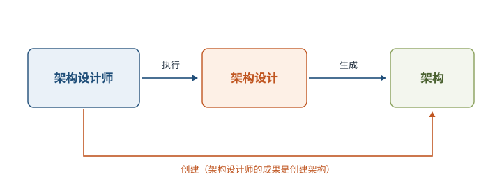

架构师的分类（注意区分两种划分口径）：

| 划分口径 | 类别 |
| --- | --- |
| 从组织上划分（5 类） | **业务架构师、主题领域架构师、技术架构师、项目架构师、系统架构师** |
| 参考微软按关注领域划分（4 种） | **企业架构师 EA、基础结构架构师 IA、特定技术架构师 TSA、解决方案架构师 SA** |

本书的培养对象重点围绕**系统架构师**的职责展开。

#### 2. 职责与任务 ⭐【高频考点】

架构设计师的职责应该是**技术领导**：一方面在组织职位上拥有**技术决策的权威**（项目经理更关注**管理资源、进度和成本**，二者代表项目的公共角色）；另一方面在品质上为他人树立榜样、指导培养团队成员，并确保技术决策被**传达、理解并始终被执行**。

架构设计师在项目中的主要任务（3 条）：

1. **领导与协调**整个项目中的技术活动（分析、设计和实施等）；
2. **推动主要的技术决策**并最终表达为系统架构；
3. **确定系统架构**，并促使其架构设计的**文档化**（包括需求、设计、实施和部署等「视图」）。

从技术角度看，架构设计师的职责就是**抽象设计、非功能设计和关键技术设计**三大任务 ⭐。

架构设计师角色可由一个人或一个团队履行；由团队履行时，**首席架构设计师**非常重要——他是架构团队的**单点协调人**，没有他，团队难以创造出内聚的架构或做出决策。最优秀的架构通常由团队而不是个人创建。

#### 3. 应具备的专业素质（8 项）⭐

| 素质 | 关键要求 |
| --- | --- |
| 掌握业务领域的知识 | 不懂业务只会做出满足自己熟悉内容、而非用户需求的方案；懂业务才能预见变化 |
| 掌握技术知识 | 关注技术的**重要因素而非细节**，不必是每个 API 的专家，但必须跟上技术发展 |
| 掌握设计技能 | 架构是**关键设计决策的具体化**，设计能力靠多年经验积累 |
| 具备编程技能 | 即使不必写代码也要跟上更新；有组织地参与开发、编写一定量代码 |
| 具备沟通能力 | 软技能中**沟通最重要**；有效的口头和书面表达，激励团队共享愿景 |
| 具备决策能力 | 在信息不明确、时间不足时也要果断决策，并学会纠正错误决策 |
| 知道组织策略 | 对政治敏感，与恰当的人沟通，确保项目获得支持 |
| 应是谈判专家 | 尽早降低风险，通过精炼/回退需求与利益相关者达成一致，说清各种折中方案的后果 |

> 助记：八项素质——「业务技术会设计，能写代码善沟通；果断决策懂策略，谈判折中降风险」。

#### 4. 知识结构（10 个方面）

战略规划能力；业务流程建模能力；信息数据架构能力；技术架构设计和实现能力；应用系统架构的解决和实现能力；基础 IT 知识及基础设施、资源调配能力；信息安全技术支持与管理保障能力；IT 审计、治理与基本需求的分析和获取能力；面向软件系统可靠性与系统生命周期的质量保障服务能力；对新技术与新概念的理解、掌握和分析能力。

总要求：**多层次**（体系结构、软硬件与网络、系统工程、信息系统、嵌入式、安全可靠性等知识层面 + 架构方法、模式、流程与模型经验，广泛了解并**精通一种**特定技术）×**多方面**（业务领域及管理、商务、财务、法律等背景知识）。

### 2.6 如何成为一名好的系统架构设计师（1.3）

#### 1. 优秀架构设计师的 6 种角色特质 ⭐【高频考点】

Pat Kua（原 ThoughtWorks 咨询师）提出，技术全面的架构设计师必须具备 6 个角色特质：

| 角色特质 | 核心要点 |
| --- | --- |
| 作为**领导者** | 像导师而非发号施令者，用讲故事、影响力、引导冲突、构建信任把架构愿景变成现实 |
| 作为**开发者** | 多与开发人员待在一起、花时间在代码上，避免「**象牙塔式架构设计师**」；技术选型要与问题域匹配 |
| 聚焦系统（**系统综合者**） | 不只看代码，还关注部署、自动化测试、性能、安全、可支持性；寻找满足**不同利益相关者**需求的方案，而非迎合某一参与者偏好 |
| 具备**企业家思维** | 从**成本和收益**两个角度评估技术选型，调查隐性成本（文档、社区、约束、长期风险），敢于承担风险、快速学习、接受失败 |
| **战略技术专家**（权衡战略与战术思维） | 不盲目追新，在团队**敏捷度与一致性**之间求平衡；可用「**技术雷达**」练习战略思维 |
| 良好的**沟通** | 用**听众熟悉的术语**（风险回报、成本收益）而非技术黑话交流；内外部沟通同样重要；用架构决策日志、Wiki 留下可追溯记录 |

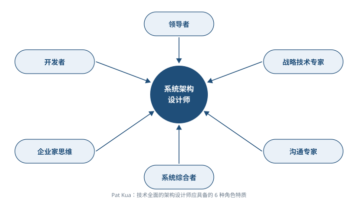

#### 2. 从工程师到系统架构设计师的演化 ⭐【重点】

系统架构设计师与建筑师的共同点都是**做好顶层设计、充当需求方和实施者的桥梁**；不同点是：**系统架构设计师一定是从工程师成长起来的**。

工程师与架构设计师的本质区别：技术上，架构设计师首要工作是**抽象建模**，更重要的是**了解业务领域**；既要有广度（语言、算法、数据库到网络协议、分布式、中间件等），也要在关键技术模块有**深度和权威性**，是技术团队的对外接口人、外部团队技术问题的终结者。架构师要成为**业务和技术的桥梁**，掌握「中庸之道」——**架构的工作主题就是权衡**，要习惯于不完美和一定条件下的不精确，而工程师往往追求完美与精确。

成为架构设计师的关键是培养**三力**：**判断力**（准确判断系统复杂度与脆弱点）、**执行力**（用合适方案解决复杂度问题）、**创新力**（创造新方案解决复杂度问题）；遵循**积累经验、拓宽视野、深度思考**的原则。

成长六阶段 ⭐【易错：年限与特征常考匹配】：

| 阶段 | 所需时间 | 典型特征 | 主要积累 |
| --- | --- | --- | --- |
| 工程师 | 1～3 年 | **在别人的指导下完成开发** | 基础技能（语言、数据结构、环境、数据库、流程） |
| 高级工程师 | 3～5 年 | **独立完成开发**（需求分析、方案设计、编码，多在已有架构下） | 方案设计经验；从知道 How 到知道 **Why** + 理论（范式、设计模式、SOLID、缓存理论） |
| 技术专家 | 4～8 年 | **某个领域的专家**，能修改、扩展和优化架构 | 拓展技术**宽度**（理解原理、优缺点、应用场景） |
| 系统架构设计师（初级） | 5～8 年 | **独立完成一个系统的架构设计**（0 到 1 或重构） | 形成自己的**架构设计方法论**（与技术专家凭经验的本质区别） |
| 系统架构设计师（中级） | 8～10 年以上 | **完成复杂系统的架构设计**（高性能、高可用、可扩展、海量存储） | 技术深度和技术理论的积累 |
| 系统架构设计师（高级） | 10 年以上 | **创造新的架构模式**（如 MapReduce、Docker 开创潮流） | **创造性** |

> 助记：成长路径一句话——「跟做 → 独做 → 钻一域 → 设计一系统 → 设计复杂系统 → 开创新模式」；初级靠方法论，中级靠深度，高级靠创造。

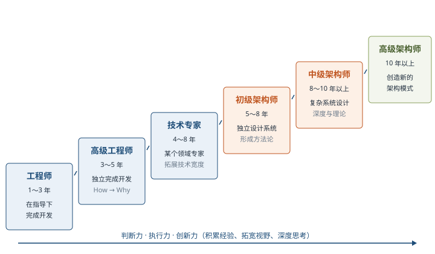

最后，技术人员的成长基本遵循「**10000 小时定律**」：成为顶尖专业人才需要 10000 小时持续不断的练习；架构设计师的成长关键在于对技术的热情以及持续的学习、实践、思考和总结。

## 三、重点与易错点

| # | 考点 | 必须记住的结论 | 易错提醒 |
| --- | --- | --- | --- |
| 1 | IEEE 1471-2000 架构定义 | 组件的基本组织 + 组件间关系 + 与环境的关系 + 指导设计和发展的原则 | 不要只记「组件+连接件」，漏掉「环境」和「原则」 |
| 2 | 架构设计的位置 | **需求分析之后、系统设计之前**；桥梁 + 早期质量保证 | 不是详细设计之后，也不是编码阶段 |
| 3 | 发展四阶段 | 基础研究（1968—1994）→ 概念体系与核心技术形成（1999—2000）→ 理论体系完善与发展（1996 至今）→ 普及应用（2000 至今） | 年份交叉属原文；IEEE 1471-2000 属于第②阶段成果 |
| 4 | 组件化 vs 模块化 vs 应用集成 | 模块化是逻辑切分无物理隔离；组件化可组装可插拔、不直接耦合；应用集成是整合不同应用 | 「组件化比模块化更独立，但比应用集成结合更紧密」方向别记反 |
| 5 | 五种典型架构 vs 经典五类风格 | 本章：分层/事件驱动/微核/微服务/云；Shaw 与 Garlan 经典五类：数据流、调用/返回、独立组件、虚拟机、仓库 | 两套分类别混淆，经典五类在第 7 章详考 |
| 6 | 分层架构 | 表现→业务→持久→数据库；SQL 在持久层；**不能跳层**；服务层是变体 | 「可以跨层调用以提高效率」是错误说法 |
| 7 | 事件驱动四部件 | 队列（入口）→ 分发器（分发）→ 通道（渠道）→ 处理器（业务逻辑，完成后发新事件） | 简单项目可合并为事件代理 + 处理器两部分 |
| 8 | 微服务三模式 | RESTful API（云服务）、RESTful 应用（企业内部）、集中消息（单点失败→集群） | 集中消息模式的缺点是单点失败 |
| 9 | 云架构虚拟中间件四组件 | 消息（请求分配+会话）、数据（复制同步）、处理（可选，协调）、部署（启停+监控负载） | 与事件驱动四部件是两套名词，最易张冠李戴 |
| 10 | 4+1 视角 | 逻辑、过程、物理、开发 + 场景；Kruchten，1995 | 「+1」是场景视角，场景用于串联其余四视角 |
| 11 | 架构师 vs 项目经理 | 架构师是**技术领导**，有技术决策权威；项目经理关注资源、进度、成本 | 架构师不是行政领导，也不替代项目经理 |
| 12 | 技术角度三大任务 | **抽象设计、非功能设计、关键技术设计** | 与「领导协调、推动决策、文档化」三条任务区分口径 |
| 13 | 6 角色 / 8 素质 / 10 知识结构 | 6 角色特质是 Pat Kua 提出；8 素质含沟通、决策、谈判等；10 知识结构是能力清单 | 出题常把「技术雷达」「企业家思维」等混入其他清单 |
| 14 | 成长六阶段 | 初级架构师=独立完成一个系统的架构设计+方法论；高级=创造新的架构模式 | 年限为大致参考，重点记「特征词」与「积累重点」 |

## 四、练习与真题

以下为依据大纲与教材自编的模拟练习题（单选），用于自测本章考点。

**1.** 根据 IEEE 1471-2000 标准，架构的定义中**不包含**下列哪一项？
A. 体现在组件中的系统基本组织  B. 组件彼此的关系及与环境的关系  C. 指导系统设计和发展的原则  D. 系统各模块的详细算法与数据结构

**2.** 在典型的四层分层架构中，SQL 语句通常位于（ ）。
A. 表现层  B. 业务层  C. 持久层  D. 数据库层

**3.** 关于分层架构，下列说法**正确**的是（ ）。
A. 各层必须了解其他层的实现细节  B. 为提高性能，用户请求可跳过持久层直接访问数据库  C. 层与层之间通过接口通信，请求依次通过各层，不能跳过任何一层  D. 分层架构强制规定系统必须恰好分为四层

**4.** 事件驱动架构中，负责「将不同的事件分发到不同的业务逻辑单元」的部件是（ ）。
A. 事件队列  B. 分发器  C. 事件通道  D. 事件处理器

**5.** 某编辑器内核仅提供最小运行功能，语法高亮、调试支持等均以独立插件形式提供，插件间通信减到最低。该软件采用的架构是（ ）。
A. 微服务架构  B. 微核架构（插件架构）  C. 事件驱动架构  D. 云架构

**6.** 云架构的虚拟中间件中，负责监控负载和响应时间、在负载增加时新启动处理单元的是（ ）。
A. 消息中间件 Messaging Grid  B. 数据中间件 Data Grid  C. 处理中间件 Processing Grid  D. 部署中间件 Deployment Manager

**7.** Kruchten 提出的「4+1」视角模型中，「+1」指的是（ ）。
A. 逻辑视角  B. 开发视角  C. 场景视角  D. 物理视角

**8.** 关于组件化与模块化的说法，**正确**的是（ ）。
A. 模块化在物理（代码）上一定实现了真正隔离  B. 组件之间存在直接耦合关系  C. 组件化比模块化更独立，但比应用集成结合得更加紧密  D. 组件化就是应用集成

**9.** 从技术角度看，架构设计师的职责可概括为三大任务，下列**不属于**的是（ ）。
A. 抽象设计  B. 非功能设计  C. 关键技术设计  D. 项目进度与成本控制

**10.** 根据教材所述成长路径，「能够独立完成一个系统的架构设计，并基于完善的架构设计方法论进行设计」是下列哪个阶段的典型特征？
A. 高级工程师  B. 技术专家  C. 初级系统架构设计师  D. 高级系统架构设计师

（参考答案集中放在全章最后的「六、参考答案」，请先独立完成再核对。）

## 五、疑问与查漏补缺

- 大纲 6.1.2 还要求「软件架构生命周期六阶段（需求、设计、实现、构件组装、部署、后开发）」，本章未展开，**复习第 7 章时补齐**并回看此处。
- 大纲 6.3 的经典五类架构风格（数据流、调用/返回、以数据为中心、虚拟机、独立构件）与 ABSD（6.2）、架构复用（6.4）、DSSA（6.5）均在第 7 章，本章只需区分「两套分类不是一回事」。
- 架构分析方法 SAAM、ATAM、CBAM 等本章仅在发展历程中提及名称，详细内容见**第 8 章**系统质量属性与架构评估。
- 架构描述语言（C2SADL、Wright、ACME、UniCon、Rapide、Darwin、MetaH、Aesop 等）了解名称与「ADL 是结构模型研究核心」即可，不需逐一深入。
- 教材图 1-7《软件架构技术发展路线概览》信息量大，考试层面记住「模块化/面向对象 → 构件 → 面向服务 → 云」主线即可。
- 教材 1.1.2 原文「分层架构通常明确约定软件一定要分成多少层」与通行理解（不强制层数、最常见四层）及同段后文表述存在出入，笔记按「不强制层数」理解，标记存疑待对照其他资料。
- 教材四阶段年份交叉（②1999—2000 与③1996 至今重叠）为原文表述，按「阶段名称 + 标志事件」记忆。

## 六、参考答案

**1.** **D**。定义四要素：组件的基本组织、组件间关系、与环境的关系、指导设计和发展的原则；详细算法与数据结构属于详细设计范畴。

**2.** **C**。持久层提供数据，SQL 语句放在持久层；数据库层负责保存数据。

**3.** **C**。各层不需要知道其他层细节；请求不能跳层；层数并非强制四层（最常见四层，也可加服务层）。

**4.** **B**。队列是入口，通道是联系渠道，处理器实现业务逻辑。

**5.** **B**。小内核 + 独立插件是微核（插件）架构的典型特征。

**6.** **D**。部署中间件负责处理单元启停与负载监控；消息中间件负责请求分配与会话控制。

**7.** **C**。四个视角为逻辑、过程、物理、开发，「+1」为场景视角，用于串联验证其余视角。

**8.** **C**。模块化只是逻辑切分、通常无物理隔离；组件间无直接耦合但可组装交互；组件化不等于应用集成。

**9.** **D**。资源、进度、成本管理是项目经理的关注点；架构师三大技术任务为抽象设计、非功能设计、关键技术设计。

**10.** **C**。初级架构设计师的典型特征是独立完成一个系统的架构设计；其与技术专家的区别正在于依据方法论而非仅凭经验。
