# 第2章 计算机系统基础知识

- 教材位置：`02.系统架构设计师第二版-教材.pdf` PDF 第 34～114 页（书页 24～104）
- 复习状态：已完成
- 复习日期：2026-11-06
- 本章地位：全书知识底座，内容多、范围广，是**上午综合知识选择题**的重要出题章。学习策略：**概念抓关键词、分类做成表格、计算掌握三个公式（香农、阿姆达尔、位示图）**，不要在冷门细节上平均用力。

## 一、大纲考点

对照 `01.系统架构第二版-大纲.pdf` 考试科目 1 第 1 部分「计算机系统基本知识」（大纲书页 17～22，PDF 第 27～32 页），大纲 1.1～1.9 与教材 2.1～2.9 一一对应：

| 大纲条目 | 大纲要求（考点） | 教材对应 |
| --- | --- | --- |
| 1.1 计算机系统概述 | 计算机系统的定义、组成和分类 | 2.1 |
| 1.2 计算机硬件 | ⭐冯·诺依曼计算机结构；典型计算机体系结构；**CPU、GPU、DSP、FPGA**；**CISC 和 RISC**；国产处理器芯片结构；片上缓存、片外缓存、主存和外存；内总线、系统总线和外部总线；显示、音频、网络和 SATA 等接口；鼠标、显示器、扫描仪和摄像头等外部设备 | 2.2 |
| 1.3 计算机软件 | 软件的定义、作用和分类（系统软件和应用软件）；操作系统的组成、作用、类型、特点和基本原理，批处理/分时/网络/分布式/嵌入式/实时操作系统；数据库定义、作用、类型，DBMS 基本原理，关系型数据库（数据模型、关系描述和数据库设计），分布式数据库（结构和应用），常见 DBMS 产品；文件系统定义、组成、原理、存取方式和存储管理；网络协议（LAN/WAN/无线/移动）；中间件定义、作用、类型与典型产品（IBM MQSeries、BEA Tuxedo）；软件构件定义、组装模型、商用构件标准（CORBA、J2EE、DNA 2000）；通用与专用应用软件 | 2.3 |
| 1.4 嵌入式系统及软件 | 嵌入式系统定义、组成、用途、特点；嵌入式处理器及支撑硬件、环境要求；嵌入式软件集成开发环境；嵌入式系统分类（嵌入式、强/弱实时、安全攸关系统）；嵌入式软件架构和特点、与传统开发的差异；**安全攸关软件的安全性设计（DO-178 目的、安全等级划分和生命周期）** | 2.4 |
| 1.5 计算机网络 | 网络发展四阶段；基本功能（数据通信、资源共享、管理集中化、分布式处理和负荷均衡）；基本指标（速率、带宽、吞吐量、时延和利用率）；信道、信号变换、复用和多址、5G 通信网；局域网（五类拓扑和以太网技术）、WLAN（标准和三类拓扑）、广域网、城域网、移动通信网（发展、特征和服务化架构）；网络设备（集线器、中继器、网桥、交换机、路由器和防火墙）；交换技术、路由技术及相关协议；**OSI/RM 分层参考模型、OSI 协议集、TCP/IP 协议集及比较**；网络规划、设计和实施 | 2.5 |
| 1.6 计算机语言 | 计算机语言的组成；机器语言（指令格式、操作码和寻址）、汇编语言（语句格式和伪指令）、高级语言（C/C++/Java/Python）；**建模语言（UML 的组成要素、关系和五种视图）**；形式化语言（规格说明、分类、开发过程和 Z 语言） | 2.6 |
| 1.7 多媒体 | 多媒体的定义、特征、基本组成及应用；视音频技术、通信技术、数据压缩技术、VR/AR 技术 | 2.7 |
| 1.8 系统工程 | 系统工程基本概念；系统工程方法（**霍尔三维结构、切克兰德方法、并行工程方法、综合集成法、WSR 系统方法**）；系统工程全生命周期七阶段（探索研究、概念、开发、生产、使用、保障、退役）；采用方法（计划驱动、渐进迭代式、精益、敏捷）；**MBSE 基本概念与三大支柱（建模语言、建模工具、建模思路）** | 2.8 |
| 1.9 系统性能 | 计算机、路由器、交换机、网络、操作系统的性能指标；性能计算、性能设计与性能评估（含**阿姆达尔定律**） | 2.9 |

## 二、知识点笔记

### 2.1 计算机系统概述（2.1）

**计算机系统（Computer System）是指用于数据管理的计算机硬件、软件及网络组成的系统**：按人的要求接收和存储信息，自动进行数据处理和计算，并输出结果信息。通常所说的计算机系统指**硬件子系统 + 软件子系统**；把连接多个计算机以实现计算机间数据交换的网络设备称为**计算机网络**。

- **硬件**：由机械、电子元器件、磁介质和光介质等物理实体构成，包括处理器（含运算单元和控制单元）、存储器、输入设备和输出设备等，是**有形的**。
- **软件**：一系列按照特定顺序组织的数据和指令，控制硬件完成指定功能，是**无形的**。分为**系统软件**（支持应用软件运行、提供平台支撑，如操作系统、编译工具）和**应用软件**（为某一专门应用目的而开发，如办公、娱乐软件）。

从功能看，硬件与软件的**界限正在逐渐模糊**：某些功能既可由硬件实现也可由软件实现（典型如可编程逻辑，设计阶段可当软件对待，运行时以逻辑门物理形态存在）。计算机系统可从结构、性能、规模、用途等维度分类（通用计算机、嵌入式计算机、电信/家用/可穿戴设备等），同一设备可归属多个类别，**分类没有严格界限**。

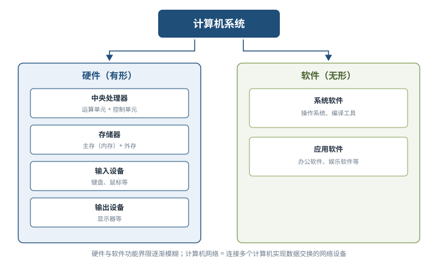

### 2.2 计算机硬件（2.2）

#### 1. 硬件组成与处理器 ⭐【重点】

冯·诺依曼结构把计算机硬件划分为**运算器、控制器、存储器、输入设备、输出设备** 5 部分；现实硬件中，**控制单元和运算单元集成为处理器**，输入/输出设备常集成为一体，因此按**处理器、存储器、总线、接口和外部设备**来阐述。

**处理器（CPU）**是运算和控制的核心：位宽从 4 位发展到 64 位；能力上集成多级缓存、多种总线和接口；内核从单核发展为多核、异构多核和众核。指令集按复杂程度分两类 ⭐【高频考点】：

| 指令集 | 全称 | 代表 | 趋势 |
| --- | --- | --- | --- |
| CISC 复杂指令集 | Complex Instruction Set Computers | Intel、AMD 的 **x86** CPU | 因历史原因仍存在 |
| RISC 精简指令集 | Reduced Instruction Set Computers | **ARM 和 Power** | **几乎所有后期出现的指令集均为 RISC**，是发展趋势 |

典型处理器体系结构中：指令部件通过 **MMU-Cache** 存储结构取得指令并译码控制；**存取部件**取数据；**寄存器组**为运算器准备数据与结果寄存器；**运算部件**（整型、浮点、向量）执行运算；**完成部件**对结果排队并向指令部件反馈，控制指令顺序执行、跳转等时序。各部件经**地址总线、数据总线**互连。

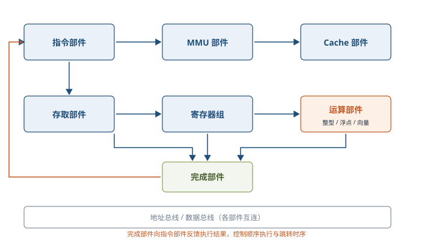

常见专用处理器芯片 ⭐：

| 芯片 | 特点 | 典型应用 |
| --- | --- | --- |
| GPU 图形处理器 | 具有**数百或数千个内核**，优化为**并行**运行大量计算 | 深度学习、机器学习 |
| DSP 数字信号处理器 | 专用于**实时数字信号处理**：饱和算法处理溢出、乘积累加提高矩阵效率、傅里叶变换专用指令 | 各类高速信号采集设备 |
| FPGA 现场可编程逻辑门阵列 | 硬件逻辑**可编程重构**，设计阶段可当软件对待、运行时以逻辑门物理形态存在 | 需要灵活定制硬件逻辑的场合 |

国产处理器呈现百花齐放局面，知名度较高的有**龙芯、飞腾、申威、兆芯、国微、国芯、华睿、翔腾微和景嘉微**等。

#### 2. 存储器 ⭐【重点】

存储器按硬件结构可分为 SRAM、DRAM、NVRAM、Flash、EPROM、Disk 等。计算机系统通常采用**分层体系（Memory Hierarchy）**，按与处理器的物理距离分 4 个层次 ⭐【高频考点】：

| 层次 | 位置与介质 | 典型容量 | 特点 |
| --- | --- | --- | --- |
| 片上缓存 | 处理器核心内，**SRAM** | 16kB～512kB（L1/L2） | 速度最快、容量最小 |
| 片外缓存 | 处理器核心外，需经交换互联开关访问，一般也是 **SRAM** | 256kB～4MB（L2/L3 或平台 Cache） | 容量较片上略大 |
| 主存（内存） | 独立部件/芯片，**DRAM**，经总线连接 | 数百 MB～数十 GB | **依赖不断充电维持数据**（易失） |
| 外存 | 磁带、磁盘、光盘、各类 Flash | Nor Flash 为 MB 级，磁盘为 GB/TB 级 | 速度慢、容量大、**掉电保持数据** |

外存掉电保持数据但并非永久：Flash 约 10 年、光盘数年至数十年、磁盘 10 年以上、磁带 30 年以上。整体规律：**越靠近处理器，速度越快、容量越小、单位成本越高**。

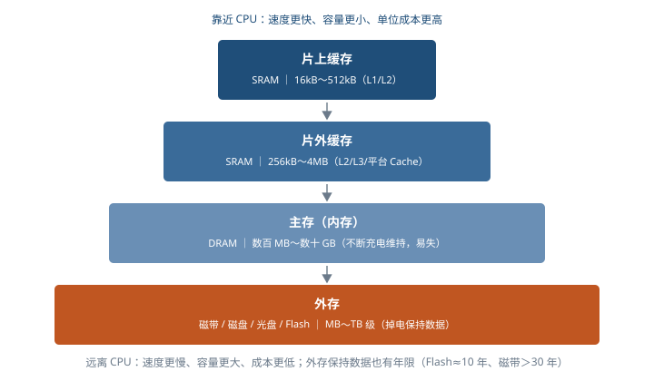

#### 3. 总线、接口与外部设备

**总线（Bus）是计算机部件间遵循某一特定协议实现数据交换的形式**。按所处位置分三类 ⭐：

| 类型 | 别称 | 作用范围 |
| --- | --- | --- |
| 内总线 | 片上总线、片内总线 | 各类**芯片内部**互连 |
| 系统总线 | 局部总线（广义次级联） | 计算机中 **CPU、主存、I/O 接口**之间 |
| 外部总线 | 通信总线 | 计算机板与**外部设备**之间、或计算机系统之间 |

总线之间通过**桥（Bridge）**连接，桥是一种特殊外设，主要实现**总线协议间的转换**。总线性能指标有总线带宽、服务质量 QoS、时延和抖动等。常见**并行总线**：PCI、PCIe、ATA(IDE)；常见**串行总线**：USB、SATA、CAN、RS-232、RS-485、RapidIO 和以太网等；专业领域还有航空 ARINC429/659/664、MIL-STD-1553B，工控 CAN、IEEE1394、VME 等。

**接口是同一计算机不同功能层之间的通信规则**：显示类（HDMI、DVI）、音频类（TRS、RCA、XLR）、网络类（RJ45、FC）、PS/2、USB、SATA、LPT 打印、RS-232 等；离散量接口与 A/D 转换接口多随需求设计。**一种总线可对应多种接口**（如以太网总线可用 RJ-45 或同轴电缆连接）。

**外部设备（外围设备）是计算机的非必要设备**：包括所有输入输出设备以及部分存储设备（外存），如键盘、鼠标、显示器、扫描仪、摄像头、麦克风、打印机、光驱、网卡、存储卡/盘；移动穿戴设备中有加速计、GPS、陀螺仪、感光和指纹识别设备等。外设都通过**接口**与计算机主体连接。

### 2.3 计算机软件（2.3）

#### 1. 软件概述

**计算机软件是指计算机系统中的程序及其文档**，是计算任务的处理对象和处理规则的描述。处理对象是**数据**（数字、文字、图形等，只是表示而无含义）或**信息**（数据及有关的含义）；处理规则指处理的动作和步骤；文档是便于了解程序的阐述性资料。软件按作用和运行环境分为**系统软件**（不依赖特定应用领域的通用软件，可再分操作系统、程序设计语言翻译系统、数据库管理系统和网络软件）和**应用软件**（为某类应用需要设计，可再分专用与通用）。

#### 2. 操作系统 ⭐【重点】

**操作系统是计算机系统的资源管理者**，首要作用是通过 **CPU 管理、存储管理、设备管理和文件管理**合理分配资源，是配置在计算机硬件上的**第 1 层软件**：向下管理裸机，向上为其他软件提供支持、为用户提供接口。

组成：**内核（Kernel）+ 配套软件**（GUI、常用应用程序、实用程序、开发运行构件）。内核提供**进程管理（任务管理）、存储管理、文件管理和设备管理**，对硬件抽象后向应用提供统一的**系统调用接口（API）**；内核常驻内存、以 CPU 最高优先级运行、可执行**特权指令**、可直接访问各种外设和全部主存空间。

三大作用：①管理运行程序、分配软硬件资源（处理器/存储/文件/I/O 设备管理）；②提供友善**人机界面**（GUI）；③为应用开发运行提供高效平台（呈现一台「**虚拟计算机**」，屏蔽物理设备细节）。

四个特征 ⭐【高频考点】：

| 特征 | 含义 | 关键点 |
| --- | --- | --- |
| 并发性 | 宏观上多个程序同时运行 | 单 CPU 下微观上**交替轮流执行**；多 CPU 才可**并行** |
| 共享性 | 资源被多个并发进程共同使用而非独占 | 共享方式分**同时共享和互斥共享** |
| 虚拟性 | 把一个物理实体变为多个逻辑对应物，或把多个物理实体变为一个逻辑对应物 | 提供易用高效的操作环境（如虚拟内存） |
| 不确定性 | 进程「走走停停」，执行时机、速度、完成时间不可预知 | 可能导致**执行结果不唯一** |

操作系统分类 ⭐：

| 类型 | 核心思想 | 记忆要点 |
| --- | --- | --- |
| 批处理操作系统 | 单道：一次只有一个作业装入内存；多道：多个作业装入内存，I/O 时把 CPU 交给其他作业 | 多道三特点：**多道、宏观并行、微观串行**；作业由用户程序、数据和作业说明书组成 |
| 分时操作系统 | CPU 时间划分为很短**时间片**，轮流为各终端用户服务 | 四特点：**多路性、独立性、交互性、及时性**；用户感觉独占系统 |
| 实时操作系统 | 以足够快的速度处理外来信息，在被控对象允许的时间范围内快速反应 | 对交互要求不高、**要求可靠性**；分实时控制系统（火炮、自动驾驶）和实时信息处理系统（订票、检索） |
| 网络操作系统 | 使联网计算机方便有效地共享网络资源、为网络用户服务 | 特征：硬件独立性、多用户支持、目录服务等 |
| 分布式操作系统 | 为分散计算机组成的系统配置，统一界面、协同完成任务 | 是网络操作系统的**更高级形式**，增加**透明性**、可靠性和高性能 |
| 微型计算机操作系统 | 常用的微机 OS | Windows、Mac OS、Linux |
| 嵌入式操作系统 | 运行在嵌入式智能设备中，统一协调软硬件资源 | 五特点：**微型化、可定制、实时性、可靠性、易移植性（HAL+BSP）**；常见 VxWorks、μClinux、μC/OS、eCos 等 |

#### 3. 数据库 ⭐【重点】

**数据库（DB）是指长期存储在计算机内、有组织的、统一管理的相关数据的集合**，不仅描述数据本身，还包括事物之间的联系，具有**较小的冗余度、较高的数据独立性和易扩展性**，可为多个用户共享。早期有层次式、网络式、关系型三种；目前最常见的是关系型和非关系型。按存储体系可分为 5 类：

| 类型 | 存储特点 | 通俗理解 |
| --- | --- | --- |
| 关系型数据库 | 把复杂数据结构归结为简单的**二元关系（二维表）**，操作建立在关系表格上 | 多张 Excel 表互相关联 |
| 键值（Key-Value）数据库 | 数据存为**键值对**集合，键是唯一标识符 | 大字典，按 key 取 value |
| 列存储数据库 | 相对行式存储，按**列**组织表中数据 | 按列整列地读，利于分析统计 |
| 文档数据库 | 存放 XML/JSON/BSON 等**自描述、分层树状**文档，文档相似但不必相同 | 可视为**其值可查的键值数据库** |
| 搜索引擎数据库 | 面向搜索引擎爬取数据的特定格式存储 | 为检索性能优化 |

**关系数据库**：数据模型是数据库系统的核心与基础，具有**数据结构、数据操作和完整性约束条件**三要素 ⭐。关系可理解为二维表，用若干关系表示实体及其联系；**主码能唯一确定某个实体**（如学号唯一确定学生）。例如：学生（学号，姓名，年龄，系别）、课程（课程号，课程名，学分）、选课（学号，课程号，分数）。

数据库设计特点：以数据模型为核心展开、静态结构设计与动态行为设计分离、试探性、反复性和多步性；设计方法分直观设计法、规范设计法、计算机辅助设计法和自动化设计法 4 类（常用 3NF 方法、E-R 方法等）。设计分 6 个阶段 ⭐【高频考点】：

| 阶段 | 主要任务 | 关键产物/方法 |
| --- | --- | --- |
| 需求分析 | 调查现行系统，明确**数据需求和业务处理需求** | 需求说明书 |
| 概念结构设计 | 建立信息模型（数据建模），与具体 DBMS 无关 | **E-R 方法**：局部 E-R → 全局 E-R → 全局优化 |
| 逻辑结构设计 | 确定数据模型，**E-R 图转换为指定数据模型**，确定完整性约束和用户视图 | 视图、概念模式及应用处理说明书 |
| 物理结构设计 | 确定存储结构与存取方法、存放位置与存储分配 | 高效可实现的物理结构 |
| 应用程序设计 | DBMS 二次开发：选方法、订计划、选架构、定安全策略 | 结构化或面向对象设计方法 |
| 运行维护 | 转储和恢复、安全完整性控制、性能监督分析与改造、重组重构 | 保证正常运行与优化 |

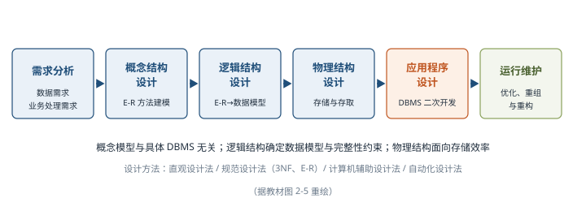

**分布式数据库系统（DDBS）**：针对**地理上分散、管理上又需要不同程度集中**的需求提出。满足**分布性、逻辑相关性、场地透明性和场地自治性**的称为完全分布式数据库系统；特点是数据的集中控制性、数据独立性、数据冗余可控性、场地自治性和存取的有效性。我国提出的 **4 层结构模式** ⭐：

| 层次 | 内容 | 通俗理解 |
| --- | --- | --- |
| 全局外层 | 多个**全局视图** | 各类用户看到的全局数据外观 |
| 全局概念层 | 全局概念模式、**分片模式、分配模式** | 全局逻辑结构 + 数据怎么切分、放到哪些场地 |
| 局部概念层 | 各场地的局部概念模式 | 每个场地自己的逻辑结构 |
| 局部内层 | 各场地的局部内模式与**局部数据库** | 每个场地实际的物理存储 |

4 层模式适用于**同构型和异构型**分布式数据库。应用领域有分布式计算、Internet 应用、数据仓库、数据复制和全球联网查询等（Sybase Replication Server 为典型产品）。

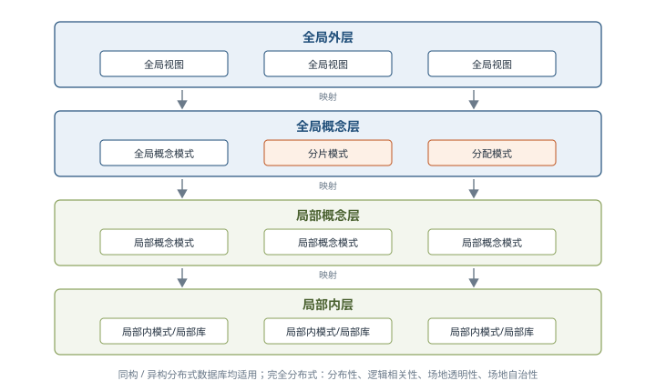

**常用 DBMS**：小型代表有 MySQL（2009 年被 Oracle 收购）、Access；大型代表有 **Oracle、SQL Server、IBM DB2**。Oracle 使用 **PL/SQL**，产品含数据库服务器、开发工具和连接产品三类；DB2 是 IBM 分布式数据库解决方案，支持同一条 SQL 查询不同 Database 甚至不同 DBMS 的数据；**Sybase 是世界上第一个真正基于 C/S 结构的 RDBMS 产品**，由 SQLServer、SQLToolset、OpenClient/OpenServer 三部分组成；SQL Server 使用 **Transact-SQL**。大型 DBMS 的共同特点：基于网络环境（C/S、B/S 均可）、支持大规模应用（数千并发用户）、自动锁、高安全性、备份恢复与设备镜像、维护数据完整性、分布式处理功能。

#### 4. 文件系统 ⭐【重点】

**文件（File）是具有符号名的、在逻辑上具有完整意义的一组相关信息项的集合**，包括**文件体**（真实内容）和**文件说明**（文件名、类型、存储地址、长度、访问权限、时间等管理信息）。**文件系统是操作系统中实现文件统一管理的一组软件和相关数据的集合**，功能：**按名存取**（而非按地址存取）、统一用户接口、并发访问和控制、安全性控制、优化性能、差错恢复。常用文件系统类型有 FAT、VFAT、NTFS、Ext2、HPFS 等。

文件分类：按性质用途分系统文件、库文件、用户文件；按保存期限分临时、档案、永久文件；按保护方式分只读、读/写、可执行、不保护文件；**UNIX 分为普通文件、目录文件和设备文件（特殊文件）**。

**逻辑结构**（用户角度）分两类：**有结构的记录式文件**（由一个以上记录构成，记录可定长或不定长）和**无结构的流式文件**（一串顺序字符流/字节流，用读/写指针指出下一个要访问的字符，可看作记录式文件的特例）。

**物理结构**（存储设备上的存放方法）⭐【易错】：

| 物理结构 | 存放方式 | 存取特点 |
| --- | --- | --- |
| 连续结构（顺序结构） | 逻辑上连续的信息依次放在**连续编号**的物理块上 | 知道起始块号 + 长度即可方便存取 |
| 链接结构（串联结构） | 放在**不连续**物理块，每块设指针指向下一块 | 知道第 1 个块号即可按链指针查找整个文件 |
| 索引结构 | 放在不连续物理块，系统为每个文件建**索引表**（逻辑块号→物理块号），索引表起始地址放在文件目录项中 | 通过索引表直接定位，索引表一般占一个或几个物理块（多物理块时可链接文件或多重索引） |

**存取方法**：顺序存取（按顺序依次读/写）和随机存取（按任意次序读/写）。

**空闲空间管理**：数据结构称磁盘分配表，常用方法 ⭐：

| 方法 | 原理 | 要点 |
| --- | --- | --- |
| 空闲区表 | 为所有连续未分配「空闲区」建表（序号、第 1 块号、块数、状态） | **适用于连续文件结构** |
| 位示图（Bitmap） | 每一位对应一个物理块，**0 表示空闲、1 表示占用**；字长 32 位时第 0 个字对应 0～31 号块 | 大小由磁盘物理块总数决定，**适合各种物理结构** |
| 空闲块链 | 每个空闲块存指向下一个空闲块的指针，构成链表，头指针放在特定位置 | 不需磁盘分配表，**节省空间** |
| 成组链接法 | **UNIX 采用**：空闲块分组（如每 100 块一组），每组第 1 块登记下一组块号和总数；第 1 块号为 0 表示最后一组 | 兼顾链表与成组管理 |

**文件共享与保护** ⭐【易错】：

| 共享方式 | 原理 | 特点 |
| --- | --- | --- |
| 硬链接 | 两个文件目录表目指向**同一个索引结点**（不同文件名链接同一文件实体） | 文件主删除共享文件须先删除所有硬链接，否则其他用户目录指针悬空 |
| 符号链接 | 建立新的文件或目录，与原文件**路径名映射**，访问时经映射找到原文件 | **可跨越文件系统**，甚至跨网络连接其他机器的文件 |

文件保护采用**存取控制**：存取控制矩阵（用户 × 文件二维矩阵，权限 R/W/X 组合，因太大往往无法实现）；存取控制表（按用户类别简化，**UNIX 把用户分为文件主、同组用户和其他用户三类**）；用户权限表（以用户为单位集中记录可存取文件，相当于矩阵一行的简化）；密码（创建时提供密码，存盘加密、读取解密）。

#### 5. 网络协议与中间件 ⭐【重点】

**协议是网络中的计算机进行通信时，为实现数据正常发送与接收必须遵循的事先约定好的规则**，规定通信的数据格式、传送时序以及控制信息和应答信号等。常用网络协议包括**局域网协议（LAN）、广域网协议（WAN）、无线网协议和移动网协议**；互联网使用 **TCP/IP 协议簇**。

**中间件（Middleware）是应用软件与各种操作系统之间使用的标准化编程接口和协议**，处在**操作系统、网络和数据库之上、应用软件的下层**，起承上启下作用，使应用开发独立于硬件和操作系统并能在不同系统上运行，属于**可复用基础软件**。

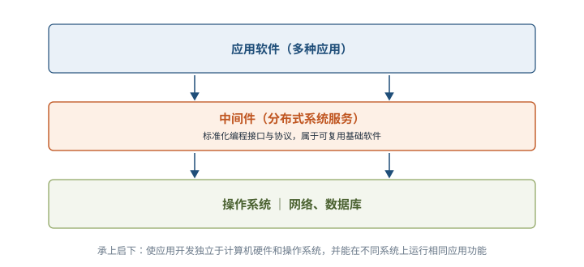

中间件按在分布式系统中承担的职责分为 8 类：

| 类型 | 职责 | 代表产品/要点 |
| --- | --- | --- |
| 通信处理（消息）中间件 | 实现可靠、高效、实时的跨平台数据传输 | **市面上销售额最大**；BEA eLink、**IBM MQSeries**、TongLINK |
| 事务处理（交易）中间件 | 大量事务在多服务器上实时并发、负载平衡调度、故障恢复与自动切换 | **BEA Tuxedo** 由此闻名 |
| 数据存取管理中间件 | 网络上虚拟缓冲存取、格式转换、解压等 | 面向集中存放的各类数据 |
| Web 服务器中间件 | 弥补浏览器会话能力差、不擅长数据写入、受 HTTP 限制等不足 | 如 SilverStream 产品 |
| 安全中间件 | 解决安全保密问题，适应灵活多变的安全要求 | 军政商部门须用国产产品 |
| 跨平台和架构的中间件 | 集成不同系统平台上的构件或新老版本构件 | **CORBA 功能最强但庞大**；JavaBeans 灵活简单适合浏览器；COM+ 适合 Windows |
| 专用平台中间件 | 为特定应用领域建立参考模式、架构与构件库 | 如电子商务、网站领域 |
| 网络中间件 | 网管、接入、网络测试、虚拟社区和虚拟缓冲等 | 当前热门研发方向 |

两个典型产品 ⭐【易错：产品与类型对应】：**IBM MQSeries 是消息处理中间件**，由信息传输系统和应用程序接口组成，资源是**消息和队列**，关键是**异步消息处理保证可靠传输**（网络不可靠或应用忙/故障时信息不丢失、不阻塞）；**BEA Tuxedo 是交易中间件**，支持多数据库协调更新并确保数据完整性，能持续监视并排除故障构件保证**不间断访问**，可按负载自动启停应用服务实现负载均衡，借助 **DDR（数据依赖路由）**选择消息路由。

#### 6. 软件构件

**构件（组件）是一个自包容、可复用的程序集**，整体向外提供统一访问接口，外部只能通过接口访问而不能直接操作内部。**两个最重要特性：自包容与可重用** ⭐。

**构件组装模型**：需求分析定义功能后，设计构件组装结构（系统划分为构件集合、明确关系），再独立开发/重用/购买构件，最后组装、测试发布。开发过程：**设计构件组装 → 建立构件库 → 构建应用软件 → 测试与发布**。优点：自包容使扩展容易、重用降低成本、粒度小便于团队并行独立开发；缺点：依赖经验丰富的架构设计师、为重用可能牺牲性能、学习成本高、**第三方构件库质量难以控制**。

主流商用构件标准规范 ⭐：

| 标准 | 提出方 | 核心内容 |
| --- | --- | --- |
| CORBA | OMG | 三层：**对象请求代理 ORB**（分布对象的「软总线」，实现对象间通信互操作）、公共对象服务（并发、名字、事务、安全等）、公共设施（构件框架与业务协作规则）；CCM 构件模型含抽象构件模型、构件容器结构、构件配置和打包规范 |
| J2EE | Sun | 支持 **RMI 和 IIOP**；服务器端形式有 Servlet、JSP、**EJB**；**EJB 是业务逻辑层的中间件技术**，给出服务器端分布构件规范（构件、容器接口、打包配置），Bean 分会话 Bean（维护会话）和实体 Bean（处理事务），通常由 Servlet 负责客户端通信、访问 EJB、经 JSP 生成页面返回 |
| DNA 2000 | Microsoft | 基于 Windows 2000 的分布计算架构，融合事务处理、可伸缩性、异步消息队列和集群；**DCOM/COM/COM+** 将 COM、DCOM、MTS 功能统一，提供负载均衡、内存数据库、对象池、构件管理配置等服务 |

#### 7. 应用软件

应用软件按开发方式和适用范围分为**通用应用软件**（文字处理、电子表格、图形图像、媒体播放、网络通信、演示、信息检索、个人信息管理、游戏等，如 Word、Excel、Photoshop、PowerPoint）和**专用（定制）应用软件**（按特定领域要求专门开发，如超市销售管理、集成制造、教务管理、医院信息系统，专用性强、成本高、价格贵）。广泛使用的应用软件共同特点：**替代现实世界已有工具且更方便有效；能完成已有工具很难甚至不可能完成的任务**。

### 2.4 嵌入式系统及软件（2.4）⭐【重点】

#### 1. 组成及特点

**嵌入式系统（Embedded System）是为了特定应用而专门构建且将信息处理过程和物理过程紧密结合为一体的专用计算机系统**；以应用为中心、以计算机技术为基础，软硬件**可配置可裁减**，需满足功能、可靠性、成本、体积和功耗的严格要求。嵌入式软件指可运行在嵌入式系统中的程序代码和帮助这些软件开发所用的工具或环境软件的总称。

基本工作原理：通过外部接口采集输入信息或人机接口输入的命令，对数据加工计算，将结果通过外部接口输出**控制受控对象**。组成 5 部分：

| 组成 | 要点 |
| --- | --- |
| 嵌入式处理器 | 抵抗高温、寒冷、电磁、加速度等**恶劣环境**，低功耗、体积小；工艺分**民用、工业、军用**三档 |
| 相关支撑硬件 | 处理器以外的**存储器、定时器、总线、I/O 接口及专用硬件**（教材 ARM 实例：Flash/SDRAM/硬盘、LCD、键盘、RS-232/USB/JTAG、TCP/IP 与 CAN 总线） |
| 嵌入式操作系统 | 管理计算机资源和应用软件，应具备**实时性、可剪裁性和安全性** |
| 支撑软件 | 为应用开发运行提供公共服务与开发调试能力，通常以**库**的方式被引用 |
| 应用软件 | 为完成嵌入式系统某一特定目标开发 |

特点 8 条：**专用性强；技术融合；软硬一体、软件为主（有 IP 核）；比通用计算机资源少；程序代码固化在非易失存储器中；需专门开发工具和环境（本身不具备开发能力）；体积小、价格低、工艺先进、性能价格比高、配置要求低、实时性强；对安全性和可靠性要求高**。

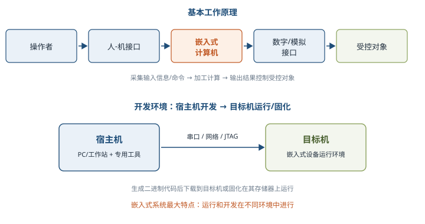

#### 2. 分类

- 按用途分**嵌入式实时系统和嵌入式非实时系统**，实时系统又分**强实时（Hard Real-Time）和弱实时（Weak Real-Time）**。**实时系统是指能够在指定或确定的时间内完成系统功能并对外部或内部、同步或异步事件做出响应的系统**：计算正确性**不仅取决于逻辑正确性，也取决于结果产生的时间**，时间约束不满足就是系统错误。
- 按安全性要求分**安全攸关（Safety-Critical/Life-Critical）系统和非安全攸关系统**。**安全攸关系统是指其不正确的功能或失效会导致人员伤亡、财产损失等严重后果的计算机系统**。

#### 3. 嵌入式软件的组成及特点 ⭐【高频考点】

嵌入式系统最大特点：**运行和开发在不同环境中进行**——运行环境称「**目标机**」，开发环境称「**宿主机**」，经串口/网络/JTAG 连接，生成二进制代码后卸载到目标机或固化运行。软件组成采用**层次化结构**，分 5 层 ⭐：

| 层次 | 内容 | 记忆要点 |
| --- | --- | --- |
| 应用层 | 工业控制、军事、物联网、移动设备等具体应用 | 面向最终业务 |
| 中间件层 | 嵌入式数据库、OpenGL、JAVA、虚拟机、**DDS/CORBA**、Hadoop 等 | 连接两个独立应用的桥梁，常分服务/集成/数据/消息/安全中间件 |
| 操作系统层 | **嵌入式（实时）操作系统 E(RT)OS**（任务管理、存储管理、任务间通信、时钟/中断管理）+ 可配置组件（文件系统、设备管理、运行时库 RTL、GUI、网络管理、目标机代理 Agent） | 组件可配置可剪裁 |
| 抽象层 | **硬件抽象 HAL**（为上层提供虚拟硬件资源）+ **板级支持包 BSP**（硬件驱动软件，面向芯片/电路驱动） | 屏蔽硬件差异、支撑易移植 |
| 硬件层 | 微处理器、存储器（ROM/SDRAM/Flash）、I/O（A/D、D/A）、通用设备、总线、电源、时钟 | 运行支撑的硬件环境 |

嵌入式软件主要特点 6 条 ⭐【易错：安全性 vs 可靠性表述】：

| 特点 | 含义 | 常用设计方法 |
| --- | --- | --- |
| 可剪裁性 | 按功能需求增减软件模块，使系统更紧凑 | 静态编译、动态库、控制函数流程 |
| 可配置性 | 按运行功能/性能需要被配置，扩展、变更和增量服务 | 数据驱动、静态编译、配置表 |
| 强实时性 | 任务必须在规定时限（Deadline）内完成，算法优劣是主要影响 | 表驱动、配置、静/动态结合、汇编语言 |
| 安全性（Safety） | 规定条件和时间内**不发生事故**的能力，反映失效后损失大小；机载 DO-178 分 A～E 5 个安全等级 | 编码标准、安全保障机制、FMECA |
| 可靠性 | 规定条件和时间周期内**程序执行所要求功能**的能力；软件不随时间老化，与硬件可靠性衡量指标完全不同 | 容错技术、余度技术、鲁棒性设计 |
| 高确定性 | 任务、资源、状态、错误和时限都预先规划，运行期间不得出现资源枯竭和未预计状态 | 静态分配资源、越界检查、状态机、静态任务调度 |

嵌入式软件开发与传统开发的差异：在**宿主机上用专门工具开发**、代码需**固化到目标机**；强调软硬件协同效率与稳定性；需要专门开发工具、目标系统和测试设备；实时性、安全性和可靠性要求更高；考虑代码规模；安全攸关系统还须满足领域**设计和代码审定**；采用**模块化设计**。

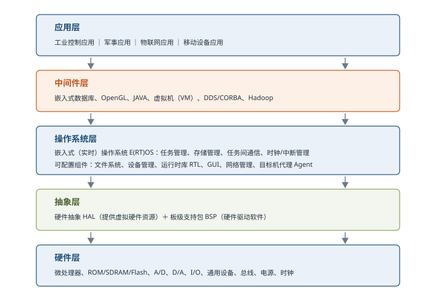

#### 4. 安全攸关软件的安全性设计（DO-178）⭐【高频考点】

IEEE 将**安全攸关软件**定义为「用于一个系统中，**可能导致不可接受的风险**的软件」。安全性属于**系统特性**，软件自身无所谓安全与否，但作为安全攸关系统的一部分时可能助长不安全因素；安全性分析应**自上而下、结合场景**。应按软件对安全性的影响程度分配**开发保证级别**：级别越高，要求的开发和验证活动、依赖性证据、错误识别排除越多，**成本也越高，并非越高越好**。

**DO-178 是美国 FAA 民用飞机适航标准中针对机载软件的标准**（《机载系统/设备合格审定中的软件考虑》），被航空、航天等安全攸关领域普遍采用。1982 年首版、**1992 年 DO-178B** 成为国际公认机载软件开发标准、**2011 年 DO-178C** 新增工具鉴定、基于模型的开发验证、面向对象技术和形式化验证。

**DO-178B 的目的**：为机载软件提供指导，使其在满足适航要求的安全性水平下完成预期功能。精髓是**目标、过程、数据**三要素 ⭐：

| 要素 | 内容 | 关键点 |
| --- | --- | --- |
| 目标 | 软件生命周期需达到的 **66 个目标**，按 A～E 安全等级分布 | 选择该标准就必须满足其全部适用目标 |
| 过程 | 为满足目标要进行的活动 | 生命周期分为**软件计划、软件开发、软件综合**三大过程 |
| 数据 | 证明目标达到的证据，即**软件生命周期数据**（文档、代码、报表、记录等） | 数据组织与配置管理要求具体 |

**软件安全等级与目标数量** ⭐【易错：数字常考】：

| 等级 | 失效状态 | 后果简要说明 | 目标数量 |
| --- | --- | --- | --- |
| A 级 | 灾难性的 | 航空器**无法安全飞行和着陆** | **66** |
| B 级 | 危害性的 | **严重**降低航空器或机组克服不利运行情况的能力 | **65** |
| C 级 | 严重的 | **显著**降低上述能力 | **56** |
| D 级 | 不严重的 | **轻微**降低上述能力 | **28** |
| E 级 | 没有影响的 | 不会影响航空器或机组任何能力 | **0** |

**软件生命周期三大过程** ⭐：

| 过程 | 职责 | 子过程 |
| --- | --- | --- |
| 软件计划过程 | 策划协调全部生命周期活动，制订软件计划和标准 | 指导开发与综合过程 |
| 软件开发过程 | 生产软件产品：自顶向下、由粗及细、从无到有 | **软件需求**（开发高层需求）、**软件设计**（细化体系结构和低层需求）、**软件编码**（编写源代码）、**集成**（编译链接加载到目标机）4 个子过程 |
| 软件综合过程 | 验证、管理、控制软件产品，保证正确、受控、可信 | **软件验证**（技术评估）、**软件配置管理**（标识、基线、更改控制、归档）、**软件质量保证**（数据和过程审计）、**审定联络**（与合格审查机构沟通）4 个子过程 |

软件生存周期与系统生存周期的关系：**系统需求 → 软件高层需求 → 软件架构（低层需求）→ 源程序代码 → 可执行目标代码**；软件需求来自系统分解，二者密不可分。

**DO-178 与 CMMI 的差异** ⭐【易错】：

| 对比项 | CMMI | DO-178 |
| --- | --- | --- |
| 视角 | **过程改进**：覆盖个人、项目、组织三层次，关注组织整体能力提升 | **适航审定**：关注项目软件质量对安全性的影响 |
| 组成 | 主要由**实践**组成（各行业最佳实践抽象） | 由**目标、活动与数据**组成，活动要求具体，对输出数据要求明确 |
| 覆盖面 | 集成系统、软件、硬件视角，措辞须兼顾多场景 | **聚焦软件**，更易被软件工程师理解；过程范围比 CMMI 少（如项目监控、风险管理、培训未明确要求） |

结论：**DO-178 比 CMMI 目标更清晰、要求更具体，且专门针对安全攸关软件**；两者都侧重「要求」而非具体方法步骤；企业要持续商业成功，CMMI 的过程改进更有指导性。

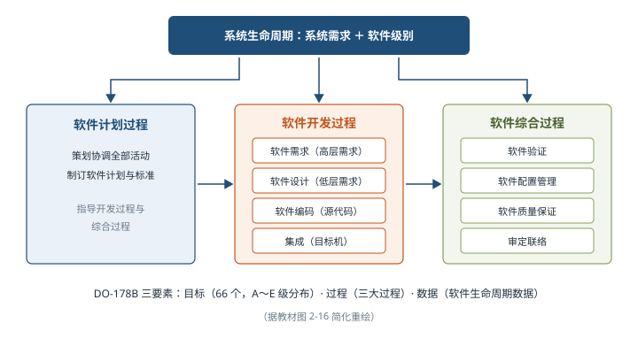

### 2.5 计算机网络（2.5）⭐【重点】

**计算机网络是利用通信线路将地理上分散的、具有独立功能的计算机系统和通信设备按不同形式连接起来，并依靠网络软件及通信协议实现资源共享和信息传递的系统**。网络技术涵盖**通信技术、网络技术、组网技术和网络工程**四方面。

#### 1. 基本概念

发展四阶段 ⭐：

| 阶段 | 时间 | 特征与代表 |
| --- | --- | --- |
| 诞生阶段 | 20 世纪 60 年代中期之前 | **以单个计算机为中心的远程联机系统**（飞机订票系统，主机 + 2000 多终端，后出现前端机 FEP） |
| 形成阶段 | 60 年代中期至 70 年代 | **多个主机互联**，代表 **ARPANET**；IMP 转接构成**通信子网**，主机构成**资源子网** |
| 互联互通阶段 | 70 年代末至 90 年代 | **开放式标准化网络**，产生 **TCP/IP 与 OSI** 两种国际通用体系结构 |
| 高速发展阶段 | 90 年代至今 | 光纤与高速网络技术，发展为以 **Internet** 为代表的互联网 |

五大功能：**数据通信**（最主要功能之一，信息以二进制形式传递）、**资源共享**（硬件、软件、数据资源）、**管理集中化**、**实现分布式处理**（大课题拆分由不同计算机完成再集中）、**负荷均衡**（过重时自动转移负荷到较轻计算机）。

性能指标 ⭐【易错：带宽两种含义】：

| 指标 | 含义 | 要点 |
| --- | --- | --- |
| 速率 | 主机或通信设备在数字信道上传送数据的速率，又称数据率/比特率 | 单位 **b/s**，最重要指标之一 |
| 带宽 | ①信号具有的**频带宽度**（单位 Hz，如电话信号 3.1kHz）；②网络中通信线路传送数据的能力，即单位时间内结点到结点能通过的「**最高数据率**」 | 网络中带宽单位是 **b/s** |
| 吞吐量 | 单位时间内通过某网络（信道、接口）的数据量 | 受带宽/额定速率限制，如 100Mb/s 以太网典型吞吐量可能只有 70Mb/s |
| 时延 | 数据从网络一端传送到另一端所需时间 | 由**发送时延、传播时延、处理时延、排队时延**组成 |
| 往返时间 RTT | 从发送数据开始到收到接收方确认总共经历的时间 | 重要性能指标 |
| 利用率 | 信道利用率（有数据通过的概率）和网络利用率（全网信道利用率的加权平均） | 完全空闲的信道利用率为零 |

非性能指标：费用、质量、标准化、可靠性、可扩展性、可升级性、易管理性和可维护性等。

#### 2. 通信技术 ⭐【重点】

**信道**分**物理信道**（由传输介质和设备组成，分无线和有线）和**逻辑信道**（发送端与接收端之间的虚拟线路，可连接或无连接，以物理信道为载体）。信息传输过程：**信源 → 发信机（编码和调制）→ 信道 → 收信机（解调和译码）→ 信宿**。不是所有频率的信号都能通过信道，**频率响应决定哪些可以通过，可通过的频率范围大小就是信道带宽**。

**香农公式** ⭐【高频考点】：**C = B × log₂(1 + S/N)**。C 为信道容量（最大传输速率，b/s），B 为信号带宽（Hz），S/N 为信噪比（信号平均功率与噪声平均功率之比）。**带宽越大、信噪比越高，信道容量越大**，实际工程中需在带宽与信噪比之间权衡。

**信号变换**：发信机处理包括**信源编码 → 信道编码 → 交织 → 脉冲成形 → 调制**；收信机做相反处理（解调、采样判决、去交织、信道译码、信源译码）。

| 环节 | 作用 | 通俗理解 |
| --- | --- | --- |
| 信源编码 | 模拟信号模数转换 + 压缩编码去冗余，形成数字信号 | 如 GSM 先 PCM 编码再 RPE-LPT 压缩 |
| 信道编码 | **增加冗余信息**以便接收端检错纠错 | 只能纠正**零星错误**，对连续误码无能为力 |
| 交织 | 把编码后数据顺序按规律打乱，接收端复原 | 使**连续误码变成零星误码**，配合信道译码纠错 |
| 脉冲成形 | 把发送数据转换成合适波形 | **减小带宽需求**（矩形脉冲竖边需很高频率） |
| 调制 | 将信息承载到满足信号要求的**高频载波**上 | 便于信道传输 |

**复用技术与多址技术** ⭐【易错】：**复用技术是在一条信道上同时传输多路数据**（TDM 时分复用、FDM 频分复用、CDM 码分复用，ADSL 用 FDM 使语音上下行占不同带宽）；**多址技术是在一条线上同时传输多个用户的数据并在接收端分离**（TDMA、FDMA、CDMA）。**多路复用技术是多址技术的基础**，多址还涉及信道资源分配算法（如 Walsh 码分配）。

**5G 通信网络**的特征技术 8 项：①基于 **OFDM** 优化的波形和多址接入（4G LTE/WiFi 广泛采用，可扩展大带宽、高频谱效率）；②可扩展的 OFDM 间隔参数配置（5G NR，适应丰富频谱与部署）；③OFDM 加窗提高多路传输效率（应对大规模物联网，降低带外辐射）；④灵活框架设计（STTI、自包含集成子帧）；⑤**大规模 MIMO**（基站端最多 **256 根天线**，二维排布实现 3D 波束成型）；⑥**毫米波**（首次将 **>24GHz** 频段用于移动宽带，速率高但易受阻、难穿墙）；⑦频谱共享（授权与非授权频谱利用）；⑧先进信道编码：**LDPC 码**（稀疏校验矩阵、性能逼近香农极限、译码可并行）和 **Polar 码**（信道极化，选近完美信道传输，**用作 5G 控制信道的主要编码方式**）。

#### 3. 网络技术 ⭐【重点】【高频考点】

**局域网（LAN）**：有限地理范围内计算机互联，封闭型。五种拓扑结构 ⭐【易错：优缺点对应】：

| 拓扑 | 结构特点 | 优点 | 缺点 |
| --- | --- | --- | --- |
| 星状结构 | 每个结点都通过连接线连到**中心结点**，任意两结点通信最多两步 | 传输快、结构简单、建网易、便于控制管理 | **中心结点故障则全网瘫痪**，可靠性低、共享能力差 |
| 树状结构 | 分级的集中式网络，任意两结点间**不产生回路**，链路双向传输 | 成本低、结构简单、扩充灵活、便于寻查路径 | 除叶结点及链路外，**任一工作站或链路故障都影响全网** |
| 总线结构 | 所有结点连到**一根总线**上，都通过总线传输 | 结构简单、布线少 | 总线负载能力有限，**总线故障影响每个结点** |
| 环形结构 | 各结点首尾相连成**闭合环**，信息沿**固定方向单向流动**，两结点仅一条通路 | 无信道选择问题、各结点地位相同 | **任一结点故障导致物理瘫痪**；不便扩充、响应延时长、效率较低 |
| 网状结构 | 任何结点彼此之间**均存在通信链路** | **任一结点故障不影响其他结点通信**，可靠性高 | 布线烦琐、建设成本高、控制复杂 |

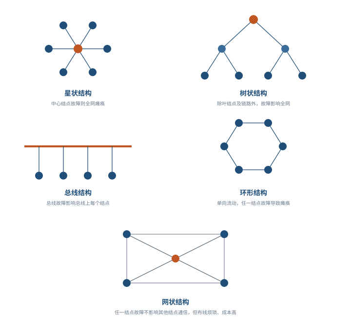

**以太网技术**：IEEE **802.3** 标准，规定物理层连线、电信号和介质访问层协议，是当前应用最普遍的局域网技术。以太帧结构 ⭐：

| 字段 | 含义 | 要点 |
| --- | --- | --- |
| DMAC | 目的终端 MAC 地址 | 接收方 |
| SMAC | 源 MAC 地址 | 发送方 |
| Length/Type | 2 字节 | **值大于 1500 表示帧类型**（属于哪个上层协议，可直接提交上层分帧处理，即流行的 ETHERNET_II）；**小于 1500 表示数据帧长度** |
| DATA/PAD | 具体数据/填充 | 不足 64 字节须填充（PAD） |
| FCS | 帧校验字段 | 判断数据帧是否出错 |

**最小帧长 64 字节** ⭐【高频考点】：受 **CSMA/CD** 算法限制——避免某结点已把数据包最后一个 bit 发完，而第一个 bit 还未到达较远结点，使对方误以为线路空闲而发送数据造成**冲突**；不足 64 字节时高层协议必须填充。数据域长度上限通常设为 **1500 字节**。最大传输距离没有严格限制，由线路质量、信号衰减决定。流量控制用于防止设备阻塞时丢帧：**半双工用反压（Back-Pressure）技术**（模拟碰撞使信源降速），**全双工遵循 IEEE 802.3x，用 64 字节「PAUSE」MAC 控制帧**通知信源暂停发送。

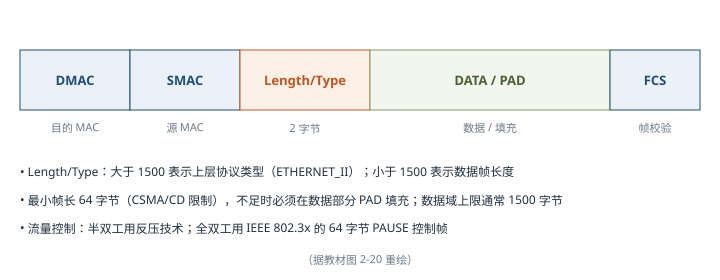

**无线局域网（WLAN）**：利用无线技术在空中传输数据、话音和视频，关键技术有红外传输、扩频、窄带微波等；优点是安装便捷、使用灵活、经济节约、易于扩展。标准演进：**IEEE 802.11**（最早，1～2Mb/s）→ **802.11b**（11Mb/s）→ **802.11a**（54Mb/s）→ **802.11g**（与 a 同速率、兼容 b、工作在免费的 **2.4GHz**、更便宜）→ **802.11n**（200Mb/s 以上）。三种拓扑 ⭐：

| 拓扑 | 结构 | 特点 |
| --- | --- | --- |
| 点对点型 | 无线链路连接两个固定有线 LAN 网段（经桥路器/中继器） | 结构简单，获**中远距离高速率**链路，无移动性问题、波束可很窄 |
| HUB 型 | 中心结点 HUB + 若干外围结点，任何两外围结点通信**须经 HUB** | 集中控制：设备简单、维护费用低、管理单一；但**延迟增加、抗毁差，中心故障易致全网瘫痪** |
| 完全分布型 | 各结点协助转发，分布路由，多跳 | **抗毁好、移动强**，适合较低速率中小型网络；复杂性和成本高、管理困难，**尚处理论探讨阶段**，军事前景好 |

**广域网（WAN）**：将分布于更广区域（城市、国家甚至国家之间）的计算机设备联接起来，通常由**电信部门组建、经营和管理**，向公众提供有偿通信服务；由**通信子网**（通信结点设备 + 链路）与**资源子网**（资源设备与软件）组成。相关技术 ⭐：

| 技术 | 要点 |
| --- | --- |
| SONET/SDH | 同步光网络：SONET 是美国标准、**SDH 由 ITU 颁布、从 SONET 发展而来**，均为**传输网络物理层技术**；SONET 用于美国加拿大，SDH 用于其他国家 |
| DDN 数字数据网 | 利用数字信道提供**半永久性连接电路**，满足租用数据专线需要；速率高、质量高、协议简单、可靠性高；**租用期间用户独占线路带宽** |
| 帧中继 FR | 运行于 OSI 的**物理层和数据链路层**，是 **X.25 的简化版**，更高性能与效率；采用**虚电路**技术，吞吐量高、时延低、适合突发业务 |
| ATM 异步传输模式 | 以**信元**为基础的**面向连接**的分组交换和复用技术；**信元长度固定 53 字节**，可高速处理交换，典型速率 **150Mb/s**，支持语音、数据、视频多业务 |

广域网分类：**公共传输网络**（电信部门组建，分电路交换和分组交换）、**专用传输网络**（单个组织自建私有，主要是 DDN）、**无线传输网络**（GSM、TD-SCDMA/WCDMA/CDMA2000、LTE、5G）。

**城域网（MAN）**：单个城市范围内建立的计算机通信网，为**整个城市而非特定部门**服务；主要用光缆，速率 100Mb/s 以上，基于大型 LAN 相似技术，标准为**分布式队列双总线 DQDB（IEEE 802.6）**；通常分**核心层、汇聚层和接入层**三层（核心层高带宽承载与互联互通、汇聚层业务汇聚分发与服务等级分类、接入层多技术用户接入）。

**移动通信网**：1G 模拟信号（只能语音、容量有限、安全性差）→ 2G 数字调制（9.6～14.4kb/s，可传文字，移动互联网起点）→ 3G（384kb/s、室内可达 2Mb/s，大数据传送成为可能）→ 4G（体验与 20Mb/s 家庭宽带相当，进入移动互联网时代）→ 5G。**5G 基本特征：高速率（峰值可大于 20Gb/s，约为 4G 的 20 倍）、低时延（从 4G 的 50ms 缩减到 1ms）、海量设备连接（1000 亿量级）、低功耗** ⭐。

5G 两个主要架构特征 ⭐【高频考点】：

| 特征 | 内容 | 要点 |
| --- | --- | --- |
| 服务化架构 SBA | 5G 核心网引入 **Service-based Architecture**，网络功能灵活定制、按需组合；控制面网元（AMF、SMF、NRF、NSSF 等）间采用**服务化接口 SBI、以 HTTP 为承载协议**；AMF 与接入网点到点用 SCTP，SMF 与 UPF、UPF 与 (R)AN 用 UDP，UPF 与 DN 基于 IP | 支持软件快速迭代、低成本试错 |
| 网络切片 | 在**单个物理网络上切分出多个逻辑网络**，避免为每个服务建专用物理网，降低建网运维成本；三类切片：**eMBB**（移动宽带：4K/8K、全息、AR/VR，高带宽高速率）、**mMTC**（海量物联网：传感器密集静止，对时延移动性要求不高）、**uRLLC**（关键任务物联网：无人驾驶、远程医疗，**超低时延超高可靠**） | 引入 SPN/FlexE 硬切片，刚性管道隔离、带宽灵活分配，保护倒换 1ms 以内 |

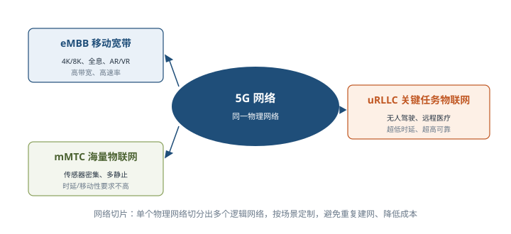

#### 4. 组网技术 ⭐【重点】【高频考点】

**基本网络设备及工作层级** ⭐【易错：设备与层级配对】：

| 设备 | 工作层级 | 核心功能 |
| --- | --- | --- |
| 集线器 | 物理层（最简单设备） | 一个端口收到的数据**转送到所有其他端口**，含上联端口 |
| 中继器 | **物理层** | 接收识别并**再生信号**后发送到其他分支，可连接不同物理介质，要求各分支数据包和逻辑链路协议相同 |
| 网桥 | **数据链路层** | 含中继器功能，可连多种介质与不同物理分支（以太网、令牌网），上层信息对其透明 |
| 交换机 | **数据链路层** | 为任意两结点提供**独享转发通路**，从端口接收数据经内部处理**转发到指定端口**；自动寻址、避免端口冲突、提高吞吐 |
| 路由器 | **网络层** | 在多个网络上**交换和路由数据包**，经路由信息生成**路由表**进行路径选择，常用于广域网或广域网与局域网互连 |
| 防火墙 | 网络门户（规则过滤） | 设安全规则对进出网络数据**监视和过滤**；硬件防火墙把程序做到芯片里，减轻 CPU 负担、路由更稳定 |

**OSI/RM 七层参考模型**：ISO 公布的开放系统互连参考模型，由低层至高层为**物理层、数据链路层、网络层、传输层、会话层、表示层、应用层** ⭐【必背】。分层思想：每一层在下层服务基础上提供更高级增值服务，最高层提供运行分布式应用程序的服务，通过分层分解复杂问题、保持层间独立。

> 助记：七层从下到上——「物、数、网、传、会、表、应」（物理、数据链路、网络、传输、会话、表示、应用）。

**TCP/IP 协议集**：Internet 核心协议，特性为逻辑编址、路由选择、域名解析、错误检测和流量控制及应用支持；是个协议族，主要包括 **IP、TCP、UDP、TELNET、FTP、SMTP、NNTP、HTTP** 等 8 个。模型分**网络接口层、网际层、传输层、应用层 4 层**：网络接口层未详细描述（主机用某种协议与网络相连）；**网际层是关键部分**，使主机把分组发往任何网络并独立传向目标；传输层定义两个端到端协议 **TCP 和 UDP**。

**OSI 与 TCP/IP 对照** ⭐【高频考点】：

| OSI 七层 | TCP/IP 四层 | 对应主要协议 |
| --- | --- | --- |
| 应用层、表示层、会话层 | 应用层 | **FTP**（文件传输）、**Telnet**（远程登录）、**SMTP**（电子邮件）、NFS（网络文件服务）、SNMP（网络管理）、HTTP 等 |
| 传输层 | 传输层 | **TCP、UDP** |
| 网络层 | 网际层 | **IP、ICMP、ARP、RARP** |
| 数据链路层、物理层 | 网络接口层 | Ethernet/IEEE 802.3、FDDI、Token-Ring、ARCnet、PPP/SLIP 等 |

Internet 地址有**域名格式和 IP 地址格式**两种表示，域名与 IP 地址一一对应；IP 协议版本 4 为 IPv4、版本 6 为 IPv6。WWW 万维网采用统一资源定位器 **URL**；常用服务有 DNS、WWW、E-mail、FTP、Telnet 等。

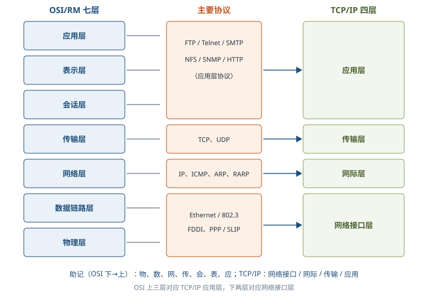

**交换技术**：交换机功能包括集线功能、中继功能（转发帧时重新产生不失真电信号）、桥接功能、**隔离冲突域功能**（每个冲突域有独立带宽）。基本交换原理 ⭐：

| 功能 | 原理 |
| --- | --- |
| 转发路径学习 | 根据收到帧的**源 MAC 地址**建立该地址与端口的映射，写入 MAC 地址表 |
| 数据转发 | 目的 MAC 在表中查到，则向**对应端口**转发 |
| 数据泛洪 | 目的 MAC **不在表中，则向所有端口转发（泛洪）**；广播帧和组播帧向所有端口（**不包括源端口**）转发 |
| 链路地址更新 | MAC 地址表每隔一定时间（如 **300s**）更新一次 |

交换机组网中多条物理链路会形成**环路**，导致数据转发异常，**生成树协议（STP）可解决链路环路问题** ⭐；为提高链路可靠性或提升端口带宽，可采用**链路聚合协议（如 802.3ad）**。

**路由技术**：路由器功能包括异种网络互连、子网协议转换、数据路由、速率适配、隔离网络防广播风暴（防火墙）、**报文分片和重组**（超 MTU 分片、到目的地重组）、备份与流量控制。路由原理：工作在网络层，根据数据包**目的地址**查**路由表**决定**下一跳地址**；路由表可静态配置，也可由动态路由协议自动生成。**路由协议是运行在路由器上、让路由器自动学习其他路由器网络并在拓扑变化后自动更新路由表的协议**，分两类 ⭐：

| 类别 | 范围 | 细分与代表 |
| --- | --- | --- |
| 内部网关协议 IGP | 一个**自治系统 AS 内** | **距离矢量**路由协议（小型网络易配置，但大型网络环路难、带宽占多）；**链路状态**算法 **IS-IS 和 OSPF**（大型网络更有效、应用广） |
| 外部网关协议 EGP | **AS 之间** | 最初 EGP 为简单树形拓扑设计、局限多；IETF 制定标准的**边界网关协议 BGP** |

#### 5. 网络工程

网络建设分三环节：**网络规划**（首要环节：需求分析、可行性分析、现有网络分析，以需求为导向兼顾技术与工程可行性）、**网络设计**（总体目标与原则、通信子网设计、设备选型、网络安全设计）、**网络实施**（工程实施计划、设备验收、安装调试、系统试运行和切换、用户培训）。

### 2.6 计算机语言（2.6）⭐【重点】

计算机语言是人与计算机之间传递信息的媒介，主要由一套指令组成，包括**表达式**（变量、常量、字面量和运算符）、**流程控制**（分支、循环、函数和异常）和**集合**（字符串、数组、散列表等数据结构）三大部分。早期分为机器语言、汇编语言和高级语言三大类，本章再增**建模语言**与**形式化语言**。

#### 1. 机器语言

**机器语言是第一代计算机语言**，全部指令的集合称指令系统，可被计算机**直接理解和执行**，优点是**执行速度快、占用内存少**；缺点是 0/1 串编程烦琐、难学难记难调试，且**依赖机器硬件、不可移植**。

**指令格式**：指令是二进制代码，**一条指令包括操作码和地址码两种信息** ⭐。完整指令需指出：操作码（操作性质功能）、操作数的地址、操作结果的存储地址、下条指令的地址。**用程序计数器 PC 存放下条指令地址**：每执行一条指令 PC 自动 +1，遇转移指令时用转移地址修改 PC，因此指令中不必显式给出下条指令地址。操作码长度取决于指令系统中的指令条数；地址码描述操作对象（直接给操作数，或指出存储器/寄存器地址）。

常见指令格式按地址域数量分 ⭐：

| 格式 | 地址安排 | 备注 |
| --- | --- | --- |
| 三地址指令 | A1、A2 为两个操作数地址，A3 为结果地址 | 下条指令地址由 PC 顺序给出 |
| 二地址指令 | A1 为第 1 操作数地址，**A2 同时确定第 2 操作数地址和结果地址** | 结果覆盖第 2 操作数 |
| 单地址指令 | A 为第 1 操作数地址 | 第 2 操作数与结果**固定使用某个寄存器**（地址隐含） |
| 零地址指令 | **堆栈型**计算机中操作数在栈顶两单元、结果放回栈顶 | 地址均隐含，只有操作码 |
| 可变地址数指令 | 地址数随操作定义改变 | 可少至 0 个、多至 6 个 |

#### 2. 汇编语言

**汇编语言是第二代计算机语言，是机器语言的符号化描述**（如 ADD 表加法、MOV 表数据传送），代码短、省空间、效率高，但**仍是面向机器的语言，通用性差、可移植性不好**；把符号翻译成二进制机器语言的程序称**汇编程序**。

源程序中有 3 种语句 ⭐【易错：是否产生机器代码】：

| 语句 | 作用 | 是否产生机器代码 |
| --- | --- | --- |
| 指令语句（机器指令语句） | 汇编后被 CPU 直接识别执行（ADD、SUB、AND 等） | **产生**（操作在程序运行时完成） |
| 伪指令语句 | 指示**汇编程序在汇编时**完成某些工作（分配存储单元、符号赋值） | **不产生**（操作在汇编时完成） |
| 宏指令语句 | 把多次重复使用的程序段定义为宏，在需要处用宏名引用 | 宏的引用，展开后按指令处理 |

指令语句和伪指令语句格式相同，均由**名字、操作符、操作数和注释**4 个字段组成：指令语句的名字叫**标号**、必须以**冒号**结束（代表指令第 1 个字节的符号地址），**伪指令语句名字后用空格结束、不得用冒号**（重要区别）；操作符字段不可缺少（指令助记符或 DB/DW/DD、SEGMENT、PROC 等伪指令）；操作数可有多个、用逗号或空格分隔；注释字段任选、以**分号**开始、不进目标程序。

#### 3. 高级语言

高级语言是一类语言的统称，**比汇编语言更贴近人类语言，与计算机架构、指令集无关，可移植性好**。代表：

| 语言 | 提出者与时间 | 特点 |
| --- | --- | --- |
| C | Bell 实验室，20 世纪 70 年代，为描述 UNIX 而开发 | **同时具有汇编和高级语言优点**：简洁灵活、可移植、可直接操作硬件、目标代码质量高、执行效率高；标准历经 C89/C90、C99、C11、C18 |
| C++ | Bell 实验室 1980 年改进 C、1983 年命名 | 保持 C 优点并**增加面向对象支持**；标准有 C++98、C++11/14/17/20 |
| Java | SUN 公司 1991 年提出 | **完全面向对象**，口号「**一次编写，处处运行**」，跨平台、可重用、安全性好，被称为 Internet 上的「世界语」 |
| Python | 吉多·范罗苏姆 1989 年设计、1991 年首发 | 解释性、互动性、面向对象的**脚本语言**，简洁易学、**标准库强大**，应用于 Web、科学计算、大数据分析 |

#### 4. 建模语言（UML）⭐【高频考点】

面向对象建模语言在 20 世纪 90 年代多达 50 余种，阻碍交流，联合设计小组求同存异推出 UML（Booch、OMT、OOSE 融合）。**1997 年 10 月 OMG 采纳 UML 1.1 作为标准建模语言**，1999 年底占面向对象建模市场 90%，成为事实上的工业标准。**UML 是定义良好、易于表达、功能强大且普遍适用的建模语言，支持从需求分析开始的软件开发全过程；它与程序设计语言无关，只是语言而不是方法学** ⭐【易错：UML 不是开发方法】。

**UML 由 3 个要素构成：基本构造块（事物、关系）、图（支配构造块如何放置的规则）和公用机制**。其中：

**事物 4 种**：**结构事物**（模型的名词、静态部分：类、接口、协作、用例、主动类、构件、制品、结点）；**行为事物**（模型的动词、动态部分：**交互、状态机、活动**）；**分组事物**（组织部分，主要是**包**，仅在开发时存在，与仅运行时存在的构件不同）；**注释事物**（解释部分，主要是**注解**）。

**关系 4 种** ⭐【高频易错：图形与语义对应】：

| 关系 | 语义 | 图形表示 |
| --- | --- | --- |
| 依赖 | 一个事物变化会影响另一个事物的语义 | **可能有方向的虚线** |
| 关联 | 描述一组链（对象之间的连接），可标注重复度和角色；**聚集是特殊类型的关联，描述整体和部分间结构关系** | 实线（聚集整体端加空心菱形） |
| 泛化 | 特殊/一般关系，**子元素对象可替代父元素对象**，子元素共享父元素的结构和行为 | **带空心箭头的实线，指向父元素** |
| 实现 | 一个类元指定由另一个类元保证执行的契约（接口与实现类/构件、用例与实现协作之间） | **带空心箭头的虚线** |

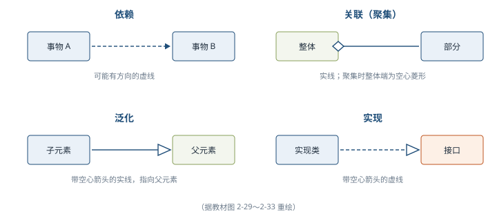

**UML 2.0 提供 13 种图**：类图、对象图、用例图、序列图、通信图、状态图、活动图、构件图、部署图、组合结构图、包图、交互概览图和计时图；其中**序列图、通信图、交互概览图和计时图统称交互图**。用例图展现用例、参与者及关系（用例间有 **<<include>> 包含和 <<extend>> 扩展**，参与者与用例间有关联，用例/参与者间可有泛化），用于对系统**语境**（画系统边界、声明外部参与者）和**需求**（系统应做什么而非怎样做）建模，把系统看作黑盒子。

**UML 5 种视图** ⭐【高频考点：用例视图居中】：

| 视图 | 描述内容 | 主要图 | 关注者 |
| --- | --- | --- | --- |
| **用例视图（中心地位）** | 系统功能需求，外部用户可观察到的功能模型 | 用例图 | 客户、分析者、设计者、开发者、测试者 |
| 逻辑视图 | 系统内部功能如何实现：静态结构和动态协作 | 类图、对象图、状态图、顺序图、合作图、活动图 | 设计、开发者 |
| 进程视图 | 系统的**并发性**：控制线程及线程间通信同步 | 状态图、顺序图、合作图、活动图、构件图、配置图 | 开发者、系统集成者 |
| 实现视图 | **代码构件组织**、实现模块及依赖关系 | 构件图 | 设计者、开发者、测试者 |
| 部署视图 | 软硬件**物理体系结构**及连接，哪个程序/对象驻留在哪台计算机执行 | 配置图 | 开发者、系统集成者、测试者 |

与第 1 章「4+1」视角对应理解：用例视图≈场景、逻辑视图≈逻辑、进程视图≈过程、实现视图≈开发、部署视图≈物理，但两套表述的出处不同，答题以题干指定体系为准。

#### 5. 形式化语言

**形式化方法是用具有精确语义的形式语言书写程序功能描述**，把概念、判断、推理转化成形式符号研究，是设计编制程序的出发点、验证程序是否正确的依据，能确保与需求一致并用于分析验证。

**规格说明语言主要流派**：①**公理方法**（前置条件与后置条件描述程序行为，代表 Floyd、Hoare、Dijkstra）；②基于集合论和一阶谓词演算的 **meta-IV 和 Z 语言**（meta-IV 对应**维也纳开发方法 VDM**）；③**代数规格说明**（抽象数据类型的代数描述，OBJ、ACT）；④**进程描述语言**（描述开发进程行为，Hoare 的 **CSP**、Milner 的 **CCS**）。ISO 认可的规格说明语言有 LOTOS、ESTELLE、SDL、Z.100 等。

**形式化方法分类**：按系统特性分面向对象（Z、VDM、B、Object-Z）、面向属性（OBJ3、Larch）、基于并发性（CCS、ACP、CSP、LOTOS）、基于实时性（TRIO、RTOZ）；按描述方式分**模型描述**（构造数学模型直接描述）与**性质描述**（描述系统性质间接描述）；按表达能力分**模型方法**（显式描述状态与动作，不能显式表示并发）、**代数方法**（隐式描述操作，也不能显式表示并发）、**进程代数方法**（显式模型描述并发，交错语义）、**逻辑方法**（逻辑描述程序/时间状态规范）、**网络模型方法**（如 **Petri 网**，独立描述每个结点、显式给出并发模型）。

**形式化开发过程**：贯穿可行性分析、需求分析、体系结构设计、详细设计、编码、测试发布 6 阶段——需求阶段要求明确描述需求；体系结构设计可采用**半形式化**方法；编码阶段自动代码生成器可把较小系统的形式化描述直接转为可执行程序；测试阶段可用于**测试用例自动生成、保证覆盖率**。

**Z 语言** ⭐【易错】：**具有「状态—操作」风格的形式化规格说明语言**，以**一阶逻辑和集合论**为形式语义基础，**最主要的结构是模式（Schema），一个模式由变量说明和谓词约束两部分组成**，描述系统状态和操作；是**强类型系统**（每个对象有唯一类型）；可结合自然语言书写；支持**求精**（从抽象模型逐步精化到可执行代码）；优点是精确、简洁、无二义性，适用于无法现场调试的高安全性系统。**Z 语言没有提供计时或并发行为的描述**，可与 CSP、CCS 等结合产生含并发行为的规格说明。

### 2.7 多媒体（2.7）

**媒体（Media）是承载信息的载体**，按 ITU-T 建议分为 5 类 ⭐【高频易错】：

| 媒体类型 | 含义 | 例子 |
| --- | --- | --- |
| 感觉媒体 | 用户接触信息的**感觉形式** | 视觉、听觉、触觉 |
| 表示媒体 | 信息的**表示形式** | 图像、声音、视频（的编码表示） |
| 表现媒体（显示媒体） | **表现和获取信息的物理设备** | 输入：键盘、鼠标、扫描仪、话筒、摄像机；输出：显示器、打印机、音箱 |
| 存储媒体 | **存储表示媒体的物理介质** | 硬盘、软盘、光盘、ROM、RAM |
| 传输媒体 | **传输表示媒体的物理介质** | 电缆、光缆、电磁波 |

**多媒体是利用计算机技术把文本、图形、图像、声音、动画和电视等多种媒体综合起来，建立逻辑连接，并能获取、压缩、加工处理和存储，集成为一个具有交互性的系统**。四个重要特征：**多维化**（媒体多样化）、**集成性**（设备集成与信息/表现集成）、**交互性**（变被动为主动的重要标志）、**实时性**（音视频等媒体具有很强时间特性）。

多媒体系统由硬件（多媒体计算机、板卡、外部设备及控制接口）和软件（驱动软件、操作系统、数据处理软件、创作工具软件、应用软件）组成。关键技术包括感觉媒体表示、**数据压缩**、存储、多媒体数据库、超文本与超媒体、信息检索、**通信**、人机交互及外部设备等。

**视音频技术**：视频技术含**视频数字化**（模拟视频模数转换为数字信号）和**视频编码**（数字化信号编码为可录制播放的视频信号）；音频技术含音频数字化、语音处理、语音合成及语音识别 4 方面。编解码目的是对视音频数据进行**传输和存储**，常加入**同步元数据**（如字幕），常见封装格式有 mpg、avi、mov、mp4 等。压缩方法总体分两类 ⭐：**无损压缩**（解压后与压缩前**完全一致**，多数采用 **RLE 行程编码**，常见格式 WAV、PCM、FLAC、APE 等）和**有损压缩**（丢失人眼人耳**不敏感**的信息且**不可恢复**，常见格式 MP3、WMA、OGG 等）。

**通信技术**：含数据传输信道技术（同轴电缆、双绞线、光纤、微波、卫星等物理介质）和数据传输技术（基带/频带传输及调制、同步、多路复用、数据交换、编码加密、差错控制等）。

**数据压缩技术** ⭐：按压缩时机分**即时压缩**（传输过程中压缩，常用于影像声音，需专门硬件如压缩卡）和**非即时压缩**；按对象分**数据压缩**（时间性数据，即时采集处理传输）和**文件压缩**（保存到磁盘等介质的数据）；按质量分**无损压缩**（利用**统计冗余**，压缩比较低）和**有损压缩**（利用人类视听不敏感特性，允许损失信息）。国际编码标准：

| 标准 | 适用对象 | 要点 |
| --- | --- | --- |
| **JPEG / JPEG 2000** | **静态图像**压缩 | 联合图像专家小组（CCITT 与 ISO 联合）制定的编码算法 |
| **MPEG 系列** | **运动图像（动态视频）**压缩 | 运动图像专家组 1988 年成立；系列含 MPEG-1、MPEG-2、MPEG-4、MPEG-7、MPEG-21、DVI |
| **H.26L** | 视频编解码 | ITU-T VCEG 1997 年制定、2002 年正式确定，提供更高压缩效率与网络适应性，适用于**可视电话和视频会议等实时视频通信** |

**VR/AR 技术** ⭐【易错：VR 与 AR 区分】：**虚拟现实 VR 是创建和体验虚拟世界的计算机仿真系统**，利用计算机生成模拟环境使用户**沉浸**其中，通过自然技能（头部转动、手势等）与虚拟实体交互，需借助头盔立体显示器、数据手套、三维鼠标等三维传感设备；**增强现实 AR 是把模拟仿真的实体信息叠加到现实世界中被感官感知**，达到**超越现实**的感官体验（涉及计算机图形图像、空间定位、人文智能技术）。VR/AR 分 4 类：

| 类型 | 定义 | 特点 |
| --- | --- | --- |
| 桌面式 VR | 计算机形成三维交互场景，鼠标等输入、屏幕呈现虚拟环境 | **易实现、应用广、成本低**，但受环境干扰、体验感弱 |
| 分布式 VR | VR 与网络融合，同一 VR 环境下多用户共享信息 | 忽略地域限制、共享度高，**研发成本极高**，适合专业领域 |
| 沉浸式 VR | 各类输入输出设备给用户**完全沉浸、全身心参与**的环境 | 实时交互与体验感好，但硬件与混合技术要求高、成本高 |
| 增强式 VR（AR） | 虚拟仿真世界与现实世界**叠加**，用户无须脱离真实世界 | 体验更完美，混合技术要求更高、开发成本高、起步晚 |

其关键技术还包括：**数据采集与优化传输**（全向相机、高速摄像机、激光设备获取自然现象数据，低功耗低延时传输）和**交互与情形实时再现**（力觉反馈、触觉反馈，跟踪定位、高效渲染、逼真显示）。

### 2.8 系统工程（2.8）⭐【重点】

#### 1. 基本概念

**系统工程是一种组织管理技术**：把研究对象看作由很多相互联系、相互制约的组成部分构成的总体，运用运筹学理论方法及电子计算机技术，对各组成部分进行分析、预测和评价，最后综合使系统达到最优。产生于第二次世界大战期间，**1960 年美国阿波罗登月计划成功运用系统工程**，此后获迅速发展。

**系统（ISO/IEC 15288:2008）**是人造的、被创建用于在定义明确的环境中提供产品或服务的组合，系统元素包括硬件、软件、数据、人员、流程、设施、材料等；**系统是由交互的元素组织起来的组合，用以实现一个或多个特定目的**。**系统之系统（SoS）**指系统元素本身也是系统的情况（如 GPS 既是飞机机载导航系统的组成，也是汽车导航系统的组成），部件系统互操作能产生单个系统无法单独达成的结果。

钱学森（1978）：系统工程是**组织管理「系统」的规划、研究、设计、制造、试验和使用的科学方法，是一种对所有「系统」都具有普遍意义的科学方法**。INCOSE：系统工程是**一种使系统能够成功实现的跨学科的方法和手段**，专注开发周期**早期**定义客户需求与功能并文件化，再考虑运行、成本、进度、性能、培训、保障、制造和退出等完整问题。核心特征：**跨学科、技术和整体性（系统思维）**——分析和设计与其部分截然不同的整体，全面看问题并把社会方面与技术方面联系起来。

#### 2. 系统工程方法 ⭐【高频考点】

系统工程方法的特点是**整体性、综合性、协调性、科学性和实践性**，包括整体观念、综合观念、科学观念和创新观念。

**① 霍尔三维结构（硬系统方法论 HSM）**：美国系统工程专家**霍尔（A.D.Hall）1969 年**提出，将系统工程活动分为前后衔接的 **7 个时间阶段和 7 个逻辑步骤**，加上所需专业知识技能，形成**时间维、逻辑维、知识维**三维结构 ⭐【必背】：

| 维度 | 内容 |
| --- | --- |
| 时间维 | **规划、拟订方案、研制、生产、安装、运行、更新** 7 个时间阶段 |
| 逻辑维 | **明确问题、确定目标、系统综合、系统分析、优化、决策、实施** 7 个逻辑步骤 |
| 知识维 | 工程、医学、建筑、商业、法律、管理、社会科学、艺术等各种专业知识和技能 |

霍尔三维结构集中体现系统工程方法的**系统化、综合化、最优化、程序化和标准化**特点，为解决大型复杂系统的规划、组织、管理提供统一思想方法。

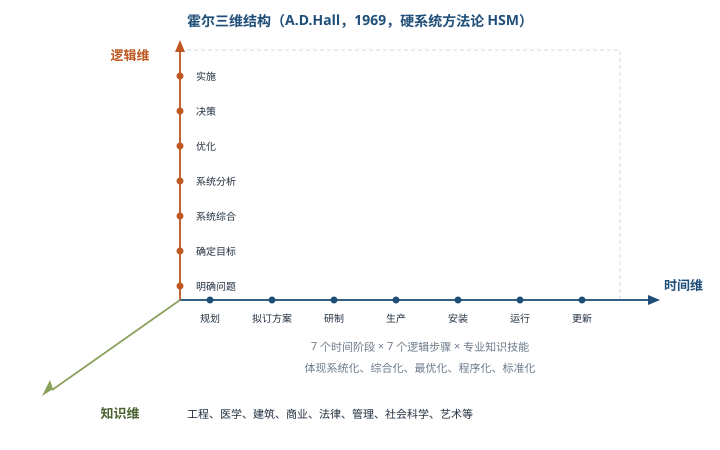

**② 切克兰德方法（软系统方法论）**：英国 **P.切克兰德 20 世纪 80 年代中前期**提出。社会经济系统的问题难以事先确定需求、难以定量分析，**核心不是「最优化」而是「比较」与「探寻」**——从模型和现状的比较中学习改善现状的途径，含有组织讨论、听取各方意见的意思，更好反映人的因素。工作过程 7 步：**认识问题 → 根底定义 → 建立概念模型 → 比较及探寻 → 选择 → 设计与实施 → 评估与反馈**。

**③ 并行工程（Concurrent Engineering）**：对产品及其相关过程（制造和支持过程）进行**并行、集成化处理**的系统方法，要求设计开始即考虑**产品生命周期全过程**（质量、成本、用户要求及工艺与服务质量）。**目标是提高质量、降低成本、缩短产品开发周期和上市时间**；做法是**产品开发初期组织多职能协同项目组**，使问题在开发早期解决、避免返工；强调设计开发期间结合概念/结构/工艺设计与最终需求、项目小组随时或定期反馈协调、依据信息系统工具（如 CIM）辅助并行化。

**④ 综合集成法**：**钱学森等 1990 年初提出「从定性到定量的综合集成法」**，用于处理**开放的复杂巨系统**（子系统种类很多且有层次结构、关联复杂且开放），区别于培根式还原论。系统分类：简单系统 → 巨系统（子系统成千上万）→ 简单巨系统（种类不多、关联简单，如激光系统）→ **开放的复杂巨系统**。开放复杂巨系统性质：**开放性、复杂性、进化与涌现性、层次性、巨量性**。1992 年钱学森又提出**综合集成研讨厅体系**：将**专家群体、数据和各种信息与计算机网络**有机结合。主要特点：定性与定量结合贯穿全过程、科学理论与经验知识结合、多学科综合、宏观与微观统一、**必须有大型计算机系统支持**。

**⑤ WSR 系统方法**：**物理（Wuli）- 事理（Shili）- 人理（Renli）方法论**，**顾基发教授和朱志昌博士 1994 年**在英国 HULL 大学提出，属定性与定量综合集成的东方系统思想。实践准则是「**懂物理、明事理、通人理**」。一般工作过程 7 步：**理解意图、制定目标、调查分析、构造策略、选择方案、协调关系、实现构想**；**协调关系始终贯穿整个过程**（协调每一步物理事理人理、意图目标现实策略方案构想、投入产出成效的关系）。物理主要用自然科学方法，事理主要用运筹学、系统工程、管理科学、控制论及软计算、特尔斐法、层次分析法等，人理可细分为关系、感情、习惯、知识、利益、和解与管理等。

#### 3. 系统工程的生命周期 ⭐【高频考点】

ISO/IEC 15288:2008 定义生命周期的目的是**以有序高效的方式建立满足利益攸关者需求的框架**，通过定义阶段并决策是否就绪进入下一阶段实现；**跳过阶段和决策会大幅增加成本与进度风险**；系统工程的任务通常集中在初期，但生产运行后仍需修改，故系统工程贯穿所有生命周期阶段。

七个一般生命周期阶段 ⭐【必背，注意与霍尔时间维区分】：

| 阶段 | 目的 | 要点 |
| --- | --- | --- |
| 探索性研究阶段 | **识别利益攸关者需求，探索创意和技术** | 大量创造性系统工程在此完成，可引入概念阶段 |
| 概念阶段 | **细化需求，探索可行概念，提出有望实现的解决方案** | 需求识别、明确并文档化（无探索阶段时在此完成）；退出计划也在此阶段定义 |
| 开发阶段 | **细化系统需求，创建解决方案描述，构建系统，验证并确认** | 含详细计划与 V&V 活动，可自主选择开发模型，不限于瀑布 |
| 生产阶段 | **生产系统并进行检验和验证** | 可能为降本或提升能力更改产品，需重新验证与系统工程评估 |
| 使用阶段 | **运行系统以满足用户需求** | 在预期环境交付服务，可有计划升级（运行流程） |
| 保障阶段 | **提供持续的系统能力** | 服务、维护使系统持续运行，可延寿降本（维护流程） |
| 退役阶段 | **存储、归档或退出系统** | 确保退出需求满足；许多国家强制创建者负责生命终止退出 |

生命周期方法 4 种 ⭐【易错：适用场景】：

| 方法 | 核心思想 | 适用/特点 |
| --- | --- | --- |
| 计划驱动方法 | 需求、设计、构建、测试、部署的传统方式，全程遵守规定流程 | 适合需协调多家公司的大型团队项目；**特别关注文档完整性、需求可追溯性及事后验证** |
| 渐进迭代式开发 IID | 先提供初始能力，再连续交付达期望系统，快速产生价值 | **需求不清晰或引入新技术时**使用；不断评估演进直至满足要求；**适用于较小、不太复杂的系统**，重点在灵活性 |
| 精益开发 | 源于丰田「准时化」，彻底消除浪费、不一致及不合理需求，**向客户交付最大价值并使浪费最小化** | 精益 SE 是把精益原则实践工具用于系统工程，提升对利益攸关者的价值交付 |
| 敏捷开发 | 关键目标在**灵活性**，风险可接受时允许从序列排除选定事件 | 原则：尽早持续交付有价值软件、**欢迎需求变更（即使后期）**、短周期交付可用软件、业务与开发每天一起工作、**面对面交谈最有效**、**工作软件是进展主要度量**、简单性、自组织团队、定期反省调整 |

#### 4. 基于模型的系统工程（MBSE）⭐【高频考点】

**2007 年 INCOSE 在《系统工程 2020 年愿景》中正式提出 MBSE 定义：MBSE 是建模方法的形式化应用，以使建模方法支持系统需求、分析、设计、验证和确认等活动，这些活动从概念性设计阶段开始，持续贯穿到设计开发以及后来的所有生命周期阶段**。MBSE 仍是系统工程，层层分解、综合集成思路不变，**核心是采用形式化、图形化、关联化的建模语言及工具改造系统工程的技术过程**。

系统工程过程三阶段产物：**需求分析阶段**产生需求图、用例图及包图；**功能分析与分配阶段**产生顺序图、活动图及状态机图；**设计综合阶段**产生模块定义图、内部块图及参数图。

**MBSE 三大支柱** ⭐【必背】：

| 支柱 | 内容 | 要点 |
| --- | --- | --- |
| 建模语言 | **SysML**（OMG 在重用和扩展 **UML 2.0 子集**基础上提出的系统建模语言），作为系统工程的标准建模语言 | 统一建模语言：跨学科通用语言、图形化可视化便于理解、形式化关联化便于计算机处理 |
| 建模工具 | 支持系统建模语言画图的计算机和网络环境（核心为支持 SysML 的软件），底层关联数据形成**模型库**，可构建分布式协同建模环境 | 已有数据转换标准可与热学、力学等专业分析软件交换数据、迭代优化 |
| 建模思路 | 设计团队如何利用各种图形建立系统模型（工作流程） | 代表方法：**IBM Telelogic Harmony-SE、Weilkiens SYSMOD、INCOSE OOSEM**；应根据组织特点研究适合自身的思路流程，是前置重点工作 |

### 2.9 系统性能（2.9）⭐【重点】

**系统性能是一个系统提供给用户的所有性能指标的集合**，包括硬件性能（主频、容量、带宽）和软件性能（上下文切换、延迟、执行时间），包括部件指标和综合指标；包含**性能指标、性能计算、性能设计和性能评估** 4 方面。

#### 1. 性能指标

| 对象 | 主要性能指标（关键词记忆） |
| --- | --- |
| 计算机 | 时钟频率（主频）、运算速度、运算精度、内存容量、存取周期、数据处理速率 PDR、吞吐率、响应时间、利用率、**RASIS 特性**（可靠性、可用性、可维护性、完整性和安全性）、平均故障响应时间、兼容性、可扩充性、性能价格比 |
| 路由器 | 设备吞吐量、端口吞吐量、**全双工线速转发能力**、背靠背帧数、路由表能力、背板能力、丢包率、时延及时延抖动、VPN 支持、队列管理、冗余热插拔、网管与计费、语音支持等 |
| 交换机 | 类型与配置、背板吞吐量、缓冲区大小、**最大 MAC 地址表大小**、支持协议标准（RIP/OSPF/BGP 等）、最大路由表数、**VLAN 及最大 VLAN 数量**、QoS、端口镜像、链路聚集与负载均衡、冗余热交换组件等 |
| 网络 | **设备级、网络级、应用级、用户级**性能指标和吞吐量 |
| 操作系统 | **系统上下文切换、系统响应时间、系统吞吐率（量）、系统资源利用率、可靠性和可移植性** |
| 数据库管理系统 | 数据库大小、表数量、单表大小、记录（行）数量与大小、索引数量、**最大并发事务处理能力**、负载均衡能力、最大连接数等 |
| Web 服务器 | **最大并发连接数、响应延迟和吞吐量**（3 项，常考） |

#### 2. 性能计算

主要方法有**定义法、公式法、程序检测法和仪器检测法**；常用计算过程有 **MIPS**（每秒百万条指令）计算、峰值计算、**等效指令速度（吉普森 Gibson 法）**；实际应用中常对指标复合计算并**加权处理**得最终结果。

#### 3. 性能设计

**性能调整**：系统性能降到基本水平时由**查找和消除瓶颈**组成。数据库系统关注 CPU/内存使用、数据库设计与管理优化、进程线程状态、硬盘剩余空间、日志文件大小；应用系统关注可用性、响应时间、并发用户数与资源占用。开始前必须**识别约束、指定负载、设置性能目标**；调整是重复受控的试验，循环过程为**收集、分析、配置和测试**。

**阿姆达尔（Amdahl）定律** ⭐【高频考点】：对某一部件采用更快执行方式所获得的系统性能改变程度，**取决于这种方式被使用的频率或所占总执行时间的比例**。

**加速比 = 不使用增强部件时完成整个任务的时间 / 使用增强部件时完成整个任务的时间**，它取决于两个因素：**增强比例**（能被改进增强的部分在总执行时间中所占比例，≤1）和**增强加速比**（增强部分本身速度提高的倍数）。公式：

**新的执行时间 = 原来的执行时间 × [(1 − 增强比例) + 增强比例 / 增强加速比]**

**总加速比 = 1 / [(1 − 增强比例) + 增强比例 / 增强加速比]**

举例：某功能部件占总执行时间的 **60%**，采用增强部件后该部分速度提高到原来的 **10 倍**，则总加速比 = 1 / [(1 − 0.6) + 0.6/10] = 1 / (0.4 + 0.06) = 1/0.46 ≈ **2.17**。可见**局部提升再大，整体加速也受未改进部分（40%）限制**——这就是「加速比取决于改进部分所占比例」的含义，也是性能优化要先找主要瓶颈的原因。

#### 4. 性能评估

**性能评估是为了一个目的，按照一定步骤，选用一定度量项目，通过建模和实验，对系统性能进行各项检测、解释测试结果并形成文档的技术**，目的之一是为性能优化提供参考。

**基准测试程序**：把应用程序中**用得最多、最频繁的核心程序**作为评价计算机性能的标准程序（benchmark）。4 种评价程序**评测准确程度依次递减** ⭐【易错：顺序】：**真实的程序 > 核心程序 > 小型基准程序 > 合成基准程序**。常用基准测试程序有整数测试 **Dhrystone**、浮点测试 **Linpack**、**Whetstone**、**SPEC** 和 **TPC** 基准程序。

**Web 服务器性能评估**：指标为**最大并发连接数、响应延迟和吞吐量**；常见评测方法有**基准性能测试、压力测试和可靠性测试**。

**系统监视** 3 种方式：①系统本身提供的**命令**（UNIX/Linux 的 w、ps、last，Windows 的 netstat 等）；②通过**系统记录文件**查阅特定时间运行状态；③**集成命令、文件记录和可视化技术**（如 Windows 的 **Perfmon**）。

## 三、重点与易错点

| # | 考点 | 必须记住的结论 | 易错提醒 |
| --- | --- | --- | --- |
| 1 | CISC 与 RISC | CISC 代表 x86（Intel/AMD）；RISC 代表 ARM/Power，后期指令集几乎均为 RISC | 不要记成「RISC 指令多而全」，其特点是**精简** |
| 2 | 存储器四层 | 片上缓存（SRAM，16kB～512kB）→ 片外缓存（SRAM，256kB～4MB）→ 主存（DRAM，充电维持）→ 外存（掉电保持） | DRAM 主存是**易失**的；外存保持数据也有年限 |
| 3 | 并发与并行 | 并发是宏观同时、微观交替；多 CPU 才并行 | 多道批处理三特点：**多道、宏观并行、微观串行** |
| 4 | 操作系统特征与分类 | 四特征：并发、共享、虚拟、不确定；分时四特点：多路、独立、交互、及时 | 嵌入式 OS 五特点：微型化、可定制、实时、可靠、**易移植（HAL+BSP）** |
| 5 | 数据库设计 6 阶段与分布式 4 层 | 需求 → 概念（E-R）→ 逻辑（转数据模型）→ 物理 → 应用程序设计 → 运行维护；分布式 4 层：全局外层/全局概念层/局部概念层/局部内层 | 全局概念层含**分片模式与分配模式**；概念结构设计与 DBMS 无关 |
| 6 | 文件物理结构与空闲管理 | 连续（连续块）、链接（指针串联）、索引（索引表）；空闲区表适用连续结构、位示图适合各种结构、成组链接为 UNIX 采用 | 位示图 **0 空闲 1 占用**；硬链接指向同一索引结点，符号链接按路径映射可跨文件系统 |
| 7 | 中间件类型与产品 | **MQSeries = 消息中间件**（消息和队列、异步可靠传输）；**Tuxedo = 交易中间件**（事务完整性、不间断访问、DDR 路由） | 消息中间件是**销售额最大**的中间件；交易中间件以 Tuxedo 闻名 |
| 8 | 构件与标准 | 构件两特性：自包容、可重用；CORBA 三层含 ORB「软总线」；EJB 属**业务逻辑层**中间件 | 会话 Bean 维护会话、实体 Bean 处理事务；构件化有第三方质量不可控风险 |
| 9 | 嵌入式 5 层与软件 6 特点 | 硬件层 → 抽象层（HAL+BSP）→ 操作系统层 → 中间件层 → 应用层；可剪裁、可配置、强实时、安全性、可靠性、高确定性 | **安全性 = 不发生事故**，**可靠性 = 执行所要求功能的能力**；开发在宿主机、运行在目标机 |
| 10 | DO-178B | 目标、过程、数据三要素；A66/B65/C56/D28/E0；三大过程：计划、开发（需求/设计/编码/集成）、综合（验证/配置管理/质量保证/审定联络） | DO-178C 于 2011 年发布；与 CMMI 区别在**适航审定 vs 过程改进** |
| 11 | 香农公式与信号变换 | C = B·log₂(1+S/N)；信道编码加冗余纠零星错、交织把连续误码变零星误码 | 复用传多路数据、多址传多用户数据，**复用是多址的基础** |
| 12 | 五种拓扑与以太网 | 星状怕中心故障、环形单向且任一故障瘫、网状最可靠成本高；最小帧长 **64B**（CSMA/CD）、数据域通常上限 **1500B**、Length/Type **大于 1500 表类型** | 半双工反压、全双工 **802.3x PAUSE 帧**；WLAN 三拓扑中完全分布型尚处理论探讨 |
| 13 | OSI 与 TCP/IP、设备层级 | 物数网传会表应；TCP/IP 四层：网络接口/网际/传输/应用；中继器物理层、网桥与交换机数据链路层、路由器网络层 | **OSI 高三层对应 TCP/IP 应用层**；STP 解决交换环路、BGP 用于 AS 之间 |
| 14 | UML | 3 要素（构造块、图、公用机制）；4 事物、4 关系、13 种图、5 视图（**用例视图居中**） | 泛化 = 空心箭头**实线**指父、实现 = 空心箭头**虚线**、依赖 = 虚线；UML 是语言**不是方法学** |
| 15 | 形式化与 Z 语言 | Z 语言以**一阶逻辑 + 集合论**为基础，**模式 = 变量说明 + 谓词约束**，强类型、可求精 | **Z 不能描述计时与并发**，可结合 CSP/CCS |
| 16 | 媒体 5 类与压缩 | 感觉/表示/表现（显示）/存储/传输；JPEG 静态、MPEG 动态、H.26L 实时视频通信 | **VR 沉浸虚拟世界、AR 虚拟叠加现实**；无损压缩利用统计冗余、多数用 RLE |
| 17 | 系统工程方法 | 霍尔三维（时间/逻辑/知识，硬系统）；切克兰德（软系统，**比较与探寻**）；并行工程（生命周期全过程、缩短周期）；综合集成法（钱学森、开放复杂巨系统）；WSR（物理事理人理，协调贯穿） | 切克兰德核心**不是最优化**；WSR 是顾基发、朱志昌 1994 年提出 |
| 18 | 生命周期 7 阶段与 4 方法 | 探索研究 → 概念 → 开发 → 生产 → 使用 → 保障 → 退役；计划驱动/IID/精益/敏捷 | **霍尔时间维 7 阶段 ≠ 生命周期 7 阶段**；IID 适合较小不太复杂系统；敏捷欢迎后期变更 |
| 19 | MBSE 三大支柱 | 建模语言（**SysML**，UML 2.0 子集扩展）、建模工具、建模思路（Harmony-SE/SYSMOD/OOSEM） | MBSE 由 INCOSE 于 **2007 年**提出，**仍是系统工程**，思路流程不变 |
| 20 | 性能计算与评估 | 阿姆达尔：**总加速比 = 1/[(1−增强比例)+增强比例/增强加速比]**；评价准确度：真实程序 > 核心程序 > 小型基准 > 合成基准 | 局部加速受未改进部分限制；Web 服务器指标：最大并发连接数、响应延迟、吞吐量 |

## 四、练习与真题

以下为依据大纲与教材自编的模拟练习题（单选），用于自测本章考点。

**1.** 关于 RISC 与 CISC 的说法，正确的是（ ）。
A. CISC 以 ARM 和 Power 为代表  B. RISC 以 Intel、AMD 的 x86 为代表  C. 几乎所有后期出现的指令集均为 RISC 架构  D. RISC 指令功能比 CISC 更复杂

**2.** 计算机存储器分层体系中，主存（内存）通常采用的结构是（ ）。
A. SRAM，依靠不断充电维持数据  B. DRAM，依靠不断充电维持数据  C. Flash，掉电后保持数据  D. EPROM，掉电后保持数据

**3.** 分时操作系统的主要特点不包括（ ）。
A. 多路性  B. 独立性  C. 交互性  D. 多道性

**4.** 在数据库设计过程中，将 E-R 图转换为指定数据模型、确定完整性约束和用户视图的工作属于（ ）。
A. 需求分析阶段  B. 概念结构设计阶段  C. 逻辑结构设计阶段  D. 物理结构设计阶段

**5.** 关于文件的物理结构与空闲空间管理，下列说法错误的是（ ）。
A. 链接结构中每个物理块设有指向下一个物理块的指针  B. 位示图适合各种物理结构，其大小由磁盘物理块总数决定  C. 空闲区表适用于连续文件结构  D. 位示图中每一位取值 0 表示占用、1 表示空闲

**6.** IBM MQSeries 与 BEA Tuxedo 分别属于（ ）。
A. 消息中间件、交易中间件  B. 交易中间件、消息中间件  C. 安全中间件、数据存取管理中间件  D. 架构中间件、网络中间件

**7.** 嵌入式系统软件通常采用层次化结构，其中硬件抽象（HAL）和板级支持包（BSP）位于（ ）。
A. 硬件层  B. 抽象层  C. 操作系统层  D. 中间件层

**8.** 按 DO-178B 标准，软件安全等级与需要达到的目标数量对应关系正确的是（ ）。
A. A 级 28 个、B 级 56 个  B. A 级 66 个、C 级 56 个  C. D 级 65 个、E 级 0 个  D. B 级 66 个、D 级 28 个

**9.** 以太网规定最小帧长为 64 字节，其主要原因是（ ）。
A. 提高信道利用率  B. 便于进行帧校验  C. 避免发送结点发完数据后，远端结点因未收到报文而误判线路空闲、发送数据造成冲突  D. 与数据域上限 1500 字节保持一致

**10.** 在 TCP/IP 模型中，ICMP、ARP 和 RARP 协议工作的层次是（ ）。
A. 应用层  B. 传输层  C. 网际层  D. 网络接口层

**11.** UML 的四种关系中，「泛化」关系在图形上表示为（ ）。
A. 可能有方向的虚线  B. 带空心箭头的实线，指向父元素  C. 带空心箭头的虚线  D. 整体端带空心菱形的实线

**12.** 关于系统工程方法，下列对应关系错误的是（ ）。
A. 霍尔三维结构——时间维、逻辑维、知识维  B. 切克兰德方法——核心是最优化  C. WSR 方法——物理、事理、人理，协调关系贯穿全过程  D. 综合集成法——钱学森提出，处理开放的复杂巨系统

**13.** 某系统中，可采用增强方式改进的部件占总执行时间的 60%，增强后该部分速度提高到原来的 10 倍。根据阿姆达尔定律，系统的总加速比约为（ ）。
A. 6.00  B. 2.17  C. 1.46  D. 4.00

**14.** 关于多媒体与 VR/AR 技术，下列说法正确的是（ ）。
A. JPEG 是面向运动图像的压缩标准  B. 无损压缩利用人类视听不敏感特性，允许损失部分信息  C. VR 创建虚拟仿真环境使用户沉浸其中，AR 将虚拟信息叠加到现实世界  D. MPEG 是静态图像压缩编码的国际标准

（参考答案集中放在全章最后的「六、参考答案」，请先独立完成再核对。）

## 五、疑问与查漏补缺

- 大纲 1.2 还要求「国产处理器芯片结构」，教材仅列举龙芯、飞腾、申威、兆芯等产品名称，未展开各芯片架构细节，复习时以**记住代表产品名录**为主，可结合时事资料适度补充。
- 大纲 1.5 的「OSI 协议集」教材表 2-5 罗列较简（VT、FTAM、CMIP/CMIS、TP0～TP4、CLNP、X.25 PLP、HDLC 等），本章未逐层展开，建议结合表 2-5 做**协议—层次**对应识记即可，不必深挖协议细节。
- 教材图 2-21「5G 网络的系统架构」涉及 AUSF、AMF、SMF、UPF 等大量网元，大纲只要求「服务化架构」，笔记保留 SBA + HTTP 承载、控制面/用户面分工即可，网元全称不作硬性背诵要求；需要时回看教材图 2-21。
- UML 13 种图的详细画法（序列图、状态图、活动图等）属于后续**软件工程与架构设计章节**的应用内容，本章掌握「3 要素、4 事物、4 关系、13 种图名称、5 视图」即可。
- DO-178C（2011）相比 DO-178B 的新增内容（工具鉴定、基于模型的开发验证、面向对象、形式化验证）教材仅一句话带过，考试若涉及通常只考「新增哪些技术」，已列入笔记；DO-178B 的 66 个目标明细不需背诵。
- 教材 2.5.2 在香农公式后有「比较大的带宽、降低信噪比」的表述，易被误读为「信噪比越低容量越大」。应按公式理解：**带宽与信噪比共同决定容量，且工程上需权衡（带宽增大往往伴随噪声功率上升）**，不要脱离公式死记该句。
- 教材 2.2.5 接口举例中「HDMI、DVI 和 DVI 等」存在重复排版，应为 HDMI、DVI、VGA 一类显示接口，笔记按显示类接口理解。
- 多媒体「表现媒体」与「表示媒体」仅一字之差，做题时注意：表示媒体 = 信息的表示形式（编码），表现（显示）媒体 = 物理设备（输入/输出设备）。

## 六、参考答案

**1.** **C**。CISC 以 x86 为代表，RISC 以 ARM/Power 为代表且是发展趋势。

**2.** **B**。主存通常采用 DRAM，依赖不断充电维持数据（易失）；片上/片外缓存一般为 SRAM；外存掉电保持数据。

**3.** **D**。分时系统四特点为多路性、独立性、交互性、及时性；「多道」是多道批处理系统的特点（多道、宏观并行、微观串行）。

**4.** **C**。逻辑结构设计阶段确定数据模型，将 E-R 图转换为指定数据模型，确定完整性约束和用户视图。

**5.** **D**。位示图中 0 表示空闲、1 表示占用，D 项正好说反。

**6.** **A**。MQSeries 是消息处理中间件（资源为消息和队列），Tuxedo 是交易中间件。

**7.** **B**。抽象层由硬件抽象（HAL）和板级支持包（BSP）组成，为上层提供虚拟硬件资源与驱动支持。

**8.** **B**。正确对应为 A66/B65/C56/D28/E0，只有 B 项完全正确。

**9.** **C**。最小帧长由 CSMA/CD 机制决定，防止远端结点误判线路空闲而产生冲突。

**10.** **C**。网际层除 IP 外还有 ICMP、ARP、RARP 等重要协议。

**11.** **B**。泛化是带空心箭头的实线并指向父元素；实现是带空心箭头的虚线；依赖是可能有方向的虚线；聚集整体端为空心菱形。

**12.** **B**。切克兰德方法的核心是「比较」与「探寻」，不是最优化；最优化是霍尔硬系统方法论的特点。

**13.** **B**。总加速比 = 1/[(1−0.6) + 0.6/10] = 1/0.46 ≈ 2.17。

**14.** **C**。JPEG 面向静态图像、MPEG 面向运动图像；利用视听不敏感特性并允许损失信息的是**有损**压缩；VR/AR 的区分以 C 项为准。
