# 第3章 信息系统基础知识

- 教材位置：`02.系统架构设计师第二版-教材.pdf` PDF 第 115～154 页（书页 105～144）
- 复习状态：已完成
- 复习日期：2026-11-06
- 本章地位：本章建立信息系统、典型业务系统与信息化模型的整体知识框架，是后续信息系统架构设计、软件工程、数据库及安全架构复习的概念底座。选择题常考分类边界、组成结构、阶段顺序和易混术语。
## 一、大纲考点

大纲科目 1 第 2 部分「信息系统基础知识」位于大纲书页 23～27（PDF 第 33～37 页）。对应关系如下。
| 大纲条目 | 大纲要求 | 教材对应 | 复习抓手 |
| --- | --- | --- | --- |
| 2.1.1 信息系统定义 | 基本目标、定义、五个基本功能 | 3.1.1 | 六类组成、人机一体化、输入到控制 |
| 2.1.2 信息系统发展 | 诺兰模型六阶段 | 3.1.2 | 阶段顺序、两个时代、转折点 |
| 2.1.3 信息系统分类 | TPS、MIS、DSS、ES、OAS 等 | 3.1.3、3.2～3.6 | 服务对象、问题结构化程度、输出 |
| 2.1.4 生命周期 | 产生、开发、运行、消亡 | 3.1.4 | 开发五阶段及各阶段产物 |
| 2.1.5 建设原则 | 高层介入、用户参与、自顶向下、工程化等 | 3.1.5 | 核心用户、全过程参与、信息一致性 |
| 2.1.6 开发方法 | 结构化、原型、面向对象、面向服务 | 3.1.6 | 适用场景与方法特征 |
| 2.1.7 综合性信息系统 | ERP、WMS、MES/SFC、PDM | 3.1.3、3.7 | 企业资源、仓储、制造、研发边界 |
| 2.2 业务处理系统 | 概念、五项功能、特点 | 3.2 | 批处理与 OLTP、三类文件 |
| 2.3 管理信息系统 | 概念、功能、组成 | 3.3 | 四部件、开闭环、金字塔、七子系统 |
| 2.4 决策支持系统 | 概念、九项功能、特点、组成 | 3.4 | 两库结构、数据仓库、数据挖掘、模型 |
| 2.5 专家系统 | 概念与 AI、六特点、组成与求解 | 3.5 | 知识库与推理机、三种推理 |
| 2.6 办公自动化系统 | 概念、三功能、组成 | 3.6 | 四大支柱、三类办公系统、四类设备 |
| 2.7 企业资源规划 | 概念、结构、功能及 PDM/CRM 应用 | 3.7 | 三流集成、计划层级、11 个模块 |
| 2.8 典型架构模型 | 电子政务、企业信息化、电子商务 | 3.8；部分见第五板块 | 五类互动、四阶段、三层融合、六种方法 |
## 二、知识点笔记
### 3.1 信息系统概述
#### 3.1.1 定义、组成与基本功能

> 教材原文：信息系统是由计算机硬件、网络和通信设备、计算机软件、信息资源、信息用户和规章制度组成的，以处理信息流为目的的人机一体化系统。

通俗地说，信息系统不是「一台计算机」或「一套软件」，而是**人、技术、数据与规则共同完成信息工作的整体**。计算机只是其中一部分，数据录入、结果使用和决策仍离不开人。

⭐【重点】五个基本功能：**输入、存储、处理、输出、控制**。其中输出是各项功能最终服务的目标，控制贯穿信息加工、处理、传输和输出各环节。
| 功能 | 一句话理解 | 餐厅收银实例 |
| --- | --- | --- |
| 输入 | 把原始数据按系统目的和环境许可收进来 | 扫码录入菜品与数量 |
| 存储 | 保存资料和数据，供后续使用 | 保存订单、菜品价格、会员记录 |
| 处理 | 对数据计算、分析、检索或挖掘 | 计算金额、统计畅销菜 |
| 输出 | 以合适形式向各类用户提供信息 | 打印小票、生成经营报表 |
| 控制 | 管理设备并约束各环节按程序运行 | 校验权限、检查折扣是否合规 |
举例：纸笔登记、算盘汇总、公告栏发布也能构成手工信息系统；接入收银机、网络和数据库后，才成为通常所说的基于计算机的信息系统。

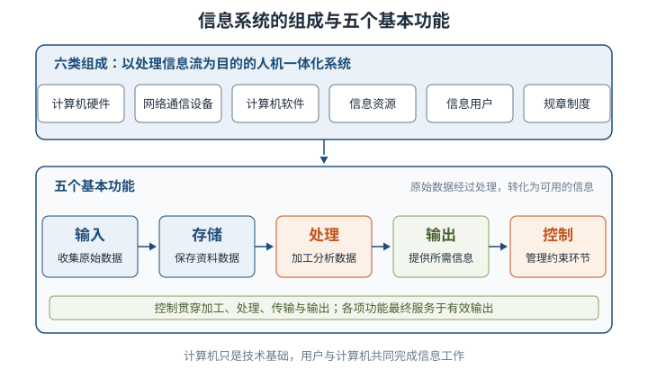
**信息化**以信息资源开发利用为核心，以网络、通信等技术为依托，不只是设备更新，也会推动组织流程、管理方式乃至生产关系变化。
#### 3.1.2 诺兰模型：信息系统发展的六阶段

⭐【高频考点】诺兰模型把组织从手工信息系统向计算机信息系统的发展概括为六个阶段，顺序不可颠倒。
| 阶段 | 核心特征 | 识别关键词 |
| --- | --- | --- |
| 1 初始 | 少量采购、少数人使用，多用于报表统计 | 常从财务部门开始 |
| 2 传播 | 应用与投入快速增长，但缺乏统一规划 | 冗余、不一致、难共享、效率不高 |
| 3 控制 | 管理者开始整体控制，强调组织协调 | 领导小组、数据库技术、信息孤岛 |
| 4 集成 | 重新规划，建立基础数据库和统一系统 | 集中式 DB、硬件与预算迅速增长 |
| 5 数据管理 | 统一数据平台、管理体系和信息管理平台 | 数据成为资源、整合共享 |
| 6 成熟 | IT 与管理过程结合，满足各层次需求 | 内外部资源整合、支持决策 |
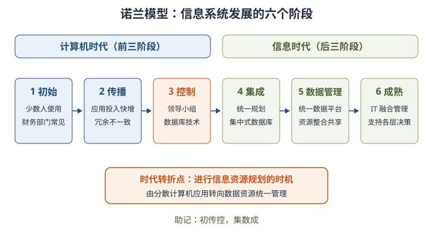

⭐【易错】前三阶段具有**计算机时代**特征，后三阶段具有**信息时代**特征；转折点是进行**信息资源规划**的时机，不是「购买更多计算机」。

> 助记：初传控，集数成；前三计算机，后三信息时代。
#### 3.1.3 信息系统分类与综合性系统

五类传统信息系统不是彼此取代，而是可并存、融合、共同发展。判断类型时先看**服务对象、问题类型和输出用途**。
| 类型 | 通俗定位 | 主要对象与问题 | 典型输出 |
| --- | --- | --- | --- |
| TPS/DPS 业务处理系统 | 把日常业务记准、算快 | 作业层、高度结构化事务 | 订单、台账、发票、业务报表 |
| MIS 管理信息系统 | 把各部门信息汇总用于管理 | 各管理层，侧重企业内部信息 | 计划、控制、预测和分析报告 |
| DSS 决策支持系统 | 用数据和模型帮人比较方案 | 半结构化、非结构化决策 | 模拟、预测、备选方案分析 |
| ES 专家系统 | 用专家知识与推理模仿专家 | 特定领域的复杂、经验性问题 | 诊断、建议及解释 |
| OAS 办公自动化系统 | 把办公信息处理自动化 | 数据、文字、声音、图形、图像 | 公文、邮件、日程、会议与档案 |
| 综合系统 | 管理边界 | 一句话例子 |
| --- | --- | --- |
| ERP 企业资源规划 | 集成企业内外部资源与进销存、生产、财务等 | 统一协调订单、物料、生产和资金 |
| WMS 仓储管理系统 | 库位、收发料、盘点、批次与库龄 | 扫码入库并指定货位，按先进先出拣货 |
| MES/SFC 制造过程管理系统 | 生产过程、工艺、设备与现场执行 | 跟踪工单到工序，采集设备与质量数据 |
| PDM 产品数据管理 | 研发物料、BOM、工程变更与协同研发 | 管理图纸版本和设计变更影响 |
举例：ERP 决定「要生产什么、需要哪些资源」，MES 管「现场怎样按工单生产」，WMS 管「物料放在哪里、怎样出入库」，PDM 管「产品设计数据哪个版本有效」。
#### 3.1.4 信息系统生命周期

⭐【重点】生命周期四阶段：**产生 → 开发 → 运行 → 消亡**。开发阶段又分**总体规划、系统分析、系统设计、系统实施、系统验收**。
| 阶段 | 主要工作 | 必记产物或判断 |
| --- | --- | --- |
| 产生 | 概念产生、需求调研与分析 | 需求分析报告 |
| 开发—总体规划 | 明确目标、总体架构、组织流程、实施计划、技术规范 | 服务企业总体目标，是开发起始阶段 |
| 开发—系统分析 | 分析组织、业务流程、数据与数据流程 | ⭐ 为设计提供**逻辑模型** |
| 开发—系统设计 | 架构、数据库、流程、模块、安全控制等设计 | 形成可实施的方案 |
| 开发—系统实施 | 编码、部署，把设计文本变成运行系统 | 用户参与尤其重要 |
| 开发—系统验收 | 试运行并检验性能、功能与用户友好性 | 验收后正式移交用户 |
| 运行 | 实际使用、质量检验与系统维护 | 长时间运行是质量试金石 |
| 消亡 | 更新改造、功能扩展、报废重建 | 建设初期就应考虑条件、时机和成本 |
运行维护分为**排错性、适应性、完善性、预防性**四类。通常运行初期前两类较多，后期后两类较多；不要误认为「验收即生命周期结束」。

> 助记：产生开发运行亡；开发细看规分设实施验。
#### 3.1.5 信息系统建设原则
| 原则 | 核心要求 | 易错提醒 |
| --- | --- | --- |
| 高层管理人员介入 | 从概念到运行给予决策、指导及资源支持 | 介入不等于亲自编程；CIO 是典型体现 |
| 用户参与开发 | 核心用户全过程、深度参与 | ⭐ 核心用户是实际使用者，不只是单位领导 |
| 自顶向下规划 | 先总体规划，保证信息一致性 | 不能代替子系统详细设计 |
| 工程化 | 用规范过程、方法和文档保证可维护、可扩展 | 不是「做出来能用就行」 |
| 其他原则 | 创新性、整体性、发展性、经济性 | 分别体现先进、完整、超前、实用 |
举例：让收费窗口人员从需求讨论到试运行都参与，比只在验收时请领导签字更符合「用户参与开发」。
#### 3.1.6 信息系统开发方法
| 方法 | 核心思想 | 适用情形与注意点 |
| --- | --- | --- |
| 结构化方法 | 生命周期分阶段，自顶向下、结构化与模块化 | 业务成熟定型；目标清晰、阶段程式化、文档规范化 |
| 原型法 | 快速做模型，让用户试用并反复修改扩充 | 需求不清、需要尽早体验；不是省略需求分析 |
| 面向对象方法 | 用对象构造问题域模型，运用封装、继承、多态 | 对象归纳为类，组织类等级与类库，强调复用 |
| 面向服务方法 | 将接口定义与实现解耦，以业务服务支持互操作 | 跨构件、跨系统复用与共享，快速响应变化 |
原型循环：**基本需求 → 快速原型 → 用户试用评价 → 修改扩充 → 满意系统**。结构化方法适合银行、电信、商品零售等业务相对成熟的系统。
### 3.2 业务处理系统（TPS）
#### 3.2.1 概念与地位

TPS 又称电子数据处理系统（EDP），针对财会、销售、库存等具体事务，完成记录、传票、记账、统计、分类和报表工作。它服务于**作业层**，处理预先确定、高度结构化的任务。

⭐【重点】TPS 是其他信息系统的**信息产生器**，也是连接企业与外部环境的**桥梁**。订票、存取款、出入库等 TPS 故障可能直接扰乱组织运行，不能因其「最初级」而误认为不重要。

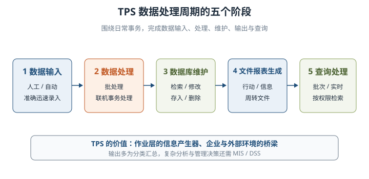
#### 3.2.2 TPS 的五项功能
| 功能 | 核心内容 | 记忆要点 |
| --- | --- | --- |
| 数据输入 | 人工、自动或二者结合，把原始数据准确迅速录入 | 输入常是信息处理瓶颈 |
| 数据处理 | 批处理或联机事务处理 | ⭐ 是否立即更新数据库 |
| 数据库维护 | 检索、修改、存入、删除 | 保证数据及时、正确反映经营状况 |
| 文件报表生成 | 行动文件、信息文件、周转文件及业务日志 | 多为分类汇总，较少分析概括 |
| 查询处理 | 批次或联机实时查询 | 按用户级别授予访问权限 |
常见自动输入设备包括 POS 终端、OCR、ATM、扫描仪、语音识别系统和触摸屏。TPS 的报表通常不能直接支持中高层复杂决策，需要 MIS/DSS 进一步分析。

⭐【高频考点】批处理与联机事务处理对比：
| 对比项 | 批处理 | 联机事务处理（OLTP） |
| --- | --- | --- |
| 数据积累 | 积累一段时间后定期成批处理 | 事务产生后立即处理，无需积累成批 |
| 数据更新 | 周期性更新，间隔期主文件可能过时 | 文件和数据库立即更新 |
| 查询 | 难满足实时查询 | 可即时响应查询 |
| 成本与保障 | 大量处理较经济 | 成本较高，需授权、容错与冗余 |
| 典型场景 | 工资、银行日终账目、定期报表 | 证券交易、航空订票、实时转账 |
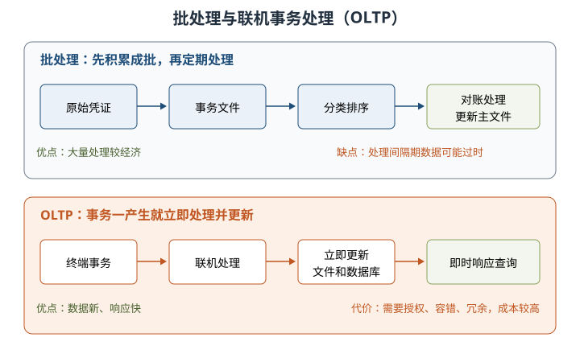

三类输出文件：**行动文件**使接收者可办理事务，如采购订单；**信息文件**证明业务已发生，如订单确认书；**周转文件**送出后还需返回，如多联发票及付款凭证。

> 助记：行动催你办，信息告诉你已办，周转出去还要还。
#### 3.2.3 特点与开发

TPS 面向高度结构化问题，适合采用结构化生命周期法；同行业事务相似，常可购买商品化产品并做少量二次开发。其性能还会直接影响客户服务与组织形象。
### 3.3 管理信息系统（MIS）
#### 3.3.1 概念、总体结构与开闭环

MIS 在 TPS 基础上引入管理方法，对企业整体信息进行处理，用于预测、控制、计划和辅助全面管理，是高度集成的人机信息系统。

⭐【重点】四大部件：**信息源、信息处理器、信息用户、信息管理者**。信息源提供数据，处理器完成加工，用户使用信息，管理者负责组织协调。
| 结构 | 决策过程中是否持续收集并反馈信息 | 例子 |
| --- | --- | --- |
| 开环 | 不依据执行过程的新信息调整本次决策，事后评价供以后参考 | 月初固定排产，中途不调整 |
| 闭环 | 不断收集反馈并调整决策，最终决策可能不同于最初设想 | 根据销量和库存动态调整排产 |
教材概括为：计算机实时处理系统通常属于闭环，批处理系统通常属于开环；但较长决策过程中的批处理也能构成闭环，不能绝对化。

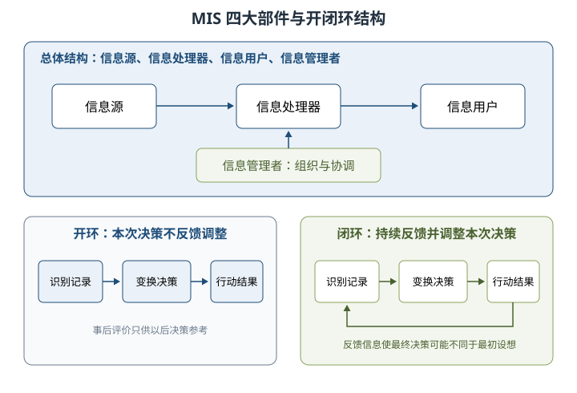
#### 3.3.2 功能结构与金字塔

管理层次通常为**战略计划、管理控制、运行控制**，底部是业务处理；管理职能可包括销售市场、生产、后勤、人事、财务会计、信息处理、高层管理。下层处理量大，上层处理量小，形成纵横交织的金字塔。

⭐【易错】横向综合是**按层**划分子系统，纵向综合是**按条（职能）**划分；纵横综合则可跨层、跨职能组合。

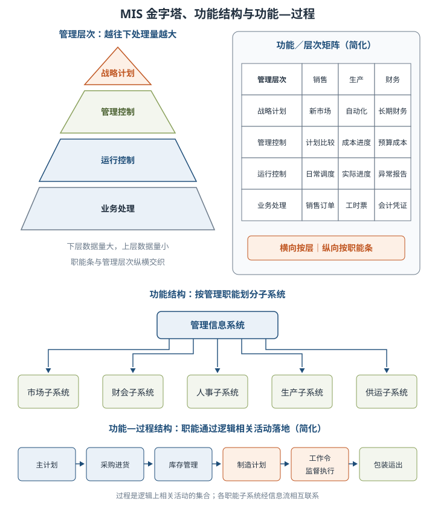

功能结构中的子系统以管理职能命名，而非以计算机设备命名；「过程」是逻辑上相关活动的集合，功能—过程结构用于说明职能如何经由业务流程落地。
#### 3.3.3 七个基本子系统与软件结构
| 子系统 | 核心职能 | 战略层关注示例 |
| --- | --- | --- |
| 销售市场 | 销售、推销、市场分析 | 新市场开发、顾客与竞争者分析 |
| 生产 | 设计、设备、调度、质量、工时 | 加工方法与自动化 |
| 后勤 | 采购、收货、库存、分发 | 自制或外购、分配方案 |
| 人事 | 雇用、培训、考核、工资、离职 | 雇用战略、工资与培训规划 |
| 财务会计 | 资金保障、核算、预算与成本 | 长期财务、税收与预算计划 |
| 信息处理 | 数据处理、设备与程序、信息需求 | 集中或分散、总体架构与规划 |
| 高层管理 | 查询、决策支持、文件与指令 | 企业方向、综合资源和外部信息 |
软件结构可理解为：面向各职能和管理层次的应用软件，建立在公用应用程序、模型库、数据库管理系统及专用/公用数据文件之上，体现共享与集成。
### 3.4 决策支持系统（DSS）
#### 3.4.1 概念、基本模式与结构

> 教材原文：DSS 能帮助决策者利用数据和模型去解决半结构化决策问题和非结构化决策问题，是交互式系统。

⭐【高频考点】DSS 的四条判别标准：以**数据和模型**为主要资源；**支持而不代替**用户决策；面向半结构化、非结构化问题；目标是提高决策**有效性**而非单纯效率。

DSS 从「模型库＋数据库＋人机交互」发展到增加知识库、方法库，再与人工智能、网络结合，形成智能、群体和分布式 DSS。基本模式中管理者处于核心，结合个人知识经验和系统支持，对真实系统进行决策。
| 结构 | 组成 | 识别要点 |
| --- | --- | --- |
| 两库结构 | 数据库子系统、模型库子系统、对话子系统 | 「两库」仍有对话部件，呈三角关系 |
| 基于知识的结构 | 语言系统、知识系统、问题处理系统 | 强调知识表达与问题处理 |
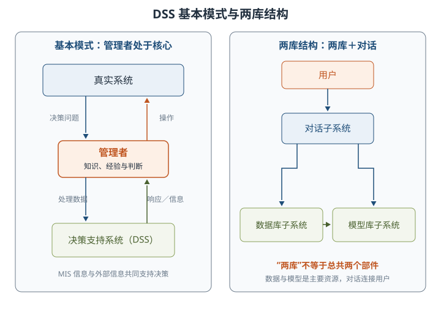
#### 3.4.2 九项功能与系统特点
DSS 的总体功能是**支持各种层次的人们进行决策**，再细分为以下九项具体功能。
| 功能组 | 对应大纲九项功能 | 通俗理解 |
| --- | --- | --- |
| 数据支持 | 整理内部数据；收集外部信息；收集活动反馈 | 给决策者「看清现状」 |
| 模型方法 | 存储管理模型；存储管理数学、统计、运筹方法 | 给决策者「分析工具」 |
| 资源管理 | 对数据、模型、方法查找、变更、增加、删除 | 工具可维护、可复用 |
| 加工交互 | 用模型方法加工数据；人机接口、图形加工与输出 | 支持汇总、预测和 What-if 分析 |
| 分布使用 | 支持分布方式与有效传输 | 异地共享数据、模型和方法 |
DSS 的五个特点：面向决策者；支持半结构化问题；辅助而不替代；随环境和认识动态调整；提倡交互，把人的经验判断与客观信息结合。
#### 3.4.3 数据仓库、数据挖掘与模型管理

作业数据需经**重组和确认**才适合决策。数据仓库与作业层系统分离，数据经提炼、清洗、一致化并载入，支持分析查询；数据字典用于统一数据含义和表示。

⭐【高频考点】数据挖掘四类结果：
| 类型 | 要回答的问题 | 例子 |
| --- | --- | --- |
| 联合 | 哪些事件经常一起发生 | 找出常被同时选修的课程，避免同时排课 |
| 定序 | 事件按什么先后次序出现 | 分析学生多个学期的选课次序 |
| 分类 | 按已知标准把对象归入哪类 | 按学制内或超学制完成学业分组 |
| 聚类 | 依据相似性可自然形成哪些群，并归纳区分规则 | 按兴趣、年龄、经验发现学生群体 |
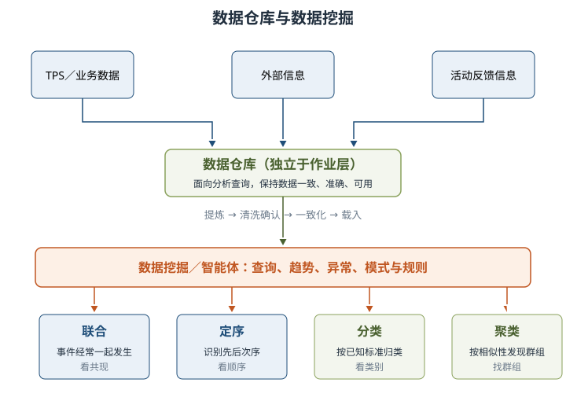

模型建立方法包括**穷枚举法、算法、启发式、模拟法**。启发式是经验规则，适合结构化程度低的问题；模拟用于仿真环境并比较策略变化；模型既有经验模型，也有客观模型。
### 3.5 专家系统（ES）
#### 3.5.1 专家系统与人工智能

> 教材原文：知识＋推理＝系统；传统软件则常表示为「数据结构＋算法＝程序」。

ES 使用特定领域专家的知识和推理过程，解决通常需要资深专家才能处理的高难度问题。其能力来自知识库，知识表示和推理方法提供应用机理；高性能常以**领域较窄、通用性较差**为代价。

人工智能旨在用机器模仿或扩展人的智能，1956 年达特茅斯会议首次提出这一学科方向。主要分支包括专家系统、机器人技术、视觉系统、自然语言处理、学习系统和神经网络。

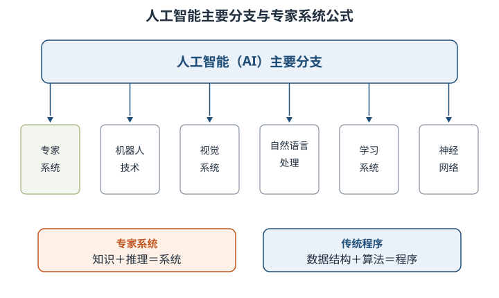
#### 3.5.2 专家系统特点
| 对比项 | 专家系统 | 一般计算机系统 |
| --- | --- | --- |
| 功能 | 解决问题、解释结果、判断与决策 | 主要是解决问题 |
| 处理对象 | 数字与符号 | 以数字处理为主 |
| 问题与知识 | 半结构化、非结构化，可处理不确定知识 | 多为结构化问题和确定知识 |
| 模拟对象 | 人类专家的推理过程 | 常用数学模型模拟问题领域 |
| 结构 | 综合数据库、知识库、推理机三级 | 数据与程序两级 |
| 适用范围 | 特定狭窄领域，依赖启发式知识 | 通用性相对更强 |
六个特点：**超越时间限制、操作成本低廉、易于传递复制、处理手段一致、善于克服难题、适用特定领域**。最后一项是局限，不要错记为「适用于所有领域」。

> 助记：不停、省钱、能复制；一致、克难、领域窄。
#### 3.5.3 组成、推理与求解过程

⭐【重点】ES 一般由**知识库、综合数据库、推理机、知识获取、解释程序、人机接口**组成，知识库与推理机是核心。
| 部件 | 作用 | 关键辨析 |
| --- | --- | --- |
| 知识库 | 存放事实性知识与启发性知识 | 静态知识库，一次推理中保持不变 |
| 综合数据库 | 存放初始状态、中间结果、过程记录、用户回答 | 动态知识库，运行中不断变化 |
| 推理机 | 按控制策略搜索知识并推理 | 与知识库分离，提高模块性和可维护性 |
| 知识获取 | 知识编辑、求精、自学习 | 维护知识一致性、完整性 |
| 解释程序 | 展示推理链、依据、数据和知识 | 回答「为什么、怎样得到结论」 |
| 人机接口 | 连接用户、领域专家和知识工程师 | 转换内部与外部表示形式 |
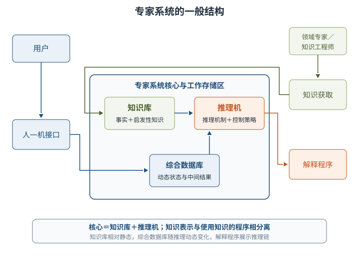
| 推理方式 | 方向与别名 | 适用情形 |
| --- | --- | --- |
| 正向推理 | 条件 → 结论，数据驱动 | 目标解空间很大 |
| 反向推理 | 假设结论 → 验证条件，目标驱动 | 解空间较小 |
| 双向推理 | 正反向同时进行，在中间达到一致 | 常用正向确定假设次序，再反向验证 |
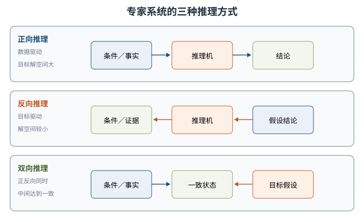

求解可概括为：搜索相关知识 → 形成假设集合 → 排序选优 → 执行方案 → 失败则回溯下一假设 → 成功解决或判定无解。
### 3.6 办公自动化系统（OAS）
#### 3.6.1 概念与四大支柱

OAS 是办公信息处理手段的自动化，强调数据、文字、声音、图形（静态）和图像（动态）的一体化处理。办公室人员包括主管、专业人员、秘书和办事员；越偏高层，沟通与决策工作越集中。

⭐【重点】四大支柱：**计算机技术、通信技术、系统科学、行为科学**。其中**行为科学为主导，系统科学为理论基础**，结合运用计算机技术和通信技术。
#### 3.6.2 三项功能与四类组成
| 业务功能 | 对应系统 | 主要内容 |
| --- | --- | --- |
| 事务处理 | 事务型办公系统 | 文字、日程、文档、报表、数据处理；多机还支持邮件、会议、语音、图像和检索 |
| 信息管理 | 管理型办公系统 | 收集、加工、传递、共享、分析和反馈，连接孤立事务 |
| 辅助决策 | 决策型办公系统 | 基于管理型系统的信息建立模型，综合分析、预测和判断 |
OAS 完整组成包括**计算机设备、办公设备、数据通信及网络设备、软件系统**。软件又分系统软件、专用软件和支持软件；大纲列出组成时不要漏掉通信及网络设备。
### 3.7 企业资源规划（ERP）
#### 3.7.1 概念与三流集成

ERP 由 Gartner Group 于 1990 年提出，是 MRPⅡ 的下一代制造业系统和资源计划系统软件。它集成企业所有资源信息，为决策、计划、控制和经营业绩评估提供平台，也是管理理论和管理思想，不只是一套软件。

⭐【高频考点】企业「三流」是**物流、资金流、信息流**。MRPⅡ 的核心是物流、主线是计划；ERP 的管理重心转向财务，并贯穿财务成本控制，管理范围扩展到整个供需链。

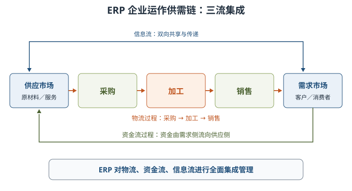
#### 3.7.2 计划层级与 11 个基本模块
| 层级或模块 | 核心问题 | 必记结论 |
| --- | --- | --- |
| 生产预测 | 未来市场需求怎样 | 经营计划、生产计划大纲、MPS 都依赖预测 |
| 销售管理 | 怎样连接市场与客户 | 属于最高层计划范畴之一 |
| 经营计划与生产计划大纲（PP） | 在资源约束下计划多少产量 | PP 承上启下，细化经营计划并指导 MPS |
| 主生产计划（MPS） | 生产什么、多少、何时交货 | 汇总应等同生产计划大纲，是 MRP 依据 |
| 物料需求计划（MRP） | 需要哪些零部件、多少、何时要 | 生产管理核心，分解为自制与采购计划 |
| 能力需求计划（CRP） | 现有能力能否满足 MRP | 核算能力、发现瓶颈 |
| 车间作业计划（PAC） | 工单交给哪个车间、按何优先级执行 | 执行层计划，主流模式包括 JIT |
| 采购与库存管理 | 采购全过程及物料进、出、存 | ERP 基本模块 |
| 质量与设备管理 | 全过程质量与设备寿命周期 | TQM 强调全员质量责任 |
| 财务管理 | 反映、监督经济活动与资金运动 | 渗透全部经济活动 |
| 扩展应用 | CRM、分销资源、供应链、电子商务等 | 也常作为独立产品实施 |
⭐【重点】计划主线：**经营计划 → 生产计划大纲 → MPS → MRP → CRP → PAC**。MRP 展开物料需求，CRP 校验能力，PAC 下达到车间执行，三者不可混淆。

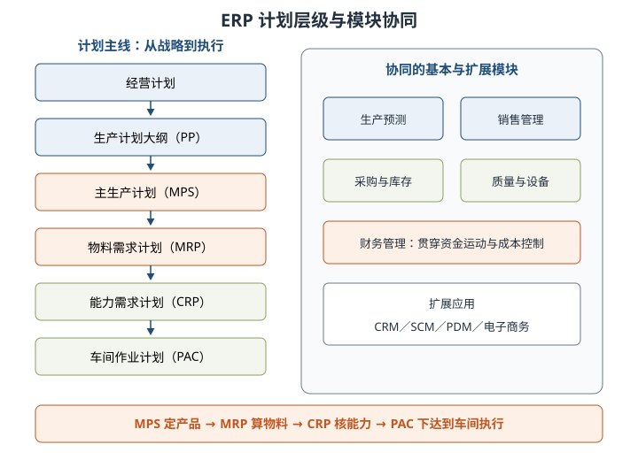
#### 3.7.3 ERP 的功能

ERP 主要提供三类价值：把制造、营销、财务等结合起来支持各层决策；为不同行业提供有针对性的 IT 解决方案；从企业内部供应链扩展到全行业、跨行业供应链协同。PDM 偏研发产品数据，CRM 偏客户关系，均可与 ERP 集成但不是同一管理边界。
### 3.8 典型信息系统架构模型
#### 3.8.1 政府信息化与电子政务

电子政务利用信息技术集成政府管理和服务职能，在网络上优化重组组织结构与工作流程，突破时间、空间和部门分隔。三个组成部分是：政府内部电子化办公、政府部门间共享与实时通信、政府与居民双向信息交流。

⭐【重点】三个行为主体形成五类互动，而不是只有 G2G、G2B、G2C 三类。
| 互动方向 | 常见简称 | 例子 |
| --- | --- | --- |
| 政府 ↔ 政府 | G2G | 公文交换、人口等基础信息共享 |
| 政府 → 企业 | G2B | 发布法规、颁发许可证 |
| 政府 → 居民 | G2C | 办事指南、证件与公共服务 |
| 企业 → 政府 | B2G | 纳税、报表、投标、政策建议 |
| 居民 → 政府 | C2G | 缴费、申报、参政议政、报警 |
电子政务四阶段：**网上发布静态信息 → 政府与用户单向互动 → 双向互动 → 网上事务处理**。判断关键是能否在线提交，以及是否最终在线完成整个业务。

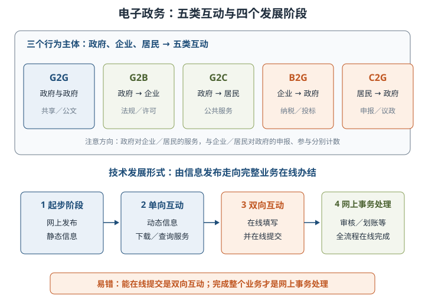

应用可归纳为六类：面向社会、政府部门之间、部门内部一般应用、内部核心数据应用、政府电子化采购、电子社区。
#### 3.8.2 企业信息化与电子商务

企业信息化是信息技术和信息资源由局部到全局、由战术到战略向企业渗透的过程，表现为生产自动化、管理网络化、决策智能化和商务电子化，根本目的在于提高竞争力。
| 规划层面 | 核心任务 | 形成依据 |
| --- | --- | --- |
| 企业战略 | 分析战略、供应链、管理模式与 IT 驱动因素 | 战略与信息技术融合 |
| 业务运作 | 找出关键驱动力、关键流程和业务需求 | 决定未来系统主要功能 |
| 管理运作 | 设计辅助流程、管理模式和信息技术体系 | 支撑组织科学高效运行 |
企业战略数据模型分为**数据库模型**与**数据仓库模型**：前者描述日常事务数据及关系，是基础；后者描述高层决策所需信息及关系。
| 企业信息化方法 | 核心抓手 |
| --- | --- |
| 业务流程重构 | 对组织结构和工作方法作彻底、根本性重新设计 |
| 核心业务应用 | 围绕企业最关键、最有竞争力的业务应用 IT |
| 信息系统建设 | 以信息系统建设作为普遍性的实施重点 |
| 主题数据库 | 面向业务主题和核心业务，减少部门分割与信息孤岛 |
| 资源管理 | 采用 ERP、SCM 等整合资源 |
| 人力资本投资 | 对知识型员工投资，适合咨询、软件等知识密集企业 |
信息化还需与**技术创新、管理创新、制度创新**协同，通常全面规划、分步实施。大纲另列「电子商务的概念和标准」，但本章教材正文未展开，列入第五板块补充。
## 三、重点与易错点
| # | 考点 | 必须记住的结论 | 易错提醒 |
| --- | --- | --- | --- |
| 1 | 信息系统组成 | 硬件、网络通信、软件、信息资源、用户、规章制度 | 不等同于计算机或软件 |
| 2 | 五功能 | 输入、存储、处理、输出、控制 | 控制贯穿各环节，输出是最终服务目标 |
| 3 | 诺兰模型 | 初始、传播、控制、集成、数据管理、成熟 | 「数据管理」与「成熟」不可倒序 |
| 4 | 两个时代 | 前三计算机时代，后三信息时代 | 转折是信息资源规划，不是集成阶段本身 |
| 5 | 生命周期 | 产生、开发、运行、消亡；开发含规分设实施验 | 系统分析出逻辑模型，设计出实施方案 |
| 6 | 用户参与 | 实际使用者是核心用户，全过程深度参与 | 领导签字不等于核心用户参与 |
| 7 | 自顶向下 | 总体规划保证信息一致性 | 不代替详细设计 |
| 8 | TPS 地位 | 作业层信息产生器、内外部桥梁 | 初级不等于不重要 |
| 9 | 批处理与 OLTP | 前者定期成批，后者立即处理更新 | 实时性越高通常授权容错成本越高 |
| 10 | 三类文件 | 行动、信息、周转 | 周转文件要返回，行动文件促发行动 |
| 11 | MIS 开闭环 | 闭环在执行中持续反馈并调整 | 批处理并非绝对不能构成闭环 |
| 12 | MIS 综合 | 横向按层，纵向按职能条 | 两个方向最易互换 |
| 13 | DSS 目标 | 支持而不代替，提高有效性 | 不是自动替领导做最终决定 |
| 14 | DSS 两库 | 数据库、模型库，另有对话子系统 | 两库结构不等于总共两个部件 |
| 15 | 数据挖掘 | 联合看共现，定序看先后，分类按标准，聚类找群组 | 分类与聚类最易混 |
| 16 | ES 核心 | 知识库＋推理机；综合数据库是动态工作存储器 | 知识库静态不等于永远不可修改 |
| 17 | 推理方向 | 正向数据驱动适合解空间大，反向目标驱动适合解空间小 | 双向不是简单只做两遍 |
| 18 | OAS 支柱 | 行为科学主导，系统科学为理论基础 | 主导不是计算机技术 |
| 19 | ERP 计划 | MPS 定产品数量交期，MRP 算物料，CRP 核能力，PAC 执行 | 不要把 CRP 当成物料展开 |
| 20 | 电子政务 | 三主体五方向，四阶段终于网上事务处理 | 双向互动不等于全流程网上办结 |
## 四、练习与真题

以下为自编单选模拟题，每题只有一个最符合题意的选项。答案与解析集中在全章最后。
**1.** 某信息系统能够自动校验录入数据、限制越权操作并监控报表输出，这最直接体现其哪项基本功能？

A. 输入  B. 存储  C. 控制  D. 处理
**2.** 按诺兰模型，企业开始成立领导小组、采用数据库技术，并着手解决数据共享问题，通常处于哪个阶段？

A. 传播  B. 控制  C. 集成  D. 数据管理
**3.** 在信息系统开发阶段中，为系统设计提供逻辑模型的是哪项工作？

A. 总体规划  B. 系统分析  C. 系统实施  D. 系统验收
**4.** 关于「用户参与开发原则」，下列说法最正确的是哪项？

A. 只需用户单位领导参加验收  B. 核心用户应全过程深度参与  C. 用户只参与系统实施  D. 用户参与会取代开发人员
**5.** 每周将员工考勤数据汇总后统一计算工资，最适合采用哪种数据处理方式？

A. 批处理  B. 联机事务处理  C. 双向推理  D. 数据挖掘
**6.** 某生产系统在排产执行中持续收集销量和库存，并据此调整本次排产方案，该 MIS 结构属于哪种？

A. 开环  B. 闭环  C. 两库  D. 批处理开环且不能反馈
**7.** 下列哪项最能准确描述 DSS 的作用？

A. 替代管理者作出最终决定  B. 只处理高度结构化业务  C. 用数据和模型支持半结构化决策  D. 主要追求事务处理效率
**8.** 从客户交易数据中发现「购买甲商品的人常同时购买乙商品」，属于数据挖掘的哪类结果？

A. 联合  B. 定序  C. 分类  D. 聚类
**9.** 医疗诊断专家系统先假设某种疾病成立，再逐项验证症状和检查条件，采用的是哪种推理？

A. 正向推理  B. 反向推理  C. 数据驱动  D. 穷举输入
**10.** 办公自动化系统四大支柱中，处于主导地位的是哪项？

A. 计算机技术  B. 通信技术  C. 系统科学  D. 行为科学
**11.** ERP 中负责根据 MPS 推导零部件和材料需求数量、需求时期的是哪项？

A. MRP  B. CRP  C. PAC  D. WMS
**12.** 居民在网上下载并填写报税表后又在线提交，但后续审核和退税仍线下完成，这主要属于电子政务的哪个阶段？

A. 起步阶段  B. 单向互动  C. 双向互动  D. 网上事务处理
## 五、疑问与查漏补缺
| 待补内容或易误读处 | 本章核对结果 | 后续处理 |
| --- | --- | --- |
| 电子商务的概念和标准 | 大纲 2.8.2 明确要求，但 3.8.2 教材正文止于企业信息化方法，未展开电子商务及标准 | 另查电子商务权威资料，补充概念、模式、相关标准体系 |
| 中国政府信息化策略和历程 | 大纲 2.8.1 单列要求，本章主要讲电子政务一般概念、内容和应用领域 | 补充我国政策阶段、重大工程与演进时间线 |
| 电子政务建设过程模式和技术模式 | 教材讲四个发展阶段及六项应用，不等于完整建设模式与技术模式 | 与第12章信息系统架构设计联动补充 |
| PDM、CRM 在企业中的应用 | 教材 3.1.3、3.7 仅给边界和扩展模块，案例应用较略 | 结合实践案例理解研发数据集成、客户营销服务集成 |
| OLTP 缩写 | 提取文本个别位置出现 OLIP 形近混排 | 统一记为 OnLine Transaction Processing，即 OLTP |
| OAS 辅助决策段用语 | 文中出现「经理型办公系统」提供信息的表述，上下文三类名称为事务型、管理型、决策型 | 按上下文理解为管理型系统提供决策信息基础 |
| 与其他章节衔接 | 结构化、原型、面向对象在第5章展开；数据仓库与数据库在第6章深化；电子政务架构在第12章深化 | 本章先记定义、边界和阶段，后续补方法细节与架构落地 |
## 六、参考答案
**1.** **C**。校验、权限约束与环节监控属于控制功能。
**2.** **B**。领导小组、数据库技术和整体控制是控制阶段的典型标志。
**3.** **B**。系统分析以业务流程等分析为基础，输出逻辑模型供系统设计使用。
**4.** **B**。核心用户主要是实际使用者，应全过程、深度参与开发。
**5.** **A**。工资数据可积累成批并定期处理，无需每次考勤后立即更新。
**6.** **B**。执行过程中持续反馈并调整本次决策是闭环结构。
**7.** **C**。DSS 以数据和模型支持半结构化、非结构化决策，支持而不代替人。
**8.** **A**。联合发现事件共现关系；定序关注先后，分类与聚类关注归组。
**9.** **B**。先提出结论假设再验证条件是目标驱动的反向推理。
**10.** **D**。四大支柱中行为科学为主导，系统科学为理论基础。
**11.** **A**。MRP 将最终产品计划展开为自制件、采购件的数量与时间计划。
**12.** **C**。能够在线提交属于双向互动；审核、退税未在线完成，尚未达到全流程网上事务处理。
