# 第4章 信息安全技术基础知识

- 教材位置：`02.系统架构设计师第二版-教材.pdf` PDF 第 155～184 页（书页 145～174）
- 复习状态：已完成
- 复习日期：2026-11-06
- 本章地位：上午综合知识的稳定出题区，密码算法、密钥管理、访问控制、数字签名、网络攻击与防御、安全等级与风险评估均为高频考点；本章也是第 18 章「安全架构设计理论与实践」的概念地基。

## 一、大纲考点

大纲科目 1 第 3 部分「信息安全技术基础知识」（书页 27～31）与教材本章 4.1～4.8 一一对应：

| 大纲条目 | 大纲要求（考点） | 教材小节 |
| --- | --- | --- |
| 3.1 信息安全基础知识 | 信息安全定义、5 个基本要素、范围（设备/数据/内容/行为安全）；信息存储安全；网络安全（安全漏洞、安全威胁、安全措施） | 4.1.1～4.1.3 |
| 3.2 信息系统安全的作用与意义 | 中央网络安全与信息化领导小组职能；国家对信息安全的要求和标准 | 4.2 |
| 3.3 信息安全系统的组成框架 | 技术体系（基础安全设备、网络、操作系统、数据库、终端）；组织机构体系（决策/管理/执行层）；管理体系（法律/制度/培训） | 4.3.1～4.3.3 |
| 3.4 信息加解密技术 | 数据加密内涵与保密通信模型；对称算法 DES、IDEA、AES；非对称算法原理与 RSA | 4.4.1～4.4.3 |
| 3.5 密钥管理技术 | 密钥使用控制（密钥标签、控制矢量）与分配方法；公钥管理（公开发布、公用目录表、公钥管理机构、公钥证书 CA）；公钥加密分配单钥体制密钥 | 4.5.1～4.5.3 |
| 3.6 访问控制及数字签名技术 | 访问控制基本模型（主体、客体、控制策略）与实现技术（矩阵、ACL、能力表、授权关系表）；数字签名定义和条件、身份认证分类、对称/公开密钥签名原理 | 4.6.1～4.6.2 |
| 3.7 信息安全的抗攻击技术 | 密钥分类（DK、KK）与生成三因素；DoS/DDoS 及防御；ARP、DNS、IP 欺骗；端口扫描分类；强化 TCP/IP 堆栈（SYN 风暴、ICMP、SNMP）；基于网络/主机的漏洞扫描 | 4.7.1～4.7.6 |
| 3.8 信息安全的保障体系与评估方法 | 安全保护能力 5 个等级；安全法规制度、安全保密管理及协议（SSL、PGP、IPSec）、数字水印；安全风险管理、风险评估要素及关系、脆弱性评估方法 | 4.8.1～4.8.2（部分未展开，见板块五） |

## 二、知识点笔记

### 4.1 信息安全基础知识

**1. 信息安全的 5 个基本要素** ⭐【重点】【高频考点】

> 教材原文：信息安全包括 5 个基本要素：机密性、完整性、可用性、可控性与可审查性。

| 要素 | 一句话含义 | 通俗理解（以一份纸质合同类比） |
| --- | --- | --- |
| 机密性 | 信息不暴露给未授权的实体或进程 | 合同锁进保险柜，只有签约双方能看 |
| 完整性 | 只有被允许的人才能修改数据，且能判别是否被篡改 | 合同盖骑缝章，换一页立刻被发现 |
| 可用性 | 授权实体在需要时可访问数据，攻击者不能占光资源阻碍工作 | 需要用合同的时候随时取得出来 |
| 可控性 | 可以控制授权范围内的信息流向及行为方式 | 合同只准复印给指定的人，不准再转抄 |
| 可审查性 | 对出现的信息安全问题提供调查的依据和手段 | 谁借过、谁复印过都有签收记录可查 |

> 助记：「机、完、可、控、审」——机密、完整、可用、可控、可审查；注意「可控性、可审查性」是 CIA 三要素之外多出的两个，选择题常在这里设陷阱。

**2. 信息安全的范围（4 类）** ⭐【重点】

| 范围 | 定位 | 三个方面 |
| --- | --- | --- |
| 设备安全 | 信息系统安全的物质基础、首要问题 | 稳定性（不出故障）、可靠性（正常执行任务）、可用性（可正常使用） |
| 数据安全 | 防止数据被未授权泄露、篡改、毁坏 | 秘密性、完整性、可用性 |
| 内容安全 | 政治、法律、道德层次的要求 | 政治健康、符合法律法规、符合道德规范 |
| 行为安全 | 服务最终通过行为提供给用户 | 行为的秘密性、完整性、可控性（偏离预期能发现、控制、纠正） |

举例：设备安全管「机器别坏」，数据安全管「数据别丢别改别泄密」，内容安全管「内容合法健康」，行为安全管「系统做的事符合预期、能纠正」——四层由硬到软、由静到动。

**3. 信息存储安全（4.1.2）**

- 包括：信息使用的安全、系统安全监控、计算机病毒防治、数据加密和防止非法攻击等。
- 用户标识与验证（访问控制的基础）两类方法：基于人的物理特征（签名、指纹、语音识别）；基于特殊安全物品（智能 IC 卡、磁条卡）。
- 用户存取权限限制两种方法：**隔离控制法**（物理隔离、时间隔离、逻辑隔离、密码技术隔离）与**限制权限法**（用户分类管理、目录文件权限控制、临时文件加密并及时清除）。
- 系统安全监控：建立审计系统和日志管理系统，监控进程与登录用户、检查文件授权与修改、检查配置与口令文件、检查登录历史。
- 计算机病毒特点 ⭐【高频考点】：**隐蔽性、传染性、潜伏性、触发性、破坏性**；防治靠制度：补丁与杀毒升级、敏感文件检查、高强度口令、每天备份、防火墙、物理隔离等。

**4. 网络安全（4.1.3）**

- 安全隐患表现在：物理安全性、软件安全漏洞（特权软件带恶意代码）、不兼容使用安全漏洞（软硬捆绑引入）、未选择合适的安全哲理（安全策略未开启）。
- 网络安全威胁 5 类 ⭐【高频考点】：非授权访问（假冒、越权）、信息泄露或丢失（窃听、流量分析、隐蔽隧道）、破坏数据完整性（删改插重发）、拒绝服务攻击、利用网络传播病毒。
- 安全措施目标 5 项：**访问控制**（有权做事）、**认证**（身份与声称一致）、**完整性**（收发一致）、**审计**（事后可证实，即不可抵赖性）、**保密**（不被窃听）。

### 4.2 信息系统安全的作用与意义

- 2010 年「震网」APT 攻击物理摧毁伊朗铀浓缩离心机，标志黑客攻击从窃取信息的「软打击」上升到毁坏设备的「硬摧毁」。
- 2014 年中央成立网络安全与信息化领导小组；核心论断：**没有网络安全就没有国家安全，没有信息化就没有现代化**。

### 4.3 信息安全系统的组成框架

> 教材原文：信息系统安全系统框架通常由技术体系、组织机构体系和管理体系共同构建。

| 体系 | 组成 | 要点 |
| --- | --- | --- |
| 技术体系 | 基础安全设备、计算机网络安全、操作系统安全、数据库安全、终端设备安全 | 密码芯片/加密卡；防火墙、VPN、加密传输；标识鉴别、最小特权、可信通路、安全审计等 |
| 组织机构体系 | 机构、岗位、人事机构 | 机构分决策层、管理层、执行层；人事机构负责素质教育、业绩考核、安全监管 |
| 管理体系 | 法律管理、制度管理、培训管理 | 管理是信息系统安全的灵魂，培训管理是确保安全的前提 |

> 助记：「三分技术，七分管理」；机构三层记「决—管—执」，管理三件记「法—制—训」。

### 4.4 信息加解密技术

**1. 保密通信模型（4.4.1）** ⭐【重点】

密码学 = 密码编码学（设计密码体制）+ 密码分析学（破译密码）。发送端用加密算法 E 和密钥 K 把明文 P 变成密文 **C=E(K,P)**，接收端用解密算法 D 和密钥 K 还原 **P=D(K,C)**。

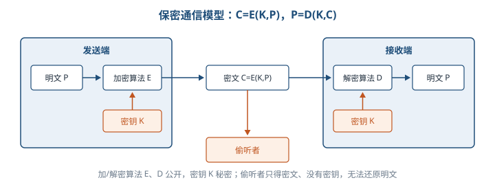

- 加/解密函数 E、D 是**公开**的，密钥 K 是**秘密**的；偷听者只有密文没有密钥，无法读懂。
- 【易错】**无条件安全**（理论不可破解）指密文不含足以确定明文的信息；现实中几乎所有密码体制都不是理论不可破解的，追求的是给定计算费用下**计算上安全**。

**2. 对称密钥加密算法（4.4.2）**：加密密钥 = 解密密钥，又称共享密钥算法。

| 算法 | 分组长度 | 密钥长度 | 轮数/要点 |
| --- | --- | --- | --- |
| DES（1977） | 64 位 | 56 位（IBM 原 Lucifer 用 128 位） | 初始置换 → 16 轮替代与换位 → 逆初始置换 |
| 三重 DES | 64 位 | 两把密钥，有效 112 位 | EDE：K1 加密 → K2 解密 → K1 加密，耗时约 3 倍 |
| IDEA（1990） | 64 位 | 128 位 | 8 轮迭代，可软硬件实现，比 DES 快 |
| AES（2002 标准） | 128 位分组 | 128 / 192 / 256 位 | Rijndael 算法胜出，全球免版税，可软硬件实现 |

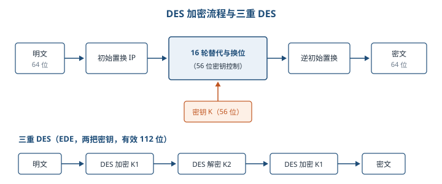

- 为什么三重 DES 不用两重 DES？⭐【易错】两重 DES 对**中间相遇攻击**极为脆弱；三把密钥 168 位被认为超过实际需要，故第 1、3 层共用 K1，有效长度 112 位。
- 举例：DES 像「同一把钥匙开锁和上锁」的保险箱，双方必须事先安全地拿到同一把钥匙——这就是后面密钥分配要解决的问题。

**3. 非对称密钥加密算法（4.4.3）** ⭐【重点】【高频考点】

1976 年 Diffie 和 Hellman 提出公钥加密思想。公钥 E、私钥 D 需满足：D(E(P))=P；不能由 E 导出 D；选择明文攻击不能破解 E。

- **公钥加密、私钥解密 → 保密通信；私钥加密、公钥解密 → 数字签名**（方向用反是常见错误）。
- RSA 密钥生成：选两个大素数 p、q；n=pq，z=(p-1)(q-1)；选 d 与 z 互质；选 e 使 ed≡1(mod z)。**公钥 (e,n)，私钥 (d,n)**；加密 C=P^e mod n，解密 P=C^d mod n。
- RSA 安全性基于**大整数分解的困难性**：分解出 n=pq 就能推出私钥。
- 举例：教材小例 p=3、q=11，则 n=33、z=20，取 d=7、e=3（3×7=21≡1 mod 20）。明文 P=2：加密 C=2³ mod 33=8；解密 8⁷ mod 33=2097152 mod 33=2，还原成功。

### 4.5 密钥管理技术

**1. 对称密钥的使用控制与分配（4.5.1）**

- 密钥分配要解决两个问题：引入自动分配机制提高效率；尽量减少系统中驻留的密钥量。
- 使用控制两种技术：**密钥标签**（如把 DES 的 8 个校验位当标签，前 3 位表示主/会话密钥、加密、解密，长度太受限）；**控制矢量**（字段长度可变，KDC 生成密钥时加入，CV 经杂凑后与主密钥异或，用于加密会话密钥，用户须凭共享主密钥和控制矢量才能恢复会话密钥）。
- 共享密钥 4 种获取方式：A 选好物理送 B；第三方选好物理分送；用已有密钥加密新密钥传送；**KDC 经保密信道分别分发**（最常用）。前两种称人工发送；N 个用户两两通信需 **N(N-1)/2** 个共享密钥。

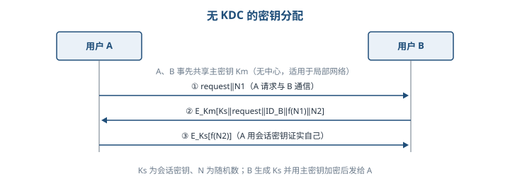

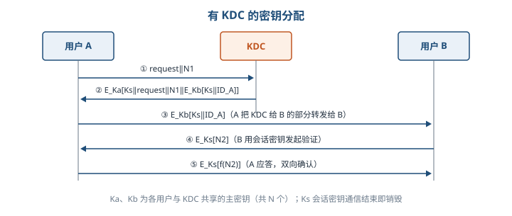

- ⭐【高频考点】KDC 方式下，会话密钥仍是 N(N-1)/2 个且**通信结束立即销毁**，但**主密钥只需 N 个**（每个用户与 KDC 共享一个），可物理分发。
- 用户多、分布广时用**分层 KDC**（本地 KDC + 全局 KDC）：减少主密钥分布，并把虚假 KDC 的危害限制在局部。
- 会话密钥更换越频繁越安全，但增加网络负担与延迟，有效期需权衡。

**2. 公钥加密体制的密钥管理（4.5.2）** ⭐【高频考点】

| 方式 | 做法 | 主要缺陷 |
| --- | --- | --- |
| 公开发布 | 用户广播自己的公钥（如 PGP 附在消息上） | 任何人都能伪造公钥发布，假冒者可解读发向被冒名者的消息 |
| 公用目录表 | 可信管理员维护「用户名+公钥」动态目录，定期公布更新 | 管理员的秘密钥一旦被获取，同样面临假冒 |
| 公钥管理机构 | 机构用自身秘密钥签名应答用户查询，用户可靠知道机构公钥 | 每次通信都求助机构，易成瓶颈，目录易受窜扰 |
| 公钥证书 | CA 用自身秘密钥对 [时戳 T、身份 ID、公钥 PK] 签字形成证书，接收方用 CA 公钥验证 | 无需再联系管理机构，避免集中管理的不便与隐患，是现行主流 |

**3. 公钥加密分配单钥密码体制的密钥（4.5.3）**

公钥算法加密慢，适合用来分配对称会话密钥，而不是直接加密大量数据。

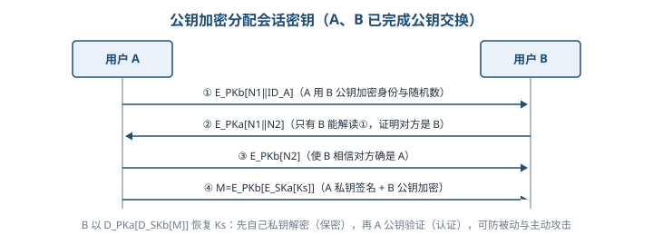

- ①②③ 步用一次性随机数 N1、N2 完成双向身份确认；④ A 发送 M=E_PKb[E_SKa[Ks]]：**用 B 的公钥加密保证只有 B 能读（保密），用 A 的私钥加密保证只有 A 能发（认证）**；B 以 D_PKa[D_SKb[M]] 恢复会话密钥 Ks。
- 该过程保密性和认证性均很强，既可防被动攻击，又可防主动攻击。

### 4.6 访问控制及数字签名技术

**1. 访问控制基本模型（4.6.1）** ⭐【重点】

- 三要素：**主体 S**（主动实体：用户、用户组、终端、进程等）、**客体 O**（被动实体：信息、文件、记录、硬件等）、**控制策略 KS**（主体对客体的操作行为集和约束条件集，即访问规则集）。
- 【易错】主体与客体是**相对角色**：一个实体被访问时就是客体，主动访问时就是主体，二者可相互转化。
- 访问控制包括三方面：**认证**（双向识别）、**控制策略实现**（防非法用户、防越权、防敏感信息泄露）、**审计**（记录管理员授权等行为，形成威慑）。

**2. 访问控制实现技术** ⭐【高频考点】

访问矩阵以主体为行、客体为列，元素是访问方式集合（R 读、W 写、O 管理）。大型系统中矩阵大且多空值，实际不保存整个矩阵：

| 实现技术 | 保存方式 | 优势 | 短板/适用 |
| --- | --- | --- | --- |
| 访问控制表 ACL | 按列：每个客体一张表 | 查某客体的访问权限、删除客体权限方便；最流行 | 查/删一个主体对所有客体的权限要遍历所有表 |
| 能力表 CL | 按行：每个主体一张表 | 查某主体的全部权限方便 | 查某客体的被授权主体困难；现代 OS 少用，分布式系统可与 ACL 结合 |
| 授权关系表 | 只存矩阵非空元素，每行一个（主体，客体，权限） | 按主体排序得能力表效率，按客体排序得 ACL 效率 | 安全数据库系统常用 |

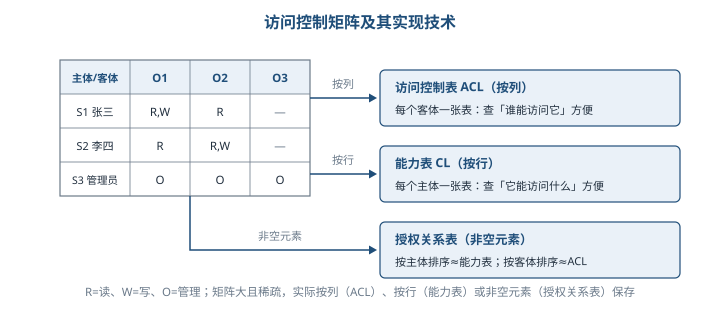

> 助记：「ACL 围着资源转（列），能力表跟着用户走（行），授权关系表两头兼顾（排序定效率）」。

**3. 数字签名（4.6.2）** ⭐【重点】【高频考点】

A 向 B 发送签名消息 P 要达到：B 能验证 P 确实来自 A（**认证**）；A 事后不能否认（**不可抵赖**）；B 不能编造或改变 P（**完整性**）。

可用数字签名的 5 个条件：签名可信、不可伪造、不可重用（不能移到别的文件上）、签名后文件不可改变、不可抵赖。

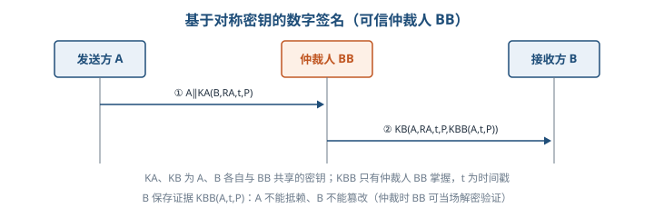

- 对称密钥签名必须引入**可信仲裁人 BB**：A、B 分别与 BB 共享密钥，BB 用只有自己掌握的密钥生成签名证据 K_BB(A,t,P)；B 保存证据，A 无法抵赖、B 无法篡改（仲裁时 BB 可当场解密验证）。

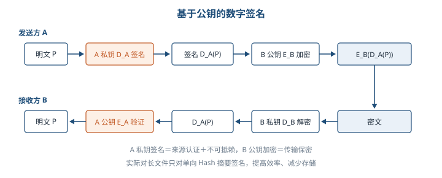

- 公钥签名：A 用自己的**私钥** D_A 签名，再用 B 的**公钥** E_B 加密；B 用自己的私钥解密后，保留 D_A(P)，随时可用 A 的公钥验证来源。A 若否认，B 出示 D_A(P) 并用 A 公钥解出 P 即可证明；B 若篡改，则拿不出与新内容对应的签名。
- 【高频】长文件直接公钥签名效率太低，实际与**单向 Hash 函数**结合：**只对文件的 Hash 摘要签名**，速度快，签名与文件可分开保存，存储量也大大降低。

### 4.7 信息安全的抗攻击技术

**1. 密钥的选择（4.7.1）** ⭐【高频考点】

- 密钥分两类：**数据加密密钥 DK**（直接加密数据）与**密钥加密密钥 KK**（加密保护其他密钥，使之安全传递）。算法的安全性在于密钥。
- 密钥生成三因素：**增大密钥空间**（N 位密钥空间为 2^N，如 8 位 ASCII 密钥从 4 字节到 8 字节，穷举时间从 1.2 小时增至 58 万年）；**选择强钥**（不用易猜口令）；**密钥的随机性**（可靠随机源或安全伪随机数发生器；要求均匀分布、独立性、不可预测性）。

**2. 拒绝服务攻击与防御（4.7.2）** ⭐【重点】

- DoS：人为或非人为行动使主机硬件/软件失去工作能力，拒绝合法用户服务；两种思路：塞满服务器缓冲区使其不接新请求；用 IP 欺骗迫使服务器复位合法用户连接。
- 传统外部 DoS 四种模式：**消耗资源**（带宽、磁盘、CPU、内存）、**破坏或更改配置信息**、**物理破坏或改变网络部件**、**利用服务程序处理错误使服务失效**（如 LAND）。
- DDoS：先侵入控制一批计算机再同时攻击同一目标，克服了传统 DoS 受网络资源限制、隐蔽性差两大弱点。

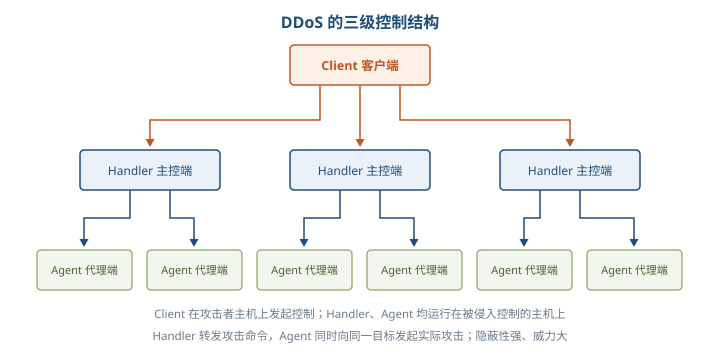

- ⭐【高频考点】三级角色：**Client 客户端**运行在攻击者主机上，发起和控制攻击；**Handler 主控端**运行在被侵入控制的主机上，控制代理端；**Agent 代理端**运行在被侵入控制的主机上，接收主控端命令、对目标实施实际攻击。
- 防御：加强数据包特征识别（找特征字符串定位攻击源）；防火墙监视敏感端口（UDP 31335、UDP 27444、TCP 27665 等）；统计通信数据量（攻击前 DNS 正反向查询激增、攻击时源地址流量超限）；及时修正系统漏洞。

**3. 欺骗攻击与防御（4.7.3）** ⭐【高频考点】

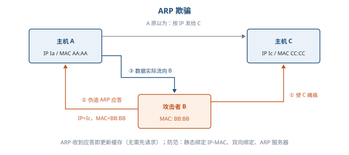

- ARP 欺骗原理：主机收到 ARP 应答就更新本地缓存，**不要求先发过请求**；攻击者 B 先使 C 瘫痪，再冒充 C 向 A 回应答（IP 是 C 的、MAC 是 B 的），A 发给 C 的数据实际流向 B——局域网按 MAC 地址传输，与 IP 无关。
- ARP 防范：`arp -s` 静态固化网关 IP-MAC；使用 ARP 服务器；**双向绑定**；ARP Guard 等防护软件。

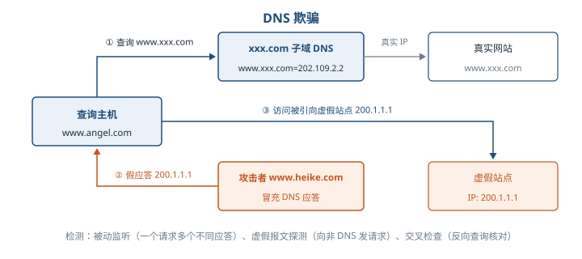

- DNS 欺骗：冒充域名服务器，把查询结果改成攻击者 IP，用户被引向虚假主页；并非真的「黑掉」对方网站，而是冒名顶替。
- DNS 欺骗检测三种 ⭐【易错】：**被动监听检测**（同一请求出现两个及以上不同结果的应答包即可疑，多 IP 会在一个应答包的多个应答域中返回）；**虚假报文探测**（向非 DNS 服务器发请求，攻击者不验证目标是否合法 DNS 也会回应答，收到应答即被攻击）；**交叉检查查询**（对应答中的 IP 反向查询 DNS 名，不一致即被欺骗）。
- IP 欺骗：先 DoS 使被冒充主机瘫痪，再利用 TCP 三次握手伪造源地址；防范：删除 hosts.equiv、.rhosts 并关闭相关 RPC 机制；防火墙过滤「来自外部、源地址却是内部 IP」的报文。

**4. 端口扫描（4.7.4）** ⭐【高频考点】

- 目的：判断目标主机开放哪些服务、运行何种操作系统。端口是 TCP/IP 定义的「软插槽」，[IP:端口] 即 Socket，定位主机中的一个进程。
- 原理：尝试与目标端口建立连接，有回复（三次握手第二次）即为活动端口。

| 扫描方式 | 做法 | 端口开放的判定 | 特点 |
| --- | --- | --- | --- |
| 全 TCP 连接 | 完成标准三次握手 | 连接建立成功 | 最古老，易被目标记录 |
| 半打开式（SYN 扫描） | 发 SYN，收到 SYN=1、ACK=1 后回 RST 放弃握手 | 回应 SYN+ACK；回 RST 则是死端口 | 未建立全连接，被记录可能性低、速度快 |
| FIN 扫描 | 发 FIN=1 报文 | 开放端口只丢弃、**无任何回应**；关闭端口回 RST | 不涉及 TCP 连接，最隐蔽，称秘密扫描 |
| 第三方（代理）扫描 | 利用「肉鸡」代替入侵者扫描 | 同代理所用方法 | 隐藏真实攻击者身份 |

**5. 强化 TCP/IP 堆栈（4.7.5）**

- **SYN Flooding** ⭐【重点】：攻击者大量发送只完成第一次握手的 SYN 请求，服务器为维护庞大半连接列表并重试 SYN+ACK（SYN Timeout 约 30 秒～2 分钟）而耗尽资源，正常用户得不到响应。【易错】攻击者要伪造**不可达**的源地址——若盗用可达主机地址，该主机收到莫名的 SYN+ACK 会回 RST 把连接重置，攻击即失效。
- 防御 SYN Flooding 靠调整注册表键值（SynAttackProtect=2、TcpMaxHalfOpen 等，了解名称即可）。
- ICMP 攻击：利用 ICMP 控制报文攻击路由器与主机，如 Ping of Death 利用 ICMP 包最大 64KB 的规定使堆栈崩溃；可设 EnableICMPRedirect=0 防御。
- SNMP 是标准网络管理协议，能汇报也能控制设备（重定向流量、改优先级、断连接），被入侵者掌握可完全接管网络；可设 EnableDeadGWDetect=0 等键值防御。

**6. 系统漏洞扫描（4.7.6）** ⭐【高频考点】

| 类型 | 原理 | 组成/优点 |
| --- | --- | --- |
| 基于网络的漏洞扫描 | 构造网络数据包发给远程目标，根据应答与漏洞特征比对 | 五模块：漏洞数据库、用户配置控制台、扫描引擎、当前活动扫描知识库、结果存储与报告生成；便宜、无需目标管理员配合、目标机零安装、维护简便 |
| 基于主机的漏洞扫描 | 在目标机安装 Agent/服务，可访问所有文件与进程 | 扫描漏洞数量多、集中化管理部署快、网络流量负载小（扫描由代理本地完成） |

### 4.8 信息安全的保障体系与评估方法

**1. 计算机信息系统安全保护等级（4.8.1）** ⭐【重点】【高频考点】

《计算机信息系统安全保护等级划分准则》（GB 17859—1999）规定 5 个等级：

| 级别 | 名称 | 对应 TCSEC | 必须记住的核心特征 |
| --- | --- | --- | --- |
| 第 1 级 | 用户自主保护级 | C1 | 隔离用户与数据，自主访问控制，保护用户和用户组信息 |
| 第 2 级 | 系统审计保护级 | C2 | 粒度更细的自主访问控制 + 登录规程、审计、隔离资源，用户对自己行为负责 |
| 第 3 级 | 安全标记保护级 | B1 | 安全策略模型、数据标记、**强制访问控制**的非形式化描述，准确标记输出信息 |
| 第 4 级 | 结构化保护级 | B2 | 明确定义的**形式化**安全策略模型；自主+强制访问控制扩展到所有主客体；考虑隐蔽通道；划分为关键/非关键保护元素 |
| 第 5 级 | 访问验证保护级 | B3 | **访问监控器**仲裁全部访问，本身抗篡改、足够小可分析测试；扩充审计、系统恢复，抗渗透能力很高 |

> 助记：「自、审、标、结、验，C1、C2、B1、B2、B3」——自主→审计→标记→结构化→访问验证；第 3 级出现「强制」，第 4 级出现「形式化」，第 5 级出现「监控器」。

**2. 安全风险管理（4.8.2）** ⭐【重点】

- 安全风险 = 系统存在的**脆弱性**被人为或自然的**威胁**利用而导致安全事件造成的影响；风险评估就是对 CIA 安全属性科学评价，识别风险，是信息安全保障体系的评价方法和决策机制。
- 评估准备 5 项：确定范围、确定目标、建立组织结构、建立系统性评估方法、获得最高管理者批准。
- 按实施者分**自评估**（系统拥有者依靠自身力量）与**他评估**（上级/业务主管机关发起，具强制意味的检查评估）。
- 基本要素：**脆弱性、资产、威胁、风险、安全措施**；相关属性：业务战略、资产价值、安全需求、安全事件、残余风险。

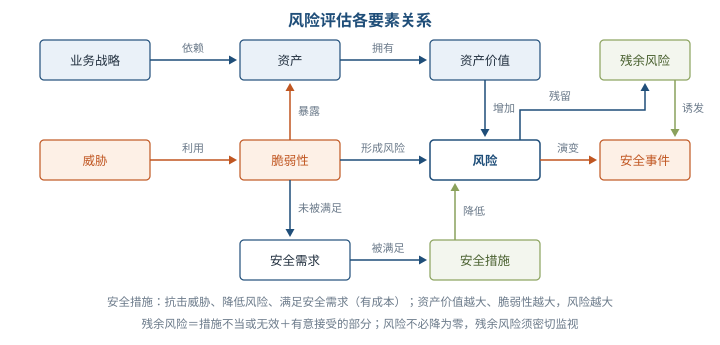

- 【高频】核心关系：业务战略依赖资产，资产拥有价值且价值越大风险越大；**威胁利用脆弱性形成风险**；脆弱性使资产暴露、是未被满足的安全需求；安全需求由安全措施满足（有成本）；安全措施抗击威胁、降低风险、减弱安全事件影响；风险演变为安全事件。
- 残余风险 = 措施不当或无效留下的风险 + 权衡成本与资产价值后**有意接受**的风险；风险不可能也没必要降为零，残余风险须密切监视，可能诱发新的安全事件。
- 资产赋值：估的是**安全价值而非账面价格**，看资产损失引发的潜在业务影响（违法、业务中断、信誉、隐私、经济损失等），即对 CIA 影响分析。
- 威胁来源：人为因素（有意/无意）与环境因素（自然不可抗力、其他物理因素）；一项资产可面临多个威胁，一个威胁可影响多项资产。
- 脆弱性评估【易错】：**弱点本身不会造成损失，只是可被威胁利用的条件**；没有威胁的弱点可不实施保护措施但必须记录；不正确或没正确实施的安全措施本身就是脆弱性。评估方法：问卷调查、人员问询、工具扫描、手动检查、文档审查、渗透测试；分技术与管 理两方面。
- 风险计算 5 步：①资产识别并赋值；②威胁分析并给发生可能性赋值；③识别脆弱性并给严重程度赋值；④由威胁与脆弱性算安全事件发生可能性；⑤结合资产重要性与发生可能性算风险值。

## 三、重点与易错点

| # | 考点 | 必须记住的结论 | 易错提醒 |
| --- | --- | --- | --- |
| 1 | 信息安全五要素 | 机密性、完整性、可用性、可控性、可审查性 | 别只答 CIA 三要素，漏掉可控、可审查 |
| 2 | 信息安全范围 | 设备、数据、内容、行为四类安全 | 设备三性=稳定/可靠/可用；行为三性=秘密/完整/可控 |
| 3 | 安全措施目标 | 访问控制、认证、完整性、审计、保密 | 「审计」对应不可抵赖性，不是查账那么窄 |
| 4 | 密码体制安全性 | 现实追求计算上安全，算法公开、密钥保密 | 无条件安全（理论不可破解）几乎不存在 |
| 5 | DES | 64 位分组、56 位密钥、16 轮替代换位 | IBM 原 Lucifer 是 128 位密钥，别与 DES 混淆 |
| 6 | 三重 DES | 两密钥 EDE，有效 112 位 | 不是 168 位；两重 DES 怕中间相遇攻击 |
| 7 | AES | Rijndael，密钥 128/192/256 位 | 没有 64 位密钥选项 |
| 8 | RSA | 公钥 (e,n)、私钥 (d,n)，安全性基于大整数分解困难 | z=(p-1)(q-1)，d 与 z 互质，ed≡1(mod z) |
| 9 | 公钥两种用法 | 公钥加密私钥解密=保密；私钥加密公钥解密=签名 | 签名用私钥「加密」，方向别记反 |
| 10 | KDC 密钥分配 | 主密钥 N 个，会话密钥 N(N-1)/2 个且用完即销毁 | 分层 KDC 把虚假 KDC 危害限制在局部 |
| 11 | 公钥证书 | CA 用自身私钥签字，接收方用 CA 公钥验证 | 证书让用户交换公钥无需再联系管理机构 |
| 12 | 访问控制实现 | ACL 按列（每客体一表）、能力表按行（每主体一表）、授权关系表存非空元素 | 授权关系表按主体排序≈能力表，按客体排序≈ACL |
| 13 | 数字签名 | 认证+不可抵赖+不可篡改；长文件只对 Hash 摘要签名 | 对称签名必须依赖可信仲裁人 BB |
| 14 | DDoS 三级结构 | Client 发起控制 → Handler 主控转发 → Agent 实际攻击 | Handler 与 Agent 都运行在被控制的主机上 |
| 15 | 扫描判定 | SYN 扫描：开放回 SYN+ACK；FIN 扫描：开放无回应、关闭回 RST | FIN 判定与直觉相反，开放反而「没声音」 |
| 16 | SYN Flooding | 伪造不可达源地址，耗尽半连接列表 | 可达主机会回 RST 重置连接，攻击失效 |
| 17 | 欺骗检测 | DNS 交叉检查=对返回 IP 做反向查询核对 | ARP 收到应答即更新缓存，不需先发请求 |
| 18 | 安全保护等级 | 自/审/标/结/验 ↔ C1/C2/B1/B2/B3 | 强制访问控制从第 3 级开始，形式化模型是第 4 级 |
| 19 | 风险要素关系 | 威胁利用脆弱性形成风险，措施降低风险，残余风险需监视 | 脆弱性本身不造成损失，只是条件；风险不必降为零 |

## 四、练习与真题

以下 14 道为按大纲考点自编的单选模拟题，答案与解析集中放在全章最后「六、参考答案」。

**1.** 信息安全五要素中，「对出现的信息安全问题提供调查的依据和手段」指的是（ ）。
A. 可控性  B. 可审查性  C. 完整性  D. 可用性

**2.** 关于 DES 算法，下列说法正确的是（ ）。
A. 明文分组 64 位，密钥 56 位，进行 16 轮替代与换位
B. 明文分组 128 位，密钥 128 位，进行 8 轮迭代
C. 明文分组 64 位，密钥 128 位，进行 16 轮替代与换位
D. 明文分组 64 位，密钥 56 位，加密解密使用不同密钥

**3.** 三重 DES 采用两把密钥按「加密—解密—加密」运算，其有效密钥长度及不采用两重 DES 的原因分别是（ ）。
A. 168 位；两重 DES 速度太慢
B. 112 位；两重 DES 对中间相遇攻击极为脆弱
C. 112 位；两重 DES 无法实现软硬件加密
D. 168 位；两重 DES 密钥空间过大难以管理

**4.** AES 高级加密标准不支持的密钥长度是（ ）。
A. 64 位  B. 128 位  C. 192 位  D. 256 位

**5.** RSA 算法中取 p=3、q=11、d=7、e=3，对明文 P=2 加密（C=P^e mod n），得到的密文为（ ）。
A. 2  B. 6  C. 8  D. 26

**6.** 关于公钥证书，下列说法错误的是（ ）。
A. 证书由 CA 用自身的秘密钥对时戳、用户身份、用户公钥等数据签字形成
B. 接收方用 CA 的公钥即可验证证书真伪
C. 用户交换公钥必须每次实时联系 CA 在线验证
D. 证书可避免统一公钥管理机构带来的瓶颈与安全隐患

**7.** 某网络有 N 个用户，采用 KDC 方式为任意两用户分配会话密钥，则系统中需要驻留的主密钥数量为（ ）。
A. N(N-1)/2  B. 2N  C. N  D. N²

**8.** 在访问控制的实现技术中，「每个客体一张表、按列保存访问矩阵，查询谁能访问某客体很方便」描述的是（ ）。
A. 能力表  B. 访问控制表 ACL  C. 授权关系表  D. 访问控制矩阵整体存储

**9.** 实际数字签名协议常与单向 Hash 函数结合使用，其主要目的是（ ）。
A. 用 Hash 值代替密钥，省去密钥管理
B. 只对文件 Hash 摘要签名，提高签名速度并减少存储量
C. 使签名可以被任何人伪造而不被发现
D. 让签名可以重复用于其他文件

**10.** DDoS 三级控制结构中，负责接收主控端命令并对目标实施实际攻击的是（ ）。
A. Client 客户端  B. Handler 主控端  C. Agent 代理端  D. 被攻击的目标主机

**11.** SYN Flooding 攻击者通常伪造不可达的源 IP 地址，其原因是（ ）。
A. 不可达地址更容易通过防火墙
B. 若盗用可达主机地址，该主机收到 SYN+ACK 后会回 RST 将连接重置
C. 不可达地址可以加快三次握手速度
D. 不可达地址不占用攻击者自身带宽

**12.** 使用 FIN 扫描探测目标端口时，若目标端口处于开放（活动）状态，扫描方通常会观察到（ ）。
A. 返回 SYN+ACK 报文  B. 返回 RST 报文  C. 报文被简单丢弃，不返回任何回应  D. 返回 ICMP 重定向报文

**13.** 依据 GB 17859—1999，提供数据标记和强制访问控制非形式化描述、对应 TCSEC B1 级的是（ ）。
A. 用户自主保护级  B. 系统审计保护级  C. 安全标记保护级  D. 结构化保护级

**14.** 关于信息安全风险评估，下列说法正确的是（ ）。
A. 脆弱性本身就会直接造成资产损失，与威胁无关
B. 风险必须降为零，否则评估不合格
C. 威胁利用脆弱性形成风险，安全措施降低风险，残余风险需密切监视
D. 资产赋值就是按资产账面价格计算风险

## 五、疑问与查漏补缺

- **大纲有、教材未展开 1**：大纲 3.8.1 还要求「安全性规章与保护私有信息规则」「安全保密管理及协议（防泄露、数字水印；安全协议 SSL、PGP、IPSec）」，教材 4.8.1 只讲了保护等级。需自行补记：SSL/TLS 工作在传输层（为应用层提供安全通道），IPSec 工作在网络层（认证头 AH、封装安全载荷 ESP），PGP 用于电子邮件等应用层加密签名（本章 4.5.2 提到其公钥公开发布方式），数字水印属于信息隐藏技术，用于版权保护与防泄露溯源。
- **大纲有、教材未展开 2**：大纲 3.6.2 列「身份认证分类（数字签名、密钥和口令）」，教材未单列小节，相关内容散见 4.1.2（用户标识与验证：物理特征、安全物品）与 4.6.2（数字签名），复习时把三者按「口令所知、物品所有、生物特征、密码学凭证」串成一条线记忆。
- **教材易误读处 1**：4.4.2 写 DES「进行 19 次变换，其中 16 次变换由 56 位密钥控制」，标准表述为初始置换 + 16 轮迭代 + 逆初始置换，考试按「16 轮、56 位密钥」作答即可。
- **教材易误读处 2**：4.5.1 控制矢量公式与 4.5.3 图 4-5 步骤⑤的排版较混乱，理解其含义即可：控制矢量经杂凑后与主密钥异或用于保护会话密钥；图 4-5 中 B 恢复会话密钥的顺序是先用自己私钥 D_SKb 解密、再用 A 的公钥 D_PKa 验证。
- **教材易误读处 3**：4.7.5 注册表键值（SynAttackProtect 等）属 Windows 早期版本的操作细节，了解「通过限制半连接数、缩短超时来防御 SYN Flooding」的思想即可，不必逐条背诵数值。
- **与其他章节衔接**：TCP 三次握手、ARP/DNS 协议细节可回看第 2 章网络部分；安全体系框架、PKI/CA 工程应用、等级保护落地在第 18 章「安全架构设计理论与实践」展开；现行等保 2.0 标准（GB/T 22239—2019）与 GB 17859—1999 的对应关系本章未涉及，可作为扩展知识补充。

## 六、参考答案

**1.** B。可审查性强调为安全事件提供调查依据和手段；可控性是控制授权范围内的信息流向与行为方式。

**2.** A。DES 为 64 位分组、56 位密钥、16 轮替代与换位；B 选项的参数属于 IDEA，且对称算法加解密密钥相同。

**3.** B。两密钥 EDE 有效长度 112 位；两重 DES 对中间相遇攻击极为脆弱，故采用三重结构。

**4.** A。AES 支持 128、192、256 位三种密钥长度，不含 64 位。

**5.** C。n=pq=33，C=2³ mod 33=8；解密 8⁷ mod 33=2 可还原明文。

**6.** C。公钥证书的价值正在于接收方用 CA 公钥离线验证即可，交换公钥无须再实时联系管理机构。

**7.** C。KDC 方式下每个用户只与 KDC 共享一个主密钥，共 N 个；N(N-1)/2 是会话密钥数量。

**8.** B。ACL 按列保存、每个客体一张表；能力表按行保存、每个主体一张表；授权关系表只存非空元素。

**9.** B。长文件直接公钥签名效率太低，只对 Hash 摘要签名可提速、减少存储，且签名与文件可分开保存。

**10.** C。Agent 代理端运行在被控制主机上，接收 Handler 命令实施实际攻击；Client 负责发起控制，Handler 负责转发命令。

**11.** B。可达主机收到与自己无关的 SYN+ACK 会回 RST 重置连接，半连接无法保持，故攻击者伪造不可达源地址。

**12.** C。FIN 报文发到开放端口仅被丢弃、无回应；发到关闭端口才返回 RST，判定逻辑与 SYN 扫描相反。

**13.** C。第 3 级安全标记保护级对应 B1，引入数据标记与强制访问控制；第 4 级结构化保护级对应 B2。

**14.** C。脆弱性只是可被利用的条件，本身不造成损失；风险不可能也没必要降为零，残余风险须监视；资产赋值看安全价值而非账面价格。
