# 第5章 软件工程基础知识

- 教材位置：`02.系统架构设计师第二版-教材.pdf` PDF 第 185～227 页（书页 175～217）
- 复习状态：已完成
- 复习日期：2026-11-06
- 本章地位：本章是后续架构设计、质量属性、架构评估与维护章节的工程基础。选择题常考模型辨析、耦合内聚、测试与项目管理，案例和论文也可复用需求、复用及过程改进知识。

## 一、大纲考点

大纲科目 1 第 4 部分对应书页 31～36（大纲 PDF 第 41～46 页）。下表将大纲条目映射到教材小节；标「补充」的内容在第五板块说明。

| 大纲条目 | 大纲要求概括 | 教材对应 |
| --- | --- | --- |
| 4.1.1 软件工程概述 | 发展历程、软件危机、定义 | 5.1、5.1.1 |
| 4.1.2 软件过程模型 | 瀑布、原型、增量、螺旋、构件组装、敏捷、RUP 的原理与特点 | 5.1.2～5.1.4、5.6；增量模型见补充 |
| 4.1.3 敏捷模型 | 定义、基本原理、特点与核心思想 | 5.1.3 |
| 4.1.4 统一过程模型 RUP | 核心概念、生命周期、特点、“4+1”视图 | 5.1.4 |
| 4.1.5 软件能力成熟度模型 | CMMI 发展、五级、关键过程域与过程目标 | 5.1.5 |
| 4.2 需求工程 | 发展、内容、特点及五项主要活动 | 5.2 |
| 4.2.1 需求获取 | 基本步骤；面谈、讨论会、问卷、观察、原型、头脑风暴 | 5.2.1 |
| 4.2.2 需求变更 | 变更控制过程；CCB 职责和权益 | 5.2.2 |
| 4.2.3 需求追踪 | 内涵、作用、双向跟踪、跟踪矩阵 | 5.2.3 |
| 4.3 系统分析与设计 | 目标、意义和范围 | 5.3 |
| 4.3.1 结构化方法 SASD | SA、SD、SP；DFD、数据字典、SC、流程图、NS、PAD、PDL、E-R | 5.3.1；UML 见补充 |
| 4.3.2 面向对象方法 | OOA 五层五活动；OOD 三类；OOP 特点；持久化 | 5.3.2 |
| 4.3.3 其他设计方法 | 构件与软件重用、逆向工程、形式化方法 | 5.5、5.6；逆向工程见补充 |
| 4.4 软件测试 | 测试目的和意义 | 5.4 |
| 4.4.1 测试方法 | 静态/动态、黑盒/白盒/灰盒、V&V、测试自动化 | 5.4.1；V&V 与脚本设计见补充 |
| 4.4.2 测试阶段 | 单元、集成、系统、性能、验收、AB；各类测试项 | 5.4.2 |
| 4.5 净室软件工程 | 定义、函数与抽样理论、四项技术、应用与缺点 | 5.5 |
| 4.6 基于构件的软件工程 | 构件特征与模型、CBSE 过程、三种组装 | 5.6 |
| 4.7.1～4.7.2 项目管理与进度 | 4P、进度活动、WBS、任务活动图 | 5.7.1～5.7.2 |
| 4.7.3 软件配置管理 SCM | 定义、目标、版本控制与变更控制 | 5.7.3 |
| 4.7.4 软件质量管理 | SQA 任务、质量因素、ISO 9001 与 CMMI | 5.7.4 |
| 4.7.5 软件风险管理 | 目标；Boehm 与 Charette 体系 | 5.7.5 |

## 二、知识点笔记

### 5.1 软件工程与过程模型

**1. 软件危机与软件工程**

软件危机是软件规模、复杂度快速增长后，传统个人化编程方式失效的集中表现：**进度难预测、成本难控制、功能难满足期望、质量无保证、难维护、缺文档**。1968 年 NATO 会议首次提出“软件危机”，随后以工程化方法应对。

> 教材原文：IEEE 认为，软件工程是将系统化的、严格约束的、可量化的方法应用于软件的开发、运行和维护，并包括对这些方法的研究。

通俗地说，软件工程不是“把代码写完”，而是用可管理、可度量的方法，把需求、设计、编码、测试、文档和维护都做好。软件工程过程可用 PDCA 记忆：

| 环节 | 教材名称 | 要解决的问题 |
| --- | --- | --- |
| P（Plan） | 软件规格说明 | 做什么，功能和运行限制是什么 |
| D（Do） | 软件开发 | 如何做出满足规格的软件 |
| C（Check） | 软件确认 | 产品是否满足用户需求 |
| A（Action） | 软件演进 | 如何持续改进以适应新需求 |

**2. 软件过程模型对比** ⭐【重点】【高频考点】

软件生命周期是从需求、设计、开发、运行维护直到淘汰的全过程；软件过程模型就是约束这些活动如何组织的“施工路线图”。

| 模型 | 核心做法 | 优点与适用 | 主要风险/缺点 |
| --- | --- | --- | --- |
| 瀑布模型 | 阶段严格顺序推进，前阶段输出是后阶段输入 | 需求明确稳定、管理规范的项目 | 串行、晚期才见产品，需求返工代价大 |
| 原型化模型 | 先快速做原型，反复反馈确认需求，再开发目标系统 | 用户说不清需求、界面交互不确定 | 原型不收敛会失败；大型系统难快速原型化 |
| 螺旋模型 | 每圈经历目标设定、风险分析、开发验证、评审 | 大型、高风险项目；强调风险驱动 | 管理成本高，依赖风险分析能力 |
| 敏捷模型 | 小步迭代增量交付，反馈驱动，欢迎变化 | 需求变化快、需要快速交付 | 不等于无计划、无文档，要求高质量沟通 |
| RUP | 用例驱动、架构中心、迭代增量，阶段与工作流二维组织 | 大型复杂项目，可裁剪的重量级过程 | 实施较重，裁剪不当会形式化 |
| CBSE | 优先复用构件，通过适配和组装构造系统 | 共性多、可复用资产丰富的系统 | 接口不兼容、构件与需求互相制约 |

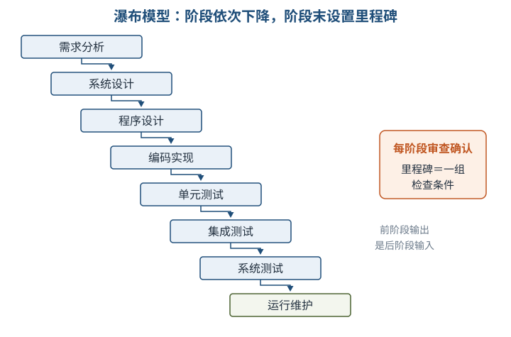

瀑布模型每个阶段结束都有里程碑审查，但不能把“阶段评审”误解为“错误只会留到下一阶段才处理”。**原型开发阶段**用于澄清需求，**目标软件开发阶段**才形成实际系统：抛弃型原型确认需求后废弃；演化型原型持续完善为产品。

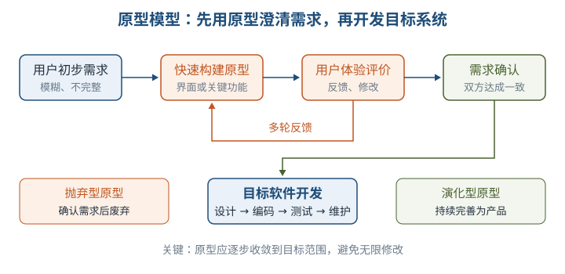

举例：开发点餐系统时，先做一个可点击但不能真正结算的界面原型，让餐馆老板确认菜品、订单和结账流程；若确认后重写，就是抛弃型原型，若在此基础上补齐功能，就是演化型原型。

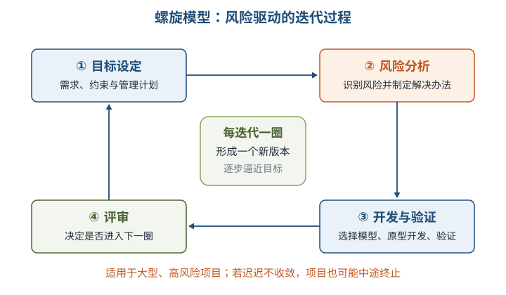

> 助记：螺旋四步“目—风—开—评”：定目标、析风险、做开发验证、评审是否进入下一圈。

**3. 敏捷方法** ⭐【重点】

敏捷的两个本质特点是：**适应性而非预设性**，用反馈控制不可预测过程；**面向人而非面向过程**，重视一线人员的技术决策和面对面沟通。核心思想再加一条：**迭代增量式开发**，按优先级与风险规划小版本。

| 方法 | 必须识别的关键词 |
| --- | --- |
| XP 极限编程 | 价值观：交流、朴素、反馈、勇气；小周期、积极反馈 |
| 水晶系列 Crystal | 以人为中心，按项目规模和环境选择不同家族成员 |
| Scrum | 产品 Backlog 按商业价值排序；Sprint 短迭代；结束交付潜在可用增量 |
| FDD | 人、过程、技术；五个核心过程，围绕“特征”设计、构建和迭代 |

举例：Scrum 像按优先级整理采购清单，每个短周期只挑选最重要的一批物品采购并验收；它不是取消清单和计划，而是让计划随反馈滚动调整。

**4. RUP 统一过程** ⭐【重点】【高频考点】

RUP 的 9 个核心工作流中，前 6 个是工程工作流：**业务建模、需求、分析与设计、实现、测试、部署**；后 3 个是支持工作流：**配置与变更管理、项目管理、环境**。生命周期每个循环产生一个新版本，分为四阶段：

| 阶段 | 核心目标 | 记忆抓手 |
| --- | --- | --- |
| 初始 Inception | 定义产品视图、业务模型和系统范围 | 想清楚“为什么做、做到哪” |
| 细化 Elaboration | 确定体系结构，制定计划和资源要求 | 搭稳架构、化解主要风险 |
| 构造 Construction | 开发并演进需求、架构和计划，形成产品 | 把产品做出来 |
| 移交 Transition | 产品交付用户使用 | 上线、培训、移交 |

RUP 核心概念可用四问记忆：**角色 Role＝Who，活动 Activity＝How，制品 Artifact＝What，工作流 Workflow＝When**。每次迭代都是包含多个工作流的完整小开发过程，不是简单重复劳动。

> 助记：RUP 三特点“用—架—迭”：用例驱动、以体系结构为中心、迭代与增量。

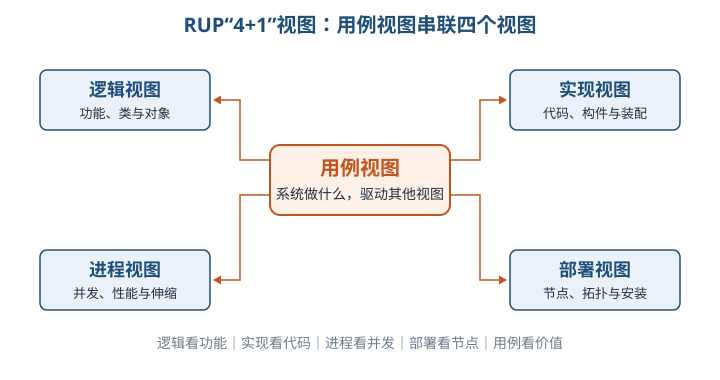

| 视图 | 主要回答 | 重点关注者 |
| --- | --- | --- |
| 用例视图 | 系统为用户做什么，驱动并串联其他视图 | 分析人员、测试人员 |
| 逻辑视图 | 功能如何由类、对象和逻辑结构实现 | 最终用户、分析设计人员 |
| 实现视图 | 代码、构件如何组织、配置和装配 | 程序员 |
| 进程视图 | 并发、进程、性能、吞吐和可伸缩性 | 系统集成人员 |
| 部署视图 | 节点、网络拓扑、发布和安装 | 系统工程师 |

**5. CMMI 成熟度等级** ⭐【重点】【易错】

| 等级 | 名称 | 关键特征 |
| --- | --- | --- |
| 1 | 初始级 | 过程随意混乱，成功依赖个人能力与“英雄主义” |
| 2 | 已管理级 | 项目级过程可计划、执行、监督和控制，管理成本进度质量 |
| 3 | 已定义级 | 组织级标准过程制度化，并积累组织过程资产 |
| 4 | 量化管理级 | 用定量目标管理质量和过程性能，强调可预测 |
| 5 | 优化级 | 用数据持续开展增量式和创新式改进 |

> 助记：成熟度“初—管—定—量—优”；二级管项目，三级有标准，四级看数据，五级持续优。

### 5.2 需求工程

**1. 需求层次与需求工程活动** ⭐【重点】

软件需求描述“系统必须满足什么”，包括功能需求和非功能需求。三个层次要会区分：

| 层次 | 含义 | 例子（图书借阅系统） |
| --- | --- | --- |
| 业务需求 | 组织或客户的高层次目标 | 减少排队，提高图书周转率 |
| 用户需求 | 用户必须完成的任务或期望 | 读者能查询图书并预约 |
| 功能需求 | 开发人员必须实现的软件功能 | 系统提供按书名检索、预约登记功能 |

非功能需求补充规定性能、质量属性、外部接口、标准规范和设计约束。例如“检索响应不超过 2 秒”不是新功能，而是性能要求。

需求工程覆盖体系结构设计前的活动，并贯穿生命周期：**需求获取 → 需求分析 → 形成需求规格 → 需求确认与验证 → 需求管理**。需求规格经评审批准形成**需求基线**，它是客户与开发者关于产品需求的约定，也是后续变更控制的基准。

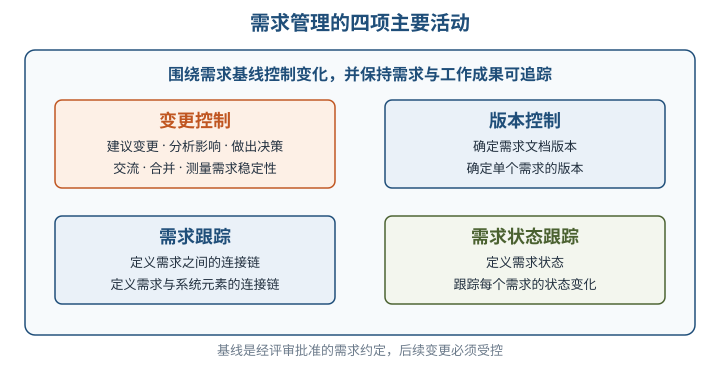

**2. 需求获取**

基本步骤为：开发高层业务模型 → 定义项目范围和高层需求 → 识别用户角色和用户代表 → 获取具体需求 → 确定业务工作流 → 整理与总结。需求陈述应说明**做什么，而不是怎样做**。

| 方法 | 最适合的场景 | 注意事项 |
| --- | --- | --- |
| 用户面谈 | 深入理解个别用户任务，是最常见有效的方法 | 会前准备，会后复查并文档化 |
| 专题讨论会 | 多方集中讨论、快速达成共识、解决冲突 | 需要主持人及用户、技术等代表 |
| 问卷调查 | 验证假设、收集统计倾向 | 不利于探索未知问题和追问模糊回答 |
| 现场观察 | 了解真实业务流程与细节 | 观察实际操作，而非只听转述 |
| 原型化方法 | 界面、报表等高度不确定需求 | 多轮反馈，避免原型无限演化 |
| 头脑风暴 | 新业务、高不确定性需求 | 鼓励发散设想，再收敛筛选 |

**3. 需求变更与 CCB** ⭐【重点】【易错】

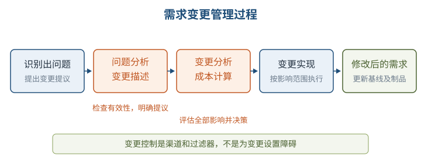

变更成本不能只算“改代码”，还要算需求文档、设计、测试、进度及相关工作产品的联动成本。**CCB 是决策机构，不是作业机构**：负责评审并裁定接受哪些变更，通常不负责提出具体变更方案，也不直接实施变更。

未获批准的变更不得进入设计实现；原始变更请求不得从配置库删除或修改；已集成的需求变更必须能追溯到核准的变更请求。重要变更被接受后，可能需要重新协商交付期、人员、范围或质量折中。

**4. 需求追踪**

| 方式 | 检查方向 | 能发现的问题 |
| --- | --- | --- |
| 正向跟踪 | 需求规格中的需求 → 设计、代码、测试等后继成果 | 需求是否漏实现、漏测试 |
| 逆向跟踪 | 设计、代码、测试用例 → 需求规格中的出处 | 是否做了无需求依据的多余功能 |

二者合称**双向跟踪**；需求跟踪矩阵保存需求与后继工作成果的对应关系。其目的不是“多填一张表”，而是维持“需求—设计—编程—测试”一致性并支持变更影响分析。

### 5.3 系统分析与设计

系统分析把复杂对象分解并识别属性与关系，形成需求规格；系统设计据此绘制实现蓝图，包括**概要设计**和**详细设计**。

**1. 结构化分析 SA：DFD 与数据字典** ⭐【重点】【高频考点】

结构化方法又称面向功能或面向数据流的方法，包括 SA、SD、SP，基本原则是分解与抽象、模块独立性和信息隐蔽。SA 常用 DFD、数据字典、结构化语言、判定表和判定树。

| DFD 元素 | 图形/作用 | 通俗理解 |
| --- | --- | --- |
| 外部项 | 圆角框或平行四边形；系统外数据提供者或使用者 | 谁给数据、谁用结果 |
| 处理/加工 | 矩形；对数据进行加工转换 | 数据在这里被做什么 |
| 数据流 | 带名称的箭头；数据流向 | 什么数据往哪里走 |
| 数据存储 | 数据库或文件中的保存数据 | 数据放在哪里 |

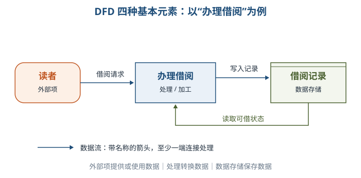

DFD 自顶向下逐层分解，父图是子图抽象，子图是父图求精。⭐【易错】检查规则：**一个处理至少有一个输入和一个输出；一个数据流至少一端是处理；父图数据流必须在相应子图中体现；分解要保持数据守恒**。

数据字典是对 DFD 各元素的文字定义集合，包含**数据项、数据结构、数据流、数据存储、处理过程**。数据项不可再分；数据结构描述组合关系；处理过程说明“做什么”及频度、响应等要求，而不是具体编码“怎么做”。

**2. 结构化设计 SD：模块、耦合与内聚** ⭐【重点】【高频考点】【易错】

SD 以 SRS、DFD 和数据字典为基础，自顶向下、逐步求精、模块化。概要设计确定模块划分、功能、接口及调用关系，形成系统结构图 SC；详细设计确定每个模块的算法和局部数据结构。信息隐藏把模块实现细节封装成“黑盒”，外部只依赖简单接口。

耦合衡量**模块之间**联系程度，越低越好；内聚衡量**模块内部各成分**围绕功能的紧密程度，越高越好。

| 耦合（低 → 高） | 识别特征 | 内聚（高 → 低） | 识别特征 |
| --- | --- | --- | --- |
| 非直接耦合 | 无直接关系，仅由上级控制调用 | 功能内聚 | 各成分共同完成单一功能 |
| 数据耦合 | 参数传递简单数据 | 顺序内聚 | 前一部分输出是后一部分输入，顺序执行 |
| 标记耦合 | 参数传递记录等数据结构 | 通信内聚 | 各成分操作同一数据结构 |
| 控制耦合 | 传入控制信息影响对方内部逻辑 | 过程内聚 | 功能相关且按特定次序执行 |
| 通信耦合 | 共用输入信息或输出需整合 | 时间内聚 | 任务在同一时间间隔执行，如初始化 |
| 公共耦合 | 多模块访问公共数据环境 | 逻辑内聚 | 逻辑上相似的任务放在一起，由参数选择 |
| 内容耦合 | 直接访问对方内部数据、跳入内部或代码重叠 | 偶然内聚 | 成分没有或只有松散关系 |

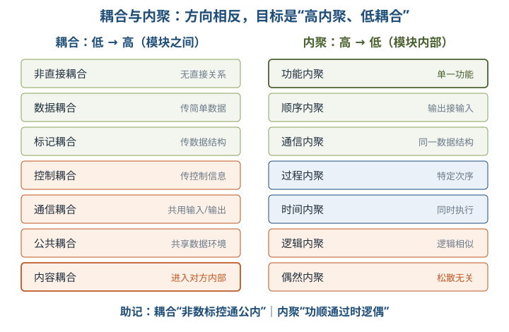

> 助记：耦合“非数标控通公内”，内聚“功顺通过时逻偶”；设计目标是高内聚、低耦合，而不是相反。

详细设计工具要辨析：**程序流程图**用方框、菱形和箭头描述控制流；**NS 盒图**强制结构化、不能任意转移控制；**PAD 图**层次清晰，便于自顶向下设计和转换为源码；**PDL**外层控制结构固定、内层具体操作灵活；判定表适合复杂条件组合。

**3. 结构化编程 SP 与 E-R 概念模型**

SP 采用自顶向下、逐步求精，只用**顺序、选择、循环**三种基本控制结构组合，并坚持单入口、单出口。原则是“程序＝算法＋数据结构”，两者分开设计、以算法为主。

E-R 图用**矩形表示实体、椭圆表示属性、菱形表示联系**；主属性名加下划线，多值属性用双椭圆，派生属性用虚线椭圆。联系数量约束为 1:1、1:N、M:N，联系自身也可以有属性。

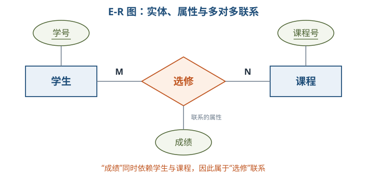

举例：“成绩”既依赖某个学生又依赖某门课程，因此应挂在“选修”联系上，而不是单独当作学生或课程的属性。

**4. 面向对象分析与设计** ⭐【重点】

OOA 模型由**主题层、对象类层、结构层、属性层、服务层**五个层次，以及标识对象类、标识结构、定义主题、定义属性、定义服务五项活动组成。分类结构表示一般—特殊（泛化—特化），组装结构表示整体—部分。

OOA 原则包括抽象、封装、继承、分类、聚合、关联、消息通信、粒度控制和行为分析；基本步骤是确定对象和类、确定结构、确定主题、确定属性、确定方法。对象之间通过消息通信，不应绕过封装直接存取内部属性。

| OOD 类 | 职责 | 典型识别与特征 |
| --- | --- | --- |
| 实体类 | 保存需要持久化的业务信息 | 学员、课程；通常是名词，有属性，不一定有操作 |
| 控制类 | 封装一个或几个用例特有的协调控制行为 | 身份验证器；通常无属性、一定有方法，随用例产生或消亡 |
| 边界类 | 隔离系统与外部参与者、设备或其他系统的交互 | 窗口、报表、打印机接口；可有属性和方法 |

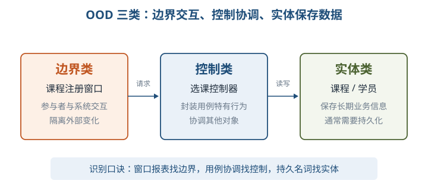

OOP 可记为“对象＋类＋继承＋多态＋消息”，目标是重用性、灵活性和扩展性。**封装**隐藏数据和实现细节；**继承**复用一般类的属性和服务；**多态**是不同对象收到同一消息可表现不同行为。对象持久化把内存对象保存到数据库或永久存储设备，关系数据库场景常用 ORM：Hibernate 自动生成并执行 SQL；iBatis 由开发者手写 SQL、灵活小巧；JDO 是持久化标准 API，可适配多种数据底层。

### 5.4 软件测试

> 教材原文：软件测试是使用人工或自动手段运行或测定某个软件系统的过程，目的在于检验它是否满足规定需求，或弄清预期结果与实际结果之间的差别。

测试是为了**发现错误并评价质量**，不能证明程序完全没有错误，也不能只理解为编码后的收尾活动。

| 分类角度 | 类型 | 核心区别 |
| --- | --- | --- |
| 程序是否运行 | 静态测试 | 不运行程序，审查需求、设计、源码、结构和流程 |
| 程序是否运行 | 动态测试 | 构造用例、执行程序、比较实际与预期结果 |
| 是否了解内部结构 | 黑盒测试 | 依据需求规格检查输入输出和功能，不看内部实现 |
| 是否了解内部结构 | 白盒测试 | 依据内部逻辑设计用例，检查路径与结构 |
| 是否了解内部结构 | 灰盒测试 | 兼顾外部输出与部分内部逻辑，深度不如白盒 |
| 执行方式 | 人工/自动化测试 | 自动化是在预设条件下自动执行并分析结果，仍需人设计目标和判断 |

⭐【易错】静态/动态与黑盒/白盒是不同分类维度，不能一一对应。白盒常见覆盖有语句、判定/分支、路径等，覆盖指标高不等于没有缺陷。

| 阶段/类型 | 主要对象与目标 | 关键提醒 |
| --- | --- | --- |
| 单元测试 | 单个模块，发现模块功能和编码错误 | 静态审查与白盒、黑盒结合，满足覆盖要求 |
| 集成测试 | 已组装模块，检查组装正确性和接口 | 重点关注模块间接口与交互 |
| 系统测试 | 完整系统，依据需求做功能、性能、安全等测试 | 通常黑盒，由独立测试小组执行并做回归 |
| 验收测试 | 交付前依据用户需求和合同验收 | 由用户开展，区别于开发过程中的系统测试 |
| Alpha/Beta | 用户在开发环境或模拟环境测试 / 多用户在真实环境测试 | Alpha 在前，Beta 更贴近真实使用 |

负载测试观察负载逐渐增加时性能指标的变化；压力测试寻找瓶颈或不可接受的性能点，确定最大服务级别，二者都属于性能测试。AB 测试让相似用户群随机访问不同版本并依据数据择优；Web 测试还包括链接是否有效及有无孤立页面、表单提交和默认值是否正确等。

### 5.5 净室软件工程

净室软件工程 CSE 用数学和统计学方法，在规约、设计和验证阶段预防错误，追求零缺陷或接近零缺陷，而不是先做出产品再大量排错。

| 理论/技术 | 必须掌握的内容 |
| --- | --- |
| 函数理论 | 程序视为定义域到值域的映射；完备性是每种输入有输出，一致性是同一输入至多一个输出，正确性可据此推理验证 |
| 抽样理论 | 所有使用情况构成总体，抽取样本测试，统计推导性能与可靠性 |
| 增量式开发 | 在统计过程控制下划分较小累积增量 |
| 基于函数的规范与设计 | 盒子结构：黑盒行为视图 → 状态盒有限状态机视图 → 明盒过程视图 |
| 正确性验证 | CSE 核心，以推理验证取代对事后排错的依赖 |
| 统计测试与软件认证 | 由使用模型产生随机样本用例，推导预期操作性能 |

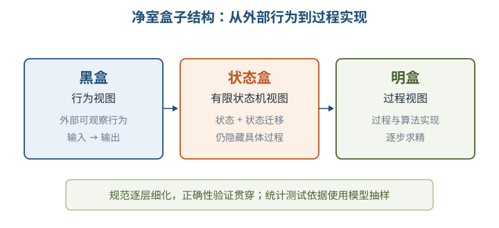

⭐【易错】“提倡不进行传统单元测试”不等于“不验证、不测试”；净室强调测试前的正确性验证和统计质量控制。其缺点是数学门槛高、验证耗时、人员训练成本高，且完全不做传统模块测试在现实中存在风险。

### 5.6 基于构件的软件工程 CBSE

CBSE 强调“购买而非重新构造”，把重点从编写程序转向复用构件的**选择、适配和集成**。构件可以是 COTS，也可自行开发。

| 构件特征 | 含义 |
| --- | --- |
| 可组装性 | 外部交互必须通过公开接口，隐藏内部信息 |
| 可部署性 | 自包含、通常为二进制，可在构件平台独立部署 |
| 文档化 | 用户可据文档判断构件是否满足需求 |
| 独立性 | 可独立组装部署；若依赖其他服务必须显式声明 |
| 标准化 | 符合标准构件模型，保证互操作性 |

构件模型三要素是**接口、使用信息、部署**；通用服务分为支持分布式通信互操作的平台服务，以及身份认证等共性支持服务。中间件实现这些共性服务，容器提供支持服务实现及整合接口。

CBSE 过程为：系统需求概览 → 识别候选构件 → 根据发现的构件修改需求 → 体系结构设计 → 构件定制与适配 → 组装构件创建系统。⭐【重点】它允许用“现有构件能支持什么”反向细化需求，体系结构阶段选择的构件模型和平台会限制可选构件范围。

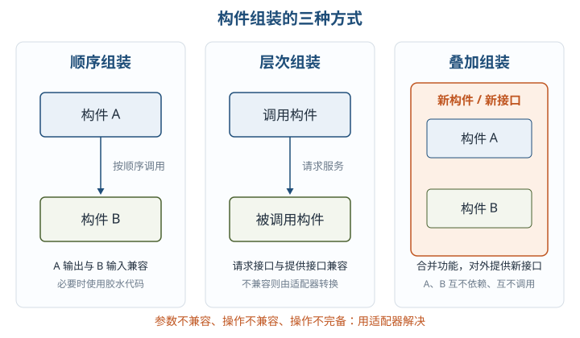

| 接口问题 | 表现 | 处理 |
| --- | --- | --- |
| 参数不兼容 | 操作名相同，但参数类型或个数不同 | 编写适配器构件转换 |
| 操作不兼容 | 提供接口与请求接口的操作名不同 | 编写适配器构件转换 |
| 操作不完备 | 一方接口只是另一方所需接口的子集 | 适配并补充缺失能力 |

顺序组装要求前一构件输出与后一构件输入兼容；层次组装要求调用构件的请求接口与被调用构件的提供接口兼容；叠加组装把多个构件合并成新构件并对外提供新接口，原构件彼此不依赖、不调用。连接构件的专门代码称**胶水代码**。

### 5.7 软件项目管理

软件项目管理围绕**人员 People、产品 Product、过程 Process、项目 Project**四类对象，目标是按预定成本、进度和质量完成项目。进度管理包括活动定义、活动排序、活动资源估计、活动历时估计、制定进度计划和进度控制。

**1. WBS 与任务活动图** ⭐【重点】

WBS 以可交付成果为导向，按“项目 → 任务 → 工作 → 日常活动”逐层分解；最底层是**工作包**，应有唯一责任主体和明确交付成果。它是进度、资源、成本、风险和采购计划的重要基础。

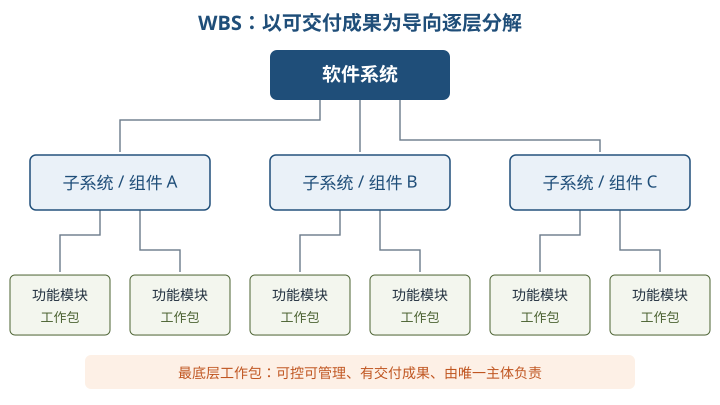

工作包要可控可管理，每个任务有明确完成标准，分解要有利于责任分配；教材建议树形结构一般不超过 6 层，既不能过粗也不能无限细分。活动定义进一步明确前驱、持续时间、必须完成日期、里程碑和交付成果，再按活动关系形成任务活动图，常用甘特图展示。

**2. 配置、质量与风险管理** ⭐【重点】【易错】

SCM 是标识、组织和控制修改的技术，目标是标识变更、控制变更、确保变更正确实现并报告变更。核心是**版本控制**和**变更控制**：前者记录何时、何人、改了什么，并通过分支合并支持并行开发；后者不是阻止变更，而是确保变更有序。

软件质量是软件与明确及隐含需求相一致的程度，可从产品运行、产品修改、产品转移三组因素理解。

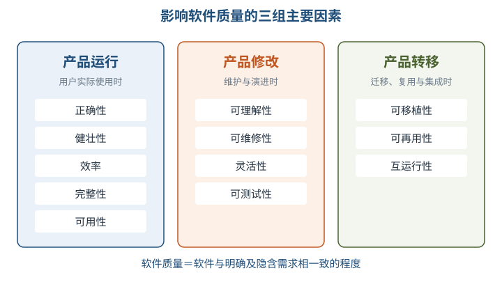

| 质量因素组 | 典型属性 | 关注问题 |
| --- | --- | --- |
| 产品运行 | 正确性、健壮性、效率、完整性、可用性 | 用起来是否正确、安全、可靠、高效 |
| 产品修改 | 可理解性、可维修性、灵活性、可测试性 | 出问题时能否理解、修复、改变和测试 |
| 产品转移 | 可移植性、可再用性、互运行性 | 能否换环境、复用并与其他系统协作 |

SQA 通过评审和审计，使软件过程对管理层可见，重点在**事前预防缺陷、尽早捕获缺陷、作用于过程、贯穿全部活动**。三项主要任务是：审计与评审、SQA 报告、处理不符合问题。质量认证关注企业整体质量体系，教材列出 ISO 9000 系列（软件企业常用 ISO 9001）和 CMM/CMMI。

风险管理目标是预防风险。Boehm 体系分为**风险估计**（辨识、分析、排序）和**风险控制**（管理计划、处理、监督）；Charette 体系分为**分析**（辨识、估计、评价）和**管理**（计划、控制、监督）。CMU-SEI 体系偏重实践，并将软件需求方纳入风险管理要素。先识别评估，再规划处置并持续监督，不能等项目失控后才“救火”。

## 三、重点与易错点

| # | 考点 | 必须记住的结论 | 易错提醒 |
| --- | --- | --- | --- |
| 1 | 软件危机 | 进度、成本、期望、质量、维护、文档六类问题 | 软件危机不是单纯“程序员技术差” |
| 2 | 瀑布与原型 | 瀑布适合稳定需求；原型用于澄清不确定需求 | 抛弃型与演化型原型的结局不同 |
| 3 | 螺旋模型 | 每圈为目标、风险、开发验证、评审 | 风险分析是标志，不只是“多次原型” |
| 4 | 敏捷 | 适应性、以人为本、迭代增量 | 敏捷不等于无计划、无文档、无架构 |
| 5 | RUP | 用例驱动、架构中心、迭代增量；四阶段九工作流 | 阶段不是九个工作流的简单串行替代 |
| 6 | “4+1”视图 | 用例串联逻辑、实现、进程、部署 | 实现视图不是部署视图，进程关注并发性能 |
| 7 | CMMI | 初始、已管理、已定义、量化管理、优化 | 二级项目级，三级组织级，四级定量可预测 |
| 8 | 需求基线与 CCB | 基线是变更基准；CCB 负责裁定 | CCB 不是实施小组，未批准不开发 |
| 9 | 需求追踪 | 正向查漏实现，逆向查无依据成果 | 双向追踪需要维护跟踪矩阵 |
| 10 | DFD | 外部项、处理、数据流、数据存储 | 数据流至少一端是处理，不是控制流图 |
| 11 | 耦合内聚 | 模块间低耦合，模块内高内聚 | 控制耦合传控制信息；公共耦合共享数据环境 |
| 12 | OOD 三类 | 边界管交互、控制管协调、实体管持久业务数据 | 控制类不是界面类，实体类不等同数据库表本身 |
| 13 | 测试分类 | 静/动看是否运行，黑/白看是否依据内部结构 | 黑盒不等于静态，白盒也不等于单元测试专用 |
| 14 | 验收与性能 | 验收由用户依据合同；负载看渐变，压力找极限 | Alpha 与 Beta 的环境和参与者不同 |
| 15 | 净室与 CBSE | 净室重正确性验证；CBSE 重复用、适配、组装 | 净室并非不测试；接口不兼容用适配器 |
| 16 | WBS、SCM、风险 | 工作包可交付且唯一负责；SCM 管版本和变更 | 风险管理先估计后控制，不是事后补救 |

## 四、练习与真题

以下为按大纲与教材考点自编的 12 道单选模拟题。

**1.** 某项目需求大体明确，但关键技术方案存在很大不确定性，管理者希望每一轮都专门识别和处置风险。最适宜的软件过程模型是：

A. 瀑布模型  B. 螺旋模型  C. 抛弃型原型模型  D. 构件组装模型

**2.** 关于敏捷与 Scrum，下列说法正确的是：

A. 敏捷要求前期计划一经批准不得变化  B. Scrum 用产品 Backlog 管理并按价值排序需求  C. Sprint 结束只提交文档不提交产品增量  D. 敏捷以过程和工具取代人员沟通

**3.** 在 RUP 中，程序员最关心代码构件的组织、配置和装配，应重点查看：

A. 用例视图  B. 逻辑视图  C. 实现视图  D. 部署视图

**4.** 某组织已建立统一的软件开发标准流程，并要求各项目按裁剪规则使用，同时持续沉淀组织过程资产。其 CMMI 成熟度至少达到：

A. 初始级  B. 已管理级  C. 已定义级  D. 优化级

**5.** 关于需求变更控制，下列做法最恰当的是：

A. 为赶进度，开发人员可先实现再补办审批  B. CCB 负责评审裁定变更但不直接实施  C. 被否决的变更请求应立即从配置库删除  D. 变更成本只计算编码工作量

**6.** 测试人员检查每个测试用例是否都能在需求规格说明书中找到依据，这属于：

A. 正向跟踪  B. 逆向跟踪  C. 回归测试  D. 配置审计

**7.** 模块 A 将“排序方式标志”传给模块 B，B 根据该标志选择不同的内部排序算法。A 与 B 之间主要是：

A. 数据耦合  B. 标记耦合  C. 控制耦合  D. 内容耦合

**8.** 某模块把“读取订单、校验订单、保存订单”组织在一起，前一处理的输出作为后一处理的输入。该模块主要体现：

A. 功能内聚  B. 顺序内聚  C. 时间内聚  D. 偶然内聚

**9.** 在 DFD 审查中，下列结构一定不符合基本规则的是：

A. 一个处理有一个输入流和一个输出流  B. 数据流从外部项直接流向另一个外部项  C. 数据存储既有读也有写  D. 子图继承父图相关输入输出数据流

**10.** 在线教育系统中的“课程”保存课程号、名称和学分等长期业务信息；“课程注册窗口”负责用户与系统交互；“选课控制器”协调选课用例。三者依次属于：

A. 控制类、实体类、边界类  B. 实体类、边界类、控制类  C. 实体类、控制类、边界类  D. 边界类、实体类、控制类

**11.** 关于软件测试，下列说法错误的是：

A. 静态测试不运行被测程序  B. 黑盒测试主要依据需求规格设计用例  C. 压力测试用于寻找瓶颈或不可接受的性能点  D. 验收测试只能由开发团队内部完成

**12.** 两个构件接口的操作名称相同，但参数个数不同。采用 CBSE 组装时，最合适的处理是：

A. 直接部署，运行时自动兼容  B. 编写适配器构件转换接口  C. 将两个构件改成内容耦合  D. 删除其中一个构件的全部接口文档

注：参考答案与一句话解析见全章最后的「六、参考答案」。

## 五、疑问与查漏补缺

1. **增量模型未独立展开**：大纲 4.1.2 单列增量模型，教材未设对应小节，可结合敏捷、RUP 与净室理解：每次交付一个可运行的功能子集，后续增量在前一版本基础上扩展；迭代强调反复求精，增量强调功能逐渐增加，二者常结合但不是同义词。
2. **逆向工程需跨章衔接**：大纲 4.3.3 要求逆向工程，本章没有系统讲解，复习第 10 章软件架构演化和维护时补齐“从既有代码/制品恢复设计、需求或架构”的内容；本章 CBSE 只覆盖构件与软件重用。
3. **V&V 与测试自动化需补记**：验证 Verification 关注“是否正确地构造产品”，即工作产品符合规格；确认 Validation 关注“是否构造了正确的产品”，即满足用户真实需要。大纲还提到测试脚本设计和测试用例自动生成，本章仅概述自动化执行，后续应结合测试工具实践补充。
4. **UML 未在本章展开**：大纲 4.3.1 将 UML 与 DFD、ERD、流程图等并列，本章仅详细讲 DFD、E-R 等。用例图可关联 RUP 用例驱动，类图可关联 OOA/OOD，但完整 UML 图形语义需在面向对象设计专题复习。
5. **教材文字疑误与版本差异**：5.1.5 提取文本中的“3168 种关键时间”疑为“关键实践”的排版/OCR 问题；CMMI 的过程域、目标数量随版本不同，考试优先记教材给出的五个等级及特征，不自行混用其他版本数字。
6. **术语对照**：RUP 的实现视图在部分资料中称开发视图；教材的“通信耦合”描述共用输入或需整合输出，不要与“通信内聚”因名称相近而混淆。
7. **与后续章节的关系**：E-R 和数据库六阶段在第 6 章深化；质量属性与架构评估在第 8 章深化；可靠性与统计测试在第 9 章衔接；复用、逆向和维护在第 10 章衔接。

## 六、参考答案

**1.** **B**。螺旋模型每圈都包含风险分析，适合大型、高风险和技术不确定性强的项目。
**2.** **B**。Scrum 以按商业价值排序的产品 Backlog 管理需求，每个 Sprint 交付潜在可用增量。
**3.** **C**。实现视图关注代码和构件的组织、配置与装配；部署视图关注节点和物理拓扑。
**4.** **C**。已定义级的标志是组织级标准过程制度化并积累过程资产，已管理级主要管单个项目。
**5.** **B**。CCB 是变更决策机构而非实施机构，所有变更须受控，原始请求和完整历史应保留。
**6.** **B**。由测试、代码或设计成果反查需求出处是逆向跟踪，可发现无需求依据的多余工作。
**7.** **C**。传入的标志用于控制模块 B 的内部逻辑，属于控制耦合，应优先重构为更清晰的数据接口。
**8.** **B**。各处理相关且前一输出是后一输入，属于顺序内聚，内聚程度仅次于功能内聚。
**9.** **B**。DFD 的数据流至少一端必须是处理，不能让数据在外部项之间直接流动而绕过系统加工。
**10.** **B**。持久业务信息对应实体类，系统外交互对应边界类，用例协调行为对应控制类。
**11.** **D**。验收测试由用户依据需求或合同开展，不是只能由开发团队内部完成。
**12.** **B**。操作同名但参数个数不同属于参数不兼容，通常通过适配器构件完成接口转换。
