# 第6章 数据库设计基础知识

- 教材位置：`02.系统架构设计师第二版-教材.pdf` PDF 第 228～257 页（书页 218～247）
- 复习状态：已完成
- 复习日期：2026-11-06
- 本章地位：本章是数据架构与后续大数据架构的理论基础。选择题重点集中在三级模式、关系运算、函数依赖与规范化、E-R 转换、数据库设计阶段及 NoSQL 分类。

## 一、大纲考点

大纲科目 1 第 5 部分对应书页 36～40（大纲 PDF 第 46～50 页）。下表将大纲条目映射到教材小节；大纲有而教材未展开的内容在第五板块补齐。

| 大纲条目 | 大纲要求概括 | 教材对应 |
| --- | --- | --- |
| 5.1.1 数据库技术发展及分类 | 数据库定义、发展阶段；DB、DBS、DBMS；分布式、并行、数据仓库与挖掘 | 6.1、6.1.1；分类见第五板块 |
| 5.1.2 数据模型 | 层次、网状、关系及第三代数据库系统 | 6.1.2 |
| 5.1.3 数据库管理系统 | DBMS 定义、范围、功能及特点 | 6.1、6.1.3 |
| 5.1.4 数据库三级模式 | 物理/逻辑/视图层；外/概念/内模式；体系结构 | 6.1.4，图 6-1 |
| 5.2.1 关系数据库基本概念 | 属性、域、度、候选码等；关系模式；三类完整性 | 6.2.1 |
| 5.2.2 关系运算 | 集合、专门关系、比较及逻辑运算符 | 6.2.2 |
| 5.2.3 设计基本理论 | 函数依赖、多值依赖、规范化 | 6.2.3 |
| 5.3.1～5.3.2 设计步骤与需求分析 | 六阶段；需求任务、参与者、SA 方法 | 6.3.1～6.3.2 |
| 5.3.3 概念结构设计 | E-R 方法；局部应用到全局 E-R 图 | 6.3.3 |
| 5.3.4 逻辑结构设计 | E-R 转关系、规范化、约束、视图、反规范化 | 6.3.4 |
| 5.3.5 物理设计 | 数据分布、存储结构、访问方式 | 6.3.5 |
| 5.3.6～5.3.7 实施与运行维护 | DDL、加载、试运行；监测、备份、重组和重构 | 6.3.6～6.3.7 |
| 5.4.1～5.4.4 标准访问接口 | OCI、嵌入式 SQL、ODBC、ORM | 6.4.1～6.4.4 |
| 5.5.1 NoSQL 分类与特点 | 定义、用途；列式、键值、文档、图数据库 | 6.5、6.5.1 |
| 5.5.2 NoSQL 体系框架 | 四层框架与适用场景 | 6.5.2 |

## 二、知识点笔记

### 6.1 数据库基本概念

**1. 数据、数据库与数据库系统** ⭐【重点】

数据是描述事物的符号记录，信息是具有特定释义和意义的数据；简单说，**数据是载体，信息是数据表达的含义**。

> 教材原文：数据库是统一管理的、长期储存在计算机内的，有组织的相关数据的集合。

| 概念 | 一句话区分 | 举例 |
| --- | --- | --- |
| DB（数据库） | 长期存储、统一管理的相关数据集合 | 图书管理系统中的读者、图书、借阅数据 |
| DBMS（数据库管理系统） | 组织、存储、管理和访问 DB 的核心系统软件 | MySQL、Oracle 等软件 |
| DBS（数据库系统） | 采用数据库技术的完整计算机系统，范围最大 | DB＋DBMS＋应用程序＋硬件＋人员等 |

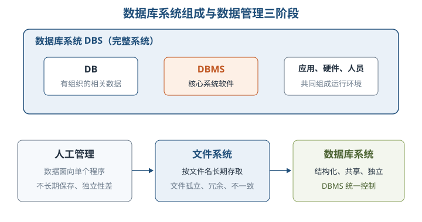

数据管理经历**人工管理 → 文件系统 → 数据库系统**。数据库系统相对文件系统的核心进步是：数据面向整个应用系统、充分共享、冗余减少、独立性提高，并由 DBMS 统一保证完整性、一致性和安全性。

| 阶段 | 数据保存与共享 | 主要短板 |
| --- | --- | --- |
| 人工管理 | 数据通常不长期保存，一组数据对应一个程序 | 程序与数据不独立，重复数据多 |
| 文件系统 | 可长期保存、按文件名访问，有一定共享 | 文件孤立、冗余大、易不一致，联系靠程序维护 |
| 数据库系统 | 数据结构化、共享、交叉访问，集中控制 | 需要 DBMS 与专业设计、运维支持 |

**2. 数据模型** ⭐【重点】【高频考点】

> 教材原文：数据模型的三要素是数据结构、数据操作和数据的约束条件。

| 要素 | 描述什么 | 记忆抓手 |
| --- | --- | --- |
| 数据结构 | 对象类型及其联系，描述系统静态特性 | 数据“长什么样” |
| 数据操作 | 检索、插入、删除、修改及规则，描述动态特性 | 能对数据“做什么” |
| 约束条件 | 完整性规则，保证数据正确、有效、相容 | 数据“必须守什么规矩” |

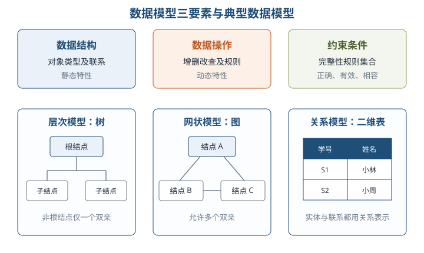

层次模型用树表示联系，除根结点外每个结点**有且仅有一个双亲**；网状模型允许多个无双亲结点、一个结点有多个双亲，是更一般的结构。二者都用存取路径表示联系，采用导航式数据操纵。网状模型表达多对多时也要引入联结记录。

**3. DBMS 的功能与数据控制** ⭐【重点】

| 功能 | 关键内容 |
| --- | --- |
| 数据定义 | 用 DDL 定义外模式、模式、内模式、完整性与安全权限，定义存入数据字典 |
| 数据库操作 | 用 DML 完成检索、插入、修改、删除 |
| 运行管理 | 并发控制、安全与完整性检查、日志、事务管理、自动恢复 |
| 组织存储管理 | 管理数据字典、用户数据和存取路径，提高空间利用率与存取效率 |
| 建立与维护 | 初始建立、数据转换、转储恢复、重组重构、性能监测分析 |

DBMS 的四项数据控制可记为：**安全性防非法使用，完整性防不合语义的数据，并发控制防相互干扰，故障恢复把数据库带回一致状态**。恢复的基础是建立冗余数据。

> 助记：DBMS 控制“四件事”——安、完、并、恢；安全管权限，完整管正确，并发管协调，恢复管兜底。

**4. 三级模式与两级映像** ⭐【重点】【高频考点】【易错】

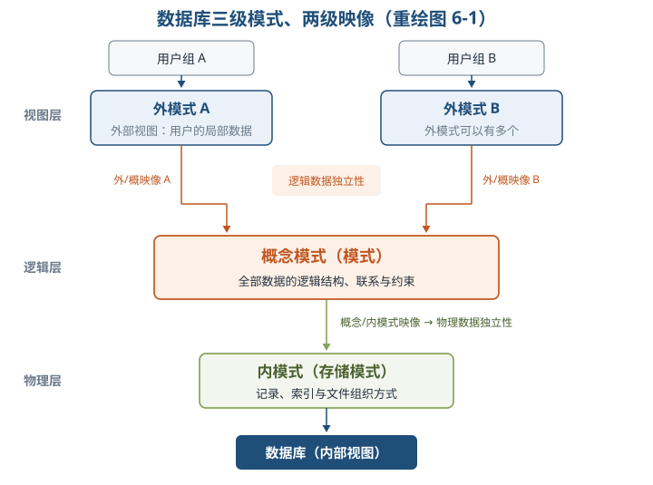

| 抽象层 | 对应模式 | 核心含义 |
| --- | --- | --- |
| 视图层 | 外模式（用户模式、子模式） | 用户所见的数据库局部逻辑结构；可有多个 |
| 逻辑层 | 概念模式（模式） | 全体数据的逻辑结构、联系及约束；通常一个，只描述“型” |
| 物理层 | 内模式（存储模式） | 记录、索引、文件组织等物理存储方式；通常一个 |

| 两级映像 | 保证的独立性 | 判断方法 |
| --- | --- | --- |
| 外模式/概念模式映像 | 逻辑数据独立性 | 概念模式改变时，调整映像，外模式与应用程序可不变 |
| 概念模式/内模式映像 | 物理数据独立性 | 内模式或存储结构改变时，调整映像，概念模式可不变 |

> 助记：“外概保逻辑，概内保物理”——看谁变了仍不影响上层，就落到哪条映像上。

### 6.2 关系数据库

**1. 基本术语、关系模式与完整性** ⭐【重点】【高频考点】

关系模型用二维表同时表示实体及实体间联系。关系模式是相对稳定的“型”，关系实例是某一时刻的“值”；形式化定义为 `R(U,D,dom,F)`，常简写为 `R(U)`。

| 术语 | 必须掌握的含义 |
| --- | --- |
| 属性、域 | 属性是列；域是该列允许取值的集合，关系模型要求域值原子化 |
| 元组、目（度） | 元组是行；目或度是属性列数，不是行数 |
| 候选码 | 能唯一标识一个元组的极小属性或属性组，可有多个 |
| 主码 | 从候选码中选定的一个；主码属性唯一且非空 |
| 主属性 | 出现在**任一候选码**中的属性；其余为非主属性 |
| 外码 | 本关系中的属性参照另一关系（也可自参照）的候选码/主码 |
| 全码 | 全部属性合起来才构成候选码 |

举例：`SC(学号,课程号,成绩)` 中，`(学号,课程号)` 是候选码，学号与课程号都是主属性；学号参照学生关系、课程号参照课程关系，因此二者又分别是外码。

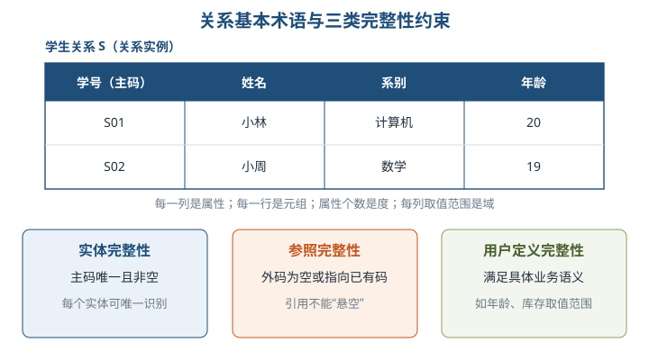

| 完整性 | 规则 | 生活化例子 |
| --- | --- | --- |
| 实体完整性 | 主码唯一且所有主码属性非空 | 每张借书证必须有唯一证号，不能空着 |
| 参照完整性 | 外码取空（允许时）或等于被参照关系中已有码值 | 借阅记录不能指向不存在的读者 |
| 用户定义完整性 | 满足具体业务语义，如范围、格式、检查约束 | 图书库存量不得小于 0 |

**2. 关系运算** ⭐【重点】【高频考点】【易错】

> 教材原文：关系操作的特点是操作对象和操作结果都是集合。

**五种基本关系代数运算是并、差、广义笛卡儿积、选择、投影**；交、连接、除等可由基本运算导出。并、交、差要求参与关系具有相容结构（同目且对应属性域相同）。

| 运算 | 记法与结果 | 识别要点 |
| --- | --- | --- |
| 并、交、差 | `R∪S`、`R∩S`、`R−S` | 分别取“属于任一”“同时属于”“只属于 R” |
| 广义笛卡儿积 | `R×S` | 列数相加、元组数相乘，是无条件拼接 |
| 选择 | `σF(R)` | 按条件选**行**，水平方向 |
| 投影 | `πA(R)` | 选**列**并去掉重复元组，垂直方向 |
| θ/等值连接 | 从 `R×S` 中选取满足条件的元组 | θ 为 `=` 时是等值连接，通常保留重复列 |
| 自然连接 | 同名同域属性等值连接，并删除重复属性列 | 同时做行、列方向处理；无公共属性时退化为笛卡儿积 |
| 除 | `R÷S` | 找 R 中与 S 的**全部**目标值都关联的对象 |
| 外连接 | 左、右、全外连接 | 保留不匹配元组，缺失侧补 `NULL` |
| 广义投影 | 投影列表允许算术表达式 | 可直接生成计算列 |
| 聚集 | `sum/avg/count/min/max` | 输入值的集合，返回单一值；`distinct` 可先去重 |

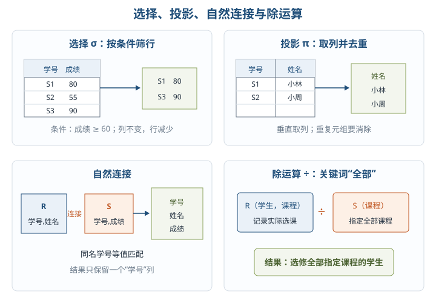

举例：要查“选修了全部指定课程的学生”，关键词是“全部”，应想到除法；若只查“选修过其中某一门”，不能用除法。

**3. 函数依赖与多值依赖** ⭐【重点】【高频考点】

`X→Y` 表示：任意两个元组只要在 X 上相同，就必须在 Y 上相同。函数依赖由**业务语义**决定，不能根据某张表当前恰好没有反例就下结论。

| 类型 | 判定 | 典型例子 |
| --- | --- | --- |
| 平凡依赖 | `Y⊆X` | `(学号,姓名)→姓名` |
| 完全函数依赖 | X 决定 Y，且 X 的任何真子集都不能决定 Y | `(学号,课程号)→成绩` |
| 部分函数依赖 | X 决定 Y，但 X 的某个真子集也能决定 Y | `(学号,课程号)→姓名`，因为学号已能决定姓名 |
| 传递依赖 | `X→Y`、`Y→Z`，且 Y 不决定 X，Z 不直接属于 X | `学号→状态→城市` |

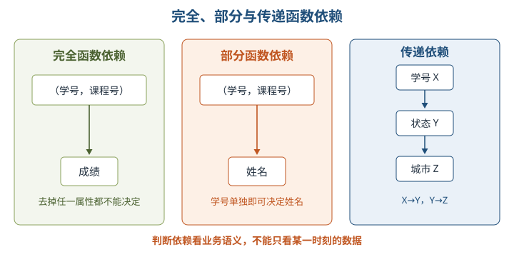

多值依赖 `X→→Y` 表示：给定 X 后，Y 的一组取值只由 X 决定，并与剩余属性 Z 无关。它具有对称性；函数依赖可看作多值依赖的特例。

**4. 规范化** ⭐【重点】【高频考点】【易错】

规范化的目的，是通过模式分解减少冗余以及插入、删除、修改异常。低级范式集合包含高级范式集合，即满足 4NF 必满足 BCNF、3NF、2NF、1NF。

| 范式 | 核心判定 | 主要消除的问题 |
| --- | --- | --- |
| 1NF | 每个属性值都不可再分，保持原子性 | 非原子字段 |
| 2NF | 在 1NF 上，每个非主属性都完全依赖于每个候选码 | 非主属性对码的部分依赖 |
| 3NF | 在 2NF 上，不存在非主属性对码的传递依赖 | 非主属性对码的传递依赖 |
| BCNF | 每个非平凡函数依赖的决定因素 X 都含有码（即为超码） | 主属性相关的部分、传递依赖及非码决定因素 |
| 4NF | 每个非平凡多值依赖的决定因素 X 都含有码 | 非平凡且非函数依赖的多值依赖 |

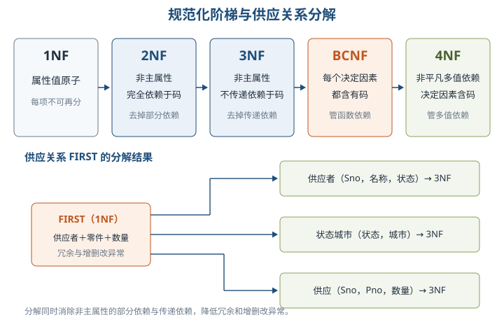

> 助记：“一原子，二去部分，三去传递，BC 看决定因素，四管多值”；3NF 只看非主属性的部分与传递，BCNF 对所有非平凡函数依赖统一要求决定因素含码。

### 6.3 数据库设计

**1. 六个阶段与需求分析** ⭐【重点】【高频考点】

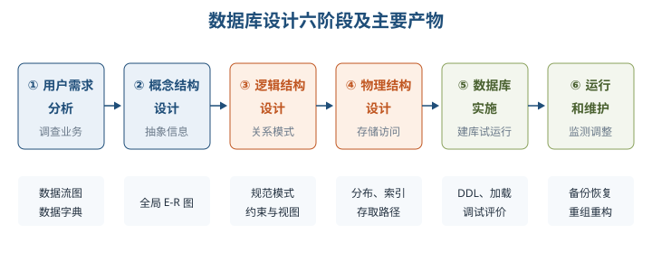

| 阶段 | 核心任务与产物 |
| --- | --- |
| 用户需求分析 | 调查业务与数据，形成数据流图、数据字典及需求说明 |
| 概念结构设计 | 建立独立于 DBMS 和硬件的概念模型，常用 E-R 图 |
| 逻辑结构设计 | 转成所选 DBMS 支持的数据模型，规范化并确定约束、视图 |
| 物理结构设计 | 确定数据分布、存储结构和访问方式 |
| 数据库实施 | DDL 建库、数据加载、应用调试、试运行与评价 |
| 运行和维护 | 性能监测改善、备份恢复、重组与重构 |

需求分析由分析人员和用户共同参与，常采用自顶向下的结构化分析（SA），逐层分解并用数据流图和数据字典表达。需求包括：**信息要求**（存什么及完整性）、**处理要求**（做什么及频度、响应时间）、**系统要求**（安全、使用方式、可扩充性）。

**2. 概念结构设计：E-R 方法** ⭐【重点】

概念结构设计通过**分类、聚集、概括**抽象现实事物。分类把共同特征归为一类；聚集定义某类型的组成属性；概括由超类定义子类，如“研究生是学生”。

设计步骤为**选择局部应用 → 逐一设计分 E-R 图 → 合并为全局 E-R 图**。合并时统一冲突并消除冗余：

| 冲突 | 典型表现 |
| --- | --- |
| 属性冲突 | 同一属性的类型、取值范围或单位不一致 |
| 命名冲突 | 同名异义或异名同义 |
| 结构冲突 | 同一对象一处抽象为实体，另一处抽象为属性；或属性集不同 |

**3. 逻辑结构设计与反规范化** ⭐【重点】【高频考点】【易错】

实体通常直接转为关系模式，实体标识符成为关系的码；联系按下表转换：

| 联系 | 常用转换方法 | 码如何处理 |
| --- | --- | --- |
| 1:1 | 通常不单独建表，可并入任一方，加入另一方码及联系属性 | 接收方原有码不变 |
| 1:N | 通常并入 **N 方**，加入一方码及联系属性 | N 方原有码不变 |
| M:N | 必须单独转为关系模式，含双方码及联系属性 | 通常由双方码共同组成主码 |

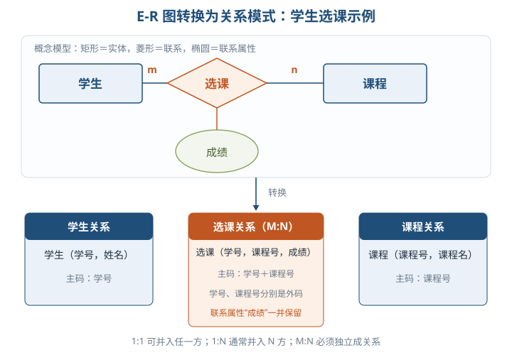

初始关系模式还要依次确定数据依赖、判断范式、必要时分解、评价修正，并确定数据项/表级/表间约束与用户视图。视图既简化跨表处理，也可按用户类别限制数据范围。

**反规范化不是从不规范化**，而是在规范化之后为加速读操作，有选择地增加冗余。常见手段有冗余列、派生列、表重组、水平/垂直分割；代价是设计复杂、更新异常，需要应用程序、批处理或触发器同步。

**4. 物理设计、实施与维护** ⭐【重点】

| 工作 | 考试抓手 |
| --- | --- |
| 数据分布 | 按应用、处理频度和响应要求分配；分布变化可能反过来调整逻辑设计 |
| 存储结构 | 可选顺序、哈希、堆、B 树等；结合处理要求与变更频度 |
| 访问方式 | 设计记录格式、物理布局和存取路径；索引是常用加速手段 |
| 聚簇 | 适合聚簇码稳定、按该码查询/连接为主的表；维护代价大，对无关查询无益 |
| 索引取舍 | 主外码、只读或查询为主、范围/排序/聚集查询宜考虑；小表、频繁更新、低基数、过长或很少查询的属性不宜 |

实施阶段以 DDL 建立实际结构，数据加载前必须整理、校验，可手工录入或用转换工具；试运行同时测试功能与效率，且应有非设计人员参与。

运行维护中，**重组不改变逻辑和物理结构**，主要清理废弃空间、碎片和指针链；**重构会修改结构**，如列、约束、表或视图的增删改。备份恢复方案应在设计阶段制定，而不是故障后才补。

**5. 应用程序与数据库交互** ⭐【重点】【高频考点】

| 方式 | 原理与特点 | 关键词 |
| --- | --- | --- |
| 库函数接口 | 调用厂商提供的底层 API，如 Oracle OCI；灵活但依赖具体 DBMS | 连接、SQL、事务函数库 |
| 嵌入式 SQL | SQL 直接写入 C 等宿主语言；先由预编译器转换为纯宿主语言函数调用 | 预编译、宿主变量、游标 |
| 通用接口标准 | ODBC 以统一 API 访问异构数据源，具体操作由对应驱动完成，先注册数据源 | 数据源名、驱动程序 |
| ORM | 用映射元数据把对象与关系表相互映射，封装持久化细节 | Hibernate、MyBatis、JPA |

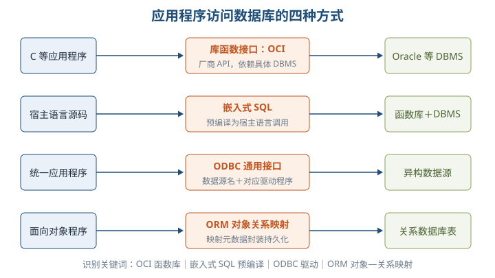

ODBC 应用程序不直接操作具体 DBMS，而由 ODBC 驱动完成；JDBC 是 Java 访问数据库的统一 API。Hibernate 偏全自动，MyBatis 偏半自动，JPA 是 Java 持久化规范，具体功能由实现框架提供。

### 6.5 NoSQL 数据库

**1. 四种类型与共同特点** ⭐【重点】【高频考点】

NoSQL 常解释为 **Not Only SQL**，泛指非关系型数据库，不是简单“反对 SQL”。它面向海量、多类型、高并发数据，通常以灵活模型和分布式扩展能力满足业务需求。

| 类型 | 数据组织与适用场景 | 代表产品 |
| --- | --- | --- |
| 列式存储 | 按列/列族组织，适合分布式海量数据与分析 | Cassandra、HBase、Riak |
| 键值存储 | 通过键和哈希表定位值，简单易部署；只查值的一小部分时效率较差 | Redis、Oracle BDB |
| 文档型 | 存储 JSON 等半结构化、可嵌套文档，可看作键值模型升级 | MongoDB、CouchDB、SequoiaDB |
| 图数据库 | 以结点和边表达关系，适合社交、交通、生物网络 | Neo4j、InfoGrid |

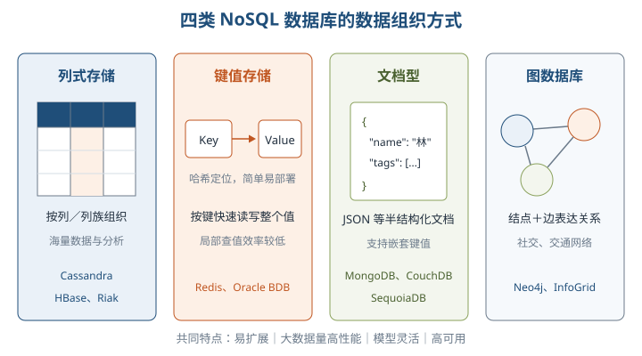

共同特点是**易扩展、大数据量下高性能、数据模型灵活、高可用**。不能把它们误记成“所有 NoSQL 都绝对不支持事务或 SQL”；本章强调的是不保证传统关系数据库那样的 ACID 与固定关系模式。

**2. 四层体系框架与适用场景** ⭐【重点】

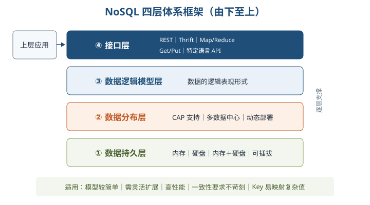

| 层次（由下至上） | 主要内容 |
| --- | --- |
| 数据持久层 | 内存、硬盘、内存＋硬盘、定制可插拔 |
| 数据分布层 | CAP 支持、多数据中心、动态部署与水平扩展 |
| 数据逻辑模型层 | 数据的逻辑表现形式 |
| 接口层 | REST、Thrift、Map/Reduce、Get/Put、特定语言 API |

适用信号：数据模型较简单、需要灵活 IT 系统、性能要求高、不要求高度一致性、给定 key 易映射复杂值。若业务高度依赖复杂关联、强一致事务，则不能只凭“数据量大”就改用 NoSQL。

> 助记：NoSQL 四层自下而上“持—分—逻—接”：先落盘，再分布，再定模型，最后给接口。

## 三、重点与易错点

| # | 考点 | 必须记住的结论 | 易错提醒 |
| --- | --- | --- | --- |
| 1 | DB、DBMS、DBS | DBMS 是 DBS 的核心软件，DB 是数据集合，DBS 范围最大 | 不要把 DBMS 等同于整个 DBS |
| 2 | 数据模型三要素 | 数据结构、数据操作、约束条件 | 数据模型不包括“数据字典”这一独立第四要素 |
| 3 | 三级模式数量 | 外模式可多个，概念模式和内模式通常各一个 | 视图层不等于只有一张视图 |
| 4 | 两级映像 | 外/概映像保逻辑独立，概/内映像保物理独立 | 改内模式对应物理独立，不是逻辑独立 |
| 5 | 主属性 | 出现在任一候选码中的属性都是主属性 | 不是只有主码中的属性才叫主属性 |
| 6 | 实体与参照完整性 | 主码唯一非空；外码为空或指向已有码值 | 外码不是任何时候都绝对禁止为空 |
| 7 | 五种基本运算 | 并、差、笛卡儿积、选择、投影 | 交、连接、除是导出运算 |
| 8 | 选择与投影 | 选择筛行，投影取列并去重 | 投影不是复制整行 |
| 9 | 自然连接 | 同名属性等值连接并删除重复列 | 等值连接通常保留重复列 |
| 10 | 除法 | 处理“与全部目标值都相关”的查询 | “至少一个”不能用除法表达 |
| 11 | 函数依赖 | 由语义决定，对任何可能实例都成立 | 当前数据碰巧唯一不能证明依赖成立 |
| 12 | 2NF 与 3NF | 2NF 去非主属性部分依赖，3NF 再去传递依赖 | 都强调“非主属性” |
| 13 | BCNF 与 4NF | BCNF 管函数依赖，4NF 管多值依赖，决定因素均须含码 | 只考虑函数依赖时最高到 BCNF |
| 14 | E-R 联系转换 | 1:1 任一方，1:N 并入 N 方，M:N 独立成关系 | M:N 不能只把外码塞进其中一方 |
| 15 | 反规范化 | 规范化后为读性能有控制地增加冗余 | 不等于放弃设计，也会引入同步成本 |
| 16 | 重组与重构 | 重组不改结构，重构修改表、约束或视图等结构 | 二者不要只凭“运行维护”就混为一谈 |
| 17 | 嵌入式 SQL 与 ODBC | 前者靠预编译，后者靠数据源与驱动屏蔽异构 | ODBC 应用不直接调用具体 DBMS 内部接口 |
| 18 | NoSQL | 四类为列式、键值、文档、图；四层为持、分、逻、接 | NoSQL 不等于“不要 SQL”或“绝不支持事务” |

## 四、练习与真题

以下为自编单选模拟题，每题只有一个最符合题意的选项。

**1.** 某系统由数据库、数据库管理系统、应用程序、硬件及数据库管理员共同组成，该整体最准确的称谓是：

A. DB  B. DBMS  C. DBS  D. DDL

**2.** 在不改变外模式和应用程序的情况下调整数据库的索引与文件组织，主要体现了：

A. 物理数据独立性  B. 逻辑数据独立性  C. 实体完整性  D. 参照完整性

**3.** 关于关系数据库术语，下列说法正确的是：

A. 关系的度是元组个数  B. 主属性只能出现在主码中  C. 候选码可以有多个  D. 外码必须同时是本关系主码

**4.** 等值连接与自然连接的主要区别是自然连接：

A. 不允许比较属性相等  B. 必须使用不等号  C. 会保留全部重复属性列  D. 比较同名属性并删除重复属性列

**5.** 选课关系 `SC(学号,课程号,姓名,成绩)` 的码为 `(学号,课程号)`，且存在 `学号→姓名`。该关系不满足 2NF 的直接原因是：

A. 属性值不原子  B. 非主属性对码部分依赖  C. 非主属性对码传递依赖  D. 存在非平凡多值依赖

**6.** 某关系已达到 3NF，但存在一个非平凡函数依赖 `X→Y`，其中 X 不含任何候选码。由此可判定它：

A. 必不属于 BCNF  B. 必不属于 1NF  C. 必满足 4NF  D. 一定不存在冗余

**7.** 将学生与课程之间的 M:N 选课联系转换为关系模式，通常应：

A. 只在学生表加课程号  B. 只在课程表加学号  C. 独立建选课关系并包含双方码  D. 删除该联系

**8.** 合并分 E-R 图时，同一“身高”属性在一个局部图中以厘米为单位，在另一个局部图中以米为单位，这属于：

A. 属性冲突  B. 命名冲突  C. 结构冲突  D. 参照冲突

**9.** 关于反规范化，下列说法正确的是：

A. 它等同于从未进行规范化  B. 它只降低查询性能  C. 它在规范化后有选择地增加冗余  D. 它不会带来数据同步问题

**10.** 嵌入式 SQL 的宿主语言编译器不能直接识别 SQL，数据库厂商通常首先提供：

A. 预编译器  B. 图数据库  C. 聚簇索引  D. 数据仓库

**11.** 需要直接存储结构灵活、可嵌套的 JSON 文档时，最匹配的 NoSQL 类型是：

A. 列式存储数据库  B. 文档型数据库  C. 图数据库  D. 层次数据库

**12.** NoSQL 四层体系框架由下至上的正确顺序是：

A. 接口层→逻辑模型层→分布层→持久层  B. 持久层→逻辑模型层→接口层→分布层  C. 分布层→持久层→接口层→逻辑模型层  D. 持久层→分布层→逻辑模型层→接口层

答案与解析集中放在全章最后的“六、参考答案”。

## 五、疑问与查漏补缺

**1. 大纲列出、但本章教材未展开的数据库分类。** 复习时需另外建立最小概念边界：

| 大纲补充项 | 最小掌握定义 |
| --- | --- |
| 分布式数据库系统 | 数据逻辑上相关、物理上分布在多个场地，由分布式 DBMS 统一管理 |
| 并行数据库系统 | 利用多处理器、多磁盘等并行执行查询与事务，目标是提高吞吐和响应速度 |
| 数据仓库 | 面向主题、集成、相对稳定、反映历史变化的数据集合，主要支持分析决策 |
| 数据挖掘 | 从大量数据中发现潜在、有用模式或知识，不等同于普通查询 |

**2. 教材 6.2.2 的表述易误读。** 一处把选择、投影也列入“扩展的关系运算”，但同节又明确五种基本运算包含选择、投影。考试应按“并、差、笛卡儿积、选择、投影是基本运算”掌握。

**3. 教材术语与现代用法有差异。** BCNF 是 Boyce-Codd Normal Form，教材“巴克斯范式”的译名不规范，按 BCNF 及其判定条件作答即可；JPA 更准确地说是一套持久化规范，Hibernate 等可作为其实现，MyBatis 通常不归为完整 JPA 实现。

**4. 易误读的范式条件。** 3NF 的教材定义较形式化，答题时先找候选码，再区分主属性/非主属性；不能因为“所有属性都是主属性，所以满足 3NF”就进一步推断一定满足 BCNF。

**5. 与其他章节衔接。** 需求分析的数据流图、数据字典承接第 5 章结构化分析；数据分布、接口选择会影响第 7 章体系结构设计；NoSQL 的 CAP 与分布式话题将在第 19 章大数据架构中继续深化。

## 六、参考答案

**1.** C。DBS 是包含 DB、DBMS、应用、硬件和人员等的完整系统。
**2.** A。内模式或存储结构改变而概念模式、外模式及应用可保持稳定，属于物理数据独立性。
**3.** C。候选码可有多个；度是属性数，主属性可出现在任一候选码中，外码不必是本关系主码。
**4.** D。自然连接按同名属性等值匹配，并在结果中去掉重复属性列。
**5.** B。码的一部分“学号”就能决定非主属性“姓名”，构成部分函数依赖。
**6.** A。BCNF 要求每个非平凡函数依赖的决定因素都含码，题设直接违反该条件。
**7.** C。M:N 联系通常独立成关系，以双方码及联系属性描述，双方码共同构成主码。
**8.** A。同一属性的数据单位不一致属于属性冲突。
**9.** C。反规范化是在规范化基础上为读性能主动增加受控冗余，并需处理同步成本。
**10.** A。预编译器把嵌入式 SQL 转成宿主语言可处理的函数调用等代码。
**11.** B。文档型数据库以 JSON 等格式保存半结构化、可嵌套文档。
**12.** D。四层自下而上是数据持久层、数据分布层、数据逻辑模型层、接口层。
