# 第7章 系统架构设计基础知识
- 教材位置：`02.系统架构设计师第二版-教材.pdf` PDF 第 258～280 页（书页 248～270）
- 复习状态：已完成
- 复习日期：2026-11-06
- 本章地位：架构师考试的**核心章**，上午选择题与下午案例题均高频。**架构风格分类与辨析、ABSD 六子过程、DSSA 活动与角色**几乎是每次考试的必考内容，也是后续第 8、10、13 章及论文写作的概念地基。

## 一、大纲考点
对照 `01.系统架构第二版-大纲.pdf` 科目 1 第 6 部分「系统架构设计基础知识」（大纲书页 40～43，PDF 第 50～53 页），大纲条目与教材小节一一对应。

| 大纲条目 | 大纲要求（考点） | 教材对应小节 |
| --- | --- | --- |
| 6.1.1 软件架构的定义 | ⭐定义、发展历程及作用；架构设计分类（**数据设计和体系结构设计**） | 7.1.1 |
| 6.1.2 软件架构设计与生命周期 | ⭐生命周期六阶段（需求、设计、实现、构件组装、部署、后开发）；Use Case 图、**ADL**、**4+1 模型**、UML；**IEEE 1471—2000** | 7.1.2 |
| 6.1.3 软件架构的重要性 | 架构设计在品质、涉众、计划、指导、复杂性、复用、维护、冲突分析上的作用 | 7.1.3 |
| 6.2.1 体系结构的设计方法概述 | ⭐ABSD 定义、适应范围；**三个基础**（功能分解、内聚耦合；质量和商业需求；模板使用） | 7.2.1 |
| 6.2.2 概念与术语 | 设计元素、视角与视图、用例和质量场景 | 7.2.2 |
| 6.2.3 基于体系结构的开发模型 | ⭐传统开发与 ABSD 的差别；ABSD 六阶段（需求、设计、文档化、复审、实现、演化） | 7.2.3 |
| 6.2.4 体系结构需求 | ⭐需求获取、**标识构件**（生成类图→对类分组→打包成构件）、架构需求评审 | 7.2.4 |
| 6.2.5 体系结构设计 | 体系结构设计过程模型（五步） | 7.2.5 |
| 6.2.6 体系结构文档化 | ⭐两个输出文档：**体系结构规格说明** + 测试体系结构需求的**质量设计说明书** | 7.2.6 |
| 6.2.7 体系结构复审 | 复审的目的、要求和意义（标识风险、发现缺陷） | 7.2.7 |
| 6.2.8 体系结构实现 | 实现过程模型（分析设计→构件实现→构件组装→系统测试） | 7.2.8 |
| 6.2.9 体系结构的演化 | ⭐演化定义、作用与六步骤 | 7.2.9 |
| 6.3.1 软件架构风格概述 | ⭐风格的定义、内涵（**词汇表 + 约束**）、分类和作用 | 7.3.1 |
| 6.3.2 数据流体系结构风格 | ⭐批处理、管道-过滤器 | 7.3.2 |
| 6.3.3 调用/返回体系结构风格 | ⭐主程序/子程序、面向对象、层次型、客户端/服务器 | 7.3.3 |
| 6.3.4 以数据为中心的体系结构风格 | ⭐仓库、黑板 | 7.3.4 |
| 6.3.5 虚拟机体系结构风格 | ⭐解释器、规则系统 | 7.3.5 |
| 6.3.6 独立构件体系结构风格 | ⭐进程通信、事件系统（隐式调用） | 7.3.6 |
| 6.4.1～6.4.2 架构复用定义、分类与原因 | 复用定义与作用；分类（**机会复用、系统复用**）；复用的能力与优势 | 7.4.1、7.4.2 |
| 6.4.3 架构复用的对象及形式 | 可复用资产对象内容（需求、架构设计、元素、测试等十类） | 7.4.3 |
| 6.4.4 架构复用的基本过程 | ⭐三阶段：构造/获取资产→管理资产（**构件库、构件分类与检索**）→使用资产（修改、扩展、配置、组装与集成） | 7.4.4 |
| 6.5.1 DSSA 的定义 | ⭐DSSA 定义与适应场景；**垂直域和水平域** | 7.5.1 |
| 6.5.2 DSSA 的基本活动 | ⭐**领域分析、领域设计、领域实现** | 7.5.2 |
| 6.5.3 参与 DSSA 的人员 | ⭐四种角色：领域专家、领域分析人员、领域设计人员、领域实现人员 | 7.5.3 |
| 6.5.4 DSSA 的建立过程 | ⭐五阶段；**DSSA 三层次系统模型** | 7.5.4 |
## 二、知识点笔记
### 2.1 软件架构概念（7.1）
#### 1. 软件架构的定义 ⭐【重点】【高频考点】
> 教材原文（Bass、Clements 和 Kazman）：**一个程序和计算系统软件体系结构是指系统的一个或者多个结构。结构中包括软件的构件、构件的外部可见属性以及它们之间的相互关系。**

通俗地说，架构就是「系统由哪些零件组成、每个零件对外长什么样、零件之间怎么连接协作」的一张总蓝图，它不是可运行的代码，而是对系统的一种**表达**，可帮助工程师分析设计有效性、早期比较备选方案、降低构造风险。

**架构设计的两个层次** ⭐：软件体系结构设计通常考虑设计金字塔中的两个层次——**数据设计**（体现数据构件、类的定义，封装属性和操作）与**体系结构设计**（关注软件构件的结构、属性和交互作用）。体系结构设计是构建软件的**初始蓝图**。【易错】「体系结构」与「架构」在本书中含义相同（Software Architecture 的不同译法），不是两个概念。

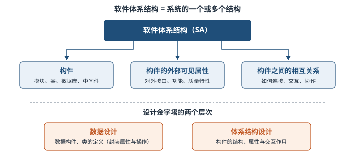

#### 2. 软件架构设计与生命周期（7.1.2）⭐【重点】
架构研究贯穿整个软件生命周期，各阶段关注点不同：

| 阶段 | 架构研究的核心内容 | 记忆关键词 |
| --- | --- | --- |
| 需求分析 | 需求模型→SA 模型的**转换**与**可追踪性**（问题空间→解空间） | 转换、追踪 |
| 设计 | SA 模型描述（基本概念、**ADL**、**多视图**）、设计分析、经验复用；研究最早、最多 | 描述、ADL、多视图 |
| 实现 | 基于 SA 的开发过程支持、SA→实现的过渡（模型映射、构件组装、中间件）、基于 SA 的测试 | 过渡、映射 |
| 构件组装 | 支持可复用构件**互联**（连接子实现、中间件）；检测并消除**体系结构失配** | 互联、失配 |
| 部署 | 用高层视图描述软硬件模型，分析部署方案的**质量属性** | 部署方案 |
| 后开发 | 维护、演化、复用：**动态软件体系结构**、**体系结构恢复与重建** | 动态、重建 |
> 助记：生命周期六阶段——「需、设、实、组、部、后」。

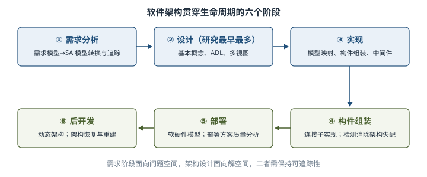

**设计阶段 SA 模型描述的三个层次** ⭐【高频考点】：

1. **SA 的基本概念**：模型由哪些元素组成、按何种原则组织。构件间的互联机制独立出来成为与构件同级的实体——**连接子**；现阶段描述方法是**构件和连接子的建模**。
2. **体系结构描述语言（ADL）**：支持构件、连接子及其配置的描述。**对连接子的重视是区分 ADL 与其他建模语言的重要特征**。典型 ADL：UniCon、Rapide、Darwin、Wright、C2SADL、Acme、xADL、XYZ/ADL、ABC/ADL。
3. **SA 模型的多视图表示**：从不同视角描述体系结构，体现**关注点分离**思想。

**典型多视图方案对比** ⭐【高频考点】【易错】：

| 模型/标准 | 提出方 | 视图组成 |
| --- | --- | --- |
| **4+1 模型** | Kruchten | 逻辑视图、进程视图、开发视图、物理视图 + 统一的**场景** |
| Hofmeister 4 视图 | Hofmeister | 概念视图、模块视图、执行视图、代码视图 |
| Views and Beyond | CMU-SEI | 模块视图、构件和连接子视图、分配视图 |
| IEEE 1471-2000 | IEEE | 软件密集型系统体系结构描述推荐实践（标准，非视图清单）；同类还有 RM-ODP、UML、Zachman 框架 |
【易错】4+1 的「+1」是**场景**（用例），不是第五个视图种类；Hofmeister 的「代码视图」不要与 4+1 的「开发视图」张冠李戴。现阶段 ADL 大多**没有显式支持多视图**。

**构件组装阶段的体系结构失配** ⭐：Garlan 等人 1995 年提出，指复用构件对体系结构和环境的**假设**与实际状况不同导致的冲突，分三类：①**由构件引起**（基础设施、控制模型、数据模型）；②**由连接子引起**（交互协议、连接子数据模型）；③**对全局体系结构的假设冲突**。**后开发阶段两个方向**：动态软件体系结构（运行时架构可改变：内部执行导致 / 外部请求重配置）与体系结构恢复重建（从已实现系统获取架构，方法有手工重建、工具支持的手工重建、查询语言自动聚集、数据挖掘四类）。

#### 3. 软件架构的重要性（7.1.3）
架构设计是**降低成本、改进质量、按时按需交付产品**的关键因素，教材列出八点：

| # | 重要性 | 一句话解释 |
| --- | --- | --- |
| 1 | 满足系统品质 | 性能、安全、可维护等质量靠架构元素交互实现，可尽早评估 |
| 2 | 使受益人达成一致目标 | 文档化架构让涉众讨论、权衡、达成共识（架构师主要职责） |
| 3 | 支持计划编制 | 构件依赖关系支撑任务划分、日程、成本与风险管理 |
| 4 | 对系统开发的指导性 | 明确定义组件、接口、通信与标准，给设计实现提供框架 |
| 5 | 有效管理复杂性 | 高层抽象 + 递归分解，把大问题拆小 |
| 6 | 为复用奠定基础 | 支持大粒度资源复用（现货组件、既有系统、封装应用） |
| 7 | 降低维护费用 | 把维护人员当作主要涉众，内建维护机制与可扩充性 |
| 8 | 支持冲突分析 | 变更前可推断影响：改一个构件能分析波及哪些构件 |
> 助记：重要性八条——「品质、共识、计划、指导、降繁、复用、省维护、析冲突」。

### 2.2 基于架构的软件开发方法 ABSD（7.2）⭐【重点】【高频考点】
#### 1. 概述与三个基础（7.2.1）
> 教材原文：**ABSD 方法是由体系结构驱动的**，即由构成体系结构的**商业、质量和功能需求的组合**驱动的。

ABSD 的特点：设计活动可以从项目**总体功能框架明确**就开始，**不必等需求抽取分析完成**，设计与需求活动**并行**；方法是**递归的、迭代的**，每步清晰定义，体系结构总是清晰的，降低设计随意性。

**三个基础** ⭐：①**功能的分解**（使用已有的基于模块的**内聚和耦合**技术）；②通过**选择体系结构风格**实现**质量和商业需求**；③**软件模板**的使用（复用一些软件系统的结构）。

> 助记：ABSD 三基础——「功能分解、风格选、模板用」。

举例：开发一个电商平台，总体功能框架（商品、订单、支付）一明确就可以开始架构设计，不必等每个页面的需求细节写完；先按功能拆出子系统，再选分层风格满足可维护性要求，界面布局套用已有模板。

#### 2. 概念与术语（7.2.2）
- **设计元素**：ABSD 自顶向下递归细化：最顶层系统分解为若干**概念子系统**和软件模板；第 2 层概念子系统分解为**概念构件**和附加模板；逐层细化直到产生**实际构件和类**。
- **视角与视图**：从不同视角观察架构——静态视角判断质量特性，动态视角判断系统行为特性；用**逻辑视图**记录设计元素的功能和概念接口。
- **用例和质量场景** ⭐【易错】：**用例捕获功能需求**（给用户一个结果值的功能点）；**质量场景捕获质量需求**（变更、性能、可靠性、交互性场景）。质量场景必须包括**预期的和非预期的**场景。

举例：「用户每年增长 10% 时系统响应仍小于 2 秒」是预期性能场景；「用户每年增长 100%」是非预期场景——未必真发生，但用来确定设计的**边界条件**。

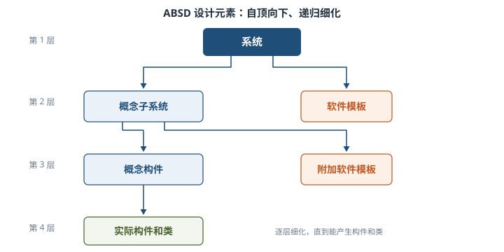

#### 3. ABSD 开发模型：六个子过程（7.2.3）⭐【高频考点】
传统开发模型中，体系结构建立在**需求分析之后、概要设计之前**，存在开发效率不高、不利于复用等缺点。ABSD 把整个过程划分为**体系结构需求、设计、文档化、复审、实现、演化**六个子过程。

> 助记：ABSD 六子过程——「需、设、文、审、实、演」。

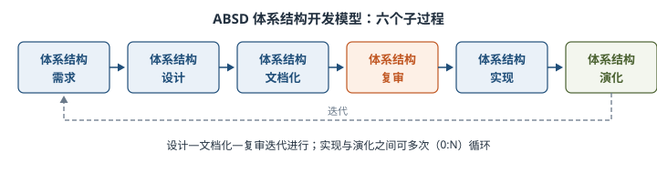

#### 4. 各子过程要点（7.2.4～7.2.9）
**（1）体系结构需求** ⭐：需求获取一般来自三方面——**系统的质量目标、系统的商业目标、系统开发人员的商业目标**。标识构件分三步：

| 步骤 | 做什么 | 要点 |
| --- | --- | --- |
| ① 生成类图 | 用 CASE 工具（如 Rational Rose）生成 | 初始逻辑结构基础 |
| ② 对类进行分组 | 隔离类成一组；概括关联的类组成附加组；聚合/合成关联的类也成附加组 | 简化类图结构 |
| ③ 把类打包成构件 | 类簇打包成构件，可再合并成更大构件 | 得到大致构件 |
随后进行**架构需求评审**：由分析、客户、设计、测试等代表组成小组，审查需求是否真实、类分组与构件合并是否合理；可在「需求获取—标识构件—需求评审」间**迭代**，类似系统需求可从**需求库**取出复用。

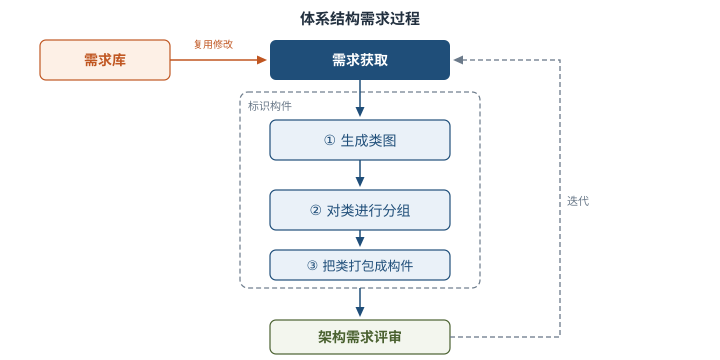

**（2）体系结构设计** ⭐：五步迭代——①**提出体系结构模型**（首先选择合适的**体系结构风格**）；②把已标识的**构件映射**到体系结构中（得到中间结构）；③**分析构件之间的相互作用**；④**产生软件体系结构**（在中间结构上精化）；⑤**设计评审**（邀请**独立于系统开发的外部人员**）。

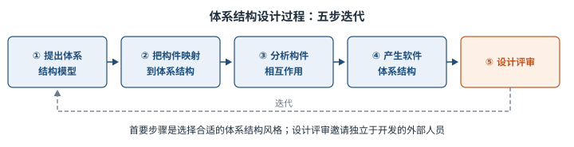

**（3）体系结构文档化** ⭐【高频考点】：主要输出**两个文档**——**体系结构规格说明** + **测试体系结构需求的质量设计说明书**。文档是系统演化各阶段设计与开发人员的**通信媒介**，要从使用者角度编写、分发给所有相关开发人员并保证**最新**。

**（4）体系结构复审**：设计、文档化、复审是一个**迭代**过程；主版本分析后安排**外部人员（用户代表和领域专家）**参加复审。通常搭建一个**可运行的最小化系统**评估架构是否满足需要。目的是**标识潜在风险、及早发现设计缺陷和错误**（需求是否满足、质量是否体现、层次是否清晰、构件划分是否合理等）。

**（5）体系结构实现**：以**复审后的文档化体系结构说明书**为基础：分析与设计→构件实现（从**构件库**查找符合**接口约束**的构件，必要时新开发）→构件组装→系统测试（构件功能测试 + 整体功能性能测试）。构件**接口约束对外唯一代表构件**。

**（6）体系结构演化** ⭐【高频考点】：使用系统演化步骤修改应用以满足新需求，六步：

| 步骤 | 内容 | 记忆点 |
| --- | --- | --- |
| ① 需求变化归类 | 变化需求与已有构件对应，找不到对应的做标记（后续新建构件） | 归类 |
| ② 制订体系结构演化计划 | 改变原结构前制订周密计划作指南 | 计划 |
| ③ 修改、增加或删除构件 | 按归类决定构件变动，并做功能性测试 | 构件变动 |
| ④ 更新构件的相互作用 | 构件变动后更新构件间控制流 | 更新交互 |
| ⑤ 构件组装与测试 | 组装成新体系结构，测整体功能与性能 | 组装测试 |
| ⑥ 技术评审 | 评审是否反映需求变动；不符合则在第②～⑥步间迭代 | 评审迭代 |
> 助记：演化六步——「归类、计划、改构件、更交互、组装测、再评审」。

### 2.3 软件架构风格（7.3）⭐【重点】【高频考点】
#### 1. 风格概述（7.3.1）
> 教材原文：**软件体系结构风格是描述某一特定应用领域中系统组织方式的惯用模式。**体系结构风格定义一个系统家族，即**一个体系结构定义一个词汇表和一组约束**。

通俗地说，风格就是「某一类系统公认的搭法」：**词汇表**规定能用哪些构件和连接件类型，**约束**规定这些构件连接件怎么组合。听到「客户/服务器」就知道系统怎么组织，这就是风格的价值——**促进设计重用**。

核心目标是**体系结构级的软件重用**。教材将经典风格分为**五大类**：

| 大类 | 包含的子风格 | 一句话特征 |
| --- | --- | --- |
| 数据流 | 批处理、管道-过滤器 | 数据依次流经各处理步骤 |
| 调用/返回 | 主程序/子程序、面向对象、层次型、客户端/服务器 | 分而治之，调用后控制返回 |
| 以数据为中心 | 仓库、黑板 | 围绕中央数据结构组织 |
| 虚拟机 | 解释器、规则系统 | 人为构建运行环境解析自定义语言 |
| 独立构件 | 进程通信、事件系统 | 构件独立、不直接通信，降低耦合 |
> 助记：五大类——「数据流、调用返、数据中心、虚拟机、独立件」。

#### 2. 数据流风格（7.3.2）⭐
数据流体系结构没有概念上的程序计数器，指令可执行性仅由**输入参数的可用性**决定，执行顺序不可预测；两种子风格对比如下。

| 对比项 | 批处理 | 管道-过滤器 |
| --- | --- | --- |
| 基本构件 | 独立的应用程序（每个处理步骤） | **过滤器**（Filter） |
| 连接件 | 某种类型的媒介（如磁带），定义数据流图 | **管道**（Pipe），传输数据流 |
| 数据传递 | 数据**完整、整体**传递，前一步结束后下一步才开始 | 数据**流式**传递，过滤器读输入流→处理→写输出流 |
| 通俗例子 | 老式工资处理：全部考勤录完才能统一算工资 | 编译器：词法分析→语法分析→代码生成流水作业 |
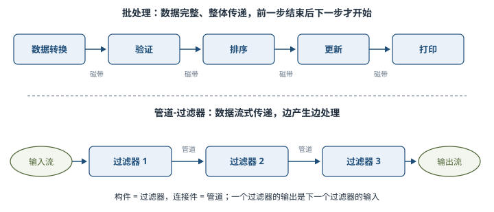

#### 3. 调用/返回风格（7.3.3）⭐
利用调用与返回机制，**分而治之**降低复杂度、增加可修改性。四个子风格：

| 子风格 | 构件 | 连接件/交互 | 特点与记忆点 |
| --- | --- | --- | --- |
| 主程序/子程序 | 主程序、子程序（可合成为模块） | **过程调用** | 单线程控制，调用有层次性；子程序正确性取决于它调用的子程序 |
| 面向对象 | **对象**（抽象数据类型的实例） | 对象间消息/过程调用 | 数据表示与操作**封装**在对象中，建立在数据抽象上 |
| 层次型 | 各层（实现虚拟机） | 层间交互**协议** | 每层为上层服务、作下层客户；接口只对相邻层可见；每层最多影响两层 |
| 客户端/服务器（C/S） | 客户机、服务器 | 网络 | 基于**资源不对等**且为实现共享；两层「胖客户机瘦服务器」，三层「瘦客户机」 |
**两层与三层 C/S 对比** ⭐【高频考点】：两层 C/S 三部分——数据库服务器、客户应用程序、网络；服务器管数据，客户机完成用户交互。三层 C/S 增加**应用服务器**，应用功能分为**表示层**（用户接口，图形界面）、**功能层**（业务处理逻辑，驻留应用服务器）、**数据层**（数据库管理系统），三层逻辑上独立。

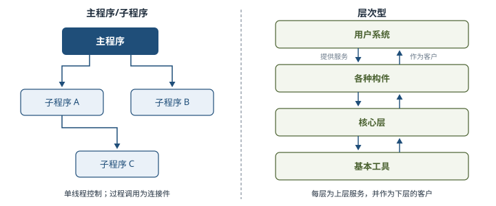

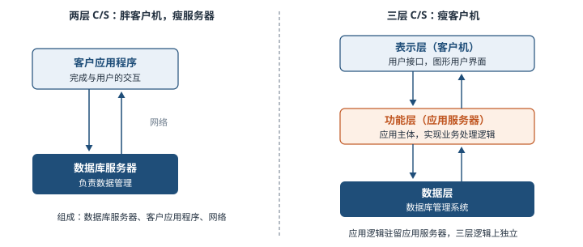

#### 4. 以数据为中心的风格（7.3.4）⭐【易错】
| 对比项 | 仓库 | 黑板 |
| --- | --- | --- |
| 中央结构 | **中央数据结构**说明当前数据状态 | **黑板**（共享数据），解空间组织成分级结构 |
| 其他构件 | 一组对中央数据操作的**独立构件** | 若干**知识源**（独立知识模块），直接存取黑板 |
| 触发方式 | 独立构件围绕仓库交互 | 知识源根据黑板状态逐步改写部分解 |
| 适用 | 数据集中存储维护、多构件共享 | **复杂非结构化问题**，综合多种知识源求解 |
| 典型应用 | 数据库系统、开发环境 | **信号处理：语音识别、模式识别**；松耦合代理数据共享 |
举例：黑板像医院专家会诊——病历（黑板）贴在中间，各科医生（知识源）轮流查看并写下自己的诊断意见，直到拼出完整结论；没有哪位医生指挥全局。

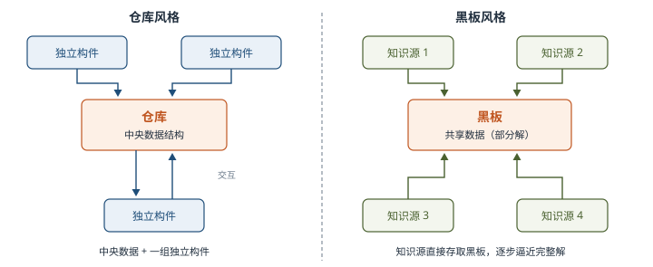

#### 5. 虚拟机风格（7.3.5）⭐
基本思想：**人为构建一个运行环境**，在其上解析运行自定义语言，增加架构灵活性。

| 子风格 | 组成 | 特点 |
| --- | --- | --- |
| 解释器 | **解释引擎** + 被解释代码的**存储区** + 记录引擎**当前工作状态**的数据结构 + 记录源代码**执行进度**的数据结构 | 仿真硬件执行过程，弥合程序语义与硬件语义差异；**缺点：执行效率较低**；典型例子：专家系统 |
| 规则系统 | **规则集、规则解释器、规则/数据选择器、工作内存**（知识库含规则集与事实集） | 基于规则推理，输入触发数据，经规则/数据选择后由解释器执行并更新工作内存 |
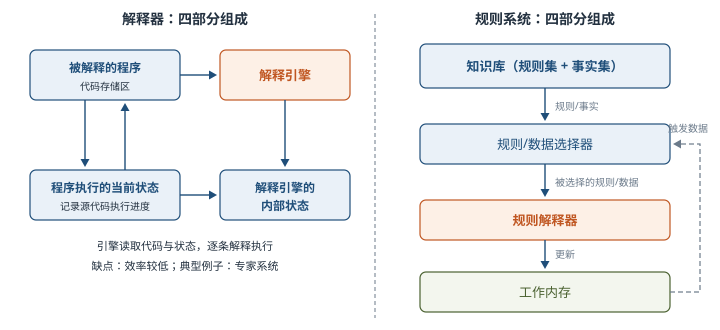

#### 6. 独立构件风格（7.3.6）⭐【高频考点】
每个构件相对独立、**不直接通信**，降低耦合度、提升灵活性。

- **进程通信**：构件是**独立的过程（命名过程）**，连接件是**消息传递**；方式可点到点、异步或同步、远程过程调用。
- **事件系统（隐式调用）** ⭐：构件**不直接调用过程**，而是**触发或广播事件**；其他构件的过程在事件中**注册**，事件触发时系统**自动调用**所有注册过程。

【易错】隐式调用的关键特征：**事件的触发者不知道哪些构件会被影响**，不能假定处理顺序，甚至不知道哪些过程会被调用；因此许多隐式调用系统也包含**显式调用**作为补充。

举例：调试器 Debugger 在断点停下时只「声明事件」，编辑器自动卷屏到断点、变量监视器自动刷新数值——Debugger 并不知道、也不关心谁会响应。这就像小区广播「停水通知」，广播员不用知道哪些住户会因此储水。

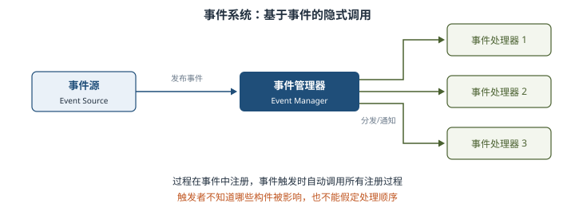

### 2.4 软件架构复用（7.4）
#### 1. 定义与分类（7.4.1）⭐
- **软件产品线**：一组软件密集型系统，共享公共可管理的特性集，以规定方式用**公共核心资产**集成开发。核心资产库包括软件架构及可剪裁元素，还包括设计文档、用户手册、项目管理历史记录、测试计划与用例等。
- **软件复用**：系统化的软件开发过程——通过**识别、开发、分类、获取和修改**软件实体，在不同开发过程中重复使用它们。
- **复用分类** ⭐【高频考点】：**机会复用**（开发过程中发现可复用资产就复用）与**系统复用**（**开发之前**就规划决定哪些需要复用）。

举例：写代码时顺手把上个项目的工具函数拷过来，是机会复用；公司立项时就规划「支付、鉴权两个模块全线产品统一复用」，是系统复用。

#### 2. 复用的原因（7.4.2）
减少开发工作、缩短时间、降低成本、提高生产力；提高产品质量与**互操作性**；使维护更简单。复用核心资产并采用产品线可显著提高效率、缩短上市时间。

#### 3. 复用的对象及形式（7.4.3）
可复用资产非常广，共**十类**：**需求、架构设计、元素、建模与分析、测试、项目规划、过程方法工具、人员、样本系统、缺陷消除**。一般形式复用包括函数、库、类/接口/包的复用；趋势是复用体**由小粒度向大粒度发展**。

#### 4. 复用的基本过程（7.4.4）⭐【高频考点】
| 阶段 | 做什么 | 关键点 |
| --- | --- | --- |
| ① 构造/获取可复用资产 | 构造恰当可复用资产 | 资产须**可靠、可被广泛使用、易于理解和修改** |
| ② 管理可复用资产 | 用**构件库**存储管理 | 构件库功能：存储、管理、检索、浏览维护；两个关键问题：**构件分类**（按特定方式组织）与**构件检索**（快速准确找到构件） |
| ③ 使用可复用资产 | 检索→获取→定制（**修改、扩展、配置**）→**组装与集成**成最终系统 | 以需求为导向 |
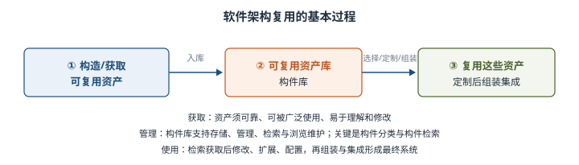

### 2.5 特定领域软件体系结构 DSSA（7.5）⭐【重点】【高频考点】
#### 1. 定义与特征（7.5.1）
> 教材原文（Hayes Roth）：**DSSA 就是专用于一类特定类型的任务（领域）的、在整个领域中能有效地使用的、为成功构造应用系统限定了标准的组合结构的软件构件的集合。**

Tracz 的定义：DSSA 是支持一组应用的**领域模型、参考需求、参考体系结构**等组成的开发基础，目标是支持特定领域中**多个应用的生成**。通俗地说，DSSA 就是「同一行业的一类系统，共用一套标准架构骨架」。

**DSSA 四个必备特征** ⭐：①严格定义的**问题域和问题解域**；②**普遍性**（可用于领域中特定应用开发）；③对整个领域**构件组织模型的恰当抽象**；④具备该领域固定的、典型的**可重用元素**。

**领域的两种理解** ⭐【易错】：**垂直域**——定义一个特定**系统族**，覆盖族内多个系统，产出通用软件体系结构（只能应用于**成熟、稳定的领域**）；**水平域**——定义多个系统、多个系统族中**功能区域的共有部分**，在**子系统级**涵盖多个系统族的特定功能。垂直域条件难满足时，可把领域**分割成较小范围**。

#### 2. 基本活动（7.5.2）⭐
| 活动 | 目标 | 要点 |
| --- | --- | --- |
| 领域分析 | 获得**领域模型** | 定义领域边界、识别信息源（现存系统、文献、专家、用户调查等）；选**样本系统**，区分共同需求与独有需求 |
| 领域设计 | 获得 **DSSA** | 不是单个系统表示，而是适应多系统的高层设计；通过**多选一、可选**方案体现变化性；同时形成**重用基础设施的规约** |
| 领域实现 | 依据领域模型和 DSSA **开发组织可重用信息** | 可从现有系统提取或新开发；是**重用基础设施的实现**阶段 |
整个过程是**反复的、逐渐求精**的，每个阶段都可能返回前面的步骤修改完善。

> 助记：DSSA 三活动产出——「分析出模型、设计出架构、实现出构件」。

#### 3. 参与 DSSA 的人员（7.5.3）⭐【高频考点】
| 角色 | 谁来担任 | 主要任务 |
| --- | --- | --- |
| 领域专家 | 有经验的用户、软件工程师等 | 提供领域知识；组织**领域字典**；帮助选择**样本系统**；**复审**领域模型与 DSSA |
| 领域分析人员 | 有知识工程背景的系统分析员 | 控制**领域分析**过程；知识获取并组织到**领域模型**；验证与维护领域模型 |
| 领域设计人员 | 有经验的软件设计人员 | 控制软件设计过程；根据领域模型**开发出 DSSA**；验证 DSSA；建立领域模型与 DSSA 的联系 |
| 领域实现人员 | 有经验的程序设计人员 | 从头开发或用**再工程**从现有系统**提取可重用构件**；验证构件；建立 DSSA 与构件间联系 |
【易错】「开发 DSSA」是**领域设计人员**的事，「开发可重用构件」是**领域实现人员**的事；「复审领域模型」找**领域专家**，「维护领域模型」找**领域分析人员**。

#### 4. DSSA 的建立过程与三层模型（7.5.4）⭐
建立过程分**五个阶段**：①**定义领域范围**（确定领域中有什么、何时结束）；②**定义领域特定的元素**（编译**领域字典**和同义词词典，识别共同性与差异性）；③**定义领域特定的设计和实现需求约束**（描述解空间有差别的特性，记录约束后果）；④**定义领域模型和体系结构**（产生一般体系结构，说明构件语法语义）；⑤**产生、搜集可重用的产品单元**（为 DSSA 增加构件）。

该过程是**并发的、递归的、反复的**（螺旋模型），每阶段可能经历多遍、每次增加细节。

**DSSA 三层次系统模型** ⭐：**领域开发环境**（领域架构师，参考需求/领域模型/参考结构/开发工具）→ **领域特定的应用开发环境**（应用工程师，实例化的体系结构）→ **应用执行环境**（操作员）。

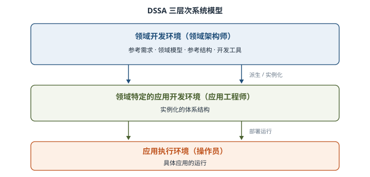

## 三、重点与易错点
| # | 考点 | 必须记住的结论 | 易错提醒 |
| --- | --- | --- | --- |
| 1 | 架构定义 | 构件 + 外部可见属性 + 相互关系（Bass 定义） | 架构是「表达」不是可运行软件 |
| 2 | 架构设计两层次 | 数据设计 + 体系结构设计 | 不要写成「概要设计 + 详细设计」 |
| 3 | 生命周期六阶段 | 需求、设计、实现、构件组装、部署、后开发 | 「构件组装」独立成阶段，别漏 |
| 4 | ADL 的特征 | 支持构件、连接子及配置；**重视连接子**是区别于其他建模语言的标志 | ADL 大多不显式支持多视图 |
| 5 | 4+1 模型 | 逻辑、进程、开发、物理 + 场景 | 「+1」是场景；Hofmeister 是概念/模块/执行/代码 |
| 6 | 体系结构失配 | 构件假设与环境实际不同导致冲突；分构件、连接子、全局架构三类 | Garlan 等 1995 年提出 |
| 7 | ABSD 三基础 | 功能分解（内聚耦合）、选风格实现质量商业需求、软件模板 | 驱动是「商业+质量+功能需求组合」 |
| 8 | 用例 vs 质量场景 | 用例捕获功能需求，质量场景捕获质量需求（含预期与非预期） | 非预期场景用于确定边界条件 |
| 9 | ABSD 六子过程 | 需求、设计、文档化、复审、实现、演化 | 文档化输出**两个**文档：规格说明+质量设计说明书 |
| 10 | 标识构件三步 | 生成类图→对类分组→把类打包成构件 | 分组规则：隔离、概括关联、聚合/合成关联各成组 |
| 11 | 架构演化六步 | 归类→计划→构件变动→更新交互→组装测试→技术评审 | 不符合需求在第②～⑥步间迭代 |
| 12 | 五大类风格 | 数据流、调用/返回、以数据为中心、虚拟机、独立构件 | 黑板属「以数据为中心」，解释器属「虚拟机」 |
| 13 | 批处理 vs 管道-过滤器 | 批处理整体传递、逐步串行；管道-过滤器流式传递 | 管道-过滤器构件是过滤器、连接件是管道 |
| 14 | 两层/三层 C/S | 三层增加应用服务器；表示层/功能层/数据层 | 两层胖客户机，三层瘦客户机 |
| 15 | 事件系统隐式调用 | 触发者不知道谁被影响、不假定处理顺序 | 可包含显式调用作补充；进程通信构件是命名过程 |
| 16 | 复用分类与过程 | 机会复用/系统复用；获取→管理（构件库）→使用 | 管理两关键：构件分类、构件检索 |
| 17 | DSSA 垂直/水平域 | 垂直域=系统族通用架构；水平域=跨系统族共有功能（子系统级） | 垂直域要求领域成熟稳定 |
| 18 | DSSA 活动与角色 | 分析→领域模型；设计→DSSA；实现→可重用构件；四角色各司其职 | 开发 DSSA 是设计人员，开发构件是实现人员 |
## 四、练习与真题
以下为本章自编模拟单选题，答案集中放在全章最后。

**1.** 根据 Bass 等人的定义，软件体系结构不包括下列哪项内容？
A. 软件的构件  B. 构件的外部可见属性  C. 构件之间的相互关系  D. 构件内部的算法实现细节

**2.** 在软件架构生命周期中，研究「动态软件体系结构」和「体系结构恢复与重建」属于哪个阶段？
A. 设计阶段  B. 实现阶段  C. 构件组装阶段  D. 后开发阶段

**3.** 关于体系结构描述语言（ADL），下列说法正确的是？
A. ADL 只描述构件，不描述连接子
B. 对连接子的重视是区分 ADL 与其他建模语言的重要特征
C. 现阶段的 ADL 大多显式支持多视图表示
D. UML 是典型的 ADL，二者完全等同

**4.** ABSD 方法的三个基础是功能分解、选择体系结构风格实现质量和商业需求，以及？
A. 软件模板的使用  B. 严格的需求冻结  C. 形式化验证  D. 面向对象分析

**5.** 在 ABSD 中，用于捕获质量需求的是？
A. 用例  B. 数据流图  C. 质量场景  D. 类图

**6.** ABSD 模型把整个软件过程划分为六个子过程，下列哪项不属于其中？
A. 体系结构需求  B. 体系结构文档化  C. 体系结构复审  D. 体系结构部署

**7.** 体系结构文档化过程的主要输出结果是体系结构规格说明和？
A. 测试体系结构需求的质量设计说明书  B. 详细设计说明书  C. 用户操作手册  D. 项目开发计划

**8.** ABSD 标识构件过程的正确步骤顺序是？
A. 对类进行分组→生成类图→把类打包成构件
B. 生成类图→把类打包成构件→对类进行分组
C. 生成类图→对类进行分组→把类打包成构件
D. 把类打包成构件→生成类图→对类进行分组

**9.** 某系统由词法分析、语法分析、语义分析、代码生成等步骤组成，前一步的输出作为后一步的输入，数据以流的方式传递。该系统采用的架构风格是？
A. 批处理  B. 管道-过滤器  C. 黑板  D. 主程序/子程序

**10.** 语音识别系统通常综合多种知识源，围绕共享数据结构逐步求解复杂的非结构化问题，最适合采用的架构风格是？
A. 仓库  B. 黑板  C. 解释器  D. 事件系统

**11.** 关于基于事件的隐式调用风格，下列说法错误的是？
A. 构件通过触发或广播事件进行交互
B. 事件的触发者不知道哪些构件会被这些事件影响
C. 构件之间必须直接调用对方的过程
D. 许多隐式调用系统也包含显式调用作为补充

**12.** 在 DSSA 活动中，负责「控制整个软件设计过程，根据领域模型开发出 DSSA」的角色是？
A. 领域专家  B. 领域分析人员  C. 领域设计人员  D. 领域实现人员

## 五、疑问与查漏补缺
1. **大纲 6.1.1 要求「发展历程」**：本章未展开，该内容在**第 1 章 1.1.1** 系统讲述，两章应合并记忆；UML、IEEE 1471-2000 的细节同样见第 1 章。
2. **教材笔误/印刷瑕疵**：7.1.1 节末「其日标是」应为「其目标是」；7.5.4 两处「Tract」与 7.5.1 的「Tracz」为同一人，拼写不一致；图 7-11 以「主机+终端」示意早期 C/S，理解时以文字定义为准。
3. **与其他章衔接**：质量场景与六属性场景在**第 8 章**展开；动态演化与架构恢复重建在**第 10 章**深入；层次型、C/S 的工程落地见**第 13 章**；DSSA 与产品线实践可对照**第 12 章**。
4. **大纲 6.2.7 复审的「要求」**：教材只给出原则（外部人员参加、搭建可运行最小化系统、标识风险），未给量化指标，答题按「目的=标识风险、发现缺陷；方式=外部人员+最小化系统」组织即可。

## 六、参考答案
**1.** D。架构包括构件、构件的外部可见属性和相互关系，不关心内部算法实现细节。

**2.** D。后开发阶段围绕维护、演化、复用，典型方向是动态软件体系结构与体系结构恢复重建。

**3.** B。ADL 支持构件、连接子及其配置，重视连接子是其重要特征；现阶段 ADL 大多不显式支持多视图。

**4.** A。ABSD 三基础：功能分解、通过选择架构风格实现质量和商业需求、软件模板的使用。

**5.** C。用例捕获功能需求，质量场景捕获质量需求（变更、性能、可靠性、交互性）。

**6.** D。六子过程为需求、设计、文档化、复审、实现、演化，不含「部署」。

**7.** A。文档化输出体系结构规格说明与测试体系结构需求的质量设计说明书两个文档。

**8.** C。标识构件三步：生成类图→对类进行分组→把类打包成构件。

**9.** B。步骤间以数据流连接、流式传递是管道-过滤器；批处理要求数据完整整体传递。

**10.** B。黑板适用于复杂非结构化问题，综合多种知识源，传统应用即语音识别、模式识别。

**11.** C。隐式调用中构件不直接调用过程，而是触发/广播事件，由系统自动调用注册过程。

**12.** C。开发 DSSA 是领域设计人员的任务；领域实现人员负责开发或提取可重用构件。
