# 第8章 系统质量属性与架构评估

- 教材位置：`02.系统架构设计师第二版-教材.pdf` PDF 第 281～314 页（书页 271～304）
- 复习状态：已完成
- 复习日期：2026-11-06
- 本章地位：质量属性场景是把模糊需求变成可测试目标的通用方法，是综合知识常考点；ATAM 的效用树、敏感点、权衡点与风险分析则是案例题高频素材。

## 一、大纲考点

大纲科目 1 第 7 部分对应教材本章，编号不同但内容一致。

| 大纲条目 | 大纲要求 | 教材对应 | 复习抓手 |
| --- | --- | --- | --- |
| 7.1.1 质量属性概念 | 软件质量定义、范围、内涵及主要影响因素 | 8.1.1 | GB/T 16260.1 六特性；开发期与运行期分类 |
| 7.1.1 GB/T 16260.1 | 理解标准中的质量模型 | 8.1.1 | 六特性及各自子特性，避免与架构评估八属性混淆 |
| 7.1.2 面向架构评估的质量属性 | 性能、可靠性、可用性、安全性、可修改性、功能性、可变性、互操作性 | 8.1.2 | 八属性的定义、度量与边界 |
| 7.1.3 质量属性场景描述 | 场景定义、组成及重点关注的六类属性场景 | 8.1.3、表8-1～表8-6 | 六要素；六类场景的刺激、响应与度量 |
| 7.2.1 评估重要概念 | 敏感点、权衡点、风险承担者、场景；评估方法分类 | 8.2 引言、8.2.1 | 问卷/检查表、场景、度量三类方法 |
| 7.2.2 系统架构评估方法 | SAAM、ATAM、CBAM 及其他方法 | 8.2.2 | 三种主方法的目标与步骤；其他方法识别关键词 |
| 7.3 ATAM 架构评估实践 | 演示、调查和分析、测试、报告四阶段 | 8.3.1～8.3.4、图8-5～图8-7 | 八步骤、效用树、头脑风暴、风险与权衡点 |

## 二、知识点笔记

### 8.1.1 质量属性概念

> 教材原文：软件系统质量属性是一个系统的可测量或者可测试的属性，用来描述系统满足利益相关者需求的程度。

通俗地说，功能属性回答“系统能做什么”，质量属性回答“做得怎样”。架构不能只列功能模块，还要说明响应多快、故障后多久恢复、修改要花多大代价。

⭐【重点】GB/T 16260.1 从管理角度把软件质量分为六个维度：

| 六特性 | 子特性 | 一句话理解 |
| --- | --- | --- |
| 功能性 | 适合性、准确性、互操作性、依从性、安全性 | 提供的功能是否正确、合规并能协作 |
| 可靠性 | 容错性、易恢复性、成熟性 | 在规定条件和时间内持续完成规定功能 |
| 易用性 | 易学性、易理解性、易操作性 | 用户是否容易学会、看懂和操作 |
| 效率 | 资源特性、时间特性 | 用多少资源、花多少时间完成工作 |
| 维护性 | 可测试性、可修改性、稳定性、易分析性 | 出问题后是否容易定位、修改和验证 |
| 可移植性 | 适应性、易安装性、一致性、可替换性 | 是否能迁移、安装并替代其他软件 |

按生命周期还可分为开发期质量属性与运行期质量属性：

| 分类 | 属性 | 记忆重点 |
| --- | --- | --- |
| 开发期 6 项 | 易理解性、可扩展性、可重用性、可测试性、可维护性、可移植性 | 主要影响设计、编码、测试、修改和迁移 |
| 运行期 7 项 | 性能、安全性、可伸缩性、互操作性、可靠性、可用性、鲁棒性 | 主要在系统运行、交互、故障和负载变化时体现 |

举例：给网店增加“优惠券”功能，代码是否容易看懂、改动和测试，属于开发期质量；促销时能否撑住十倍请求、故障后能否快速恢复，属于运行期质量。

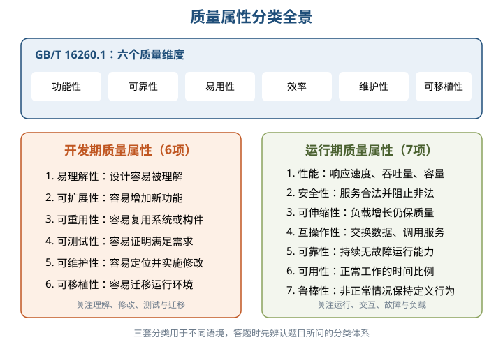

⭐【易错】几组相近概念：

- **可扩展性**偏向增加新功能；**可伸缩性**偏向用户量、数据量增长后仍维持服务质量，常通过增加服务器实现。
- **可靠性**关注规定条件、规定时间内无故障完成规定功能；**可用性**关注正常工作的时间比例以及故障后的恢复速度。
- **安全性**同时包含“向合法用户提供服务”和“阻止非授权使用”，不能只记成保密。
- **鲁棒性**又称健壮性或容错性，强调非法操作、软硬件故障等非正常情况下的行为。

### 8.1.2 面向架构评估的质量属性

⭐【高频考点】架构评估普遍关注八类质量属性：

| 属性 | 核心含义与常见度量 | 架构理解要点 |
| --- | --- | --- |
| 性能 | 响应能力；响应时间、单位时间事务数、吞吐量、容量 | 关注事件到达后多快响应、单位时间处理多少事件 |
| 可靠性 | 规定条件和时间内完成规定功能；MTTF、MTBF | 包含容错与健壮性；失效率恒定且修复时间很短时二者近似相等 |
| 可用性 | 系统正常运行的时间比例 | 可由故障间隔和故障恢复速度刻画 |
| 安全性 | 服务合法用户并阻止非授权使用或拒绝服务 | 机密性、完整性、不可否认性、可控性 |
| 可修改性 | 快速且高性价比地变更系统 | 包含可维护性、可扩展性、结构重组、可移植性 |
| 功能性 | 完成期望工作的能力 | 通常需要许多构件协作，不等于“质量属性都不重要” |
| 可变性 | 架构按预定义规则扩充或变更为新架构的能力 | 对软件产品线尤其重要 |
| 互操作性 | 与其他系统或环境交换数据、调用服务的难易程度 | 需要精心设计外部可视功能、数据结构和软件入口 |

可靠性的两个方面必须区分：

| 方面 | 出错后的目标 | 是否要求继续运行 |
| --- | --- | --- |
| 容错 | 确保系统行为正确，并进行内部“修复” | 通常要求恢复或重复操作，继续提供服务 |
| 健壮性 | 抵御错误使用和错误输入，使系统进入预定义状态 | 不一定继续运行，可按预定义方式终止 |

举例：支付节点宕机后自动切换备用节点并继续收款，体现容错；收到格式错误的请求后拒绝处理、记录日志并安全返回初始状态，体现健壮性。

> 助记：评估八性——“性、靠、用、安；改、功、变、互”，即性能、可靠性、可用性、安全性、可修改性、功能性、可变性、互操作性。

### 8.1.3 质量属性场景描述

> 教材原文：质量属性场景是一个具体的质量属性需求，是利益相关者与系统的交互的简短陈述。

⭐【重点】【高频考点】一个完整场景由六部分组成，缺一不可度量：

| 要素 | 回答的问题 | 支付系统示例 |
| --- | --- | --- |
| 刺激源 Source | 谁或什么产生刺激 | 支付节点内部进程 |
| 刺激 Stimulus | 发生了什么条件或事件 | 节点进程崩溃 |
| 环境 Environment | 事件发生时系统处于何种状态 | 系统正常运行、正在处理在线支付 |
| 制品 Artifact | 哪个系统或系统部分受到影响 | 支付服务及其所在节点 |
| 响应 Response | 系统采取什么行动 | 检测并记录故障，通知运维，切换备用节点 |
| 响应度量 Measurement | 如何判断响应是否达标 | 30 秒内恢复支付服务，期间不产生重复扣款 |

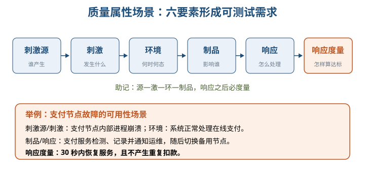

> 助记：源—激—环—制品，响应之后必度量。

六类质量属性场景的侧重点如下。⭐【易错】教材此处六类是“可用性、可修改性、性能、可测试性、易用性、安全性”，**不含可靠性**。

| 场景类型 | 典型刺激与环境 | 典型响应 | 响应度量关键词 |
| --- | --- | --- | --- |
| 可用性 | 内外部的疏忽、错误、崩溃；正常或降级模式 | 检测、记录、通知、禁止故障源、降级或恢复 | 可用时间、修复时间、不可用区间、降级运行时间 |
| 可修改性 | 用户、开发者或管理员要求增删改功能、质量或容量；设计至运行时 | 定位修改点、修改、测试、部署，控制连带影响 | 成本、工作量、资金、受影响元素数量、副作用 |
| 性能 | 周期、随机或偶发事件；正常或超载模式 | 处理刺激、调整服务级别 | 等待时间、期限、吞吐量、抖动、缺失率、数据丢失率 |
| 可测试性 | 分析、设计、代码、集成或交付完成；设计至部署时 | 访问状态和计算值、准备测试环境、执行测试 | 语句覆盖率、故障概率、测试时间、依赖链长度、环境准备时间 |
| 易用性 | 最终用户想学习、高效使用、减少错误、适配或获得满意体验 | 帮助、导航、撤销、纠错、定制、国际化、状态反馈 | 任务时间、错误数、成功率、满意度、知识获得、损失时间或数据 |
| 安全性 | 已识别或未知、授权或未授权主体试图读写数据、调用服务或发起拒绝服务 | 认证、授权、阻止、审计、加密、限流、通知与恢复 | 攻击成功概率、检测率、突破成本、服务保持率、恢复与受损范围 |

举例：把“系统要快”改成性能场景——“正常负载下，外部用户提交订单，订单服务在 2 秒内返回结果，95% 请求满足该时限”。这样才可以测试和验收。

### 8.2 系统架构评估概述

架构评估利用数学或逻辑分析，对一致性、正确性、质量属性和规划结果给出描述性、预测性、指令性结论，为架构策略决策服务。

| 方法类别 | 核心做法 | 优势与局限 |
| --- | --- | --- |
| 调查问卷或检查表 | 设计问题清单，利用相关人员经验审查架构 | 简单直接，但较大程度依赖评估者主观判断 |
| 基于场景 | 分析架构对使用或修改场景的支持程度 | 把抽象质量需求落到具体交互；SAAM、ATAM 是代表 |
| 基于度量 | 建立质量属性与度量的映射，从架构文档取度量信息，再推导质量属性 | 强调可量化证据，关键是映射原则和度量数据 |

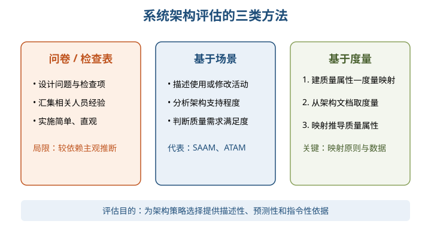

### 8.2.1 评估中的重要概念

| 概念 | 必须掌握的定义 | 例子 |
| --- | --- | --- |
| 敏感点 | 一个或多个构件或其关系的特性，对实现某个质量属性至关重要 | 缓存容量对吞吐量很敏感 |
| 权衡点 | 影响多个质量属性的特性，是多个质量属性的敏感点 | 提高加密级别增强安全性，却增加处理时延、影响性能 |
| 风险 | 架构中可能妨碍高优先级质量属性目标实现的问题点 | 应用信息散落在框架各处，导致修改代价高 |
| 非风险 | 支持特定优先质量属性的架构优势 | 框架与应用分离，便于替换应用 |
| 风险承担者 | 对架构施加影响并有自身关切的人，也称利益相关人 | 架构师、开发、维护、测试、项目经理、客户、用户等 |
| 场景 | 从风险承担者角度描述其与系统交互的简短陈述 | 用户在高峰时提交订单并要求及时响应 |

⭐【易错】8.2.1 的评估场景常简写为**刺激、环境、响应**三方面；8.1.3 的完整质量属性场景则是**六要素**。题目问法不同，答案数量不同。

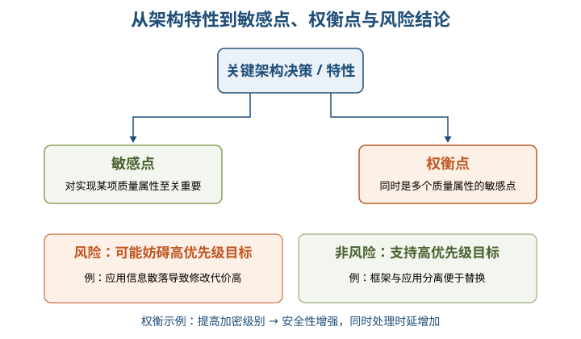

### 8.2.2 SAAM 方法

SAAM 是早期形成文档并广泛使用的架构分析方法，以场景为评估技术，最初主要用于分析**可修改性**，后来扩展到可移植性、可扩展性等，也可比较多个架构。

- 主要输入：问题描述、需求声明、架构描述。
- 使用时机：用于架构最后版本，但早于详细设计；描述应让所有参与者理解。
- 架构描述三方面：功能、结构和分配。
- 目标：验证基本架构假设和原则，发现固有风险、需求冲突和单一视角造成的不完整设计。
- 知识库：教材明确说 SAAM **不考虑已有知识库的可重用性**。

⭐【重点】SAAM 五步：

| 步骤 | 做什么 |
| --- | --- |
| 1 场景开发 | 各风险承担者协商，形成反映系统活动的任务场景 |
| 2 架构描述 | 描述计算构件、数据构件及数据与控制关系 |
| 3 单个场景评估 | 对直接、间接场景逐一分析架构支持程度 |
| 4 场景交互评估 | 分析多个场景对相同构件的共同影响 |
| 5 总体评估 | 权衡场景及其交互，形成单架构结论或多架构比较 |

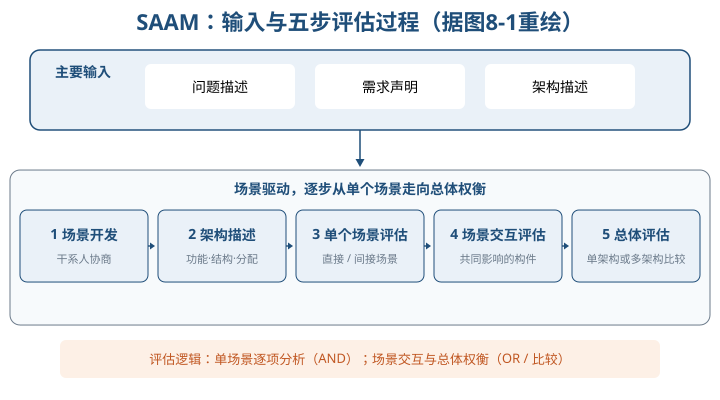

### 8.2.2 ATAM 方法

⭐【重点】【高频考点】ATAM 在 SAAM 基础上发展，关注多个相互影响、相互竞争的质量属性，初始重点是**性能、安全性、可修改性、可用性**。其核心不是给架构打一个总分，而是在开发前揭示质量属性之间的折中、敏感点和风险。

ATAM 的三类场景：

| 场景 | 关注内容 | 直观例子 |
| --- | --- | --- |
| 用例场景 | 系统典型使用，引出信息 | 用户提交订单并查询状态 |
| 增长场景 | 对系统的一般修改和演进 | 增加一种支付方式 |
| 探测/探索性场景 | 可能造成过载的极端修改或增长 | 同时接入多个应用、命令行改为窗口界面 |

ATAM 的四个活动领域及七步如下，注意它与 8.3 的“四阶段八步骤”不是同一套划分。

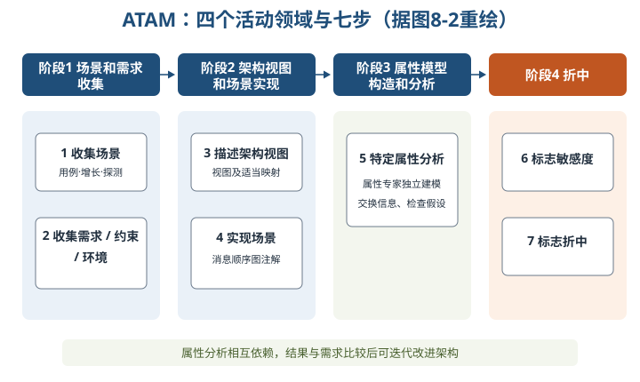

⭐【重点】效用树：

- 结构：**树根（效用）→质量属性→属性分类/具体说明→质量属性场景（叶子）**。
- 作用：把笼统的“系统要好”分解为可讨论、可排序的具体场景。
- 修剪：保留重要场景，教材建议通常不超过 50 个。
- 两个维度：先评场景对系统成功的重要性，再评架构实现难易度，均用 H/M/L。
- 优先级对：**(H,L)** 表示“重要且易实现”，不是“高风险、低风险”。

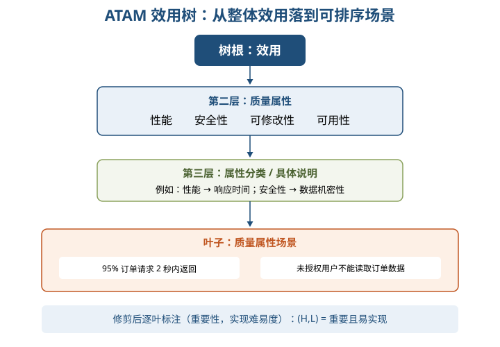

举例：“正常高峰下 95% 订单请求 2 秒内返回”可挂在“性能→响应时间”分支；其重要性为 H、实现难度为 M，则记为 **(H,M)**。

### 8.2.2 CBAM 方法

CBAM 在 ATAM 之后开始，复用 ATAM 的场景与评估结果，从经济角度对架构决策的成本和收益建模，帮助风险承担者按投资回报 ROI 选择策略。

⭐【重点】CBAM 八步：

| 步骤 | 核心动作 |
| --- | --- |
| 1 整理场景 | 按商业目标排序，选取优先级最高的约 1/3 场景 |
| 2 场景求精 | 给出最坏、当前、期望、最好四种质量属性响应级别 |
| 3 确定优先级 | 干系人基于“期望响应”投票，结合票权得到场景权值 |
| 4 分配效用 | 为四种响应级别建立效用表 |
| 5 建立策略关系 | 明确架构策略影响哪些场景、属性和响应级别 |
| 6 内插求效用 | 根据效用表和对应关系，求期望响应下各策略的效用 |
| 7 计算总收益 | 用场景权值与策略效用计算策略总收益 |
| 8 计算 ROI 并选择 | 估算成本，结合收益求 ROI，按成本约束和 ROI 排序 |

> 助记：CBAM——“整、精、投、效；关、插、益、投（ROI）”：整理、求精、投票、效用，建关系、内插、收益、投资回报。

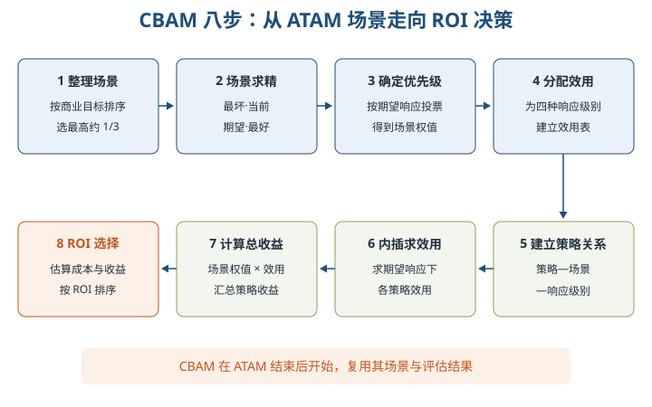

其他评估方法以“名称—识别关键词”掌握即可：

| 方法 | 一句话识别 |
| --- | --- |
| SAEM | 区分用户定义的外部质量属性与开发者决定的内部质量属性，建立度量准则并评估 |
| SAABNet | 用贝叶斯信念网络 BBN 表达不确定、不完整的定性知识，辅助诊断和预测 |
| SACMM | 用图内核、子结构相似度和架构距离度量架构修改 |
| SASAM | 映射并比较预期架构与源代码中的实际架构，属于静态评估 |
| ALRRA | 用动态复杂度、动态耦合度与 FMEA 评估架构可靠性风险 |
| AHP | 建立递阶结构、构造两两比较判断矩阵、求权重并总排序，辅助多准则决策 |
| COSMIC+UML | 把复杂度、耦合度、内聚度等面向对象度量与 COSMIC、UML 组件图关联，评估可维护性 |

### 8.3 ATAM 方法架构评估实践

⭐【高频考点】实践过程是四阶段八步骤：

| 阶段 | 步骤 | 主要产出或活动 |
| --- | --- | --- |
| 1 演示 | 1 介绍 ATAM | 说明过程、分析技术、预期结果，解答疑虑 |
| 1 演示 | 2 介绍业务驱动因素 | 说明主要功能、利益相关者、业务目标和约束 |
| 1 演示 | 3 介绍要评估的架构 | 描述架构、质量需求、技术约束、外部交互和架构方法 |
| 2 调查和分析 | 4 确定架构方法 | 解释控制流程及关键质量目标如何实现 |
| 2 调查和分析 | 5 生成质量属性效用树 | 收集场景，具体化并排序质量目标 |
| 2 调查和分析 | 6 分析架构方法 | 分析高优先级场景，识别风险、非风险、敏感点和权衡点 |
| 3 测试 | 7 头脑风暴和优先场景 | 扩大干系人参与，合并同类场景、投票、补充效用树 |
| 3 测试 | 8 分析架构方法 | 针对投票高优先级场景再次分析，发现新增风险与权衡 |
| 4 报告 | 汇总并提交结果 | 提交效用树、场景集、分析问题、风险与非风险、架构方法 |

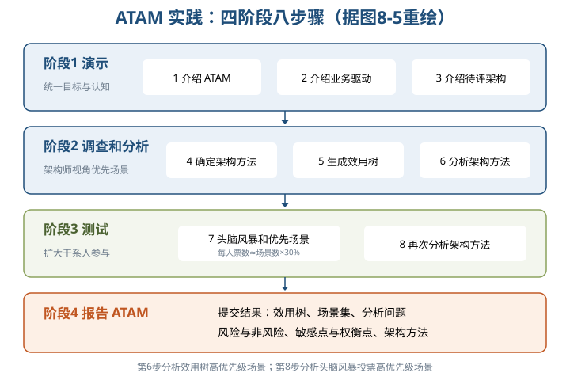

第 7 步的投票规则：每位风险承担者票数约为**场景总数 × 30%**，取最近整数。教材例中共有 16 个场景，因此每人 5 票。投票后按总票数排序，截取截止线以上场景，再与效用树优先场景比较和合并。

教材用 Hoover 与 Banking 两种事件架构演示评估。二者都有事件、队列、事件管理器和处理程序，但框架封装与应用耦合方式不同。

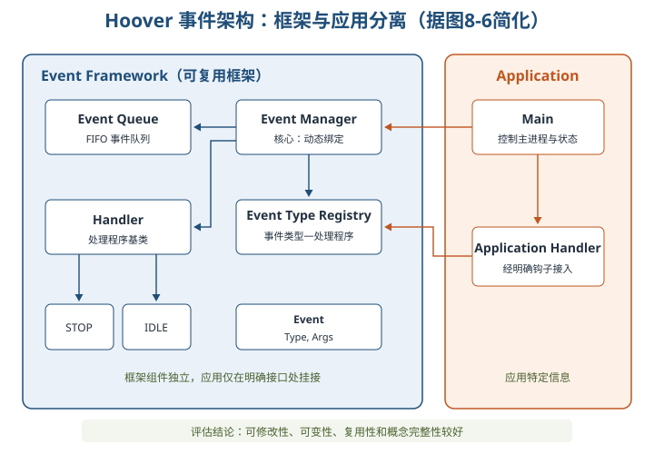

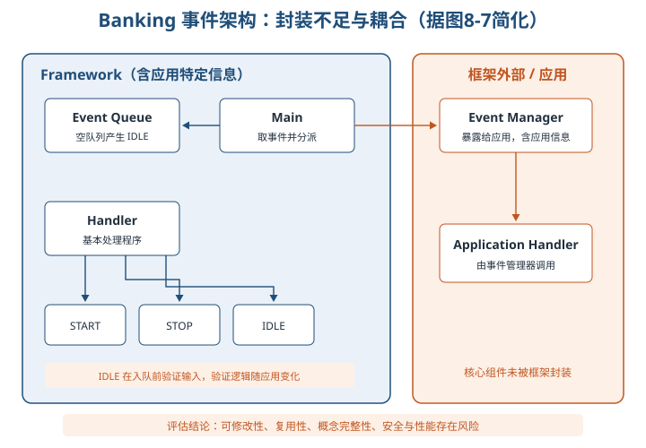

| 比较维度 | Hoover 架构 | Banking 架构 |
| --- | --- | --- |
| 封装 | 框架组件与应用分离，通过明确钩子挂接 | 事件管理器暴露给应用，应用特定信息嵌入多个组件 |
| 可修改性、可变性 | 高；注册表动态绑定处理程序，修改影响面小 | 较差；更换应用或新增组件常需大范围修改 |
| 可重用性 | 组件较独立，易复用 | 组件相互依赖，复用往往需要重大修改 |
| 可靠性 | 有缺陷输入可在事件绑定时处理 | 入队前验证输入，但换应用时验证逻辑也要改变 |
| 概念完整性 | 事件处理机制统一，控制机制较少 | 控制转移链较长，一致性不足 |
| 功能性 | 组件协调，能完成预期任务 | 基本能完成预期任务，属于非风险 |
| 安全性 | 数据封装较好，注册表仅由事件管理器操作 | 应用信息分散，整体机密性较差 |
| 性能 | 处理任务涉及组件较少，推定响应较快 | 处理链较长、涉及组件较多，推定性能不足 |

⭐【易错】“某个架构完成预期功能”不代表它没有架构风险。Banking 的功能性、可靠性可视为非风险，同时其可修改性、概念完整性、安全性和性能仍可能是风险。

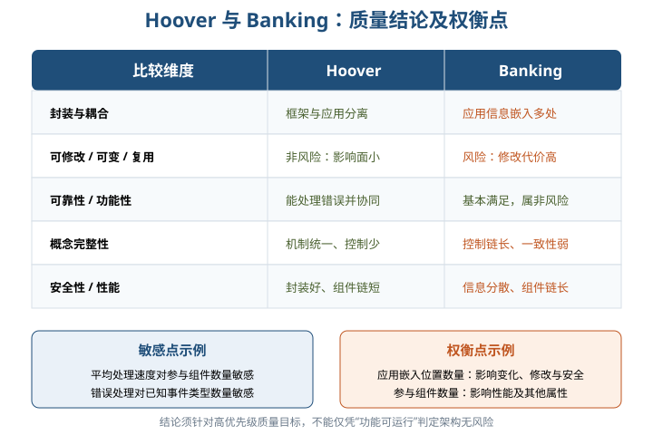

## 三、重点与易错点

| # | 考点 | 必须记住的结论 | 易错提醒 |
| --- | --- | --- | --- |
| 1 | 质量属性 | 必须可测量或可测试，描述满足利益相关者需求的程度 | “用户体验好”“系统很快”不是完整场景 |
| 2 | GB/T 六特性 | 功能、可靠、易用、效率、维护、可移植 | 不要与架构评估八属性、六类场景混背 |
| 3 | 开发期/运行期 | 开发期 6 项，运行期 7 项 | 可伸缩性属于运行期，可扩展性属于开发期 |
| 4 | 可靠性 vs 可用性 | 可靠性重无故障能力；可用性重正常时间比例与恢复速度 | MTTF、MTBF 是可靠性指标，不要直接当作可用性定义 |
| 5 | 容错 vs 健壮性 | 容错求正确行为并修复；健壮性保证进入预定义状态 | 健壮性不保证出错后继续运行 |
| 6 | 可修改性 | 包含可维护、可扩展、结构重组、可移植 | 可移植性在此是可修改性的特例，不只属于 GB/T 六特性 |
| 7 | 场景六要素 | 刺激源、刺激、环境、制品、响应、响应度量 | 漏掉响应度量就无法客观测试 |
| 8 | 六类属性场景 | 可用、可修改、性能、可测试、易用、安全 | 此处不包含可靠性 |
| 9 | 评估场景三要素 | 8.2.1 常写刺激、环境、响应 | 与 8.1.3 六要素按题目出处区分 |
| 10 | 敏感点 vs 权衡点 | 权衡点同时影响多个质量属性，是多个属性的敏感点 | 不是任何“缺点”都叫权衡点 |
| 11 | SAAM | 场景技术，主抓可修改性；五步骤；可比较架构 | 不考虑已有知识库可重用性 |
| 12 | ATAM 四属性 | 性能、安全、可修改、可用 | 不是只评估性能，也不是输出单一分数 |
| 13 | ATAM 三类场景 | 用例、增长、探测/探索性 | 极端增长属于探测场景，不是一般用例 |
| 14 | 效用树 | 效用根→属性→分类→场景叶；(重要度,难易度) | (H,L) 是重要且易实现，不是风险等级 |
| 15 | ATAM 两套划分 | 8.2.2 为四活动领域七步；8.3 为四阶段八步 | “测试”是实践第三阶段，不等于软件测试 |
| 16 | CBAM | 接在 ATAM 后，引入成本、收益和 ROI | 不是替代 ATAM，也不是先做成本再收场景 |
| 17 | CBAM 数据 | 最高约 1/3 场景；最坏/当前/期望/最好；内插求效用 | 投票依据是期望响应，不是最坏响应 |
| 18 | 头脑风暴投票 | 每人票数约为场景总数 × 30% | 16 个场景是每人 5 票，不是总共 5 票 |
| 19 | 风险 vs 非风险 | 看是否支持高优先级质量目标，而非功能能否运行 | 同一架构可同时存在风险和非风险 |

## 四、练习与真题

以下为自编单选模拟题，答案与解析集中在全章最后。

**1.** 下列关于软件系统质量属性的说法，最准确的是哪一项？

A. 只描述系统功能是否完整  B. 可测量或可测试并反映满足干系人需求的程度  C. 只在编码完成后才需要考虑  D. 与软件架构决策无关

**2.** 在 GB/T 16260.1 的六项质量特性中，“可测试性、可修改性、稳定性和易分析性”属于哪一项？

A. 维护性  B. 可靠性  C. 可移植性  D. 效率

**3.** 某系统在单个节点故障后自动切换备用节点并继续处理业务，这最直接体现了可靠性的哪个方面？

A. 可移植性  B. 容错  C. 可变性  D. 互操作性

**4.** “正常负载下，外部用户提交订单，订单服务在 2 秒内响应，95% 请求满足要求”中的“95% 请求在 2 秒内响应”属于哪个场景要素？

A. 刺激  B. 环境  C. 响应度量  D. 刺激源

**5.** 下列哪一组全部属于教材重点介绍的六类质量属性场景？

A. 可用性、可修改性、性能、可测试性、易用性、安全性  B. 可靠性、可修改性、性能、可测试性、易用性、安全性  C. 可用性、可伸缩性、性能、可测试性、易用性、安全性  D. 可用性、可修改性、功能性、可测试性、易用性、安全性

**6.** 某架构决策提高加密级别后安全性增强，但响应时间变长。该加密级别最可能被识别为什么？

A. 非风险  B. 权衡点  C. 场景  D. 效用树根节点

**7.** 关于 SAAM，下列说法正确的是哪一项？

A. 只用于评估性能  B. 主要输入不包括架构描述  C. 以场景为技术并重点分析可修改性  D. 必须计算每种策略的 ROI

**8.** ATAM 效用树中，某场景的优先级对为 (H,L)，它表示什么？

A. 高安全性、低可靠性  B. 高重要性、低实现难度  C. 高风险、低成本  D. 高性能、低可用性

**9.** “未来同时将多个应用接入框架，以检验架构的极端扩展能力”最符合哪类 ATAM 场景？

A. 用例场景  B. 增长场景  C. 探测/探索性场景  D. 检查表场景

**10.** CBAM 相对于 ATAM 最主要的新增内容是什么？

A. 引入成本、收益和 ROI 以辅助策略选择  B. 取消质量属性场景  C. 只比较源代码行数  D. 用问卷代替干系人参与

**11.** ATAM 实践阶段进行头脑风暴投票，若共有 20 个场景，按教材规则每位干系人约有多少票？

A. 3 票  B. 5 票  C. 6 票  D. 20 票

**12.** 在教材 Hoover 与 Banking 案例对比中，Banking 架构风险的重要根源是什么？

A. 完全不能处理事件  B. 应用信息嵌入多个组件且事件管理器暴露  C. 没有事件队列  D. 没有任何处理程序

## 五、疑问与查漏补缺

- **ATAM 五种基本结构未展开**：8.2.2 只说由 Kruchten 4+1 视图派生、逻辑视图分为功能结构和代码结构，没有逐项列出五种结构。答题宜掌握这一原文边界，并结合第7章视图知识复习，不自行编造固定名单。
- **SAAM 英文全称与年份的表述**：教材前文用 Software Architecture Analysis Method，后文用 Scenarios-based Architecture Analysis Method，并写“1983 年提出”；不同文献的名称、年份表述可能不同。校内复习按教材识别“SAAM、场景、可修改性”这一核心，不在案例题中纠结译名。
- **ATAM“实用性”疑为笔误**：8.2.2 开头曾写性能、实用性、安全性和可修改性，随后及效用树部分均明确为性能、安全性、可修改性和**可用性**，考试按后者掌握。
- **实践术语翻译不统一**：效用树又译实用程序树，场景又写情景，探测场景又写探索性场景，集成性又写概念完整性。读案例时按同义术语识别。
- **表8-10、表8-14 的版式容易误读**：风险与非风险应按后续文字结论理解，不能把 Banking 的功能性、可靠性也误判为风险，更不能把 Hoover 的安全、性能误判为风险。
- **CBAM 缺少完整数值例题**：教材给出四种响应级别、效用表、内插、总收益和 ROI 的步骤，但没有完整演算。复习重点是数据流和顺序，不自行推导未给出的效用值。
- **与其他章节衔接**：第7章的架构视图和风格是评估对象与架构描述基础；第9章将进一步展开可靠性建模、设计和评估，本章先分清可靠性、可用性、容错与健壮性即可。
- **SACMM 图8-3、图8-4**：两图展示某开源工具架构距离及 LOC 趋势，用于说明“代码规模增长不必然意味着架构剧烈变化”，不是 ATAM 实践图，考试识别 SACMM 的图内核与架构距离即可。

## 六、参考答案

**1.** **B**。质量属性必须可测量或可测试，用来描述系统满足利益相关者需求的程度。

**2.** **A**。可测试性、可修改性、稳定性和易分析性均是维护性的子特性。

**3.** **B**。容错强调错误发生时保持正确行为并通过内部修复继续提供服务。

**4.** **C**。“95% 请求在 2 秒内响应”给出了可测试的判定标准，属于响应度量。

**5.** **A**。六类为可用性、可修改性、性能、可测试性、易用性和安全性，不含可靠性。

**6.** **B**。同一架构特性同时影响安全性和性能，是多个质量属性的敏感点，即权衡点。

**7.** **C**。SAAM 使用场景技术，主要质量属性是可修改性，也可用于比较多个架构。

**8.** **B**。效用树优先级对的两个维度依次是重要性和实现难易度，H/L 分别为高/低。

**9.** **C**。探测/探索性场景用于覆盖极端修改或增长，检验系统边界与过载情况。

**10.** **A**。CBAM 复用 ATAM 结果，进一步建立成本、收益和 ROI 模型来选择架构策略。

**11.** **C**。每人票数约为场景总数的 30%，20×30%=6 票。

**12.** **B**。应用信息散落、组件耦合及事件管理器未封装，导致修改、复用、安全和性能等风险。
