# 第9章 软件可靠性基础知识

- 教材位置：`02.系统架构设计师第二版-教材.pdf` PDF 第 315～339 页（书页 305～329）
- 复习状态：已完成
- 复习日期：2026-11-06
- 本章地位：可靠性定义与 MTTF/MTTR/MTBF 等度量、容错与检错设计、双机热备是综合知识高频考点；运行剖面、可靠性模型与评价流程是案例题和论文的常用素材。

## 一、大纲考点

大纲科目 1 第 8 部分「软件可靠性技术」（书页 44～47）与教材本章一一对应。注意大纲 8.6 用「评估」，教材 9.6 标题用「评价」，含义相同。

| 大纲条目 | 大纲要求 | 教材对应 | 复习抓手 |
| --- | --- | --- | --- |
| 8.1.1 软件可靠性定义 | 定义、与硬件可靠性的区别；框架性定义；软件可靠性工程的阶段（分配、设计、分析、测试、评估） | 9.1.1 | 三个「规定」；软硬件 4 点区别；定义 3 个特点 |
| 8.1.2 定量描述 | 度量方法与意义；失效概率、可靠度、失效强度、MTTF、MTTR、MTBF | 9.1.2 | 三种时间；R(t)=1−F(t)；MTBF=MTTF+MTTR |
| 8.1.3 可靠性目标 | 失效严重程度（按成本影响）的等级分类 | 9.1.3、表9-1～9-3 | 严重程度类；用可靠度、故障强度、MTTF 描述目标 |
| 8.1.4 可靠性测试的意义 | 测试的目的和意义、发展 | 9.1.4 | 失效可致灾难；系统失效约 80% 与软件有关 |
| 8.1.5 广义与狭义可靠性测试 | 两种测试的定义 | 9.1.5、图9-1 | 狭义＝软件可靠性试验；测试目的 3 方面 |
| 8.2.1 影响因素 | 技术层面：运行剖面、软件规模、内部结构、开发方法和开发环境、可靠性投入 | 9.2.1 | 缺陷引入—发现—清除主线＋5 因素 |
| 8.2.2 建模方法 | 模型基本组成、假设的局限性、重要特性 | 9.2.2 | 4 组成；3 共同假设；好模型 5 特性 |
| 8.2.3 模型分类 | 可靠性模型分类、十类常用模型的内涵 | 9.2.3 | 十类名称与代表模型（NHPP、G-O 等） |
| 8.3 软件可靠性管理 | 目标、计划、进度、任务和修正措施；各阶段可靠性活动 | 9.3 | 六阶段关键活动与共同活动 |
| 8.4 软件可靠性设计 | 设计准则（简化、重用、健壮性）；容错、检错、降低复杂度、系统配置 | 9.4.1～9.4.4 | 恢复块/N版本/冗余；检错 4 要素；双机热备 3 模式 |
| 8.5 软件可靠性测试 | 测试概述；定义运行剖面；用例设计；测试实施与 4 类可靠性数据 | 9.5.1～9.5.4 | 马尔可夫链；用例 8 组成；受控测试同版本 |
| 8.6 软件可靠性评估 | 评价过程；模型选择；数据收集；评估和预测 | 9.6.1～9.6.4 | 评价 3 步；模型选择 4 方面；无失效≠可靠度 1 |

## 二、知识点笔记

### 9.1.1 软件可靠性定义

> 教材原文：软件可靠性是软件产品在规定的条件下和规定的时间区间完成规定功能的能力。

通俗地说，可靠性回答「软件在约定环境和时间内，不犯错地把该做的事做好的把握有多大」。IEEE 计算机学会 1983 年的定义（我国 GB/T-11457 于 1989 年采用）进一步强调：⭐【重点】在规定的条件下、规定的时间内，软件不引起系统失效的**概率**，该概率是系统输入和系统使用的函数，也是软件中存在缺陷的函数——系统输入决定是否会遇到已存在的缺陷。

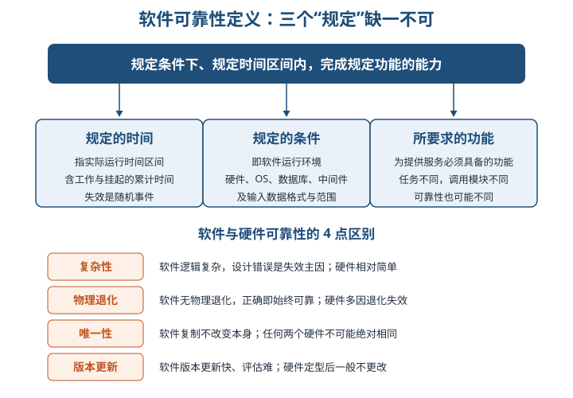

框架性定义的三个要素与三个特点：

| 要素/特点 | 内容 | 一句话理解 |
| --- | --- | --- |
| 规定的时间 | 指运行时间，含工作与挂起（开启但空闲）的累计时间 | 失效是随机事件，运行时间是随机变量 |
| 规定的条件 | 运行环境：硬件平台、OS、数据库、中间件、输入数据格式范围与操作规程 | 环境不同可靠性不同，也用于划分失效责任 |
| 所要求的功能 | 任务不同则调用子模块、程序路径不同 | 先明确任务功能才能准确度量可靠性 |
| 特点① | 用内在「缺陷」和外在「失效」的关系描述可靠性 | 缺陷是固有病根，失效是随机发病 |
| 特点② | 使量化评估成为可能 | 可按不同目的建立数学模型分析 |
| 特点③ | 用概率描述可靠性比较科学 | 失效随机、缺陷无损耗，概率方法合理 |

举例：同一订票软件，平时少量查询与春运集中抢票是两种「规定条件」，可靠性表现不同；只要求查询功能与要求支付功能，调用的模块不同，可靠性结论也不同。

⭐【易错】软件**不存在物理退化**，软件正确性与可靠性密切相关，一个正确的软件任何时刻均可靠；硬件则主要由物理退化导致失效。软件的**唯一性**（复制不改变本身，任何两个硬件不可能绝对相同）正是概率方法在硬件可靠性领域大获成功、在软件领域却不令人满意的原因。

### 9.1.2 软件可靠性的定量描述

⭐【重点】「规定时间」有三种概念，用**执行时间**度量可靠性最准确：

| 时间概念 | 含义 | 财务软件一例（9:00 开机、17:00 退出） |
| --- | --- | --- |
| 自然时间（日历时间） | 年月周日等自然流逝的时间段 | 一天 24 小时 |
| 运行时间 | 软件从启动到运行结束的时间段 | 8 小时 |
| 执行时间 | CPU 执行程序指令所用的时间总和 | 不足 2 小时，视业务频度与设计而定 |

⭐【重点】【高频考点】六个定量指标必须记牢公式与方向：

| 指标 | 公式/定义 | 记忆要点 |
| --- | --- | --- |
| 失效概率 F(t) | 运行开始到时刻 t 出现失效的概率 | F(0)=0，单调递增，F(+∞)=1（任何软件都有缺陷） |
| 可靠度 R(t) | R(t)=1−F(t)，规定条件下、规定时间内不失效的概率 | R(0)=1，R(+∞)=0 |
| 失效强度 f(t) | f(t)=F′(t)，单位时间出现失效的概率 | 是 F(t) 的导数，不是 F(t) 本身 |
| MTTF 平均失效前时间 | MTTF=∫0^∞ R(t)dt，持续运行时间的期望 | 不可修复系统即平均寿命，不含老化失效 |
| MTTR 平均恢复前时间 | 恢复时间的期望，含确认失效、记录任务、重新投入使用的时间 | MTTR 越短，易恢复性越好 |
| MTBF 平均故障间隔时间 | 失效或维护所需平均时间，含故障时间及检测维护时间 | 指数分布时 MTBF=MTTF+MTTR |

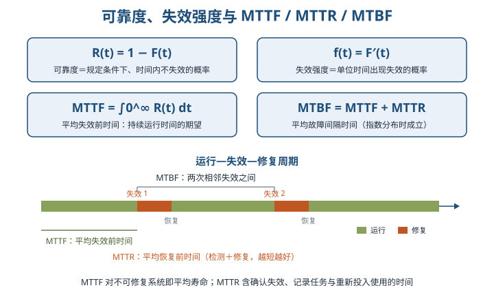

> 助记：失效概率 F 单调升到 1，可靠度 R 等于 1−F；失效强度 f 是 F 的导数；故障间隔 MTBF＝失效前 MTTF＋恢复前 MTTR。

两个补充概念：

- **软件回合（Run）**：软件在规定环境下的一个基本执行过程（给定输入到给出输出），是最小的、不可分的执行单位。在数据域上可把可靠度定义为「成功执行一个回合的概率」，属于静态（表态）度量；时间域上的可靠度则是动态度量。
- **软件运行剖面（Operational Profile）**：对系统使用条件的定义，输入值用按时间的分布或在可能输入范围内出现概率的分布来描述。它量化了定义中的「规定条件」，对应可靠性测试的测试环境与测试数据设计。

### 9.1.3 可靠性目标

**失效严重程度类**就是对用户具有相同程度影响的失效集合。分级常按对成本的影响或对系统能力的影响，通常用数量级划分等级。

| 划分标准 | 分级示例（教材表9-1/9-2） | 适用系统 |
| --- | --- | --- |
| 按成本影响（5 级） | 1 级＞100 万；2 级 10～100 万；3 级 1～10 万；4 级 0.1～1 万；5 级＜0.1 万 | 某电子商务运营系统 |
| 按系统能力影响（4 级） | 1 级系统崩溃、重要数据不可恢复；2 级停止响应、重要数据可恢复；3 级重要操作无响应、可恢复；4 级部分操作无响应、可用其他方式替代 | 某电信实时计费系统 |

可靠性目标指客户对软件性能满意程度的期望，通常用**可靠度、故障强度、MTTF** 等指标描述。建立定量指标需在可靠性、交付时间和成本之间平衡，步骤为：确定系统运行模式 → 定义故障严重性等级 → 确定故障强度目标。

⭐【易错】教材表 9-3 的趋势要记：**失效严重程度类越高，可靠性要求越高、允许的失效强度越低**——1 级要求 99.9999%（平均无失效时间约 114 年），2 级 99.99%（约 417 天），3 级 99%（约 4 天），4 级 90%（约 9 小时）。

### 9.1.4 可靠性测试的意义

- 软件失效可能造成灾难性后果：教材举例——控制系统 Fortran 程序少了一个逗点，导致美国一次宇宙飞行失败。
- ⭐【高频考点】某研究机构统计，计算机系统的失效中约 **80% 与软件有关**；软件路径数庞大，很难用全路径覆盖测试排除所有缺陷。
- 软件可靠性技术不如硬件成熟：故障树分析（FTA）、失效模式与效应分析（FMEA）在硬件领域较成熟，在软件领域尚未定型。
- 软件费用持续增长，可靠性问题是主要原因之一；系统对软件的依赖性不断增强。

### 9.1.5 广义的可靠性测试与狭义的可靠性测试

> 教材原文：狭义的软件可靠性测试是指为了获取可靠性数据，按预先确定的测试用例，在软件的预期使用环境中，对软件实施的一种测试。

狭义测试也叫「**软件可靠性试验**」，是面向缺陷的测试：以用户将要使用的方式测试软件，每次测试代表用户将完成的一组操作，是最终产品使用的预演，所得数据接近实际运行数据，可用于可靠性评价。广义测试则是为最终评价软件可靠性而运用**建模、统计、试验、分析和评价**等一系列手段实施的完整过程。

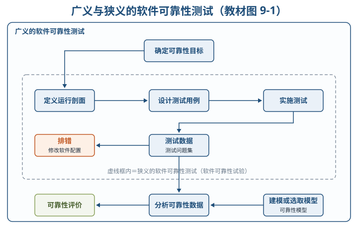

可靠性测试的目的可归纳为 3 方面：①发现软件在需求、设计、编码、测试和实施等方面的缺陷；②为软件使用和维护提供可靠性数据；③确认软件是否达到可靠性的定量要求。

### 9.2.1 影响软件可靠性的因素

软件可靠性模型是为预计或估算软件可靠性所建立的**可靠性框图和数学模型**，目的是把复杂系统的可靠性逐级分解为简单系统，以便定量预计、分配、估算和评价。建模先分析影响因素，主线是缺陷的引入、发现与清除。

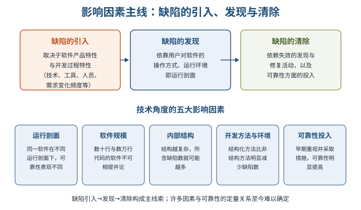

### 9.2.2 软件可靠性的建模方法

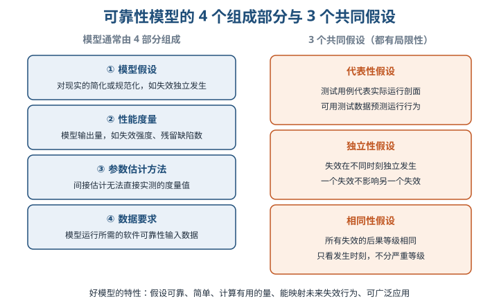

⭐【易错】**估计**与**预测**的区别：估计是通过收集到的失效数据进行统计分析、归纳出模型参数；预测是使用软件产品自身属性和开发过程确定参数，可在开始执行程序前完成。预测未来失效行为时，若发现引入了新错误或修复使新故障不断发生，应**停止预测**，等足够多的故障出现后重新估计参数。模型一般以「固定运行环境中运行不变的程序」为估测实体，代码或运行剖面变化时应分段处理。

### 9.2.3 软件的可靠性模型分类

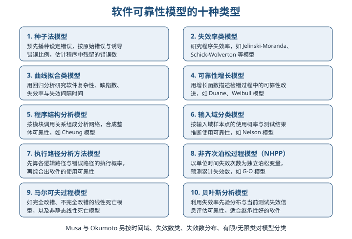

> 助记：十类模型——「种失曲增、结输入路、泊马贝」：种子法、失效率、曲线拟合、可靠性增长；程序结构、输入域、执行路径；非齐次泊松（NHPP）、马尔可夫、贝叶斯。

### 9.3 软件可靠性管理

软件可靠性管理是软件工程管理的一部分，以全面提高和保证软件可靠性为目标，把现代管理理论用于软件生命周期中的可靠性保障活动，内容包括各阶段可靠性活动的目标、计划、进度、任务和修正措施等。

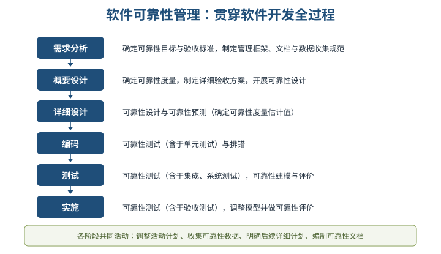

⭐【易错】各阶段活动并非每个软件系统的必须内容，也不是全部内容，应按软件差异与可靠性投入裁剪。目前可靠性管理仍停留在**定性描述**水平，很难用量化指标管理。

### 9.4 软件可靠性设计

⭐【重点】【高频考点】实践证明，保障软件可靠性**最有效、最经济、最重要的手段是在软件设计阶段采取措施进行可靠性控制**（章首与 9.4 两次强调）。测试排错只能有限改善可靠性，不能根本提高，且修改设计缺陷代价昂贵。

可靠性设计三原则：①是软件设计的一部分，须在总体设计框架中使用、不与其他设计原则冲突；②在满足提高软件质量的前提下，以提高和保障可靠性为最终目标；③应确定可靠性目标、不能无限扩大化，并排在**功能度、用户需求和开发费用之后**考虑。

#### 9.4.1 容错设计技术

适用于失效后果特别严重的场合（飞机飞控、空中交通管制、核反应堆安全控制）。常用三种方法：

| 方法 | 核心机制 | 关键点 |
| --- | --- | --- |
| 恢复块设计 | 恢复块含若干功能相同、设计差异的程序块文本，每一时刻一个文本运行，故障时用备份文本替换 | 属于「动态冗余」；被选择的块可以是模块、过程、子程序、程序段 |
| N 版本程序设计 | 多个版本对相同初始条件和输入的操作结果实行多数表决，防止单一版本故障提供错误服务 | 需求说明完全精确（设计错误不相关的前提）；设计全过程不相关（不同算法、语言、工具、人员不交流） |
| 冗余设计 | 在完整软件之外，用不同路径、不同算法或不同实现方法的模块/系统做备份，故障时替换 | 相同两套软件互备意义不大；增加存储、内存与运行时间，需折中 |

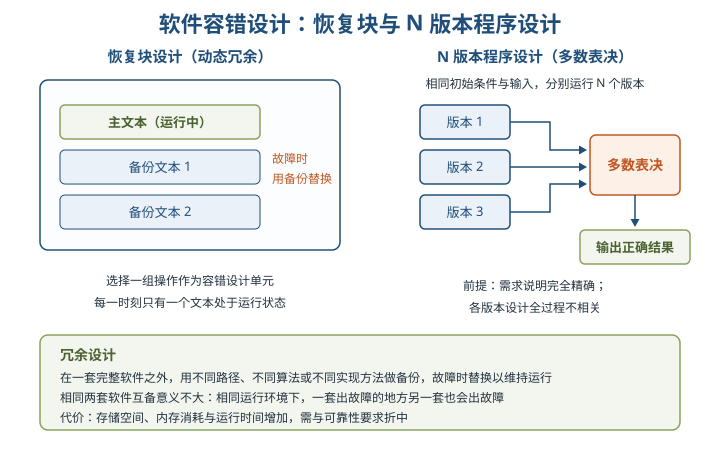

举例：N 版本像三位互不商量的司机各自独立规划路线，按多数一致的路线行驶——一位规划出错不会带偏整支队伍；但若三人照抄同一份错误地图（需求说明不精确），仍会一起走错。

#### 9.4.2 检错技术

对无须在线容错或不能采用冗余设计、但可靠性要求较高的部分，用检错技术在故障后及时发现并报警，提醒维护人员处理。⭐【重点】检错实现代价一般**低于**容错和冗余，但**不能自动解决故障**，无人干预最终将导致系统不能正常运行。

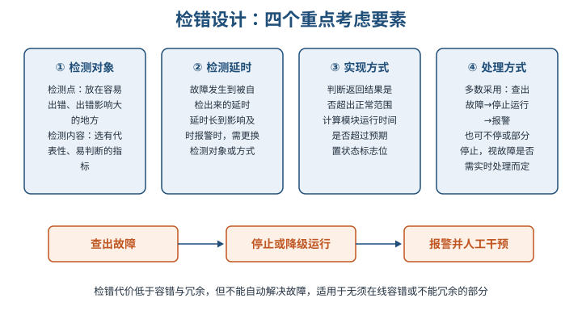

#### 9.4.3 降低复杂度设计

软件复杂性分为**模块复杂性**（模块内部数据流向和程序长度）与**结构复杂性**（不同模块之间的关联程度）。复杂度是产生软件缺陷的重要根源：⭐【易错】当复杂度超过一定界限时，缺陷数急剧上升、可靠性急剧下降。降低复杂度设计就是在保证功能的前提下，简化软件结构、缩短代码长度、优化数据流向。硬件领域成熟的 FTA、FMEA 也可尝试用于软件设计，但因软硬件性质差异巨大，应用效果和范围极其有限。

#### 9.4.4 系统配置技术

双机热备由两台服务器、外接共享磁盘阵列柜和双机热备份软件组成：操作系统与应用程序装在各自本地系统盘，用户数据放在共享磁盘阵列中；主机故障时备机主动替代，保证服务不中断。「**心跳**」指主从系统按一定时间间隔互发通信信号表明各自运行状态，心跳表明主机故障或备机收不到心跳时，高可用管理软件立即把系统资源转移到备用系统。

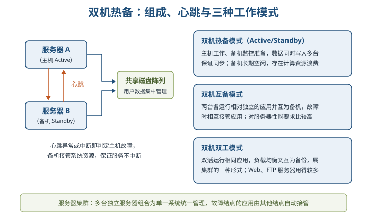

> 助记：热备一主一备（Active/Standby，有资源浪费）；互备各跑应用、互为主备（性能要求高）；双工双活同应用（负载均衡，Web/FTP 常用）。

服务器集群是一组相互独立的服务器在网络中组合成单一系统并以单一系统模式管理，通常拥有共同名称；结点故障时其应用由其他结点自动接管，可透明加入构件。

### 9.5.1 软件可靠性测试概述

可靠性测试由**可靠性目标的确定、运行剖面的开发、测试用例的设计、测试实施、测试结果的分析**等主要活动组成。⭐【易错】划分测试、随机测试、覆盖测试等都是面向错误的测试，其结果数据**不能直接用于可靠性评价**，必须经过分析处理后才能使用可靠性模型进行评价。可靠性测试最好在受控的自动测试环境下由专业机构完成，并考虑对开发进度和成本的影响。

### 9.5.2 定义软件运行剖面

定义运行剖面首先为软件使用行为建模，可采用**马尔可夫链**：把输入域编码为代表用户观点的使用状态集，弧表示激励导致的状态转换，弧上分配转换概率，可用有向图或转换矩阵表示。随后开发使用模型，将输入域分层。

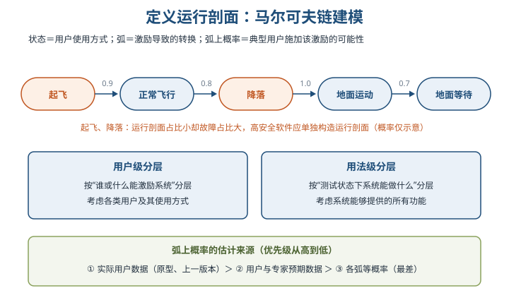

⭐【易错】教材飞控例：正常飞行、起飞、降落、地面运动、地面等待 5 个状态中，起飞和降落在运行剖面上只占很小百分比，却占很大故障比例。因此对边界、跃迁情况和关键功能**不应只按简单运行剖面测试**，应构造专门的运行剖面、补充统计模型之外的测试用例；一个产品可为关键操作单独定义多个运行剖面。

### 9.5.3 可靠性测试用例设计

测试用例要反映实际使用情况、镜像运行剖面；为剖面中每个元素定量赋予发生概率值和关键因子，据此分配测试资源，**优先测试最重要或最频繁使用的功能**，尽早发现对可靠性影响最大的故障。用例选择既要一般情况，也要极限情况和最大最小边界值。

典型测试用例的 8 个组成部分：①测试用例标识；②被测对象；③测试环境及条件；④测试输入；⑤操作步骤；⑥预期输出；⑦判断输出结果是否符合标准；⑧测试对象的特殊需求。

除常规用例外，还要重点考虑与可靠性密切相关的特殊情况（可适当「强化输入」，即比正常输入更恶劣但合理程度内的输入）：

| 序号 | 测试目的 | 关注内容（教材表9-4） |
| --- | --- | --- |
| 1 | 屏蔽用户操作错误 | 对常见误操作的提示和屏蔽情况 |
| 2 | 错误提示的准确性 | 对用户的错误提示是否准确描述 |
| 3 | 错误是否导致系统异常退出 | 有无操作错误引起系统异常退出 |
| 4 | 数据可靠性 | 输入数据有效性检查，冗余数据过滤、校验和清洗 |
| 5 | 异常情况的影响 | 硬件故障、网络故障、部分软件模块失效后的受损程度与补救工具 |

### 9.5.4 可靠性测试的实施

⭐【重点】可靠性测试必须是**受控测试**：为保证统计数据有效，测试过程中每个测试用例必须用**相同的软件版本**，新的软件版本意味着新测试的开始。

⭐【易错】需要补充非统计测试（如覆盖测试）时，最佳选择是两者都执行；非统计测试若在可靠性测试**之前**完成，统计数据仍然有效；若在**之后**执行，可能影响可靠性评估的准确性。

实施难点是判断用例运行成功还是失败（可测试性问题）。对输出难以逐项验证的科学计算软件，可分两个阶段：第一阶段运行较少量用例并对照规范仔细检查；第二阶段运行大量用例，不再逐项人工检查，只找错误信息、断电、崩溃、死机等失效现象，或把输出记录到文件后用搜索、过滤方法处理。若计算正确性无法验证，则需形式化证明。

⭐【重点】用时间定义的可靠性数据分 4 类，可互相转化：

| 数据类型 | 记录内容 |
| --- | --- |
| 失效时间数据 | 发生一次失效所累积经历的时间 |
| 失效间隔时间数据 | 本次失效与上一次失效之间的间隔时间 |
| 分组时间内的失效数 | 某个时间区间内发生了多少次失效 |
| 分组时间的累积失效数 | 到某个区间为止的累积失效数 |

每个测试记录必须包含：测试时间、含测试用例的测试说明或标识、所有测试结果（包括失效数据）、测试人员。为积累更多数据，应使用多台计算机同时运行软件以增加累计运行时间，并建立软件错误报告、分析与纠正措施系统。测试结束后编写《软件可靠性测试报告》（可参考 GJB 438A-97 剪裁），内容包括：软件产品标识、测试环境配置（软硬件）、测试依据、测试结果、测试问题、测试时间。

### 9.6 软件可靠性评价

评价过程包括 3 个方面：**选择可靠性模型 → 收集可靠性数据 → 可靠性评估和预测**。开发过程中用于估计当前可靠性、判断能否终止测试并发布、预计达标所需时间与工作量；对最终产品则结合可靠性验证测试，确定产品达到的可靠性水平。

⭐【重点】选择可靠性模型需比较 4 个方面：

| 方面 | 要点 |
| --- | --- |
| 模型假设的适用性 | 逐条分析假设；如模型假定缺陷立即排除而实际低严重级缺陷不立即排错，则模型不适用 |
| 预测的能力与质量 | 难以事前评价，应尽量选用比较成熟、应用较广的模型 |
| 输出值能否满足评价需求 | 重点指标：当前可靠度、平均无失效时间、故障密度、达到目标的日期、达到目标的成本 |
| 模型使用的简便性 | 数据易收集且不超预算；简单易懂；便于使用、最好有工具支持数据输入 |

可靠性数据主要是软件失效数据，贯穿整个生命周期收集。收集存在 5 个问题：规范不统一、连续性不能保证、缺乏有效手段、完整性不能保证、质量和准确性不能保证。⭐【易错】使用不准确的可靠性数据进行评价，误差有可能比用模型预测产生的误差**大一个数量级**。可行办法：及早确定模型并统一数据规范；制定可实施的收集计划并指定专人负责；重视可靠性测试数据的整理分析；利用数据库存储与统计分析。

⭐【易错】测试期间没有失效发生，**不能认为程序可靠度是 1.0**——除非进行了完全的测试（几乎不可能），否则无法做出估计。可简单假设测试基于二项式分布做保守估计，或凭经验按无故障运行的用例数量在一定置信度水平上估计可靠性等级。

模型之外的辅助分析手段：①失效数据的图形分析法（累积失效个数图、单位时间段失效数图、失效间隔时间图）；②试探性数据分析技术（EDA），关注循环相关、短期内失效数急剧上升、失效数集中的时间段，可发现排错引入新缺陷、数据收集质量问题及时间域定义错误等。

## 三、重点与易错点

| # | 考点 | 必须记住的结论 | 易错提醒 |
| --- | --- | --- | --- |
| 1 | 可靠性定义 | 规定条件＋规定时间＋规定功能，缺一不可 | 「规定时间」不是单指日历时间 |
| 2 | 三种时间 | 执行时间（CPU 时间）度量可靠性最准确 | 运行时间含挂起空闲，不等于执行时间 |
| 3 | R(t)、F(t)、f(t) | R(t)=1−F(t)；F(0)=0、F(+∞)=1 | 失效强度 f(t)=F′(t)，不是 F(t) |
| 4 | MTBF | 指数分布时 MTBF=MTTF+MTTR | 不要记成相减；MTTR 越短易恢复性越好 |
| 5 | 软硬件区别 | 软件无物理退化，设计错误是失效主因 | 软件唯一性使概率方法不如硬件领域成功 |
| 6 | 失效严重程度类 | 对用户影响程度相同的失效集合，可按成本/系统能力分级 | 等级越高可靠性要求越高（99.9999% 对 114 年） |
| 7 | 广义/狭义测试 | 狭义＝软件可靠性试验，面向缺陷获取数据 | 广义还包含建模、分析与可靠性评价 |
| 8 | 模型三假设 | 代表性、独立性、相同性 | 相同性＝不区分失效严重等级，勿与独立性混淆 |
| 9 | 模型十类 | 种子法、NHPP、马尔可夫、贝叶斯等及代表模型 | 种子法靠「播种错误」；贝叶斯靠先验＋测试信息 |
| 10 | 可靠性设计地位 | 设计阶段控制最有效、最经济、最重要 | 测试排错只能有限改善，不能根本提高 |
| 11 | N 版本与冗余 | 多版本多数表决；冗余须不同路径/算法/实现 | 相同两套软件互备意义不大，不是有效冗余 |
| 12 | 检错技术 | 代价低于容错，但不能自动解决故障 | 四要素：检测对象、延时、实现方式、处理方式 |
| 13 | 双机热备 | 热备/互备/双工三模式；心跳定期互发信号 | 心跳中断即判主机故障；双工才是双活负载均衡 |
| 14 | 运行剖面 | 马尔可夫链：状态＋弧＋转换概率 | 起飞降落占比小故障多，关键操作须单独剖面 |
| 15 | 测试实施 | 同一版本受控测试，新版本＝新测试开始 | 非统计测试宜在可靠性测试前做，之后做或影响评估 |
| 16 | 可靠性评价 | 选模型→收数据→评估预测 | 无失效≠可靠度 1.0；数据不准误差或超模型一个数量级 |

## 四、练习与真题

以下为按大纲与教材考点自编的模拟单选题，答案与解析集中放在全章最后。

**1.** 软件可靠性定义中的「规定时间」，用于度量软件可靠性最准确的是（ ）。
A. 自然时间  B. 运行时间  C. 执行时间（CPU 时间）  D. 日历时间

**2.** 某财务软件上午 9:00 开机运行、下午 17:00 退出，期间 CPU 执行指令不足 2 小时，这里的「8 小时」属于（ ）。
A. 自然时间  B. 运行时间  C. 执行时间  D. CPU 时间

**3.** 对可靠度服从指数分布的系统，MTBF、MTTF、MTTR 的关系是（ ）。
A. MTBF=MTTF−MTTR  B. MTBF=MTTF+MTTR  C. MTBF=MTTF×MTTR  D. MTBF=MTTR−MTTF

**4.** 关于软件与硬件可靠性的区别，下列说法错误的是（ ）。
A. 软件不存在物理退化现象  B. 设计错误是导致软件失效的主要原因  C. 软件复制会改变软件本身  D. 软件版本更新较快，可靠性评估难度大

**5.** 为获取可靠性数据，按预先确定的测试用例在软件预期使用环境中实施的测试，称为（ ）。
A. 软件可靠性试验  B. 覆盖测试  C. 可靠性增长测试  D. 随机测试

**6.** 软件可靠性模型的三个共同假设不包括（ ）。
A. 代表性假设  B. 独立性假设  C. 相同性假设  D. 完整性假设

**7.** 在程序中预先有意「播种」设定错误，再根据原始错误数与诱导错误数比例估计残留错误数的模型属于（ ）。
A. 贝叶斯分析模型  B. 种子法模型  C. 输入域分类模型  D. 曲线拟合类模型

**8.** 保障软件可靠性最有效、最经济、最重要的手段是（ ）。
A. 测试阶段加强排错  B. 设计阶段采取可靠性控制  C. 实施阶段严格验收  D. 运行阶段增加备份

**9.** 关于 N 版本程序设计，下列说法错误的是（ ）。
A. 各版本对相同输入的操作结果实行多数表决  B. 需求说明的完全性和精确性是设计错误不相关的前提  C. 各版本设计全过程应保持不相关  D. 所有版本应使用同一算法和同一编程语言

**10.** 双机热备方案中的「心跳」是指（ ）。
A. 磁盘阵列的数据同步机制  B. 主从系统按一定时间间隔互发通信信号以表明运行状态  C. 用户会话的保活机制  D. 数据库的事务日志

**11.** 关于软件可靠性测试的实施，下列说法正确的是（ ）。
A. 测试过程中可随时更换软件版本  B. 非统计测试在可靠性测试之后执行不影响评估  C. 每个测试用例必须使用相同的软件版本  D. 多台计算机同时运行软件会降低数据有效性

**12.** 可靠性测试期间没有发生任何失效，正确的做法是（ ）。
A. 认定软件可靠度为 1.0  B. 可假设测试基于二项式分布作保守估计  C. 认定软件不存在缺陷  D. 立即停止全部测试活动

**13.** 定义软件运行剖面时，将输入域编码为使用状态集、用弧表示激励转换并分配转换概率，常用的建模方法是（ ）。
A. 故障树分析  B. 马尔可夫链  C. 决策表  D. 数据流图

**14.** 检错设计技术应着重考虑的要素不包括（ ）。
A. 检测对象  B. 检测延时  C. 实现方式与处理方式  D. 多数表决

## 五、疑问与查漏补缺

1. **大纲有、教材略**：大纲 8.1.1 提到「软件可靠性工程的定义和阶段（分配、设计、分析、测试和评估）」，教材未单列该术语，可按本章「建模—设计—测试—评价」的流程对应理解并补记五阶段名称。
2. **大纲有、教材略**：大纲 8.4 的「软件可靠性设计方法准则（简化设计、重用设计和健壮性设计）」与教材 9.4 的三条设计原则表述不同，教材未出现「重用设计」，需按大纲另行记忆。
3. **大纲原文疑有笔误**：大纲 8.4.1 容错分类写为「信息容错、结构容错和信息容错」，两项重复，通常应为信息、结构、时间等维度；大纲提到的「日志和副本、指令复执和程序卷回」等容错方法教材未展开，答题时注意按题干语境选择。
4. **大纲有、教材略**：大纲 8.4.2 检错设计方法（简单原理、同型原理、对称原理、层次原理和安全原理）教材未展开，仅需记住名称；大纲 8.5.1 的测试分类（可靠性增长测试、可靠性验证测试、可靠性摸底测试）教材也未明确分类，注意与广义/狭义之分区分。
5. **教材文本层瑕疵**：教材表 9-3 的失效强度数值在 PDF 文本层中显示不全（10 的负指数丢失），复习时记住「严重程度类越高→可靠性要求越高→允许失效强度越低」的趋势即可，不必纠结具体指数。
6. **与其他章节衔接**：第 8 章把可靠性、可用性列为质量属性，本章 MTBF=MTTF+MTTR 可直接支撑可用性指标计算；双机热备与集群在架构设计案例题中常与可用性、负载均衡一起出现；FTA/FMEA 与后续安全相关章节的故障分析互相印证。

## 六、参考答案

**1.** C。执行时间是 CPU 执行程序指令的时间总和，用它度量软件可靠性最准确、效果最好。
**2.** B。运行时间指软件从启动到运行结束的时间段；24 小时是自然时间，CPU 执行不足 2 小时是执行时间。
**3.** B。可靠度服从指数分布时 MTBF=MTTF+MTTR，即故障间隔＝失效前时间＋恢复前时间。
**4.** C。软件具有唯一性，复制不改变软件本身；其余三项均为教材所述软硬件可靠性区别。
**5.** A。狭义的软件可靠性测试也叫「软件可靠性试验」，面向缺陷、以用户使用方式测试以获取可靠性数据。
**6.** D。三个共同假设是代表性、独立性、相同性，至今尚未找到克服其局限性的有效方法。
**7.** B。种子法模型利用捕获—再捕获抽样技术，靠预设「种子」错误估计程序残留错误数。
**8.** B。教材两次强调：设计阶段采取可靠性控制最有效、最经济、最重要，测试排错只能有限改善。
**9.** D。N 版本要求设计全过程不相关，应使用不同算法、不同语言、不同工具，而非同一算法同一语言。
**10.** B。心跳是主从系统按时间间隔互发的状态信号，备机收不到心跳即判定主机故障并接管资源。
**11.** C。受控测试要求所有用例使用相同版本，新版本意味着新测试开始；非统计测试宜在可靠性测试前完成。
**12.** B。无失效不能认定可靠度为 1.0，可用二项式分布作保守估计，或按无故障用例数在置信度水平上估计等级。
**13.** B。运行剖面用马尔可夫链建模：状态集代表用户使用方式，弧表示激励转换并分配转换概率。
**14.** D。检错四要素为检测对象、检测延时、实现方式、处理方式；多数表决属于 N 版本程序设计。
