# 第10章 软件架构的演化和维护

- 教材位置：`02.系统架构设计师第二版-教材.pdf` PDF 第 340～378 页（书页 330～368）
- 复习状态：已完成
- 复习日期：2026-11-06
- 本章地位：本章回答“架构怎样变、怎样评估变化、怎样管住变化”，是架构设计从一次性交付走向全生命周期治理的关键一章。静态/动态演化、演化评估、网站十阶段演化和可维护性度量是选择题与案例题的重要素材。

## 一、大纲考点

| 大纲条目 | 大纲要求 | 教材对应小节 |
| --- | --- | --- |
| 9.1 软件架构演化概述 | 演化的定义、重要性、原因和原则；组件、连接件、约束三类关注点 | 10.1；原则集中见 10.4 |
| 9.2 面向对象软件架构演化过程 | 对象、消息、复合片段、约束演化及其核心操作 | 10.2.1～10.2.4 |
| 9.3 软件架构的演化分类 | 四个演化时期；静态/动态演化需求、过程、原子操作；DSA 与 DR | 10.3.1～10.3.3 |
| 9.4 软件架构可持续演化原则 | 18 项原则及相应度量方案 | 10.4 |
| 9.5 软件架构演化评估方法 | 已知过程的版本度量与质量属性距离；未知过程的逆向推测评估 | 10.5.1～10.5.2 |
| 9.6 软件架构演化实例分析 | 大型网站架构的 10 个演化阶段 | 10.6.1～10.6.10 |
| 9.7 软件架构维护 | 知识管理、隔离区域、版本管理；CCN、FFC、CBO、RFC、TCC、LCC | 10.7.1～10.7.4 |

## 二、知识点笔记

### 10.1 软件架构演化和定义的关系

> 教材原文：软件架构的演化就是为了维持软件架构自身的有用性。

演化不是只改代码，而是软件**整体结构**随需求、业务环境和运行环境变化而调整，覆盖需求获取、架构建模、文档、实现和维护等全生命周期。“架构是演化来的，而不是设计来的”强调初始设计要在使用中持续校正。

⭐【重点】架构层演化优于直接改代码的三个原因：

| 原因 | 通俗理解 |
| --- | --- |
| 形式化、可视化表示提高可构造性 | 先看全城交通图再改道路，比沿街盲目施工更可控 |
| 整体结构、配置和约束信息支持预判 | 设计时就能考虑未来可能怎样扩展 |
| 明确组件耦合关系，支持动态调整 | 知道“谁连着谁”，才能估计拆改会波及哪里 |

不同架构定义决定不同演化视角。若 `SA={components, connectors, constraints}`，演化就围绕三要素的添加、修改和删除展开。

| 要素 | 含义与演化表现 | 典型波及效应 |
| --- | --- | --- |
| 组件 Component | 计算元素、数据存储或重要模块；增删改内部模块 | 新模块带来新消息，删模块删消息，改模块改消息 |
| 连接件 Connector | 组件之间的交互关系；增删改交互消息 | 常伴随组件演化，也可由内部结构或交互流程调整引起 |
| 约束 Constraint | 组件与连接件的拓扑关系、配置及参数 | 约束数据增删改，可能改变架构正确性判断 |

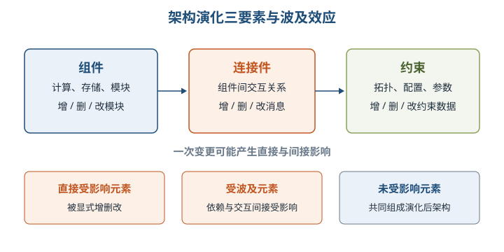

变更元素分为**直接受影响**与**间接受波及**两类，它们再与未受影响元素共同组成演化后架构。

举例：给商城增加“积分服务”是组件演化；订单服务调用积分服务是连接件演化；规定“扣积分必须先于发货”是约束演化。只加服务却没有消息交互，它对当前系统行为就没有实际意义。

### 10.2 面向对象软件架构演化过程

#### 1. 对象演化与消息演化

对象自身的接口、类型、语义等属性变化不改变对象间交互过程；真正影响顺序图动态行为的对象操作只有 **AO（AddObject）** 和 **DO（DeleteObject）**。对象演化通常必须伴随消息演化，否则新增对象没有交互、删除对象留下无效关系。

⭐【高频考点】消息是顺序图的核心，五类消息演化如下。

| 操作 | 全称 | 改变内容 | 记忆抓手 |
| --- | --- | --- | --- |
| AM | AddMessage | 新增一条交互消息 | 加交互 |
| DM | DeleteMessage | 删除一条交互消息，是 AM 的逆向操作 | 删交互 |
| SMO | SwapMessageOrder | 交换两条消息的时间顺序 | 换先后 |
| OM | OverturnMessage | 反转发送对象与接收对象 | 换方向 |
| CMM | ChangeMessageModule | 改变消息的发送或接收对象 | 换端点 |

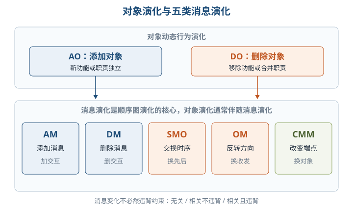

消息演化与约束有三种关系：**无关**、**相关但不违背约束**、**相关且违背约束**。前两类可保持架构正确性，第三类是不正确演化；因此“消息发生变化”不等于“必然破坏约束”。

#### 2. 复合片段演化与约束演化

复合片段描述对象交互的控制流，与消息同属连接件范畴。重点关注会产生分支的 `ref、loop、break、alt、opt、par`；其内部执行序列的演化等价于消息序列演化。

| 操作 | 含义 | 关键提醒 |
| --- | --- | --- |
| AF / DF | 添加 / 删除复合片段 | 二者互为逆向演化；`ref` 关联另一顺序图，`par` 产生并行消息 |
| FTC | 改变复合片段类型 | 改变控制流，可看作“删除旧片段＋添加新片段” |
| FCC | 改变片段成立条件 | 同时修改条件成立与不成立两条转移的触发事件 |

约束演化只有 **AC（添加约束）** 与 **DC（删除约束）**；修改约束视为“删除旧约束＋添加新约束”。AC 后必须检查当前设计是否满足新约束，DC 后一般仍满足剩余约束。

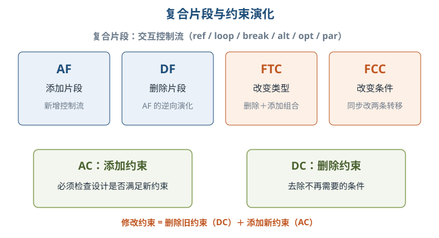

> 助记：对象只增删，消息“增删换序、反向换端”；片段“增删改型改条件”，约束只增删、修改先删后增。

### 10.3 软件架构演化方式的分类

三种典型分类视角不要混答：

| 分类依据 | 类别 |
| --- | --- |
| 实现方式与实施粒度 | 基于过程和函数、面向对象、基于组件、基于架构的演化 |
| 研究方法（Barnes 等） | 演化支持；版本和工程管理工具；架构变换形式方法；成本收益分析 |
| 是否处于系统运行期 | 静态演化、动态演化（本章重点） |

⭐【高频考点】四个演化时期按“编译前→编译后执行前→受限运行中→运行中”排列。

| 时期 | 时间边界与特点 |
| --- | --- |
| 设计时演化 | 架构模型及相关代码编译之前 |
| 运行前演化 | 编译之后、执行之前；无需考虑应用状态，但需考虑架构及组件增删机制 |
| 有限制运行时演化 | 设计时预定条件，系统进入“安全”模式后执行规定操作 |
| 运行时演化 | 运行中增删、替换组件或改变拓扑，最难实现 |

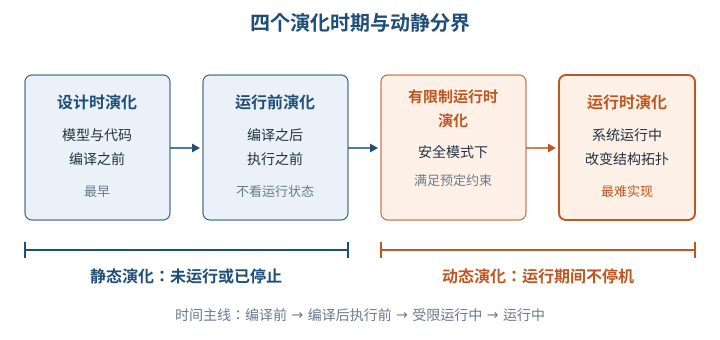

#### 1. 静态演化

静态演化是系统**停止运行期间**的修改更新，需求来自设计时调整和运行前升级；对应更正性、适应性、完善性维护。

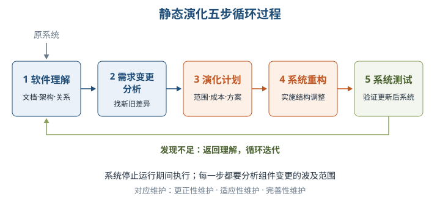

> 助记：先“理解”，再“析需”；定“计划”，做“重构”，最后“测试”，不合格就迭代。

⭐【重点】原子演化操作是基于 UML 模型、**逻辑语义上粒度最小**的修改，并非物理上绝对不可分割。每次原子操作产生中间版本 `Ai`，不同质量属性关注的操作序列可以不同。

| 关注质量 | 原子操作集合 | 影响 |
| --- | --- | --- |
| 可维护性（组件图） | AMD/RMD 依赖、AMI/RMI 接口、AM/RM 模块、SM/AGM 拆分/聚合 | 改变逻辑结构、调用方式、内聚与耦合 |
| 可靠性（用例图、部署图、顺序图） | AMS/RMS 消息、AO/RO 对象、AF/RF/CF 片段、AU/RU 用例、AA/RA 参与者 | 改变交互场景复杂度和潜在运行风险 |

静态演化可借助组件影响关系与**可达矩阵**计算变更波及范围。正交软件架构则通过“功能分层＋线索化”控制影响：同层组件不允许相互调用，每个变动只影响一条线索。

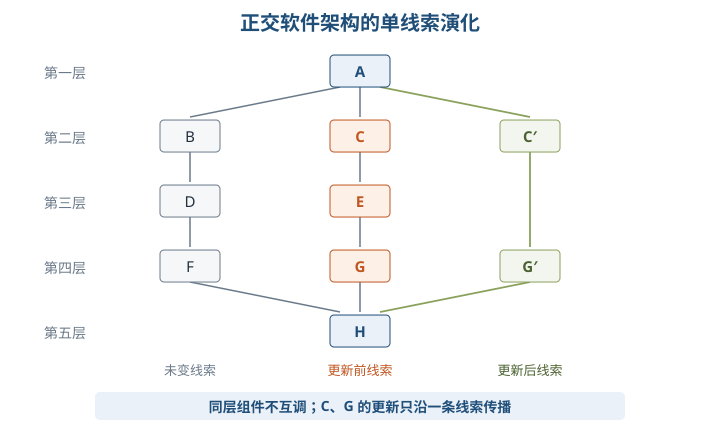

正交架构演化顺序：需求变动归类并判断重用 → 制订计划 → 增删改组件 → 更新组件交互 → 形成演化后架构。

#### 2. 动态演化

动态演化是在系统运行期间、**不停止系统功能**的情况下完成演化，发生于有限制运行时和运行时阶段。需求既可能来自内部执行（如请求到达时创建组件），也可能来自外部重配置请求（如操作系统在线升级），尤其适用于航空航天、生命维持、金融、交通等难停机系统。

| 动态性级别 | 允许变化 | 例子 |
| --- | --- | --- |
| 级别1：交互动态性 | 固定结构下的数据动态交互 | 同一批服务不断交换新数据 |
| 级别2：结构动态性 | 增删组件和连接件实例 | 在线增加一个服务实例（研究与应用主流） |
| 级别3：架构动态性 | 基本构造可重定义，如新组件类型 | 在线引入前所未有的组件类型 |

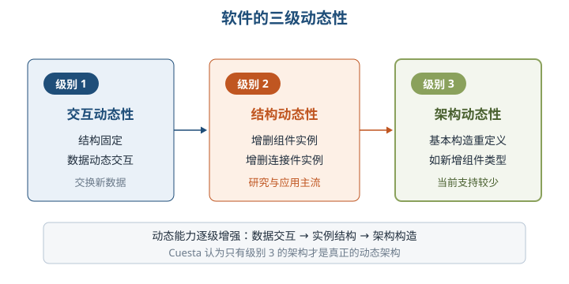

动态演化内容包括**属性改名、行为变化、拓扑结构改变、风格变化**。风格通常应保持，确需改变时只变为其衍生风格，如两层 C/S→三层 C/S、1 对 1 请求响应→1 对 N。

| 技术 | 核心含义 | 本章归类 |
| --- | --- | --- |
| DSA 动态软件架构 | 能修改自身架构，并在系统执行期间实施修改 | 架构动态性 |
| DR 动态重配置 | 部署后从组件、连接件配置入手，在线增删及改连接 | 结构动态性 |

⭐【重点】DSA 把运行时架构表示为有状态、有行为、可操作的共享实体，使协同逻辑脱离计算组件。系统必须保存当前架构信息、设置监控管理机制，并保证演化操作**原子性**：任一操作失败，整个操作集撤销。

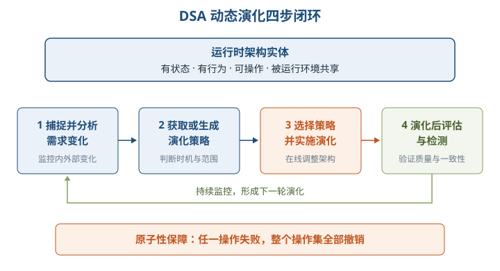

| DSA 描述语言 | 视角与核心机制 |
| --- | --- |
| π-ADL | 行为视角；以 π 演算描述组件、连接件和行为随时间演化，适合移动系统 |
| Pilar | 反射视角；基于 MARMOL，组件由接口、配置、具化、约束组成 |
| LIME | 协调视角；分离计算与协调，支持物理和逻辑移动性 |

DSA 工具路线包括反射机制、组件操作、π 演算和外部架构演化管理器。PKUAS 的四类平台实体是**容器系统、公共服务、工具、微内核**：前三者作为被管理系统组件组成资源层，微内核负责装载、配置、卸载及状态管理。

DR 的四种重配置模式如下。

| 模式 | 重配置控制要点 |
| --- | --- |
| 主从 | 主组件分派工作并汇总从组件响应；主操作状态与主重配置状态正交 |
| 中央控制 | 一个中央控制器控制多个组件，维护空闲/非空闲状态 |
| 客户端/服务器 | 同步消息交互；须在客户端事务或服务器当前事务集合完成后增删组件 |
| 分布式控制 | 功能分布于多个控制组件，常见环形和顺序模式 |

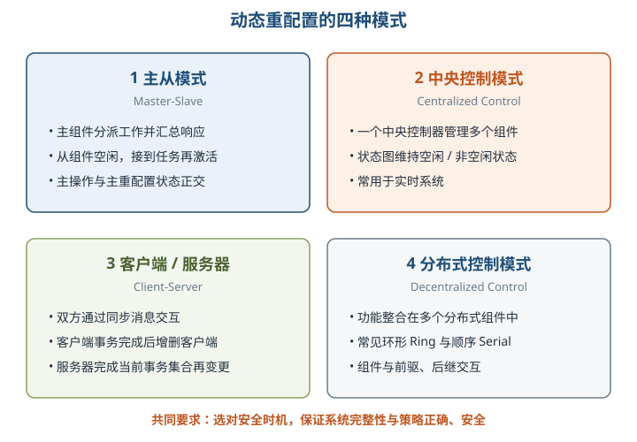

DR 难点：约束难定义；性能约束需运行时评估；单一方案难兼顾所有性能方面；同时保证系统完整性与重配置策略正确、安全。PuLSE 以产品为核心支持产品线构想与部署，PLUSEE 则用多视角 UML 模型和 OCL 检查一致性。

### 10.4 软件架构可持续演化原则

⭐【高频考点】18 项原则可归成“成本进度风险、结构行为、模块复杂性、重构重用、技术环境标准、质量需求”六组；考试常给度量方案反选原则。

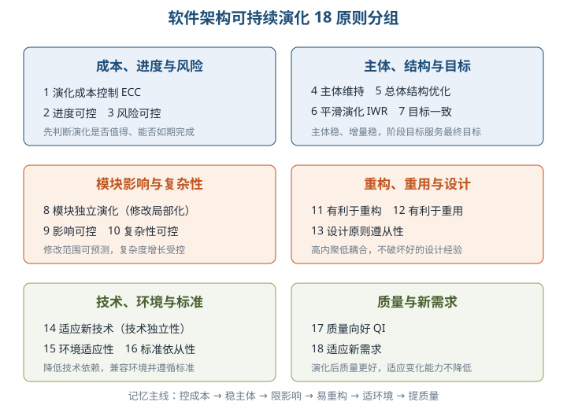

| # | 原则 | 必须掌握的度量或判断 |
| --- | --- | --- |
| 1 | 演化成本控制 ECC | `CoE ≪ CoRD`：演化成本远小于重新开发成本最佳 |
| 2 | 进度可控 | 实际与预期完成时间差越小越好，体现迭代递增 |
| 3 | 风险可控 | 分别检验经济、时间、人力、技术、环境风险 |
| 4 | 主体维持 | `AIG=主体规模变更量/主体规模`，主体行为稳定、增量平稳 |
| 5 | 系统总体结构优化 | 用整体可靠性和性能判断结构是否更合理 |
| 6 | 平滑演化 IWR | `IWR=变更总量/项目规模`，相邻版本更新率相对固定 |
| 7 | 目标一致 | 阶段目标与最终目标一致，实际与预期目标差越小越好 |
| 8 | 模块独立演化（修改局部化） | 修改尽量局部，对其他模块影响小 |
| 9 | 影响可控 | 修改波及范围可预测、可控制 |
| 10 | 复杂性可控 | CC 低于阈值且增长可控，保证易维护、扩展、分析、测试 |
| 11 | 有利于重构 | 复杂度越低，通常越容易重构 |
| 12 | 有利于重用 | 高内聚、低耦合有利于维持或提高重用性 |
| 13 | 设计原则遵从性 | 冲突原则占比越小越好，不与既有设计原则冲突 |
| 14 | 适应新技术（技术独立性 TI） | 降低对特定技术依赖，使软件可跨平台运行 |
| 15 | 环境适应性 | 用硬件/软件兼容性衡量新环境适应能力 |
| 16 | 标准依从性 | 不违背国际、国家、行业、企业等质量标准，需人工判定 |
| 17 | 质量向好 QI | 演化后质量优于演化前，关注指标综合效果更好 |
| 18 | 适应新需求 | 不降低、最好提高架构适应新需求的能力，比较适应需求集与实际需求集 |

> 助记：成本进度先控险，主体优化求平滑；目标模块控影响，复杂重构促重用；设计技术适环境，标准质量迎需求。

### 10.5 软件架构演化评估方法

#### 1. 演化过程已知

把完整演化拆成原子操作序列，得到 `A0,A1,…,An`；逐版本度量得到 `Q0,Q1,…,Qn`，再算质量属性距离。可维护性的 `Qi` 是 CCN、FFC、CBO、RFC、TCC、LCC 构成的六元组，可靠性的 `Qi` 是表示潜在风险率的实数。

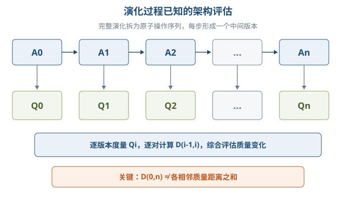

- 可维护性距离：对六维向量求归一化笛卡儿距离，`Dm(A,B)=sqrt(Σ[((ai-bi)/(ai+bi))²])`。
- 可靠性距离：一维简化形式，`Dr(A,B)=abs((a-b)/(a+b))`。
- 距离越大，表示同一架构两个版本在相应质量属性上的差距越大，**不直接等于结构差异越大**。

⭐【易错】`D(0,n)` 不等于各相邻距离之和，原子操作的质量影响**不具有累加性**。质量距离应针对同一架构的不同演化版本，不宜用来比较两个完全不同的软件。

评估用途：分析架构修改影响、监控质量变化曲线、定位质量突变对应的关键演化过程。

#### 2. 演化过程未知

无法追踪中间步骤时，只对演化前后版本分别度量，比较质量属性变化并计算距离，逆向推测可能的演化操作、位置和对象，再分析高层驱动因素（修错、提性能、平台移植等），最后判断变化是否符合预期。

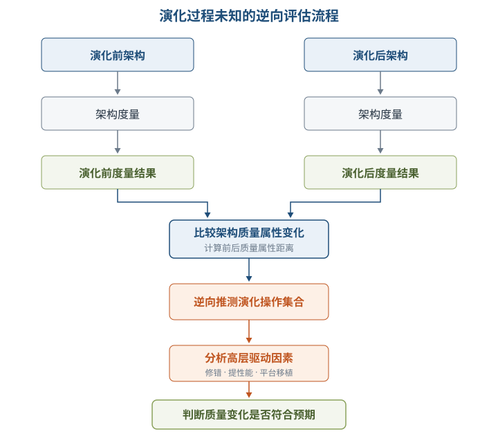

举例：若重构目标是提高可维护性，度量显示圈复杂度下降、耦合度降低，说明演化符合预期；若复杂度反升，则原问题未解决或引入了新质量问题。

### 10.6 大型网站系统架构演化实例

⭐【高频考点】十阶段的主线是**瓶颈驱动演化**，不是任何网站必须机械照搬的固定路线。

| 阶段 | 主要瓶颈 | 核心演化手段与结果 |
| --- | --- | --- |
| 1 单体架构 | 初期访问量小 | 应用、数据库、文件同机，简单但资源互相争用 |
| 2 垂直架构 | 单机性能与存储不足 | 应用、文件、数据库分服务器，按角色配置硬件 |
| 3 缓存 | 数据库访问压力大 | 本地缓存＋远程分布式缓存，利用“80% 访问集中于 20% 数据” |
| 4 服务集群 | 单应用服务器连接与处理能力有限 | 负载均衡＋应用服务器集群，提高并发与可伸缩性 |
| 5 数据库读写分离 | 缓存未命中读及全部写仍压数据库 | 写主库、读从库、主从复制，数据访问模块屏蔽差异 |
| 6 反向代理和 CDN | 地域网络差异、响应慢 | 二者均靠缓存尽早返回数据，加速并减轻后端压力 |
| 7 分布式文件与数据库 | 单库、单文件系统到极限 | 文件和数据分布式；数据库拆分是最后手段，优先业务分库 |
| 8 NoSQL 和搜索引擎 | 存储与检索需求复杂 | 引入可伸缩的非关系存储和检索，统一数据访问模块管理多源 |
| 9 业务拆分 | 业务场景复杂 | 按产品线拆应用、独立部署，以链接、消息队列或共享存储关联 |
| 10 分布式服务 | 应用与存储连接过多、公共业务重复 | 抽取共用业务独立部署，应用专注界面并远程调用服务 |

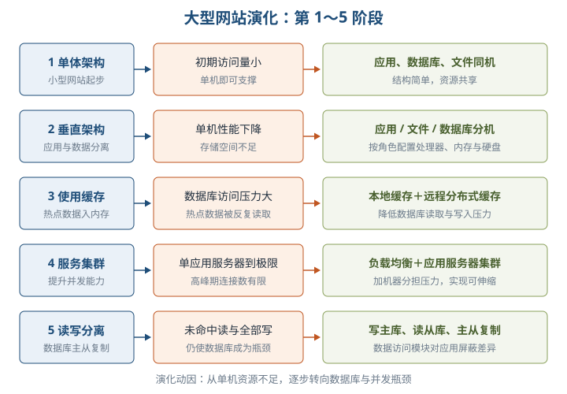

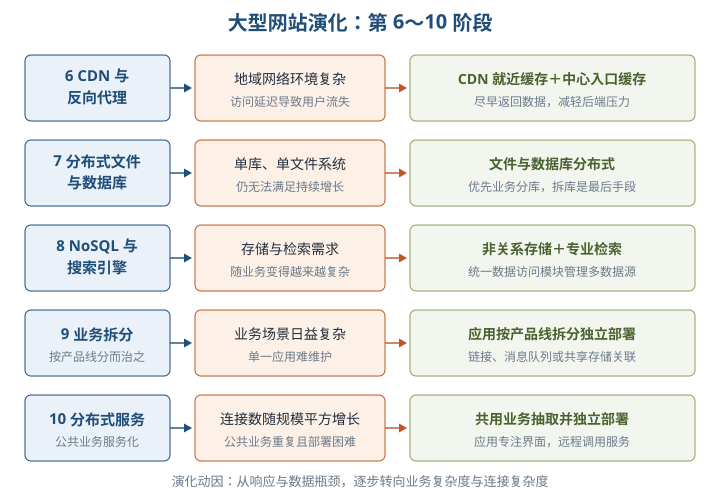

| 易混技术 | 部署位置与特点 |
| --- | --- |
| 本地缓存 | 应用服务器内，速度快但容量有限，并与应用争内存 |
| 远程分布式缓存 | 独立缓存服务器集群，容量可扩展，需网络访问 |
| CDN | 网络提供商机房，用户就近获取缓存数据 |
| 反向代理 | 网站中心机房，请求先到达代理，命中缓存就直接返回 |

### 10.7 软件架构维护

维护要追踪和控制演化，使其持续满足需求，主要包含知识、修改和版本管理。

| 管理内容 | 核心考点 |
| --- | --- |
| 架构知识管理 | **架构知识＝架构设计＋架构设计决策**；既记录“做成什么样”，也记录“为什么这样做” |
| 架构修改管理 | 建立隔离区域（Region of Quiescence），明确规则、类型、影响范围和副作用，使修改少影响其他部分 |
| 架构版本管理 | 为版本演化控制、使用、评价和量化度量提供依据；可借助邻接矩阵、可达矩阵分析波及效应 |

知识不文档化会“沉没”，人员变动后会“腐蚀”；现实障碍包括记录收益不直观、短期进度压力、缺乏反思和培训、知识难共享检索。

⭐【高频考点】可维护性六指标针对组件图。`L` 为组件图数目，`totalN/totalE` 为外部组件数/相连边数；组件内部子组件用于高层模块内聚度分析。

| 指标 | 度量含义 | 复习结论 |
| --- | --- | --- |
| CCN 圈复杂度 | 整个架构独立执行路径数，`CCN=(totalE-totalN)+2L` | 整体度量，不取组件平均；越高越复杂，实践中以 `CCN≤10` 为宜 |
| FFC 扇入扇出度 | 综合组件主动调用与被调用频率 | 越大表示接口或依赖关联越多；架构结果为组件值平均 |
| CBO 模块间耦合度 | 模块与其他模块交互频繁程度 | 越大越易受修改和错误影响，可维护性越差、风险越高 |
| RFC 模块的响应 | 执行所需功能数量，含自身接口、依赖模块和子模块功能 | `RFC=S+E+R`；只含被提供接口且无子模块/依赖时可为 0 |
| TCC 紧内聚度 | 子组件之间直接依赖形成的内部紧密程度 | 高内聚有利于独立演化；无子组件时为 not applied |
| LCC 松内聚度 | 在直接关系上计入间接关联后的内聚程度 | 与 TCC 对比观察内部关联；无子组件时不适用 |

教材示例中 `totalE=19、totalN=13、L=1`，故 `CCN=(19-13)+2×1=8`。ClientApplication 含 2 个子组件，示例算得 `FFC=32、CBO≈0.231、RFC=4、TCC=LCC=3`；除 CCN 外，其余架构级指标取外部组件度量结果的平均值。

> 助记：圈看全图，扇看来往，耦看牵扯，响应看功能，紧松看内部。

## 三、重点与易错点

| # | 考点 | 必须记住的结论 | 易错提醒 |
| --- | --- | --- | --- |
| 1 | 演化本质 | 整体结构演化，贯穿全生命周期 | 不等同于局部代码修改 |
| 2 | 架构三要素 | 组件、连接件、约束 | 约束不是连接件本身 |
| 3 | 对象演化 | 影响动态行为的对象操作是 AO、DO | 接口等自身属性变化不直接列为对象动态行为演化 |
| 4 | 消息演化 | AM、DM、SMO、OM、CMM | SMO 换顺序，OM 换方向，CMM 换端点 |
| 5 | 消息与约束 | 可无关、相关不违背、相关且违背 | 消息变化不必然破坏约束 |
| 6 | 复合片段 | AF、DF、FTC、FCC | FCC 要同步改成立/不成立两条转移 |
| 7 | 四时期 | 编译前、编译后执行前、受限运行中、运行中 | 运行前不是运行时；运行时最难 |
| 8 | 静态演化 | 停机更新；理解→析需→计划→重构→测试 | 原子操作是逻辑粒度最小，不是物理不可分 |
| 9 | 正交架构 | 同层组件不互调，变动只影响一条线索 | “正交”不是组件完全无依赖 |
| 10 | 三级动态性 | 交互动态、结构动态、架构动态 | 增删实例属级别2；新组件类型属级别3 |
| 11 | DSA/DR | DSA 修改自身架构；DR 修改部署后配置 | 二者是不同侧面，不是严格互斥分类 |
| 12 | DSA 原子性 | 任一操作失败，整个操作集撤销 | 不是失败操作单独跳过 |
| 13 | 18原则 | ECC 看成本、IWR 看平稳、模块独立看局部修改 | 主体维持与平滑演化都求稳定，但度量对象不同 |
| 14 | 质量距离 | 衡量同一架构版本间质量差异，不可累加 | 不用于推断两个不同软件的结构相似度 |
| 15 | 已知/未知评估 | 已知追踪中间版本；未知由前后度量逆向推测 | 未知过程并非不能评估 |
| 16 | 网站演化 | 缓存→集群→读写分离→CDN/代理→分布式→业务与服务拆分 | CDN 在网络商机房，反向代理在中心机房 |
| 17 | 知识管理 | 架构知识＋设计决策及依据 | 只保存架构图不完整 |
| 18 | 六指标 | CCN 看整体，其余通常取组件平均；高内聚低耦合 | 无子组件时 TCC/LCC 为 not applied，不是填 0 |

## 四、练习与真题

以下 12 道为自编单选模拟题，答案与解析集中在全章最后。

**1.** 在面向对象软件架构演化中，交换两条消息时间顺序的操作是（ ）。
A. AM  B. SMO  C. OM  D. CMM

**2.** 关于四个架构演化时期，下列说法正确的是（ ）。
A. 运行前演化发生在编译之前  B. 设计时演化必须考虑运行状态  C. 运行时演化最难实现  D. 有限制运行时演化不允许任何约束

**3.** 静态演化的一般过程，正确的先后顺序是（ ）。
A. 需求变更分析→软件理解→系统重构→演化计划→系统测试  B. 软件理解→需求变更分析→演化计划→系统重构→系统测试  C. 软件理解→演化计划→需求变更分析→系统测试→系统重构  D. 演化计划→软件理解→系统重构→需求变更分析→系统测试

**4.** 正交软件架构能够限制修改波及范围，主要依赖（ ）。
A. 同层组件自由互调  B. 所有组件部署在同一节点  C. 功能分层与线索化，同层组件不互调  D. 每次变更都重写全部组件

**5.** 系统在线增加一个已有类型的组件实例，按 Cuesta 的分类属于（ ）。
A. 交互动态性  B. 结构动态性  C. 架构动态性  D. 非动态演化

**6.** DSA 实施演化时，若操作集中的一个操作失败，正确处置是（ ）。
A. 跳过失败操作继续执行  B. 只记录错误但不处理  C. 撤销整个操作集  D. 直接停止整个业务系统

**7.** 判断架构演化成本是否值得，最符合演化成本控制原则的是（ ）。
A. CoE 远大于 CoRD  B. CoE 约等于 CoRD  C. CoE 远小于 CoRD  D. 只比较代码行数

**8.** 关于架构质量属性距离，下列说法正确的是（ ）。
A. 任意两个软件都可据此判断结构相似度  B. 总距离必等于各相邻距离之和  C. 距离越大表示版本间对应质量差异越大  D. 可靠性距离是六元组距离

**9.** 关于 CDN 与反向代理，下列说法正确的是（ ）。
A. 二者基本原理都不是缓存  B. CDN 部署在网络提供商机房，反向代理部署在网站中心机房  C. 反向代理用于主从数据库复制  D. CDN 只能缓存数据库写请求

**10.** 架构知识管理中的“架构知识”应理解为（ ）。
A. 架构设计＋架构设计决策  B. 源代码＋测试数据  C. 组件数＋连接件数  D. 用户需求＋硬件清单

**11.** 关于可维护性指标，下列说法正确的是（ ）。
A. CBO 越大，可维护性通常越好  B. CCN 必须取所有组件值的平均  C. RFC 只统计代码注释数量  D. CBO 越大，越容易受其他模块修改和错误影响

**12.** 某组件没有子组件时，其 TCC 和 LCC 应如何处理（ ）。
A. 都强制记为 1  B. 都强制记为 0  C. 记为 not applied，不适用  D. 用 CCN 替代

## 五、疑问与查漏补缺

- **大纲要求“知识管理现状”，教材未给统一落地策略。** 可补充采用架构决策记录（ADR）保存背景、选项、决策、理由和后果，但答题仍应以教材的定义和现实障碍为主。
- **DSA 与 DR 的边界不是公认严格分类。** 教材为便于讨论将 DSA 归为架构动态性、DR 归为结构动态性，不宜推广成行业唯一定义。
- **教材个别度量文字存在口径疑点。** “适应新需求”以适应需求集合占实际需求集合的比例理解时通常越高越好，但提取文本的方案说明写“RNR 越小越好”；复习应掌握原则目标，遇到原题需结合公式和选项核对。
- **缩写随模型视角变化。** 对象删除在 10.2 写 DO，在可靠性原子操作中写 RO；消息增删也出现 AM/DM 与 AMS/RMS 两组写法，需按题干语境识别，不要机械跨表替换。
- **内聚度措辞易误读。** 教材末称“模块间内聚度 TCC/LCC”，但公式和示例实际分析组件内部子组件关系；无子组件时不适用，不应理解为组件之间的耦合。
- **与其他章节衔接。** 质量向好和评估可回看第8章质量属性；可靠性风险度量衔接第9章；网站业务服务化可衔接第15章面向服务架构，在线重配置与弹性伸缩可衔接第14章云原生架构。
- **十阶段是典型案例而非强制步骤。** 实际系统可能合并、跳过或并行采用缓存、集群、分库和服务化，核心答题依据始终是“当前瓶颈与对应措施”。

## 六、参考答案

**1.** **B**。SMO（SwapMessageOrder）交换消息先后顺序；OM 反转方向，CMM 改变发送或接收对象。

**2.** **C**。运行时演化可增删、替换组件或改拓扑，实现最难；运行前演化发生在编译后执行前。

**3.** **B**。静态演化为软件理解、需求变更分析、演化计划、系统重构、系统测试，并可循环迭代。

**4.** **C**。分层和线索化且同层不互调，使每次变动只影响一条线索。

**5.** **B**。增删已有组件或连接件实例属于结构动态性；定义新组件类型才属于架构动态性。

**6.** **C**。动态演化必须保证原子性，任一操作失败就撤销整个操作集，避免不稳定状态。

**7.** **C**。ECC 要求演化成本 CoE 明显小于重新开发成本 CoRD，远小于最佳。

**8.** **C**。质量属性距离衡量同一架构版本间质量差异，不具有累加性，也不等同于结构相似度。

**9.** **B**。两者都利用缓存尽早返回数据；CDN 靠近用户，反向代理位于网站中心机房入口。

**10.** **A**。架构知识不仅包括设计结果，还包括设计决策及其依据。

**11.** **D**。CBO 越大表示耦合交互越多，通常可维护性越差；CCN 是整体度量而非组件平均。

**12.** **C**。没有子组件时内聚度公式分母无意义，教材以 not applied 表示，不能简单填 0 或 1。
