# 第11章 未来信息综合技术

- 教材位置：`02.系统架构设计师第二版-教材.pdf` PDF 第 379～412 页（书页 369～402）
- 复习状态：已完成
- 复习日期：2026-11-06
- 本章地位：本章是新兴技术的概念大集合，综合知识选择题几乎每次必考 2～4 分；考点以「定义归属、分类辨析、特征记忆」为主，深度要求不高，但面广、名词多，适合用表格+图示集中记忆。

## 一、大纲考点

大纲科目 1 第 10 部分「未来信息综合技术」对应教材本章，共 6 个条目，与教材 6 个小节一一对应；大纲科目 1 的第 11 部分是「标准化与知识产权」，不属于本章。

| 大纲条目 | 大纲要求 | 教材对应 | 复习抓手 |
| --- | --- | --- | --- |
| 10.1 信息物理系统（CPS）技术 | CPS 概念、实现、建设与应用 | 11.1.1～11.1.3 | 三级体系架构；四大核心要素「一硬一软一网一平台」；闭环赋能体系 |
| 10.2 人工智能（AI）技术 | AI 概念、发展历程、关键技术 | 11.2.1～11.2.3 | 弱/强 AI 辨析；发展里程碑事件；机器学习四分类与传统/深度学习对比 |
| 10.3 机器人技术 | 机器人定义、发展历程、4.0 核心技术、分类 | 11.3.1～11.3.4 | 三代机器人特征；机器人 4.0 五大核心技术；两种分类法 |
| 10.4 边缘计算技术 | 概念、定义、特点、边云协同、安全与应用 | 11.4.1～11.4.6 | 章鱼类比；三类落地形态；四大特点；边云六种协同 |
| 10.5 数字孪生技术 | 发展历程、定义、关键技术、应用 | 11.5.1～11.5.4 | 三项核心技术（建模/仿真/数字线程）；三种类型；四大应用领域 |
| 10.6 云计算和大数据技术 | 云计算服务与部署模式、大数据定义与研究内容 | 11.6.1～11.6.2 | SaaS/PaaS/IaaS 对比；四种部署模式；大数据 3V/4V；分析五阶段 |

## 二、知识点笔记

### 11.1.1 信息物理系统的概念

信息物理系统（Cyber-Physical Systems，CPS）术语最早由**美国国家航空航天局（NASA）于 1992 年**提出；2006 年美国国家科学基金会科学家海伦·吉尔在首个 CPS 国际研讨会上对其进行了详细描述。CPS 是控制系统、嵌入式系统的扩展与延伸。

> 教材原文：CPS 通过集成先进的感知、计算、通信、控制等信息技术和自动控制技术，构建了物理空间与信息空间中人、机、物、环境、信息等要素相互映射、适时交互、高效协同的复杂系统，实现系统内资源配置和运行的按需响应、快速迭代、动态优化。

⭐【重点】CPS 的本质：构建一套信息空间与物理空间之间**基于数据自动流动**的「状态感知、实时分析、科学决策、精准执行」**闭环赋能体系**，解决生产制造、应用服务过程中的复杂性和不确定性问题，提高资源配置效率，实现资源优化。

通俗地说，CPS 就是给物理设备配上一个「数字大脑」：传感器持续把设备状态传给大脑，大脑分析后下达指令，设备执行后再反馈，循环不息。

举例：智能机床的传感器发现刀具磨损加剧（状态感知），系统分析剩余寿命（实时分析），决定降低转速并安排换刀（科学决策），自动调整加工参数（精准执行），整个过程无需人工干预。

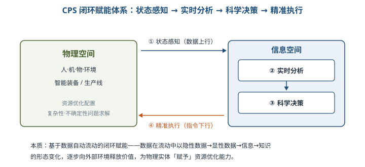

### 11.1.2 CPS 的实现

⭐【重点】【高频考点】CPS 体系架构分为三个层级，逐级扩展：

| 层级 | 定位 | 核心功能 | 举例 |
| --- | --- | --- | --- |
| 单元级 | 不可分割的 CPS 最小单元 | 可感知、可计算、可交互、可延展、自决策，形成最基本的数据闭环 | 一个智能部件、一台工业机器人、一台智能机床 |
| 系统级 | 多个单元级通过工业网络互联 | 互联互通、即插即用、边缘网关、数据互操作、协同控制、监视与诊断；局部资源自组织、自配置、自决策、自优化 | 一条冲压生产线：传送带+机器人+冲压机床协同 |
| SoS 级 | 多个系统级 CPS 的有机组合 | 数据存储、数据融合、分布式计算、大数据分析、数据服务；资产性能管理和运营优化服务 | 多个工序构成车间级乃至整个工厂的 CPS |

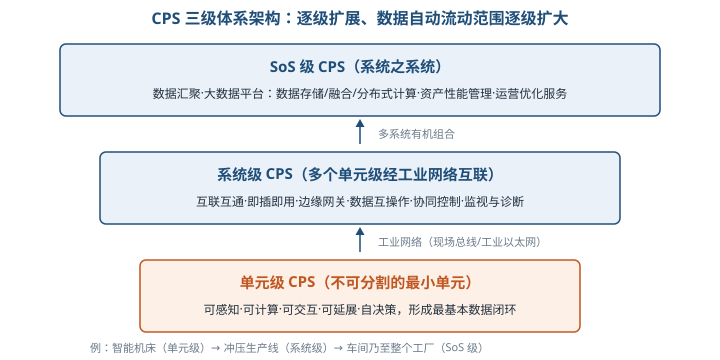

CPS 技术体系分三类：**总体技术**（系统架构、异构系统集成、安全技术、试验验证等顶层设计）、**支撑技术**（智能感知、嵌入式软件、数据库、中间件、SDN、物联网、大数据等）、**核心技术**（虚实融合控制、智能装备、MBD、数字孪生、现场总线、工业以太网等基础技术）。

⭐【重点】上述技术可归纳为四大核心技术要素，务必记牢对应关系：

| 要素 | 内容 | 作用 |
| --- | --- | --- |
| 一硬 | 感知和自动控制 | CPS 实现的硬件支撑 |
| 一软 | 工业软件 | 固化 CPS 计算和数据流程的规则，是 CPS 的核心 |
| 一网 | 工业网络 | 互联互通和数据传输的网络载体 |
| 一平台 | 工业云和智能服务平台 | 数据汇聚和支撑上层解决方案的基础，对外提供资源管控和能力服务 |

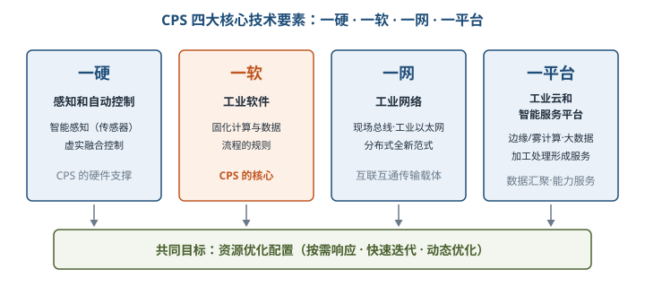

> 助记：「硬软网台」——硬件感知控制、软件固化规则、网络承载互联、平台汇聚服务。

### 11.1.3 信息物理系统的建设和应用

CPS 典型应用场景归纳为四类：

| 场景 | 内涵 | 典型应用 |
| --- | --- | --- |
| 智能设计 | 在虚拟空间中仿真「预演」，及早发现设计问题 | 产品及工艺设计、生产线/工厂设计 |
| 智能生产 | 打破信息孤岛，设备互联互通，从「制造」到「智造」 | 设备管理、生产管理、柔性制造 |
| 智能服务 | 本地与远程云服务协作的一体化工业云服务体系 | 健康管理、智能维护、远程征兆性诊断、协同优化、共享服务 |
| 智能应用 | 设计者、生产者、使用者转变为新价值创造的参与者 | 无人装备、产业链互动、价值链共赢 |

⭐【易错】CPS 建设路径循序渐进，四阶段各有重点：**体系设计**（应用模式、层次架构、安全体系、标准规范的整体设计）→ **单元级建设**（重点是感控设备安装、制造工艺与流程数字化）→ **系统级建设**（重点是工业网络建设）→ **SoS 级建设**（重点是大数据平台、智能服务平台建设）。不要把各阶段重点张冠李戴。

### 11.2.1 人工智能的概念

人工智能（AI）是利用数字计算机或其控制的机器**模拟、延伸和扩展人的智能**，感知环境、获取知识并使用知识获得最佳结果的理论、方法、技术及应用系统。研究领域包括机器人、自然语言处理、计算机视觉和专家系统等。

⭐【高频考点】按能否真正实现推理、思考和解决问题，AI 分为两类：

| 类别 | 判定标准 | 现状 |
| --- | --- | --- |
| 弱人工智能 | 不能真正实现推理和解决问题，看似智能但并不真正拥有智能、无自主意识 | 迄今为止的 AI 系统都属于弱人工智能，主流研究集中于此；语音识别、机器翻译等已接近或超越人类水平 |
| 强人工智能 | 真正能思维，有知觉和自我意识；类人（思考类似人）与非类人（完全不同的意识与推理方式） | 又称通用人工智能、类人智能；至少未来几十年内难以实现 |

举例：人脸识别闸机能准确认出你，但它并不知道自己「在认人」，也不会推理和思考，属于典型的弱人工智能。

### 11.2.2 人工智能的发展历程

⭐【高频考点】关键里程碑事件（人物、年份、意义常考）：

| 时间 | 事件 | 意义 |
| --- | --- | --- |
| 1950 | 图灵发表《计算机与智能》，提出图灵测试 | 机器与人对话而不被辨别出机器身份，即称具有智能 |
| 1956 | 麦卡锡、明斯基等召开达特茅斯夏季研讨会 | 正式使用「人工智能」术语，标志 AI 研究领域诞生 |
| 1959 | 阿瑟·塞缪尔提出机器学习 | 从制造智能演化为通过学习获取智能，进入第一次繁荣期 |
| 1968 | 费根鲍姆提出首个专家系统 DENDRAL | AI 从理论研究走向实际应用 |
| 20 世纪 70 年代 | 算力与数据不足，遭遇基础性障碍 | AI 进入「寒冬」 |
| 20 世纪 80 年代初 | 专家系统商业成功；1980 年计算机战胜双陆棋世界冠军 | 第二次浪潮；1987 年 LISP 机市场崩塌后再度萧瑟 |
| 1997 | IBM 深蓝战胜国际象棋世界冠军卡斯帕罗夫 | 基于规则的 AI 的里程碑式胜利 |
| 2006 | 辛顿等推动深度学习 | 为 AI 发展带来重大影响 |
| 2010 年起 | 大数据+算力+算法提升，进入爆炸式发展 | 2016 年 AlphaGo 战胜围棋世界冠军李世石 |

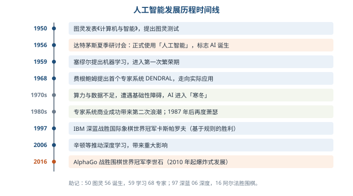

> 助记：「50 图灵 56 诞生，59 学习 68 专家；97 深蓝 06 深度，16 阿尔法胜围棋」。

### 11.2.3 人工智能关键技术

六大关键技术先建立整体印象：**自然语言处理**（机器翻译、语义理解、问答系统）、**计算机视觉**（模仿人类视觉，端到端算法）、**知识图谱**（结构化的语义知识库，由节点和边组成的图数据结构，从「关系」角度分析问题）、**人机交互**（语音、情感、体感、脑机交互等）、**VR/AR**（生成高度近似的数字化环境）、**机器学习**（核心研究领域）。

⭐【重点】【高频考点】机器学习定义：从经验数据 E 中对任务 T 进行学习的算法，其在任务 T 上的性能度量 P 随经验数据 E 的学习而变得更好（E、T、P 三要素）。按学习模式分四类：

| 类型 | 训练数据要求 | 典型算法 | 典型应用 |
| --- | --- | --- | --- |
| 监督学习 | 已标注的样本集 | 回归、分类 | 垃圾邮件侦测、手写体辨识 |
| 无监督学习 | 无需标注样本 | Apriori、KMeans、随机森林、主成分分析 | 市场分割、异常检测、社交网络分析 |
| 半监督学习 | 少量标注样本+大量未标注样本 | 图论推理、拉普拉斯支持向量机 | 减少标注代价的分类与回归 |
| 强化学习 | 需要反馈机制（奖赏） | Q-Learning、时间差学习 | 机器人控制、无人驾驶、工业控制 |

⭐【易错】「强化学习需要反馈机制」是与其他三类最本质的区别；「半监督=少量标注+大量未标注」不要与无监督混淆。

按学习方法分为传统机器学习与深度学习：

| 对比项 | 传统机器学习 | 深度学习 |
| --- | --- | --- |
| 特征提取 | 需人工完成，依赖大量领域专业知识 | 不需人工特征提取，自动学习特征 |
| 数据与算力 | 适合有限样本 | 需要大量训练数据和强大 GPU 算力 |
| 典型算法 | 逻辑回归、支持向量机、K 近邻、决策树、贝叶斯、Adaboost、三层人工神经网络等 | 卷积神经网络（CNN）、循环神经网络（RNN）等 |

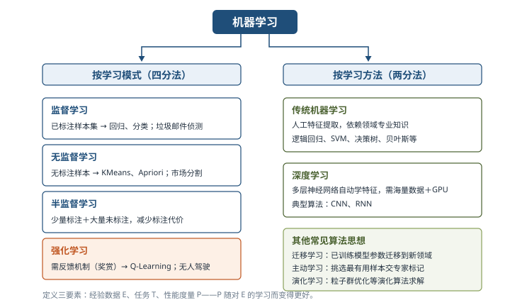

此外还有三类常见算法思想：**迁移学习**（把已训练好的模型参数迁移到新领域，解决目标领域数据不足）、**主动学习**（算法主动查询最有用的未标记样本交专家标记，用较少样本获得高性能）、**演化学习**（用演化算法的优化工具设计机器学习算法，如粒子群优化）。

### 11.3.1～11.3.2 机器人概念与发展历程

Robot 一词最早出现在 **1920 年捷克作家卡雷尔·卡佩克**的剧本中，捷克语意为「苦力」「奴隶」。加藤一郎提出的机器人三条件：具有脑、手、脚三要素；具有非接触与接触传感器；具有平衡觉和固有觉传感器。

⭐【高频考点】机器人发展分三代：

| 代际 | 类型 | 核心特征 | 例子 |
| --- | --- | --- | --- |
| 第一代 | 示教再现型 | 通过示教存储程序和信息，工作时读取并重复示教动作，对环境无感知 | 汽车点焊机器人 |
| 第二代 | 感觉型 | 拥有力觉、触觉、滑觉、视觉、听觉等感觉，能感受和识别工件 | 20 世纪 70 年代后期开始研究 |
| 第三代 | 智能型 | 带多种传感器，能复杂逻辑推理、判断及决策，自主决定自身行为 | 20 世纪 90 年代以来 |

**机器人 4.0 时代**：把云端大脑分布在各个地方，充分利用边缘计算优势，实现规模化部署；强调感知智能协作之外还应具有理解和决策能力，并能通过少量数据建立识别能力。

### 11.3.3 机器人 4.0 的核心技术

⭐【重点】五大核心技术：

| 技术 | 要点 |
| --- | --- |
| 云-边-端的无缝协同计算 | 云侧提供高性能计算和知识存储，边缘侧处理数据并协同共享，机器人端只完成实时操作；需动态任务迁移机制 |
| 持续学习与协同学习 | 少量数据建立识别能力→自主找数据并自动标注→重训练提升；机器人之间经云端共享数据 |
| 知识图谱 | 需要更动态、个性化的知识；与感知决策深度结合；分别存在于机器人侧、云侧和边缘侧 |
| 场景自适应 | 基于三维语义理解预测场景事件，改变行为模式；关键是场景预测能力 |
| 数据安全 | 端到端安全传输+服务器端安全存储；机器人本体、云侧、边缘侧安全需求各不相同 |

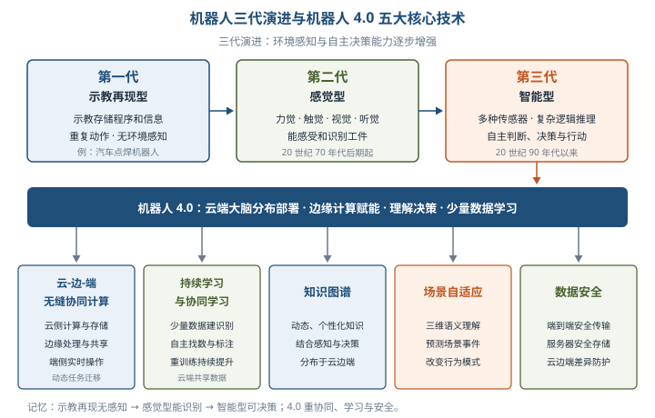

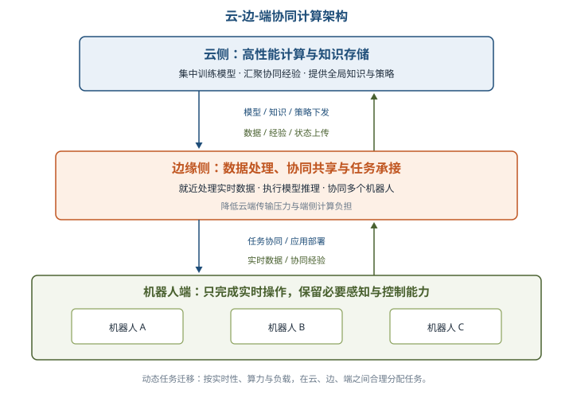

### 11.3.4 机器人的分类

⭐【易错】两种分类标准不要混淆：

| 分类标准 | 类别 | 说明 |
| --- | --- | --- |
| 按控制方式 | 操作机器人、程序机器人、示教再现机器人、智能机器人、综合机器人 | 综合机器人由操纵、示教再现、智能机器人组合而成，如火星机器人 |
| 按应用行业 | 工业机器人、服务机器人、特殊领域机器人 | 特殊领域机器人用于核电站、海底、宇宙空间等人员难以进入的场合 |

### 11.4.1～11.4.2 边缘计算概念与定义

举例：章鱼是无脊椎动物中智商最高的动物之一，其神经元 **60% 分布在八条腕足上，脑部仅 40%**，用「腿」就近解决问题——这正是边缘计算的形象类比：把数据处理、应用运行由网络中心下放到网络边缘节点，就近采集并处理数据，不必把海量原生数据全部上传到远端大数据平台。

⭐【高频考点】边缘计算产业联盟（ECC）定义：边缘计算是在**靠近物或数据源头**的网络边缘侧，融合**网络、计算、存储、应用**核心能力的开放平台，就近提供边缘智能服务，满足行业数字化在敏捷连接、实时业务、数据优化、应用智能、安全与隐私保护等方面的关键需求。其三类落地形态：

| 落地形态 | 内涵 | 代表方案 |
| --- | --- | --- |
| 云边缘 | 云服务在边缘侧的延伸，逻辑上仍是云服务，能力依赖云或与云紧密协同 | 华为云 IEF、阿里云 Link Edge、AWS Greengrass |
| 边缘云 | 在边缘侧构建中小规模云服务能力，中心云主要提供管理调度 | 多接入边缘计算（MEC）、CDN、华为云 IEC |
| 云化网关 | 以云化技术重构原有嵌入式网关，边缘侧提供协议/接口转换，云侧控制器负责资源调度与业务编排 | 云化网关形态 |

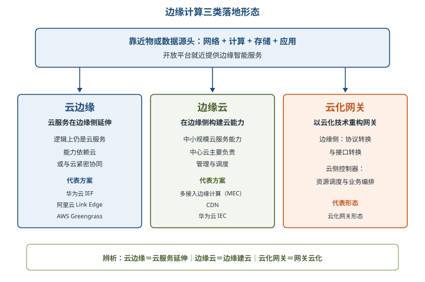

### 11.4.3～11.4.4 边缘计算特点与边云协同

⭐【重点】边缘计算四大特点：

| 特点 | 含义 |
| --- | --- |
| 联接性 | 边缘计算的基础；需支持丰富网络接口、协议、拓扑，借鉴 TSN、SDN、NFV、5G 等并与工业总线互通 |
| 数据第一入口 | 物理世界到数字世界的桥梁，拥有大量、实时、完整的数据，支撑数据全生命周期管理 |
| 约束性 | 适配工业现场恶劣条件（防电磁、防尘、防爆、抗振动等），受功耗、成本、空间约束 |
| 分布性 | 天然分布式部署，要求分布式计算与存储、动态调度、分布式智能与分布式安全 |

⭐【重点】【高频考点】边缘计算与云计算**不是替代关系，而是互补协同关系**：云计算擅长**全局性、非实时、长周期**的大数据处理；边缘计算适合**局部性、实时、短周期**数据处理。边云协同包括六种：

| 协同 | 边缘侧职责 | 云端职责 |
| --- | --- | --- |
| 资源协同 | 本地资源调度管理，执行云端策略 | 设备、资源、网络连接管理策略 |
| 数据协同 | 数据采集、初步处理分析并上传 | 海量数据存储、分析与价值挖掘 |
| 智能协同 | 按 AI 模型执行推理，实现分布式智能 | 集中式模型训练，模型下发边缘 |
| 应用管理协同 | 应用部署运行环境、本节点应用生命周期管理 | 应用开发测试环境、生命周期管理能力 |
| 业务管理协同 | 提供模块化、微服务化的应用/数字孪生/网络实例 | 按客户需求实现业务编排 |
| 服务协同 | 按云端策略实现部分 EC-SaaS 服务 | SaaS 服务分布策略与云端 SaaS 能力 |

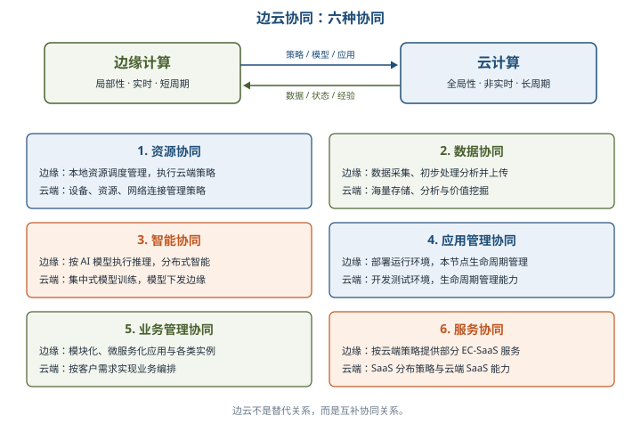

### 11.4.5～11.4.6 边缘计算安全与应用

边缘计算的 **CROSS 价值**：Connectivity（联接）、Realtime（实时）、data Optimization（数据优化）、Smart（智能）、Security（安全）。边缘安全价值体现在：提供可信基础设施、为边缘应用提供可信赖安全服务、保障安全的设备接入和协议转换、提供安全可信的网络及覆盖。

边缘计算五大应用场合速记：**智慧园区**（海量连接管理、实时采集处理、本地业务自治）、**安卓云与云游戏**（游戏集中在边缘数据中心运行，终端相当于视频播放设备）、**视频监控**（边缘图像识别与视频分析、智能存储、边云协同）、**工业物联网**（OPC UA over TSN、vPLC、缺陷检测）、**Cloud VR**（渲染计算、转码、缓存加速卸载到边缘，带宽可降 30%、时延降 50%）。

### 11.5.1～11.5.2 数字孪生体发展历程与定义

数字孪生体最早的概念模型由 **Michael Grieves 博士于 2002 年**提出；「数字孪生体（Digital Twin）」名称最早出现在**美国空军实验室 2009 年**的「机身数字孪生体」概念中；2010 年 NASA 在技术路线图中直接使用该名称。发展历程四阶段：技术准备期（1960—21 世纪初）→ 概念产生期（2002—2010）→ 领先应用期（2010—2020，NASA、美军方、GE）→ 深度开发与大规模扩展应用期（2020—2030）。

> 教材原文：数字孪生体是现有或将有的物理实体对象的数字模型，通过实测、仿真和数据分析来实时感知、诊断、预测物理实体对象的状态，通过优化和指令来调控物理实体对象的行为，通过相关数字模型间的相互学习来进化自身，同时改进利益相关方在物理实体对象生命周期内的决策。

通俗地说，数字孪生体就是给物理对象在电脑里造一个实时同步的「影子」：影子能反映本体当前状态，还能仿真预演未来，指挥本体优化运行。

⭐【重点】Grieves & Vickers（2016）提出数字孪生体三种类型：**数字孪生原型体**（描述设计形态）、**数字孪生实例体**（对应具体实物个体）、**数字孪生聚合体**（实例体的聚合）；其操作环境称为**数字孪生环境**。

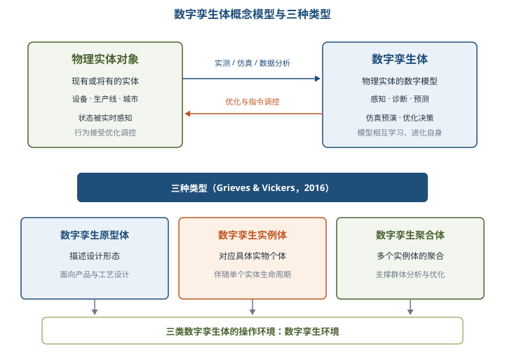

### 11.5.3 数字孪生体的关键技术

⭐【重点】【高频考点】技术体系层次归属是常考点：

| 层次 | 技术 | 定位 |
| --- | --- | --- |
| 三项核心技术 | 建模、仿真、基于数据融合的数字线程 | 建模是「数化」阶段核心、创建数字孪生体的源头；仿真保证数字孪生体与物理实体有效闭环；数字线程支撑多视图模型协同 |
| 顶层框架技术 | 系统工程和 MBSE（基于模型的系统工程） | 统领建模、仿真和数字线程 |
| 底层伴生技术 | 物联网 | 为数字孪生体提供数据连接基础 |
| 外围使能技术 | 云计算、机器学习、大数据、区块链 | 支撑数字孪生体构建与运行 |

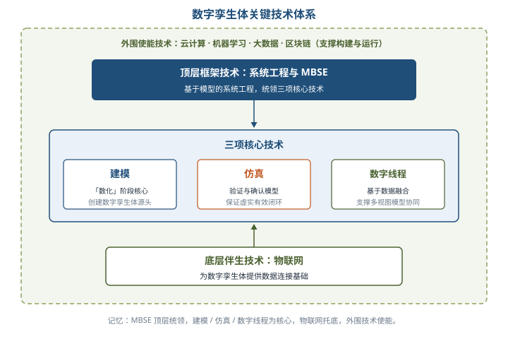

建模与仿真是一对伴生体：**建模**是把对物理世界的理解简化和模型化；**仿真**是验证和确认这种理解的正确性和有效性，把包含确定性规律和完整机理的模型转化为软件来模拟物理世界。建模技术体系的三维空间：**需求指标、生存期阶段、空间尺度**。

### 11.5.4 数字孪生体的应用

四大应用领域：**制造**（设计阶段仿真优化、制造阶段数字生产线与物理生产线实时交互，是智能制造的基石）、**产业**（按数化→互动→先知→先觉→共智顺序深入，覆盖市场营销、供应链物流、维保服务）、**城市**（数字孪生城市是新型智慧城市的前提，特征含传感监控即时性、信息传递交互性等）、**战场**（单体装备应用与战场综合应用，服务于战略、战役、战术层次）。

### 11.6.1 云计算技术概述

云计算概念于 **2007 年 10 月**正式出现（谷歌与 IBM 宣布联合研究）。IBM 定义的内涵包含**平台和应用**两方面：平台即基础设施，地位相当于 PC 上的操作系统；云应用所需的计算与存储通常在「云端」完成，客户端通过互联网访问。

⭐【重点】【高频考点】三类典型服务方式：

| 服务方式 | 提供内容 | 用户要做的事 | 类比 |
| --- | --- | --- | --- |
| IaaS 基础设施即服务 | 内存、I/O、存储、计算能力整合成虚拟资源池 | 自己在之上搭建系统与应用 | 租毛坯房 |
| PaaS 平台即服务 | 分布式开发环境、服务器平台、硬件资源，对外提供 Web API | 在平台上定制开发自己的应用程序 | 租带精装修的房，自己布置软装 |
| SaaS 软件即服务 | 统一部署的应用软件，按数量、时长订购，浏览器访问 | 简单配置后即可上线使用 | 直接住酒店 |

⭐【易错】**灵活性 SaaS→PaaS→IaaS 依次增强**（可控资源越来越底层），**方便性 IaaS→PaaS→SaaS 依次增强**。PaaS 是云计算服务模式中最为关键的一层，地位相当于系统软件，为上层 SaaS 应用提供 API。

⭐【重点】NIST 定义的四种部署模式：**公有云**（基础设施公开分配给公众）、**社区云**（分配给共同关注任务、安全需求、政策的一些社区组织专有，属公有云范畴内的组成部分）、**私有云**（分配给单个组织）、**混合云**（公有云、私有云和社区云的组合）。

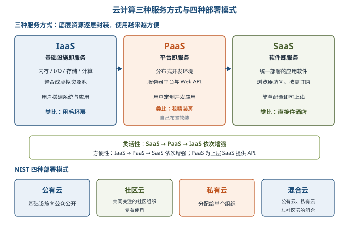

云计算发展历程三条线索：**虚拟化技术**（1959 年 Christopher Strachey 首次提出，对应 IaaS 的发展）、**分布式计算技术**（经历多处理器运行、分布式对象、Web 服务、网格计算、对等计算、效用计算等阶段，对应 PaaS 的发展）、**软件应用模式**（SaaS 概念 2001 年 SIIA 白皮书确立，2003 年起 Salesforce 等企业成功实践，对应 SaaS 的发展）。

### 11.6.2 大数据技术概述

⭐【高频考点】大数据特征的不同提法：

| 提出方 | 特征模型 |
| --- | --- |
| 维基百科 | 大小或复杂性超出现有常用软件工具以合理成本、可接受时限处理的数据集 |
| Gartner | 三个量化指标：数据量、数据种类、处理速度（三大挑战：不断增长的数据量、多格式数据、性能） |
| IBM | 3V：大规模 Volume、高速度 Velocity、多样化 Variety，另含潜藏价值 Value（第 4 个 V） |
| SAS | 3V 基础上增加「可变性」（数据流不一致、周期性峰值）和「复杂性」（数据来源多样、需数据治理） |

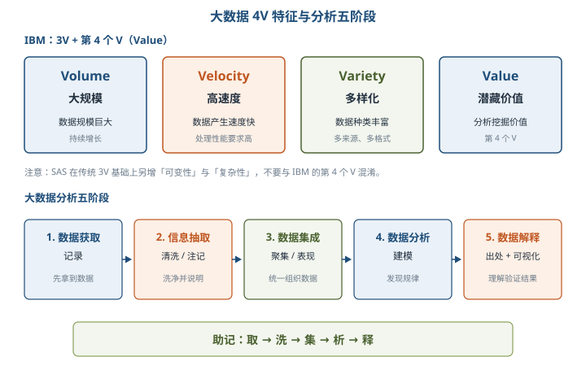

⭐【重点】大数据分析五个主要阶段：**数据获取/记录 → 信息抽取/清洗/注记 → 数据集成/聚集/表现 → 数据分析/建模 → 数据解释**。解释阶段强调「数据的出处（data provenance）」与可视化，让用户理解、验证分析结果。大数据应用四大领域：制造业、服务业、交通行业、医疗行业。

> 助记：分析五步「取—洗—集—析—释」，先拿数据再洗净，集成之后做建模，最后解释给人听。

## 三、重点与易错点

| # | 考点 | 必须记住的结论 | 易错提醒 |
| --- | --- | --- | --- |
| 1 | CPS 术语来源 | NASA 于 1992 年最早提出；2006 年海伦·吉尔详述 | 不要记成 2006 年才提出 |
| 2 | CPS 本质 | 基于数据自动流动的「状态感知—实时分析—科学决策—精准执行」闭环赋能体系 | 闭环四环节顺序不能颠倒 |
| 3 | CPS 三级架构 | 单元级（最小单元）→系统级（工业网络互联）→SoS 级（数据汇聚与运营优化） | 即插即用、协同控制属系统级，不属于单元级 |
| 4 | CPS 四要素 | 一硬（感知和自动控制）、一软（工业软件）、一网（工业网络）、一平台（工业云和智能服务平台） | 工业软件是 CPS 的核心，不是硬件 |
| 5 | CPS 建设路径重点 | 单元级重感控设备与工艺数字化；系统级重工业网络；SoS 级重大数据与智能服务平台 | 各阶段建设重点常交叉出题 |
| 6 | 弱/强人工智能 | 迄今所有 AI 系统都是弱人工智能；强 AI 有自我意识，分为类人与非类人 | AlphaGo 再强也属弱人工智能 |
| 7 | AI 里程碑 | 1956 达特茅斯标志 AI 诞生；1959 塞缪尔提出机器学习；1968 DENDRAL 首个专家系统；1997 深蓝；2006 辛顿深度学习；2016 AlphaGo | 图灵测试是 1950 年，不是 AI 诞生标志 |
| 8 | 机器学习四分类 | 监督（标注样本）、无监督（无标注）、半监督（少量标注）、强化（反馈机制） | 随机森林在教材中列入无监督常见算法，按教材记忆 |
| 9 | 传统 ML vs 深度学习 | 传统 ML 需人工特征提取；深度学习靠多层神经网络自动学特征，需海量数据+GPU | CNN、RNN 属深度学习；SVM、决策树属传统 ML |
| 10 | 三代机器人 | 示教再现型→感觉型→智能型 | 第一代无环境感知；第三代才能自主决策 |
| 11 | 机器人 4.0 五大技术 | 云-边-端协同计算、持续与协同学习、知识图谱、场景自适应、数据安全 | 云侧重计算与知识存储，端侧重实时操作 |
| 12 | 边缘计算落地形态 | 云边缘、边缘云、云化网关三类 | MEC、CDN 属边缘云；IEF、Greengrass 属云边缘 |
| 13 | 边云关系与六协同 | 互补协同而非替代；资源、数据、智能、应用管理、业务管理、服务 | 云端训练模型、边缘执行推理属智能协同 |
| 14 | 数字孪生体核心技术 | 建模、仿真、数字线程三项核心；MBSE 顶层框架；物联网底层伴生 | 云计算、大数据、区块链只是外围使能技术 |
| 15 | 云计算服务与部署 | 灵活性 IaaS 最强、方便性 SaaS 最强；部署分公有/社区/私有/混合四云 | PaaS 是最关键一层，相当于系统软件 |
| 16 | 大数据特征与分析 | IBM 3V+Value；SAS 另加可变性、复杂性；分析五阶段「取洗集析释」 | 数据出处与可视化属解释阶段 |

## 四、练习与真题

以下为本章自编单选模拟题，答案与解析集中放在全章最后「六、参考答案」。

**1.** 信息物理系统（CPS）这一术语最早由（ ）于 1992 年提出。
A. 美国国家科学基金会  B. 美国国家航空航天局  C. 美国国防部  D. 欧盟委员会

**2.** 在 CPS 体系架构中，实现互联互通、即插即用、协同控制、监视与诊断等功能的是（ ）。
A. 单元级 CPS  B. 系统级 CPS  C. SoS 级 CPS  D. 器件级 CPS

**3.** CPS 四大核心技术要素「一硬、一软、一网、一平台」中，「一软」指的是（ ）。
A. 嵌入式操作系统  B. 工业软件  C. 工业数据库  D. 智能感知软件

**4.** 关于强人工智能与弱人工智能，下列说法正确的是（ ）。
A. AlphaGo 属于强人工智能  B. 目前的 AI 系统均属于弱人工智能  C. 弱人工智能具有自主意识  D. 强人工智能已广泛应用于语音识别

**5.** 标志人工智能研究领域正式诞生的事件是（ ）。
A. 1950 年图灵提出图灵测试  B. 1956 年达特茅斯夏季研讨会  C. 1959 年塞缪尔提出机器学习  D. 1968 年专家系统 DENDRAL 问世

**6.** 某系统仅利用少量标注样本和大量未标注样本进行训练分类，以降低标注代价，该学习方式属于（ ）。
A. 监督学习  B. 无监督学习  C. 半监督学习  D. 强化学习

**7.** 与传统机器学习相比，深度学习的主要特点是（ ）。
A. 需要人工完成领域特征提取  B. 只需少量训练样本即可工作  C. 基于多层神经网络自动学习特征，依赖大量数据与 GPU 算力  D. 典型算法为支持向量机和决策树

**8.** 按照机器人发展历程，第三代机器人是（ ）。
A. 示教再现型机器人  B. 感觉型机器人  C. 智能型机器人  D. 遥控操作型机器人

**9.** 按照边缘计算产业联盟（ECC）的定义，多接入边缘计算（MEC）和 CDN 属于边缘计算的（ ）落地形态。
A. 云边缘  B. 边缘云  C. 云化网关  D. 中心云

**10.** 在边云协同中，「云端开展 AI 集中式模型训练并下发模型，边缘节点按模型执行推理」属于（ ）。
A. 资源协同  B. 数据协同  C. 智能协同  D. 服务协同

**11.** 数字孪生体的三项核心技术是（ ）。
A. 物联网、云计算、大数据  B. 建模、仿真、基于数据融合的数字线程  C. 系统工程、MBSE、区块链  D. CAD、CAE、CAM

**12.** 关于云计算三种服务方式，下列说法错误的是（ ）。
A. 灵活性按 SaaS→PaaS→IaaS 依次增强  B. 方便性按 IaaS→PaaS→SaaS 依次增强  C. PaaS 在整个云计算体系中起支撑作用  D. SaaS 模式下用户需自行搭建服务器平台才能使用应用

**13.** SAS 公司在大数据传统 3V 模型基础上增加的两个特征是（ ）。
A. 价值性和真实性  B. 可变性和复杂性  C. 规模性和高速性  D. 多样性和隐私性

## 五、疑问与查漏补缺

1. **大纲无细目、教材面面俱到**：大纲第 10 部分仅列 6 个技术条目、未列细目，复习深度以教材标题级概念和分类为准即可，不必深究算法推导；但「分类归属」类选择题需逐表记牢。
2. **教材笔误与排版**：11.2.3 中 Q-Learning 印为「Q-Leamning」、人机交互缩写印为「HCl」（应为 HCI）、11.6.2 中 Gartner 印为「Granter」、SIIA 印为「SIA」，均为 OCR/排版噪声，复习时按正确术语理解；11.5.2 PTC 定义一句原文有脱字，不影响「中物、连接、数据管理、应用」四构成要点。
3. **随机森林的归类**：教材把随机森林列为无监督学习常见算法，而业界通常将其用作监督学习集成算法；考试以教材为准，实际工程中按主流理解使用，两处不要互相否定。
4. **与其他章节的衔接**：云计算服务/部署模式与第 7 章架构风格、第 8 章质量属性（性能、可用性、安全性）结合出案例题；边缘计算、CPS 与第 4 章安全技术（边界防护、数据安全）呼应；数字孪生中的 MBSE 与第 5 章软件工程的模型驱动开发思想一脉相承，可串联复习。
5. **时效性说明**：教材成书较早，AI 部分未覆盖大模型/生成式 AI 新进展；若真题出现 ChatGPT 等新名词，按「属于弱人工智能、属于自然语言处理应用」的教材框架作答即可。

## 六、参考答案

**1.** B。CPS 术语最早由美国国家航空航天局（NASA）于 1992 年提出，2006 年由 NSF 的海伦·吉尔详细描述。

**2.** B。系统级 CPS 在单元级基础上增加互联互通、即插即用、边缘网关、数据互操作、协同控制、监视与诊断等功能。

**3.** B。「一软」指工业软件，它固化了 CPS 计算和数据流程的规则，是 CPS 的核心。

**4.** B。迄今为止的 AI 系统（含 AlphaGo）都是弱人工智能；强人工智能有知觉和自我意识，未来几十年内难以实现。

**5.** B。1956 年达特茅斯会议正式使用「人工智能」术语，标志 AI 研究领域诞生；图灵测试只是思想奠基。

**6.** C。半监督学习利用少量标注样本加大量未标注样本训练，目的是减少标注代价、提高学习能力。

**7.** C。深度学习基于多层神经网络自动学习特征，需海量训练数据和强大 GPU 算力；SVM、决策树属传统机器学习。

**8.** C。三代顺序为示教再现型（第一代）→感觉型（第二代）→智能型（第三代），智能型可自主推理、判断和决策。

**9.** B。边缘云在边缘侧构建中小规模云服务能力，代表有 MEC、CDN、华为云 IEC；IEF、Greengrass 属云边缘。

**10.** C。智能协同的分工是「云端训练、边缘推理」，实现分布式智能。

**11.** B。建模、仿真和基于数据融合的数字线程是三项核心技术；物联网是底层伴生技术，云计算、大数据、区块链是外围使能技术。

**12.** D。SaaS 由服务商统一部署应用软件，用户浏览器订购使用、简单配置即可，无需自行搭建平台；其余三项均正确。

**13.** B。SAS 在 3V 基础上增加「可变性」（数据流不一致、周期性峰值）与「复杂性」（来源多样、需数据治理）。
