# 第12章 信息系统架构设计理论与实践

- 教材位置：`02.系统架构设计师第二版-教材.pdf` PDF 第 413～458 页（书页 405～450）
- 复习状态：已完成
- 复习日期：2026-11-06
- 本章地位：下篇首章，把上篇架构基础落到企业信息系统建设，是下午案例题的重点底座。复习要能从企业现状出发选架构、排 ADM 阶段、选规划方法，并说明集成方案如何解决实际痛点。

## 一、大纲考点

大纲考试科目 2「系统架构设计案例分析」第 2 主题「信息系统架构的设计理论与实践」（大纲书页 51～52，PDF 页 61～62）与本章直接对应。科目 1 第 11 部分为「标准化与知识产权」，仅与大纲 2.3 的标准法规要求交叉，不是本章主体。

| 大纲条目 | 大纲要求 | 教材对应 | 复习抓手 |
| --- | --- | --- | --- |
| 2.1 信息系统架构概述 | 定义和发展；集中式与分布式；四种常用架构模型；企业总体框架 | 12.1、12.2 | 架构三要素；物理/逻辑结构；单机、C/S、SOA、数据交换总线；战略/业务/应用/基础设施 |
| 2.2 设计方法（ADM） | TOGAF；ADM 定义、开发阶段和详细活动 | 12.3.1 | TOGAF 六组件；ADM 十阶段；三级迭代；需求管理居中；范围四维度 |
| 2.3 信息化总体架构方法 | 信息化概念、生产力、建设与特征；工程建设方法 | 12.3.2 | 数据导向与流程导向；五阶段生命周期；CSF/SST/BSP；资源管理与标准法规意识 |
| 2.4 案例分析 | 价值驱动体系结构；Web 服务在 HL7 上的应用；以服务为中心的企业整合 | 12.4 | 价值驱动因素；HL7 消息与适配器；业务分析→服务建模→IT 环境分析→高层架构 |

⭐【案例题考查形式】通常给出企业异构系统、业务变化、性能或集成困难等材料，要求**辨识架构模式并比较优劣、补全 ADM 阶段及活动/交付物、选择信息化规划方法、分析 SOA/ESB/HL7 集成方案**。作答不能只默写定义，应按「材料问题 → 对应架构机制 → 能解决什么 → 代价或约束」展开。

## 二、知识点笔记

### 12.1.1～12.1.3 信息系统架构概念、发展与定义

信息系统架构（Information System Architecture，ISA）关注系统组成部分之间、系统与业务之间、系统与技术之间的关系。现代信息系统架构有两个层次：**概念层次**包含艺术、科学、方法和建设风格；**物理层次**是架构工作形成的物理结构及相互作用结果。

> 教材原文：软件或计算机系统的信息系统架构是该系统的一个（或多个）结构，而结构由软件元素、元素的外部可见属性及它们之间的关系组成。

⭐【重点】【高频考点】定义抓住三个词：**元素、外部可见属性、关系**。外部可见属性是其他元素可以依赖的假设，如提供的服务、性能特征；类的私有字段、函数内部算法等纯内部实现细节不属于架构。

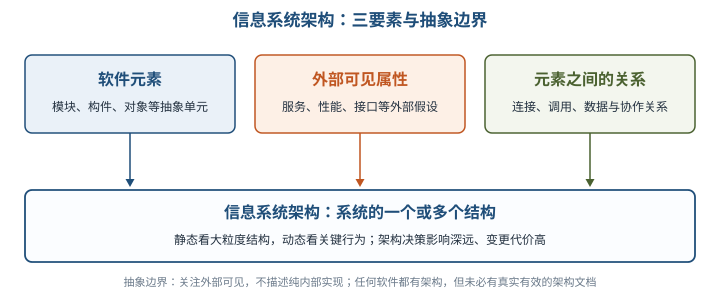

| 理解要点 | 必须掌握的含义 | 易混点 |
| --- | --- | --- |
| 多结构 | 不同结构分别传达模块、运行、部署等方面信息，单个结构不能代表完整大型架构 | 架构不是一张部署图 |
| 架构与文档 | 任何软件都有架构，但不一定有架构文档；文档可能过时 | 有文档不等于文档反映了真实架构 |
| 静态与动态 | 静态关注大粒度总体结构；动态关注关键行为的共同特征 | 不只是「有哪些模块」 |
| 基础性与决策 | 解决关键重复问题，包含影响深远、修改代价高的决策 | 架构师水平也是约束，重大决策应评审 |

举例：订单服务对外承诺「提交订单后 2 秒内返回订单号」属于外部可见属性；它内部用哪种排序算法整理临时数据，通常不是架构关注点。

| 发展节点 | 核心贡献 |
| --- | --- |
| 20 世纪 80 年代中期，John Zachman | 引入信息系统架构框架，从信息、流程、网络、人员、时间、基本原理六个视角分析企业 |
| 1999 年，美国联邦 CIO 委员会 | 公布联邦企业架构框架，协调公共业务流程、技术引入、信息流和系统投资 |
| 1995 年，TOGAF 发布 | 以美国国防部 TAFIM 为基础，形成开放、迭代、可复用架构资产的企业框架 |

架构受干系人、开发组织、架构师经验和技术环境影响，也会反作用于组织分工、目标和后续需求，形成**架构商业周期**。

### 12.2.1 架构风格

> 教材原文：信息系统架构风格是描述某一特定应用领域中系统组织方式的惯用模式。架构风格定义了一个系统家族，即一个架构定义一个词汇表和一组约束。

通俗地说，架构风格就是某类系统反复使用的「组织套路」：规定有哪些构件/连接件，以及它们怎样组合。它支持**架构级大粒度复用**，但选择必须结合项目特点。

| 通用风格 | 代表形式 | 一句话识别 |
| --- | --- | --- |
| 数据流 | 批处理序列、管道/过滤器 | 数据依次经过处理步骤 |
| 调用/返回 | 主程序/子程序、面向对象、层次结构 | 一方调用，另一方执行并返回 |
| 独立构件 | 进程通信、事件系统 | 构件通过消息或事件协作 |
| 虚拟机 | 解释器、基于规则的系统 | 构造执行语义或规则的环境 |
| 仓库 | 数据库、超文本、黑板系统 | 围绕共享数据中心协作 |

### 12.2.2 信息系统架构分类

⭐【重点】物理结构看**硬件资源的空间分布**，逻辑结构看**功能子系统的综合体**，二者分类维度不同。

| 对比项 | 集中式结构 | 分布式结构 |
| --- | --- | --- |
| 资源配置 | 软件、数据、设备集中；多终端共享主机也属集中式 | 网络连接不同地点的软硬件和数据，可统一管理，也可本地独立运行 |
| 优点 | 便于管理、资源利用率较高 | 按需配置、扩展方便、应变能力强；单结点故障一般不致全系统停止 |
| 局限 | 规模扩大后维护困难；主机故障易形成单点风险 | 标准不易统一、协调困难、整体资源规划管理复杂 |
| 典型形态 | 单机、多用户主机终端 | 一般分布式、客户机/服务器；已成为主流 |

| 逻辑结构综合 | 综合对象 | 例子 |
| --- | --- | --- |
| 横向综合 | 同一管理层次的多种职能 | 运行控制层的人事和工资子系统一体化 |
| 纵向综合 | 同一职能的不同管理层次 | 工厂会计系统与公司会计系统贯通 |
| 纵横综合 | 信息模型和处理模型 | 建公共数据库、统一处理系统，提取通用模块 |

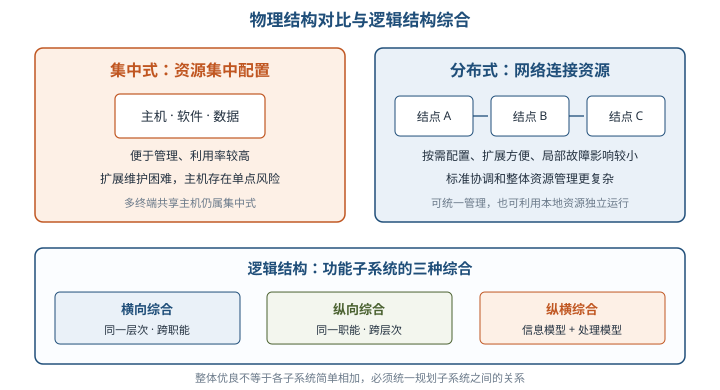

⭐【易错】各子系统单独性能优良，不保证整体性能优良；必须统一规划子系统间关系，强调整体协调。

### 12.2.3 信息系统架构的一般原理

ISA 要在企业战略、业务、组织、管理和技术之间建立**多维、分层、集成、开放**的体系。其柔性来自把系统拆成「组成成分 + 成分关系」，识别相对稳定部分，在稳定部分支撑下重组易变部分，以较小改动适应环境。

举例：电商的订单、客户、商品等核心概念相对稳定，促销规则变化较快；把促销规则独立配置，就不必每次活动都重写订单核心。

### 12.2.4 四种常用架构模型

| 模型 | 核心特征 | 典型适用与提醒 |
| --- | --- | --- |
| 单机应用 | 独立运行于一台物理机，可含多进程/多线程 | 架构形态简单不等于业务算法简单，如 CAD、图像处理软件 |
| 两层/多层 C/S（含 MVC） | 请求—响应分工，逐层分离界面、业务与数据 | 两层偏胖客户端；多层提升伸缩性、并发和隔离性 |
| SOA 与多服务集合 | 多个能独立提供完整功能的应用以消息/RPC 协作 | 服务是广义业务功能单元，不是某个操作系统守护进程 |
| 企业数据交换总线 | 以连接器作为公共通道，接收并分发数据、请求、回复 | 成熟总线偏实时交易；可靠的大数据量传输常需单独设计 |

**两层、三层、B/S 与多层 C/S**：两层常将界面和业务逻辑集成在客户端，后台提供数据库服务；三层把业务处理独立出来；B/S 采用浏览器这一通用客户端；四层常见为浏览器、Web 服务器、中间件/应用服务器、数据库服务器。

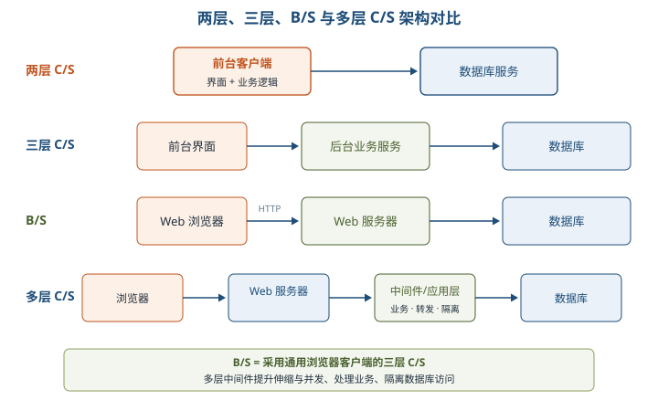

⭐【高频考点】**B/S 本质是采用通用客户端界面的三层 C/S**，浏览器与 Web 服务器仍基于 TCP/IP，只是在应用层用 HTTP 标准化。多层中间件的三大价值：扩展并发与伸缩性、转发请求/处理业务逻辑、隔离 Web 服务器与数据库以提高安全性。

三层 C/S 前后台通信可基于 Socket、自定义消息、RPC、CORBA/IIOP、Java RMI、J2EE JMS、HTTP 等；HTTP 不是面向对象结构，对象数据需平面化后传输。

| MVC 角色 | 职责 | 教材中的典型层次映射 |
| --- | --- | --- |
| View（视图） | 图形化展示处理结果 | 浏览器/表示相关部分 |
| Controller（控制器） | 接收请求，连接不同模型和视图 | Web 服务器相关部分 |
| Model（模型） | 数据或业务逻辑、持久化 | 应用逻辑及数据部分 |

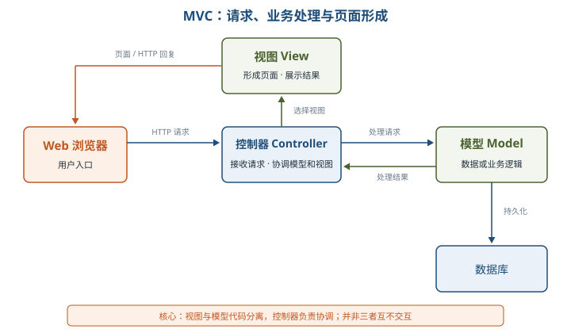

MVC 的关键是**视图与模型代码分离**，控制器负责协调；按业务逻辑是否再独立成服务，可对应三层或四层体系。

| 对比 | 多层单点应用 | SOA 多服务结构 |
| --- | --- | --- |
| 对外边界 | 各层共同组成一个完整应用，去掉关键层就不能工作 | 每个服务本身是可独立提供完整功能的应用 |
| 协作范围 | 应用内部各层协作 | 多个独立应用之间协作 |
| 通信本质 | 预定义协议、请求/回复 | 消息机制或远程过程调用（RPC） |

Web Service 是 SOA 在 Web 应用之间的典型实现，常通过 SOAP、WSDL 开放内部服务，但不能把 SOA 等同于 Web Service。

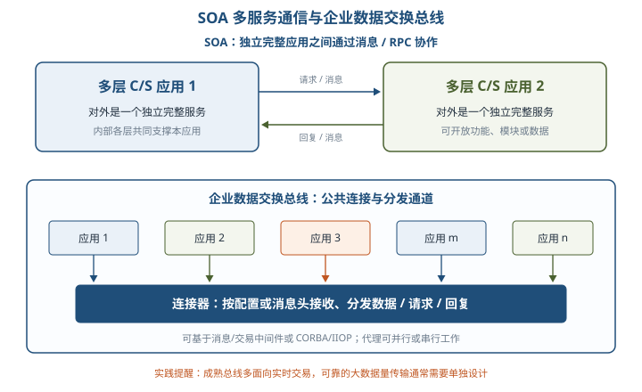

### 12.2.5 企业信息系统总体框架

⭐【重点】【高频考点】总体框架的四部分与管理金字塔对应；**业务系统和应用系统同在第二层**。

| 组成 | 管理层次 | 核心作用 |
| --- | --- | --- |
| 战略系统 | 第一层，战略管理 | 高层决策支持与企业战略规划；向业务系统提重组要求、向应用系统提集成要求 |
| 业务系统 | 第二层，战术管理 | 对业务过程/活动建模，以 BPR 优化流程，识别相对稳定数据 |
| 应用系统 | 第二层，战术管理 | 用 TPS、MIS、DSS、ES、OAS 等软件实现业务控制并提高运行效率 |
| 信息基础设施 | 第三层，运行管理 | 提供数据、技术和管理平台，支撑应用、战略及业务重组 |

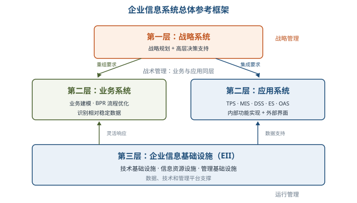

企业信息基础设施（EII）分三类：**技术基础设施**（计算机、网络、系统/支持软件、交换协议）、**信息资源设施**（数据、交换标准、处理方法）、**管理基础设施**（组织、人员分工、制度）。一般而言信息资源较稳定，技术和管理变化较多，但每类内部都有稳定与易变部分，不能绝对化。

### 12.3.1 TOGAF 与 ADM 架构开发方法

TOGAF 是 The Open Group 制定的开放企业架构框架，目标是统一沟通语言、避免专有方案锁定、节约资源并提高投资回报。其核心思想包括模块化架构、内容框架、扩展指南和适配不同架构风格。

| TOGAF 9 六组件 | 记忆要点 |
| --- | --- |
| 架构开发方法（ADM） | **核心**，开发企业架构的分步方法 |
| ADM 指南和技术 | 应用 ADM 时可采用的指南与技术 |
| 架构内容框架 | 工件元模型、架构构建块（ABB）、交付成果 |
| 企业连续体和工具 | 对架构输出分类、存储，支持资产复用 |
| TOGAF 参考模型 | 技术参考模型 TRM、集成信息基础设施参考模型 III-RM |
| 架构能力框架 | 建立架构实践所需组织、流程、技能、角色和职责 |

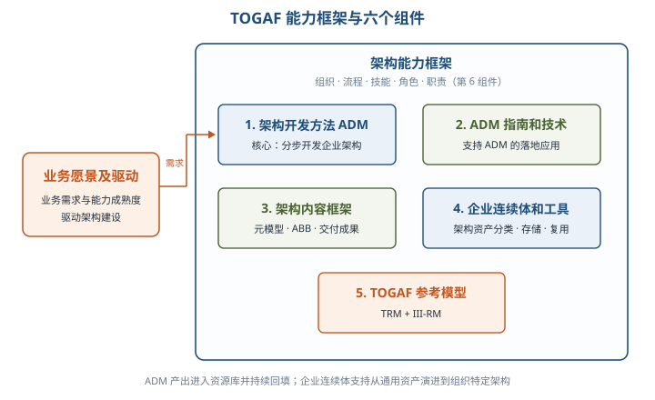

企业连续体体现从基础架构、通用基础架构、行业架构到组织特定架构的演进；ADM 指导演进，资源库提供可复用资产，ADM 的新交付物又持续回填资源库。

⭐【重点】【高频考点】ADM 十个阶段中，需求管理位于中心，准备阶段和 A～H 构成迭代过程。

| 阶段 | 主要活动与高频交付物 |
| --- | --- |
| 准备阶段 | 建团队、定组织范围与治理框架、选并剪裁框架和工具、定义架构原则；形成资源库雏形和架构工作要求书 |
| A 架构愿景 | 定范围、约束、干系人和业务需求，评估能力与风险，形成愿景、工作说明书和计划并获批 |
| B 业务架构 | 描述基线/目标业务架构，差距分析；关注组织、目标、角色等静态特征和流程、功能、服务等动态特征 |
| C 信息系统架构 | 数据架构定义所需数据源和类型；应用架构定义处理数据、支撑业务的应用；两者可顺序或并行 |
| D 技术架构 | 将应用组件映射为硬件、软件、通信技术组件，形成基线/目标技术架构并做差距分析 |
| E 机会及解决方案 | 合并 B～D 差距，识别工作包和项目、过渡架构，决定制造/购买/重用等途径并评估依赖与优先级 |
| F 迁移规划 | 做业务价值、成本、绩效和风险分析，形成详细实施迁移计划、路线图和架构契约 |
| G 实施治理 | 签署架构契约，监督实施、开展合规审查，确保部署方案符合目标架构 |
| H 架构变更管理 | 持续监测基线和业务价值，受控处理技术、业务及经验教训引发的变更，必要时启动新循环 |
| 需求管理 | 贯穿所有阶段，识别、存储、排优先级、跟踪变更及影响，维护需求基线和需求库 |

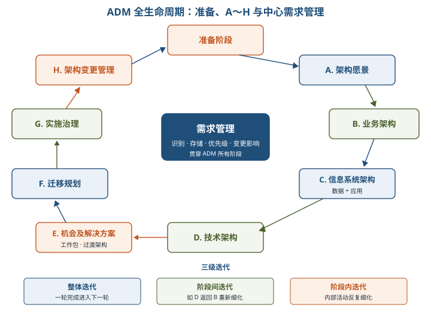

> 助记：「预备愿景起，业信技奠基；机会迁移治，变更需求续」——业务、信息系统、技术是 B/C/D，机会、迁移、治理、变更对应 E/F/G/H，需求贯穿始终。

⭐【易错】B、C、D 的共性步骤是「基线架构 → 目标架构 → 差距分析」；E 才开始直接关注实施，G 是实施中的架构监督，H 是持续变更管理，不要混为一谈。

ADM 的三级迭代：**整体迭代**（完成一轮进入下一轮）、**阶段间迭代**（如技术架构返回业务架构）、**阶段内迭代**（阶段内部活动反复细化）。架构范围由企业自己确定，从四个维度限定：

| 范围维度 | 要回答的问题 |
| --- | --- |
| 企业范围或焦点 | 覆盖哪个组织、业务或合作联盟 |
| 架构领域 | 是否覆盖业务、数据、应用、技术全部四域 |
| 详述垂直范围或级别 | 细化到第几层，与系统设计的边界在哪里 |
| 时间周期 | 愿景覆盖多久，需要哪些中间目标架构 |

### 12.3.2 信息化总体架构方法

信息化是培育、发展以智能化工具为代表的新生产力并造福社会的历史过程。国家信息化体系六要素：**信息资源、信息网络、信息技术应用、信息技术和产业、信息化人才、信息化政策**。

信息化完整内涵包括信息网络体系、信息产业基础、社会运行环境、效用积累过程；常见平台包括知识管理、日常办公、信息集成、信息发布、协同工作、公文流转、企业通信七类。教材归纳的信息化特征为：**易用性、健壮性、平台化/灵活性/拓展性、安全性、门户化/整合性、移动性**。

⭐【重点】数据导向与流程导向不是互斥选型，而是互补视角。

| 对比项 | 数据导向架构 | 流程导向架构 |
| --- | --- | --- |
| 关注中心 | 数据对象及关系、数据模型和质量 | 端到端流程整合及流程变化适应度 |
| 切入路径 | 主题域 → 业务对象 → 对象关系 → 概念/逻辑/物理模型 | 价值链 → 流程分解 → 业务组件 → 服务识别与流程编排 |
| 典型支撑 | 数据中心、BI、主数据管理 MDM | SOA、服务组合、流程服务 |
| 单独使用的风险 | 后续仍需管理数据产生、变更、废弃流程 | 可能只有接口元数据，缺完整数据模型，质量治理难落地 |

SOA 可帮助 MDM 做数据收集、分发和路由；MDM 的统一数据视图和数据质量能力又支撑 SOA 组合服务。

| 生命周期阶段 | 回答的问题与主要成果 |
| --- | --- |
| 系统规划 | 是否建设、建什么；初步调查、可行性研究，形成可行性报告和系统设计任务书 |
| 系统分析 | **做什么**；详细调查现行流程，建立新系统逻辑模型，形成系统说明书 |
| 系统设计 | **怎么做**；把逻辑模型转为物理方案，分总体/详细设计，形成系统设计说明书 |
| 系统实施 | 把设计落地；购置安装、编程调试、培训、数据转换、系统转换和测试 |
| 系统运行和维护 | 运行记录、评价、修改和效益评估，直至由新系统替代 |

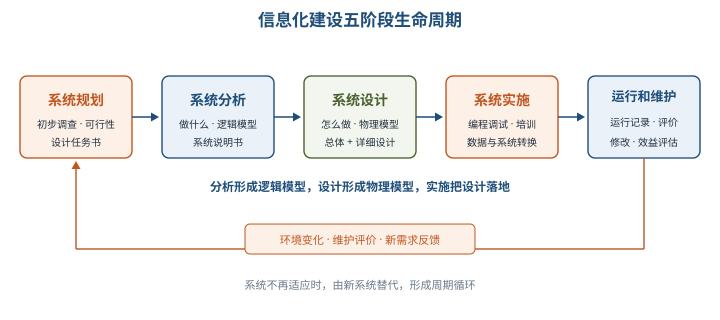

⭐【高频考点】三种总体规划方法的区分：

| 方法 | 核心路径 | 优势与局限 |
| --- | --- | --- |
| 关键成功因素法 CSF | 组织目标 → 识别关键成功因素 → 性能指标 → 关键信息集合/数据字典 → 开发优先次序 | 抓主要矛盾、重点突出，最利于确定管理目标；关键因素随组织和时期变化 |
| 战略目标集转化法 SST | 使命、目标、战略等战略集合 → 转化为 MIS 战略目标 | 反映多方要求、较全面少疏漏；突出重点不如 CSF |
| 企业系统规划法 BSP | 自上而下识别目标、企业过程和数据 → 过程/数据类矩阵分析 → 自下而上设计系统 | 强调企业过程和一致性信息，对组织变动有适应性；没有明显目标导引过程 |

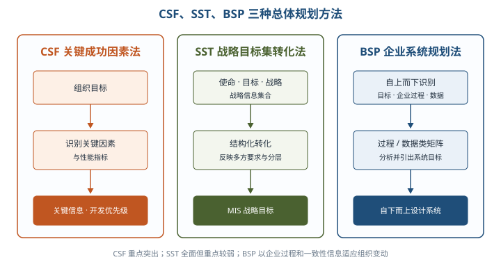

### 12.4.1 价值驱动的体系结构

系统存在的目的是为干系人创造价值。价值模型把「想要什么」和环境限制联系起来，帮助架构师优先解决最有价值的架构挑战。

| 价值驱动因素 | 含义 | 例子 |
| --- | --- | --- |
| 价值期望值 | 对功能、质量及不同质量级别实用性的期望 | 高峰期提交订单仍需 2 秒响应 |
| 反作用力 | 实际环境中实现期望的难度 | 请求量放大百倍、数据同步开销 |
| 变革催化剂 | 使期望或结果发生变化的环境事件/限制 | 大促开始、法规或部署地点变化 |

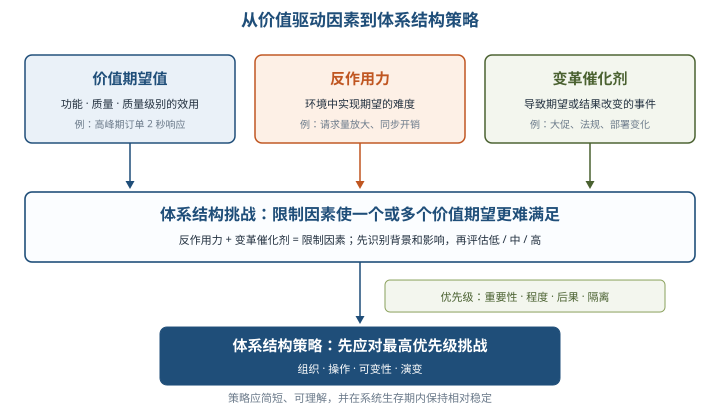

反作用力与变革催化剂合称**限制因素**。体系结构挑战是限制因素使价值期望更难满足；确定优先级时权衡**重要性、程度、后果、隔离**。最终策略从组织、操作、可变性、演变四方面给出简短、稳定且可理解的指导原则。

### 12.4.2 Web 服务在 HL7 上的应用

HL7 名称中的「第七层」指 OSI 应用层。HL7 V3 以参考信息模型（RIM）为公共静态模型，将领域模型逐步精化并与消息类型结合，生成 XML Schema（XSD）。应用间通过消息交换协作，触发事件启动一次交互，应用程序角色表示发送/接收职责，Storyboard 汇集用例叙述、角色、消息类型与交互顺序。

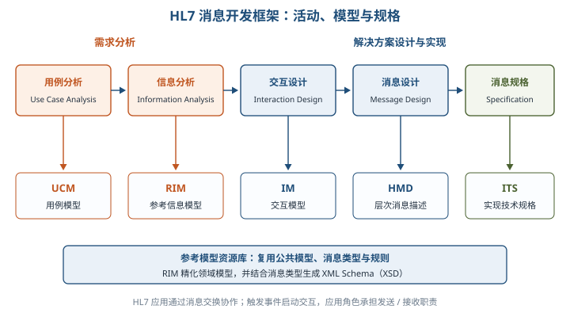

| HL7 核心制品 | 作用 |
| --- | --- |
| RIM 参考信息模型 | 提供卫生保健领域公共静态信息模型 |
| UCM / IM | 分别描述用例和交互关系 |
| HMD 层次消息描述 | 描述消息的层次结构 |
| ITS 实现技术规格 | 规定具体实现技术和消息格式 |

⭐【重点】参考体系结构把应用内部功能分为**业务逻辑**与 **Web 服务适配器**：发送端业务逻辑生成 HL7 XML 消息；适配器读取封装、配置并生成 SOAP 消息，再交给 Web 代理传输。接收端适配器验证 SOAP、拆出并校验 HL7 消息、处理通信确认，再交业务逻辑验证业务规则并按需返回应用层确认。

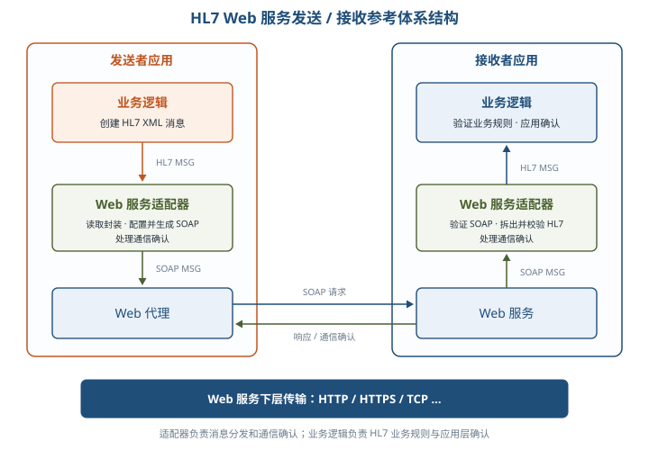

开发适配器五步骤：**消息和数据类型设计 → 适配器模式选择 → WSDL 契约开发 → 生成 Stub/代理 → 开发适配器业务逻辑**。WSDL 中，端口指定服务位置和绑定，端口类型表示接口，操作定义输入/输出，消息格式基于 XSD 类型。

### 12.4.3 以服务为中心的企业整合

航空公司案例的痛点具有代表性：主机 Information Hub 难向开放系统开放、事件点到点流转导致强耦合、跨系统业务协作硬编码导致自动化成本高和复用差。

| 案例步骤 | 关键活动 | 本章示范结果 |
| --- | --- | --- |
| 业务环境分析 | 比较多类航班流程，找共享业务活动 | 把机位、卸货、装货、推出检查抽象为可复用服务 |
| 服务建模 | 建业务组件、服务与流程模型 | Flight Management 输出 Retrieve Flight BO；Ramp Control 输出流程和检查服务 |
| IT 环境分析 | 调研外围应用、接口、交互类型和数据格式 | 识别乘务、机务、订票、航班调度四类交互 |
| 高层架构设计 | 将服务映射为信息、流程、事件、人工、传输等服务 | 以 ESB 和适配机制连接新旧系统，降低耦合 |
| 开发与演进 | 选择当前实现方式，保持服务契约稳定 | 人工服务未来可替换为自动服务，流程无需整体重写 |

Retrieve Flight BO 是**信息服务**，聚合乘务、机务、订票数据形成粗粒度 Flight BO；Ramp Coordination 是**流程服务**，由 BPEL4WS 执行并编排共享活动；航班到达由**事件服务**经 MQ、Message Broker 和 JMS 发布/订阅分发；人工检查是 **Staff Service**。

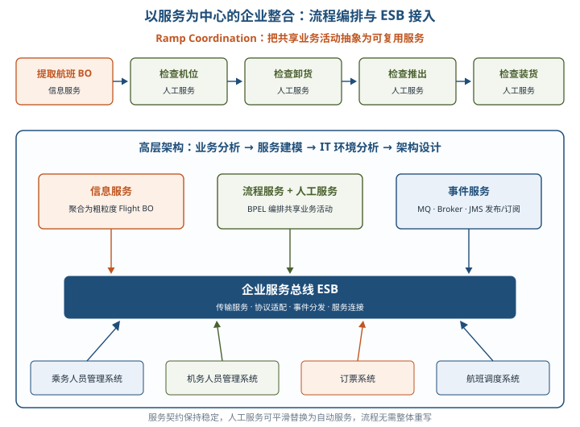

⭐【案例启示】粗粒度业务对象提高旧系统连接的通用性；ESB 发布/订阅替代点到点事件连接；流程编排复用业务活动；服务可替换性支持平滑演进。案例答题要把这些机制对应到题干痛点，而不是罗列产品名。

## 三、重点与易错点

| # | 考点 | 必须记住的结论 | 易错提醒 |
| --- | --- | --- | --- |
| 1 | ISA 定义 | 元素 + 外部可见属性 + 关系；架构可包含多个结构 | 纯内部实现细节不属于架构，文档不等于架构本身 |
| 2 | 物理与逻辑结构 | 物理看空间分布；逻辑看功能子系统综合 | 多终端共享主机仍是集中式 |
| 3 | 集中式与分布式 | 分布式扩展和容错较好，但标准协调与整体管理更难 | 分布式不等于没有故障或无需统一管理 |
| 4 | 三种逻辑综合 | 横向同层跨职能；纵向同职能跨层；纵横综合信息与处理模型 | 横向、纵向的分类维度不要对调 |
| 5 | 两层 C/S | 前台界面与业务逻辑常集成，后台数据库，偏胖客户端 | 不是「客户端只负责展示」 |
| 6 | B/S 本质 | 通用浏览器作客户端的三层 C/S，仍基于 TCP/IP | HTTP 标准化不等于脱离 TCP/IP |
| 7 | 多层中间件 | 伸缩并发、请求转发/业务处理、数据库访问隔离 | 中间件不是简单增加一台 Web 服务器 |
| 8 | MVC | 视图展示、控制器协调、模型承载数据或业务逻辑 | MVC 目标是视图与模型分离，不是三者完全无交互 |
| 9 | SOA 与多层应用 | SOA 服务是可独立提供完整功能的应用，应用间靠消息/RPC | 不要把层内服务、守护进程与 SOA 服务混同 |
| 10 | 数据交换总线 | 连接器负责接收分发；实时交易与大数据量可靠传输常分别设计 | 总线不天然包办所有批量传输需求 |
| 11 | 企业总体框架 | 战略第一层；业务与应用同第二层；基础设施第三层 | 业务系统和应用系统不是上下两层 |
| 12 | TOGAF 组件 | ADM 是核心，另有指南技术、内容、连续体工具、参考模型、能力框架 | TRM 与 III-RM 属参考模型组件 |
| 13 | ADM 十阶段 | 准备、A～H、需求管理；需求管理贯穿中心 | 不要漏准备阶段或把需求管理算作 A～H 之一 |
| 14 | B/C/D 与 E/F/G/H | B/C/D 做基线、目标、差距；E 实施规划，F 迁移，G 实施治理，H 变更 | 实施治理不是迁移规划，变更管理不是需求管理 |
| 15 | ADM 迭代与范围 | 整体、阶段间、阶段内三级迭代；范围四维度 | ADM 不替企业自动确定架构范围 |
| 16 | 生命周期 | 分析回答做什么、形成逻辑模型；设计回答怎么做、形成物理模型 | 系统说明书属分析，系统设计说明书属设计 |
| 17 | CSF/SST/BSP | CSF 抓关键重点；SST 战略集转化全面；BSP 上下结合、过程/数据矩阵 | BSP 不是纯粹自底向上规划 |
| 18 | 数据与流程导向 | 数据导向重模型质量，流程导向重端到端整合；MDM 与 SOA 互补 | 不是二选一，流程中传递的仍是数据 |
| 19 | 价值驱动 | 期望值、反作用力、变革催化剂；后两者为限制因素 | 优先级要看重要性、程度、后果、隔离 |
| 20 | HL7 与企业集成 | 适配器处理 SOAP/传输确认，业务逻辑处理 HL7 业务规则；ESB 事件解耦 | HL7 标准化消息不等于直接给出完整应用实现 |

## 四、练习与真题

以下为本章自编单选模拟题，答案与解析集中放在全章最后「六、参考答案」。

**1.** 下列内容中，通常不属于信息系统架构关注的是（ ）。
A. 构件提供的服务  B. 构件的性能特征  C. 构件之间的关系  D. 类内部私有算法的具体实现

**2.** 关于分布式信息系统结构，下列说法错误的是（ ）。
A. 可按应用需求配置资源  B. 系统扩展较方便  C. 任一结点故障都会导致全系统停止  D. 资源分散使标准统一和协调更困难

**3.** 典型两层 C/S 结构中，「胖客户端」的主要含义是（ ）。
A. 客户端必须部署高性能服务器  B. 客户端通常集成前台界面和相关业务逻辑  C. 客户端只负责显示静态页面  D. 数据库必须部署在客户端

**4.** 关于 B/S 模式，下列说法正确的是（ ）。
A. 浏览器与 Web 服务器不再使用 TCP/IP  B. B/S 与三层 C/S 完全无关  C. B/S 是采用通用客户端界面的三层 C/S  D. HTTP 是面向对象协议，可直接传输对象

**5.** 在多层 C/S 中引入中间件/应用层，下列哪项不是其主要作用（ ）。
A. 提高可伸缩性和并发能力  B. 转发请求并处理业务逻辑  C. 隔离 Web 服务器对数据库的直接访问  D. 取消所有访问控制并公开数据库

**6.** MVC 中负责接收请求、连接不同模型和视图的是（ ）。
A. Model  B. Controller  C. View  D. DataBase

**7.** 区分 SOA 多服务结构与多层单点应用的关键是（ ）。
A. 是否使用数据库  B. 是否采用 Java 技术  C. 各服务能否作为独立应用提供完整功能并相互通信  D. 是否存在 Web 浏览器

**8.** TOGAF ADM 中，确定主要信息类型及处理这些信息的应用系统属于（ ）。
A. 阶段 B 业务架构  B. 阶段 D 技术架构  C. 阶段 C 信息系统架构  D. 阶段 F 迁移规划

**9.** 在 ADM 全生命周期中，识别、存储需求并处理其变更影响，贯穿所有阶段的是（ ）。
A. 准备阶段  B. 阶段 G 实施治理  C. 阶段 H 架构变更管理  D. 需求管理

**10.** 关于信息化建设生命周期，下列对应正确的是（ ）。
A. 系统分析回答「做什么」并形成逻辑模型  B. 系统设计回答「做什么」并形成逻辑模型  C. 系统分析只负责设备采购  D. 系统规划直接形成物理模型

**11.** 自上而下识别企业过程和数据，经过程/数据类矩阵分析后再自下而上设计系统的方法的是（ ）。
A. 关键成功因素法  B. 战略目标集转化法  C. 原型法  D. 企业系统规划法

**12.** 航空公司案例中，用 ESB 的事件发布/订阅替代点到点事件流转，主要目的是（ ）。
A. 让所有系统共用同一种编程语言  B. 降低应用间耦合并提高事件集成能力  C. 取消业务确认消息  D. 把人工服务强制改成自动服务

## 五、疑问与查漏补缺

1. **大纲列出但教材未系统展开**：2.3 提到信息化资源管理、国际和国内标准/法律/规定，本章主要给概念和案例，未形成完整法规清单；复习时应结合第 4 章安全、大纲科目 1 第 11 部分「标准化与知识产权」以及现行法规补充，不在本章死记产品标准。
2. **TOGAF 版本语境**：教材按 TOGAF 9 六组件讲解，考试应以教材术语作答；实际项目使用新版本时需再核对官方结构，不把新旧版本组件混写。
3. **教材表述易误读**：12.2.4 标题称「四种架构模型」，实际是把两层/多层 C/S 与 MVC 合为一组；MVC 是多层 C/S 的标准化抽象，不应另算与四组完全并列的第五种企业集成模式。
4. **教材笔误与重复**：图 12-4 附近 Browser 有拼写噪声，ADM 输出中「目标技术架构 10.版」应理解为 1.0 版；HL7 案例步骤（4）（5）文字重复，按一次「提取并校验 HL7 负载」理解。
5. **安全性表述不能绝对化**：12.3.2 中「绝对加密」等措辞是产品化描述，案例答题应写传输/存储加密、权限、日志、签章等具体机制，不承诺绝对安全。
6. **与其他章节衔接**：通用架构风格回接第 7 章，质量权衡回接第 8 章，生命周期回接第 5 章；SOA/ESB 将在第 15 章深化，HL7 的 SOAP、WSDL 是后续学习的具体应用，不必在本章展开全部协议细节。

## 六、参考答案

**1.** D。架构强调元素、外部可见属性和关系，纯内部算法实现通常被抽象掉。

**2.** C。分布式的特点之一是单结点故障通常不会导致整个系统停止，但协调管理更复杂。

**3.** B。两层 C/S 常把前台界面与相关业务逻辑集成在客户端，后台主要提供数据库服务。

**4.** C。B/S 仍以 TCP/IP 为基础，只是用浏览器作通用客户端并在应用层采用 HTTP。

**5.** D。中间件用于伸缩、业务处理和数据库隔离，公开数据库与安全性目标相反。

**6.** B。Controller 接收请求并协调模型和视图；View 展示，Model 承载数据或业务逻辑。

**7.** C。SOA 中每个服务可看作独立完整应用，服务之间通过消息或 RPC 协作。

**8.** C。阶段 C 包含数据架构和应用架构，二者可顺序开发，也可并行开发。

**9.** D。需求管理位于 ADM 中心，维护需求基线并评估变更对各阶段的影响。

**10.** A。系统分析形成逻辑模型，系统设计再回答「怎么做」并形成物理模型。

**11.** D。BSP 的典型特征是自上而下识别、过程/数据类矩阵分析和自下而上设计。

**12.** B。发布/订阅让事件生产者和消费者不必点到点直连，从而降低耦合并增强复用。
