# 第13章 层次式架构设计理论与实践

- 教材位置：`02.系统架构设计师第二版-教材.pdf` PDF 第 459～489 页（书页 451～481）
- 复习状态：已完成
- 复习日期：2026-11-06
- 本章地位：层次式架构是企业应用最常见的总体结构，也是下午案例分析中“识图—判层—找问题—给改进”的基础。复习重点不是背框架名词，而是说清各层职责、交互约束及解耦手段。

## 一、大纲考点

大纲科目2「系统架构设计案例分析」书页53～54（PDF第63～64页）第3主题为“层次式架构的设计理论与实践”，与教材13.1～13.7对应如下。

| 大纲条目 | 大纲要求 | 教材小节 | 复习抓手 |
| --- | --- | --- | --- |
| 3.1 层次式架构概述 | 定义、特性；表现层、中间层、数据访问层、数据层 | 13.1 | 四层职责、封闭层、关注分离、污水池反模式 |
| 3.2 表现层框架设计 | MVC、MVP、MVVM；XML；UIP；动态生成 | 13.2.1～13.2.4 | 三种模式交互差异；一套XML多种界面；UIC与UIP |
| 3.3 中间层架构设计 | 组件、工作流、实体、业务逻辑层框架 | 13.3.1～13.3.4 | 面向接口与IoC/DI；五类工作流接口；D-S-C |
| 3.4 数据访问层设计 | 访问模式；ORM/Hibernate/CMP2.0；XML Schema；事务；连接管理 | 13.4.1～13.4.6 | 五种模式；DAO与DTO；ACID；工厂与连接池 |
| 3.5 数据层架构规划与设计 | 数据库设计与类、XML设计融合 | 13.5.1～13.5.2 | 全生命周期成本；数据文档与文档文档；两类存储 |
| 3.6 物联网层次架构设计 | 感知层、网络层、应用层三层体系 | 13.6 | 各层设备、职责与人体类比，云计算归属 |
| 3.7 案例分析 | 电子商务网站；电子小票服务系统 | 13.7.1～13.7.2 | PetShop演进原因；IDAL解耦；小票数据流 |

**下午案例题考查形式**：通常给出业务背景、架构图或组件描述，以主观简答要求补全层次/组件名称，比较MVC、MVP、MVVM或数据访问方案，指出跨层调用、职责混杂、污水池等问题，并提出接口抽象、工厂、ORM、事务、缓存或异步等改进；物联网题还常要求把设备与功能归入感知、网络、应用三层。答题采用“题干证据→所属层/模式→职责或问题→改进及收益”的链条。

## 二、知识点笔记

### 13.1 层次式体系结构概述

> 教材原文：层次式体系结构设计是将系统组成一个层次结构，每一层为上层服务，并作为下层客户。

软件体系结构由**元素、元素交互、集成模式及约束**构成，既描述组织与拓扑，也把需求映射到系统元素。通俗地说，它像建筑的总体设计图，先确定“有哪些区域、怎样连通”，再决定各房间如何施工。

体系结构贯穿生命周期，三项作用常考：

| 作用 | 含义 | 复习关键词 |
| --- | --- | --- |
| 利益相关人员交流 | 非程序员也能借助架构模型沟通 | 共同语言 |
| 系统设计前期决策 | 最早可分析、又最难事后推翻的决策 | 早期约束 |
| 可传递的系统级抽象 | 相似质量和功能需求可复用架构经验 | 系统级复用 |

⭐【重点】常见四层及职责如下；分层数并非固定，小系统可合并业务层与持久层，大系统可增加外部服务层。

| 层次 | 核心职责 | 不应承担 |
| --- | --- | --- |
| 表现层 | 接收输入、展示结果、界面导航 | 核心业务规则、直接SQL |
| 中间层/业务层 | 业务规则、工作流、业务实体、事务协调 | 界面渲染、数据库方言细节 |
| 数据访问层/持久层 | DAO、ORM、连接管理、对象与记录转换 | 页面控制、跨业务决策 |
| 数据层 | 持久保存数据库、文件或XML数据 | 应用流程控制 |

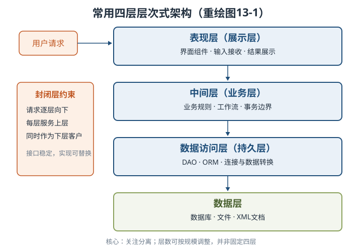

**封闭层**要求请求经过相邻层，不能随意跨层；**开放层**允许请求绕过某些层，用于减少无意义转发。封闭带来低耦合，开放可换取部分效率。

⭐【高频考点】【易错】**污水池反模式**：请求只是穿过多层，各层几乎不处理业务。教材用二八原则辅助判断，若此类请求超过20%，应考虑让一些层开放；不是所有透传都必须消灭，也不能把阈值记成80%。

举例：查询商品详情时，表现层→业务层→持久层都只是原样转发。如果大量请求如此，可评估开放业务层；涉及库存校验、优惠计算的请求仍应经过业务层。

分层还可能带来分布复杂、可靠性与性能压力、代码膨胀，因此“层越多越好”错误。

### 13.2 表现层框架设计

#### 13.2.1 MVC、MVP与MVVM

⭐【重点】三者共同目标是分离视图与模型，差别在**谁协调、View能否直接接触Model、怎样同步**。

| 模式 | 协调者及依赖 | View与Model | 典型优点 | 主要代价/场景 |
| --- | --- | --- | --- | --- |
| MVC | Controller解释输入、调用Model、选择View | View可查询Model并接收更新事件，但不能改Model | 多视图复用模型，显示与业务分离 | 交互路径较多，Web框架常见 |
| MVP | Presenter处理UI逻辑，依赖抽象IView | 不直接通信，全经Presenter | UI逻辑可脱离界面单测；一个Presenter可服务多视图 | UI种类增加会带来接口膨胀，Android常见 |
| MVVM | ViewModel做状态、转换、命令，DataBinding同步 | 不直接通信，经ViewModel双向绑定 | 声明式模板、响应式更新 | 绑定导致问题来源难定位，适合数据驱动场景 |

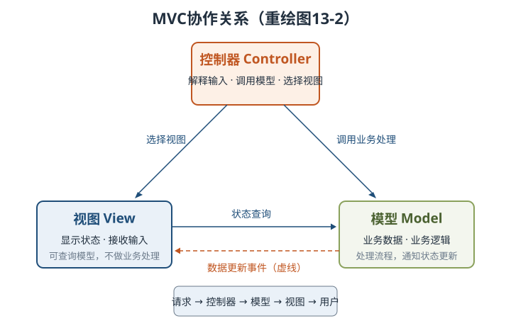

MVC处理顺序：**请求→Controller选择Model→Model业务处理→Controller选择View→View格式化并呈现**。视图显示数据但不进行实际业务处理；模型是应用主体，可给多个视图提供数据。

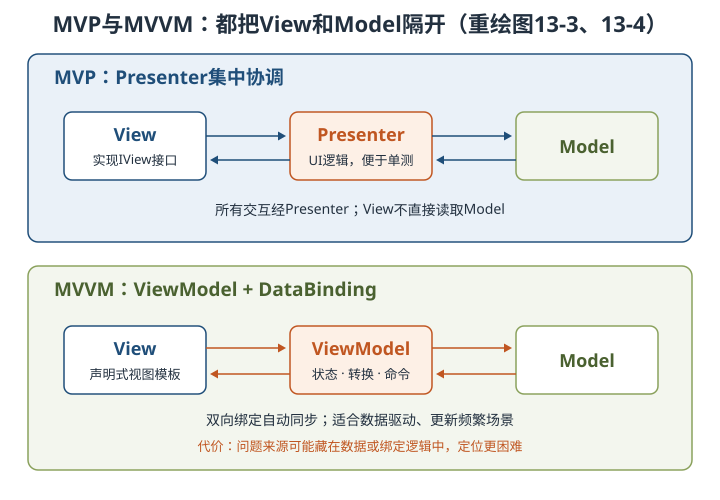

举例：同一份“账户余额”是Model，网页和App页面是不同View；MVC由Controller决定展示哪个页面，MVP由Presenter把余额交给IView，MVVM则让余额字段与文本框自动同步。

> 助记：MVC“控选模视”，MVP“全过主持”，MVVM“双向绑定”。

#### 13.2.2 XML统一表现与动态生成

XML描述**数据结构和类型**，HTML偏重数据显示与外观。把控件类型、位置、可见性、事件等保存为XML节点和属性，再由Web Form或Windows Form专用解析器生成具体界面，可用一套描述支持多种客户端；从设计模式看属于**策略模式**。

| 概念 | 时机与作用 | 关键实现 |
| --- | --- | --- |
| 界面配置 | 运行前静态定义，裁剪、重组、扩充功能 | 读取XML初始值 |
| 界面定制 | 运行中按用户习惯修改，结束时保存 | 菜单、工具栏、快捷键及属性 |
| 界面动态生成 | 运行时按元数据创建界面元素 | DOM API读XML，数据存取类读数据库 |

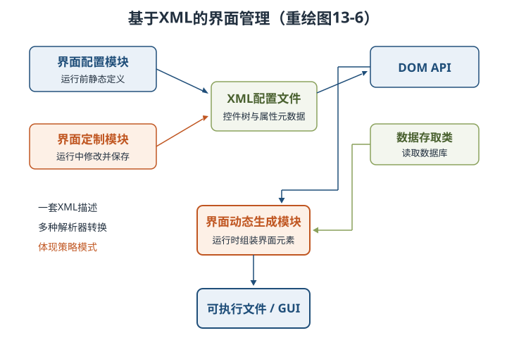

收益是界面描述与功能代码分离，便于配置、定制和移植；并不意味着XML已取代HTML成为主要页面呈现技术。

#### 13.2.3 UIP设计思想

UIP把表现层再分为**UIC**与**UIP组件**：前者是用户可见的界面，后者不可见，负责导航、工作流、状态与视图管理，以及界面信息流、事件事务和异常流程调整。

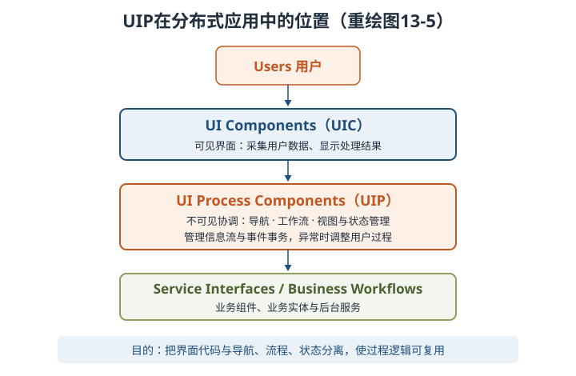

举例：跨三个页面填写订单时，页面只负责收集数据；UIP记住已填到哪一步、保存中间状态，支付失败时决定回到哪个页面。这样更换页面技术时，流程逻辑仍可复用。

### 13.3 中间层架构设计

#### 13.3.1 业务逻辑组件：接口、实现与注入

- 业务逻辑组件分为**接口与实现类**；通常按模块设计，一个组件可组合多个DAO。
- 控制器依赖业务接口而非具体实现，实现类保存DAO接口引用并提供setter，由Spring容器注入。
- **IoC**把对象创建与依赖装配控制权交给容器，**DI**是其实现方式；业务类不自行new具体DAO。
- 统一Facade接口隔离Web层与后台业务；事务代理包装目标bean，避免直接调用无事务能力的对象。

举例：订单服务只声明“需要库存DAO”，容器在启动时注入具体实现；换DAO实现不必改订单业务代码。

#### 13.3.2 工作流参考模型

> 教材原文：工作流是业务流程的全部或部分自动化，文档、信息或任务按过程规则流转，以协调工作并达到业务整体目标。

工作流把**应用逻辑与过程逻辑**分开：功能组件不变，只修改过程模型就能调整审批顺序。

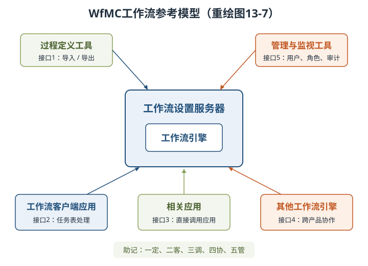

| 接口 | 连接对象 | 必记功能 |
| --- | --- | --- |
| interface 1 | 过程定义工具 | 过程定义导入/导出；早期WPDL，后来XPDL |
| interface 2 | 客户端应用 | 与任务表处理器交互，选择和推进任务 |
| interface 3 | 相关应用 | 引擎直接激活应用，常为无用户界面的后台服务 |
| interface 4 | 其他工作流引擎 | 不同厂商产品间传递任务、协同工作 |
| interface 5 | 管理监视工具 | 用户、角色、审计、资源、过程与状态管理 |

#### 13.3.3 业务逻辑层实体

业务实体封装业务数据及相关状态，可来自多张表、在层间作为I/O参数传递并可序列化。⭐【易错】它**不直接访问数据库，也不启动事务**；持久化交给数据访问组件，事务由使用它的应用或业务过程启动。

| 表示方式 | 优势 | 局限/识别点 |
| --- | --- | --- |
| XML | 标准化、层次表达灵活、跨平台互操作 | 可装载到DataSet以利用数据绑定 |
| 通用DataSet | 集合与关系、序列化、绑定、DataView排序过滤、XML互换 | 表列访问缺少编译期强类型检查 |
| 有类型DataSet | 强类型属性、代码易读、智能提示、编译期检查 | 需要生成特定类型定义 |

通用DataSet中，DataTable保存数据，UniqueConstraint标识主键，Relation表示表间关系；有类型DataSet的关键不是“运行更快”，而是**编译期发现无效表名/列名**。

#### 13.3.4 业务逻辑层框架：Domain Model—Service—Control

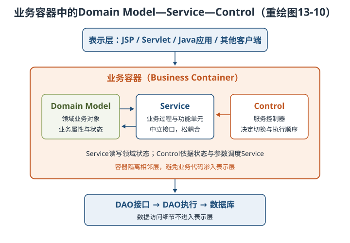

| 元素 | 职责 | 互动关系 |
| --- | --- | --- |
| Domain Model | 领域业务对象及业务属性、状态 | Service依赖并改变其状态 |
| Service | 业务过程的功能单元，以中立接口和契约联系 | 松耦合，内部实现可变化 |
| Control | 服务之间的纽带和切换控制 | 根据领域状态与参数决定服务顺序 |

容器降低业务层与相邻层耦合；Control把“服务实现”与“服务转向”分开。⭐【易错】D-S-C用于业务层，不应把Domain Model机械等同于MVC的Model。

### 13.4 数据访问层设计

#### 13.4.1 五种数据访问模式

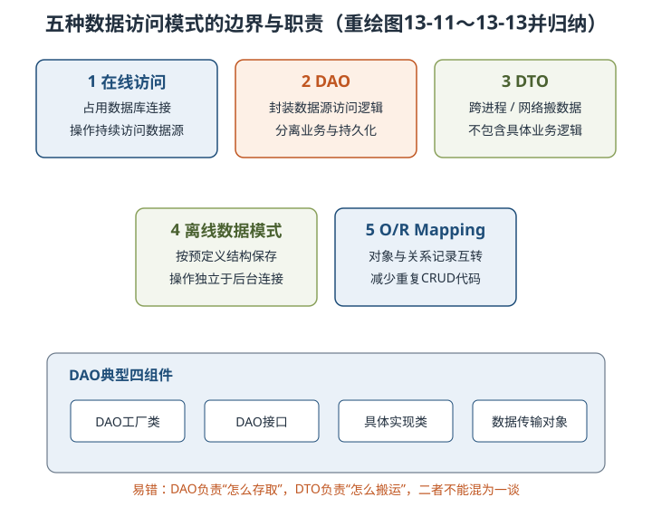

| 模式 | 核心问题 | 必记结论 |
| --- | --- | --- |
| 在线访问 | 如何持续操作后台数据源 | 占用连接，每次操作经连接交互 |
| DAO | 如何封装持久化细节 | 工厂、接口、具体实现、DTO四组件 |
| DTO | 如何减少跨边界多次细粒度读取 | 跨进程/网络的数据容器，不含具体业务逻辑 |
| 离线数据模式 | 无持续连接时怎样操作 | 数据按预定义结构保存，独立于后台连接与数据源 |
| O/R Mapping | 对象模型与关系模型怎样转换 | 对象↔记录，减少重复CRUD与SQL处理 |

DTO可用内置集合或自定义强类型类：前者通用、代码少但类型检查弱；后者编译期安全但编码量大。代码生成和带类型信息的集合试图兼顾两者。

#### 13.4.2 工厂模式与ORM/Hibernate

工厂模式定义创建对象的接口，让子类/工厂决定实例化哪种实现。数据访问中先抽象DataAccess，再由DataAccessFactory按数据库类型返回SQL Server、Oracle或OleDb实现，客户端只依赖统一接口。

⭐【易错】换数据库只改配置的前提是未使用特定数据库专有函数；在业务代码中写数据库方言会破坏可移植性。

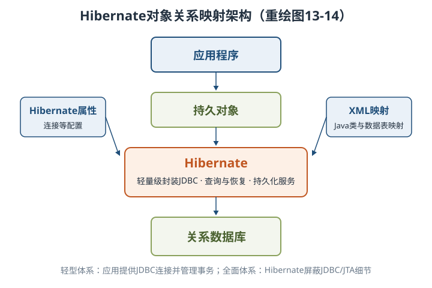

Hibernate是开源ORM框架，对JDBC做轻量级对象封装，提供Java类到数据表映射及查询恢复机制。轻型体系中应用提供JDBC连接并自管事务；全面体系中Hibernate屏蔽JDBC/JTA细节。ORM还可借助Cache调优，但不等于任何场景都性能更好。

#### 13.4.3 XML Schema

XML Schema描述XML文档的合法结构、内容与限制，使用XML自身语法、命名空间和丰富数据类型，能力扩展自DTD。

| 规范部分 | 内容 | 记忆点 |
| --- | --- | --- |
| Part 0：Primer | 非标准化的入门说明 | 快速理解 |
| Part 1：Structures | 文档结构与内容限制 | 结构 |
| Part 2：Datatypes | 内嵌及自定义数据类型 | 类型 |

特点：**数据类型丰富、支持继承与复用、紧密结合Namespace**。simpleType/complexType可定义新类型；DTD不具备同等丰富的类型与继承能力。

#### 13.4.4 事务处理设计

事务是一组要么全部成功、要么全部不执行的操作；成功则commit，任一步失败则rollback。⭐【重点】【高频考点】ACID必须按标准含义掌握：

| 特性 | 必须记住的结论 | 例子 |
| --- | --- | --- |
| 原子性 Atomicity | 全部完成或全部撤销，不能只执行一半 | 转账扣款与入账同成败 |
| 一致性 Consistency | 事务把数据从一个有效状态带到另一个有效状态，约束不破坏 | 转账前后总额一致 |
| 隔离性 Isolation | 并发执行互不干扰，中间状态受隔离级别约束 | 他人不能看到半笔转账 |
| 持久性 Durability | 一旦提交，结果即使遇故障也应保存 | 重启后转账结果仍在 |

> 助记：A全做、C守规、I不扰、D久存。

J2EE常见JDBC、JTA、容器管理事务，不应在同一流程中随意混用或嵌套，事务应尽量短。JDBC组合多条SQL要先`setAutoCommit(false)`，成功`commit()`、异常`rollback()`。JTA三接口为UserTransaction、TransactionManager、Transaction，共有commit/rollback等操作；UserTransaction负责事务划分，TransactionManager偏上下文管理。

#### 13.4.5 连接对象管理设计

数据库连接是昂贵共享资源，连接池在初始化时创建一批连接，请求时分配空闲连接，用毕归还而非真正关闭，减少频繁建立/释放的开销。分配时标记状态，释放时按使用策略回池。

举例：连接池像共享会议室，使用者退房交还钥匙，不是每次散会都拆房再重建。连接复用必须防止把未提交事务或脏状态带给下一个使用者。

### 13.5 数据架构规划与设计

**数据库与类设计融合**：识别类及类间关系是数据模型关键；同一复杂问题没有唯一正确模型，好模型应最小化全生命周期成本并适应变化，不能只压开发期费用。

XML文档分为两类：

| 类型 | 结构与顺序 | 典型用途 |
| --- | --- | --- |
| 以数据为中心 | 规则、同构、少混合内容，通常不关心元素顺序 | Web数据存储与传输 |
| 以文档为中心 | 不规则、混合内容多，元素顺序重要 | 网页、产品说明、Email |

| XML存储方式 | 优点 | 主要不足 |
| --- | --- | --- |
| 文件方式（含BLOB/CLOB原样存） | 简单，保留原文 | 难取内部结构，依赖附加索引，只能整篇返回，管理难 |
| 数据库方式 | 可管结构化/半结构化数据，能操作文档内部，支持并发与约束 | 需选择合适XML数据库及模式管理 |

⭐【易错】XML虽有Schema、XPath/XQuery、DOM/SAX等数据库式能力，但在索引、安全、多用户和事务方面不能简单替代DBMS；多用户、高完整性和高性能场景不宜只靠XML文档。

### 13.6 物联网层次架构设计

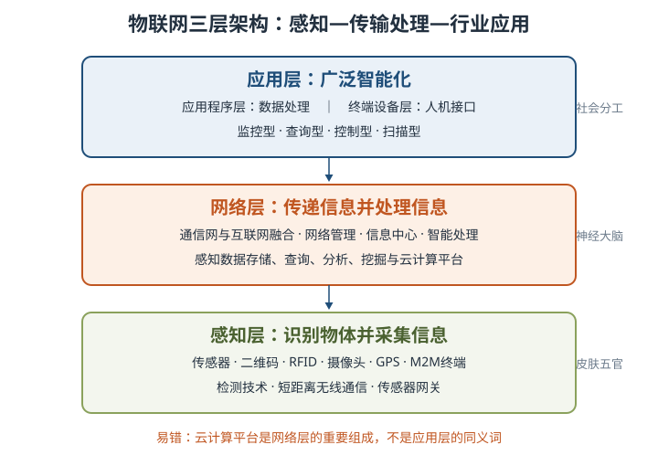

| 层次 | 核心职责 | 技术/设备 | 人体类比 |
| --- | --- | --- | --- |
| 感知层 | 识别物体、采集信息并短距传输 | 传感器、二维码、RFID、摄像头、GPS、M2M、网关 | 皮肤和五官 |
| 网络层 | 传递、存储、预处理和分析感知数据 | 移动通信网、互联网、专网、云计算、数据中心 | 神经中枢和大脑 |
| 应用层 | 行业数据处理与人机交互，提供智能服务 | 监控、查询、控制、扫描类应用及终端 | 社会分工 |

⭐【高频考点】RFID标签和读写器属于感知层；云平台作为海量感知数据存储分析平台，是网络层的重要组成；应用层还可分应用程序层和终端设备层。

### 13.7 层次式架构案例分析

#### 13.7.1 电子商务网站PetShop

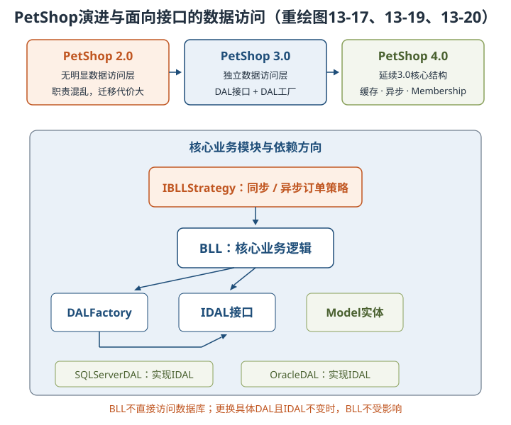

| 版本 | 结构特点 | 案例结论 |
| --- | --- | --- |
| 2.0 | 无明显数据访问层，访问性能较直接 | 业务与数据访问职责混乱，数据库或访问逻辑变化会引起大改 |
| 3.0 | 独立DAL，使用DAL Interface与DAL Factory | 纠正层次不清，支持不同数据库实现 |
| 4.0 | 核心结构延续3.0，引入缓存、异步和Membership | 性能改进不应以破坏分层为代价 |

- IDAL抽象CRUD，DALFactory负责创建，SQLServerDAL与OracleDAL实现接口；Model只有持久对象属性。
- BLL必须通过IDAL访问数据，不能直接访问数据库；接口不变时替换DAL实现不影响BLL。
- IBLLStrategy把同步/异步订单策略统一成相同调用接口，是“对变化抽象”。
- Messaging配合MSMQ支持异步订单，CacheDependency提供缓存；表现层与业务层仍有较高耦合，是案例不足。

#### 13.7.2 电子小票服务系统

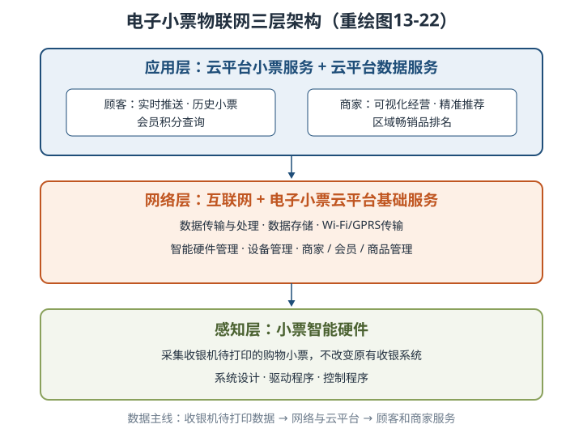

系统不改原收银系统，智能硬件采集待打印小票，经Wi-Fi/GPRS上传云平台；网络层负责传输、处理、存储和设备/商家/会员/商品管理，应用层向顾客推送和查询小票，向商家提供经营分析。

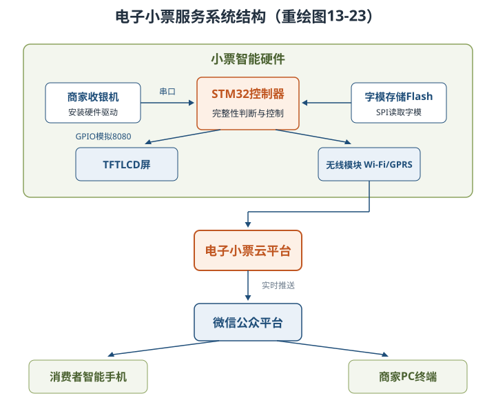

硬件数据流：收银机串口→STM32完整性判断→SPI读取Flash字模→GPIO模拟8080总线→TFTLCD显示；同时无线模块上传云平台，再经微信公众平台推送手机，商家PC查询经营数据。案例题要同时会画**三层业务视图**和**硬件数据流视图**。

## 三、重点与易错点

| # | 考点 | 必须记住的结论 | 易错提醒 |
| --- | --- | --- | --- |
| 1 | 四层职责 | 表现、中间、数据访问、数据层各司其职 | 数据访问层不等于数据库本身 |
| 2 | 分层关系 | 每层为上层服务并作为下层客户 | 不是上层为下层服务 |
| 3 | 封闭与开放 | 封闭层强制邻层交互，开放层允许绕过 | 开放不等于无约束随意调用 |
| 4 | 污水池 | 透传请求过多时可开放部分层 | 教材考虑阈值为超过20%，不是80% |
| 5 | MVC | Controller调用模型并选择视图；View可查询Model | View不处理实际业务，也不能改Model |
| 6 | MVP | View与Model全经Presenter，Presenter依赖IView | 不是View直接读Model |
| 7 | MVVM | ViewModel借DataBinding双向同步 | 双向绑定会使故障来源更难定位 |
| 8 | XML界面 | 一套XML经不同解析器生成不同客户端，属策略模式 | XML描述数据，不等于主要页面呈现技术 |
| 9 | UIP | UIC管可见交互，UIP管导航、流程和状态 | UIP组件用户不可见 |
| 10 | IoC/DI | 容器装配依赖，业务类面向接口 | IoC不是具体DAO，DI是其实现方式 |
| 11 | 工作流接口 | 一定二客三调四协五管 | 接口3直接调应用，接口2走任务表 |
| 12 | 业务实体 | 不直接访问数据库，不启动事务 | 实体不是DAO，也不是事务管理器 |
| 13 | DataSet | 有类型DataSet支持编译期检查 | 通用DataSet也能表达关系与序列化 |
| 14 | D-S-C | Domain存状态、Service做过程、Control管切换 | 不与MVC三元素一一对应 |
| 15 | DAO与DTO | DAO封装存取，DTO跨边界搬运数据 | DTO不应包含具体业务逻辑 |
| 16 | 工厂与移植 | 统一接口隔离数据库具体类 | 使用专有SQL仍会破坏数据库无关性 |
| 17 | XML Schema | Part 0入门、1结构、2类型 | Part 0是非标准化文档 |
| 18 | ACID | 全做、守规、不扰、久存 | 持久性针对已提交结果，不是失败事务仍正确 |
| 19 | 连接池 | 用毕归还不关闭，减少创建释放成本 | 归还前要清理事务与会话状态 |
| 20 | 物联网 | 感知采集、网络传输处理、应用行业智能 | RFID属感知层，云数据平台属网络层 |

## 四、练习与真题

以下为自编单选模拟题，答案与解析集中放在全章最后。

**1.** 在典型四层架构中，负责封装SQL、对象关系转换和数据库连接管理的是哪一层？

A. 表现层  B. 业务逻辑层  C. 数据访问层  D. 数据层

**2.** 某系统大量请求仅被业务层原样转发给持久层，且此类请求占比超过20%。依据教材，优先考虑哪项措施？

A. 删除表现层  B. 评估开放部分层  C. 禁止所有跨层调用  D. 将SQL写入视图

**3.** 关于MVC模式，下列说法正确的是哪一项？

A. 视图负责核心业务处理  B. 模型只能服务于一个视图  C. 控制器解释输入并选择视图  D. 视图可直接修改模型状态

**4.** 某团队希望View与Model完全不直接交互，并能用IView替身测试UI逻辑，最适宜选择哪种模式？

A. MVC  B. MVP  C. MVVM  D. DAO

**5.** MVVM中实现View与Model状态自动同步的核心机制是什么？

A. DataBinding  B. JDBC  C. MSMQ  D. XPDL

**6.** 用同一XML控件描述分别生成Web和Windows界面，再按运行环境选择解析器，主要体现哪种设计思想？

A. 策略模式  B. 污水池反模式  C. 离线数据模式  D. 容器管理事务

**7.** UIP框架中，负责导航、工作流控制和用户过程状态保存的是哪类组件？

A. UI Components  B. UI Process Components  C. Data Access Components  D. Data Sources

**8.** 工作流参考模型中，用于不同厂商工作流引擎之间协同传递任务的是哪个接口？

A. interface 1  B. interface 2  C. interface 4  D. interface 5

**9.** 关于业务逻辑层实体，下列做法正确的是哪一项？

A. 直接打开数据库连接  B. 自行启动所有事务  C. 由数据访问组件负责持久化  D. 必须包含界面导航逻辑

**10.** 某对象只承载跨网络传输的数据，不含具体业务逻辑；另一对象封装特定数据库CRUD。二者分别是什么？

A. DTO与DAO  B. DAO与DTO  C. Model与View  D. ORM与UIP

**11.** 已提交事务在系统故障后仍应保留结果，体现ACID中的哪种特性？

A. 原子性  B. 一致性  C. 隔离性  D. 持久性

**12.** 在电子小票系统中，RFID读写器、小票采集硬件和云平台感知数据分析功能依次主要归属哪组层次？

A. 感知层、感知层、网络层  B. 网络层、感知层、应用层  C. 感知层、应用层、网络层  D. 应用层、网络层、感知层

## 五、疑问与查漏补缺

- **大纲列出CMP 2.0，教材小节标题也含CMP 2.0，但正文主要展开ORM与Hibernate**：需知道CMP是EJB容器管理持久化思想，容器承担实体持久化；本章复习以“容器/框架减少手写持久化代码”的共同主线掌握，具体EJB配置可结合第15章SOA与Java EE资料补充。
- **教材ACID表述有简化甚至易误读处**：一致性不应只记“失败恢复”，持久性也不是“事务失败时数据正确”；考试按标准定义回答，即有效状态间转换、已提交结果抗故障。
- **教材连接池描述提到无空闲连接时复用已分配连接**：实际设计不能让多个客户无条件共享同一JDBC连接，应理解为按实现策略扩容、等待或受控复用，并保证线程与事务隔离。
- **“封闭层”与性能的关系需结合场景**：教材给出超过20%透传作为考虑开放层的信号，并非机械阈值；安全、事务和审计要求仍可能要求必须经过某层。
- **图13-9提取文本中表名有OCR错排**：其核心仍是Order与OrderDetails两个DataTable、各自主键及Relation关系，复习不要依赖混乱字样。
- **教材图13-14附近正文误写“图13-11显示Hibernate工作原理”**：应按图13-14理解；笔记已按Hibernate架构重绘。
- **与第7、8章衔接**：本章回答系统如何分层，第7章提供架构风格基础，第8章用于评估分层带来的性能、可靠性、可修改性权衡。
- **与第14、15章衔接**：分层是逻辑职责划分，云原生与SOA还涉及部署、服务边界和通信；不能把“一层”必然等同于“一个进程/微服务”。

## 六、参考答案

**1.** C。数据访问层封装持久化细节，数据层才是实际保存数据的数据库或文件。

**2.** B。大量无逻辑透传是污水池信号，教材建议超过20%时考虑开放部分层。

**3.** C。Controller解释用户输入、调用模型并选择视图，View不做实际业务处理。

**4.** B。MVP让View与Model都经Presenter交互，并以IView抽象提升UI逻辑可测试性。

**5.** A。ViewModel通过DataBinding及事件机制实现双向绑定和响应式更新。

**6.** A。不同表现技术解析器是可替换策略，统一的XML描述无需随客户端重写。

**7.** B。UI Process Components不可见，负责流程、导航、状态和视图管理。

**8.** C。interface 4是工作流机协作接口，支持不同产品的引擎协同。

**9.** C。业务实体不直接访问数据库，也不启动事务，持久化由数据访问组件完成。

**10.** A。DTO是跨边界数据容器，DAO封装具体数据源访问逻辑。

**11.** D。持久性保证提交后的结果在故障后仍能保存和恢复。

**12.** A。识别采集设备属于感知层，感知数据的云端存储分析主要属于网络层。
