# 第14章 云原生架构设计理论与实践

- 教材位置：`02.系统架构设计师第二版-教材.pdf` PDF 第 490～519 页（书页 482～511）
- 复习状态：已完成
- 复习日期：2026-11-06
- 本章地位：云原生是下午案例分析的高频主题，常以「企业上云/微服务改造」场景考查架构原则、架构模式与技术选型；上午综合知识也会考查容器、K8s、服务网格等概念辨析。

## 一、大纲考点

大纲（书页 54）「4. 云原生架构设计理论与实践」条目与教材小节对应如下：

| 大纲条目 | 大纲要求 | 教材对应小节 |
| --- | --- | --- |
| 4.1 云原生架构概述 | 云原生的背景、定义和特征 | 14.1、14.2.1 |
| 4.1 云原生架构概述 | 云原生架构的设计原则 | 14.2.2（七大原则） |
| 4.1 云原生架构概述 | 架构模式：服务化、Mesh 化、Serverless、存储计算分离、分布式事务、可观测架构、事件驱动架构 | 14.2.3（七大模式）、14.2.4（反模式） |
| 4.2 云原生架构相关技术 | 容器技术 | 14.3.1（Docker、Kubernetes） |
| 4.2 云原生架构相关技术 | 云原生微服务技术 | 14.3.2（设计约束与主流框架） |
| 4.2 云原生架构相关技术 | 无服务器技术 | 14.3.3（Serverless/FaaS） |
| 4.2 云原生架构相关技术 | 服务网格 | 14.3.4（Istio、Envoy 等） |
| 4.3 案例分析 | 旅行、汽车、快递、电商、体育用品五个云原生改造案例 | 14.4.1～14.4.5 |

**下午案例题考查形式**：科目 2「系统架构设计案例分析」为主观题，通常给出某企业系统上云或云原生改造的场景材料，设置若干小问题，典型问法包括：①指出原有架构（单体/烟囱式）存在的问题；②说明应采用哪种云原生架构模式并给出理由；③比较容器与虚拟机、微服务与单体、Serverless 与传统部署的优缺点；④结合场景说明 K8s 能力、服务网格收益或分布式事务方案选择。答题关键是「原则/模式名称 + 一句话定义 + 结合场景的收益」。

## 二、知识点笔记

### 14.1 云原生架构产生背景

- **Cloud Native 直译**：Cloud 指应用运行在云端而非传统数据中心；Native 指应用**从一开始就基于云环境、专为云特性设计**，充分利用云的弹性与分布式优势。一句话：云原生不是「把老系统搬上云」，而是「为云而生、按云的方式设计」。
- **企业侧动因**：传统 IT 多为「烟筒（烟囱）式」建设，各部门/各应用独立分配硬件，资源被大量占用且难以共享；上云后 IaaS 层复用程度提升，自然要求 IaaS 以上各层也统一复用，进一步降低运营成本。
- **研发侧动因（演进链）**：瀑布式流程（开发/运营/质量各自独立、信息不对称）→ 敏捷开发（解决开发效率与版本速度，但未打通运维）→ DevOps（开发、技术运营、质量保障三者的交集，促进沟通协作整合）→ 云原生（容器、微服务为 DevOps 与持续交付提供前提条件）。⭐【高频考点】**DevOps 是开发、技术运营、质量保障三者的交集**；能实现 DevOps 和持续交付是云原生技术价值不可分割的内涵。
- **新兴领域落地**：AI/大数据（容器更小粒度资源划分、计算存储分离）、边缘计算（如全国高速公路取消省界收费站项目，10 万+异构设备、30 多万边缘应用管理）、高性能计算 HPC（如 CERN 等）。

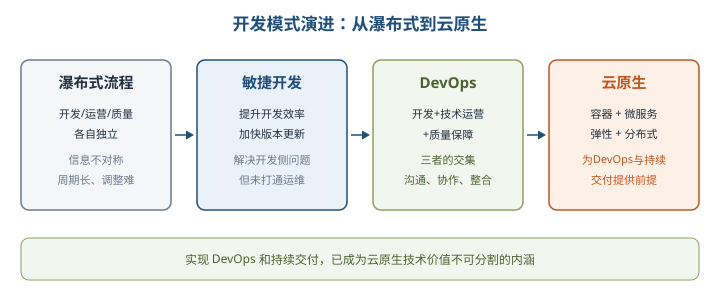

### 14.2 云原生架构内涵

#### 14.2.1 云原生架构定义

> 教材原文：云原生架构是基于云原生技术的一组架构原则和设计模式的集合，旨在将云应用中的非业务代码部分进行最大化的剥离，从而让云设施接管应用中原有的大量非功能特性（如弹性、韧性、安全、可观测性、灰度等），使业务不再有非功能性业务中断困扰的同时，具备轻量、敏捷、高度自动化的特点。

⭐【重点】云原生应用代码包含**三部分**：业务代码（实现业务逻辑，唯一核心）、三方软件（业务依赖的所有三方库）、处理非功能特性的代码（高可用、安全、可观测性等）。云原生架构把后两类尽可能剥离到 IaaS/PaaS，让开发者只聚焦业务代码；但**不是所有非功能特性都能剥离（如易用性不能剥离）**【易错】。

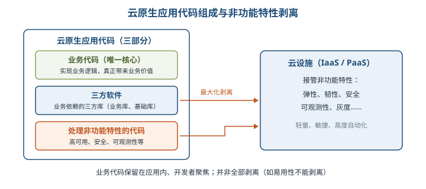

定义带来的三个变化（理解即可，常作为案例题答题素材）：

| 变化 | 核心内容 | 举例 |
| --- | --- | --- |
| 代码结构发生巨大变化 | 存储、网络等能力变成云服务，云产品解决分布式高可用、扩缩容、安全升级等挑战 | 用对象存储代替自己维护文件服务器，不用关心节点宕机与扩容 |
| 非功能性特性大量委托 | 虚拟机热迁移、容器自动重启切换、云服务托管有状态部分，应用变薄、无状态化 | 应用把缓存、数据库交给云服务，自身故障恢复降到分钟级 |
| 高度自动化的软件交付 | 容器标准化打包屏蔽环境差异，以「面向终态」方式完成安装、配置、运行和变更 | 微服务部署到成千上万节点时，靠自动化而非安装手册交付 |

#### 14.2.2 云原生架构原则 ⭐【重点】【高频考点】

| 原则 | 一句话通俗解释 | 关键要点/关键词 |
| --- | --- | --- |
| 服务化原则 | 把大软件拆成按生命周期独立迭代的服务，面向接口编程 | 微服务/小服务拆分；限流降级、熔断隔仓、灰度、零信任等本质是基于**服务流量**（而非网络流量）的控制策略 |
| 弹性原则 | 部署规模随业务量自动伸缩，不按峰值预先采购固定资源 | 免容量规划、降闲置成本、扛得住突发流量 |
| 可观测原则 | 让一次点击背后的多次服务调用全程可见、可下钻 | 日志、链路跟踪、度量三种手段；区别于传统监控/业务探活/APM |
| 韧性原则 | 依赖的软硬件出异常时，软件仍能抵御并持续提供服务 | 核心目标提升 MTBF（平均无故障时间）；手段含异步化、重试/限流/降级/熔断/反压、主从、集群、AZ 高可用、单元化、跨 region 容灾、异地多活 |
| 所有过程自动化原则 | 交付与运维全过程标准化后再自动化 | IaC、GitOps、OAM、Kubernetes Operator、CI/CD；配置数据自描述、面向终态交付 |
| 零信任原则 | 默认不信任网络内外任何人/设备/系统，先认证授权再访问 | IP、主机、地理位置、所处网络均不能作为可信凭证；从「网络中心化」走向「身份中心化」；核心是身份 Identity |
| 架构持续演进原则 | 架构不是一次定死的封闭设计，而要能持续演进 | 兼顾架构治理与风险控制；存量迁移要评估迁出/迁入成本风险，用微服务、网关、服务网格、数据迁移、在线灰度等细粒度控制 |

> 助记：「服弹可观韧，自动零信任，演进」——服务化、弹性、可观测、韧性、所有过程自动化、零信任、架构持续演进，共七原则。

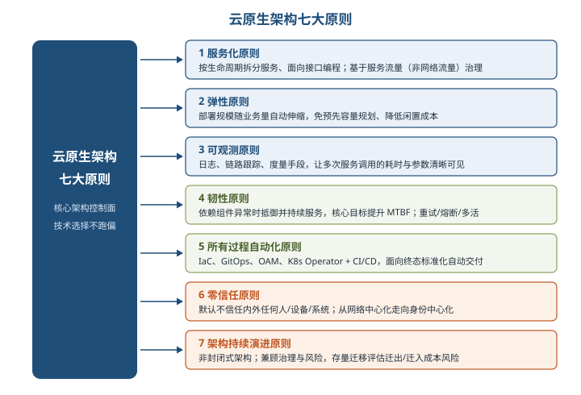

举例：弹性原则就像餐饮店的「共享充电宝机柜」，旺季人多自动多投放、淡季收回，不用按一年最高峰一次性买死设备；零信任则像小区「进每栋楼都要刷卡验证身份」，而不是进了大门就畅行无阻。

#### 14.2.3 主要架构模式 ⭐【重点】【高频考点】

**1. 服务化架构模式**：以应用模块为颗粒度划分软件，以接口契约（如 IDL）定义业务关系，以标准协议（HTTP、gRPC 等）互联互通，结合 DDD、TDD、容器化部署提升质量与迭代速度。典型模式为**微服务**与**小服务（MiniService）**：小服务是一组关系密切、共享数据的服务组合，适用于非常大型系统，避免接口颗粒度过细带来的调用损耗与治理复杂度。收益：代码模块关系与部署关系分离，每个接口可独立部署实例数、独立扩缩容与升级。

**2. Mesh 化架构模式**：把中间件框架（RPC、缓存、异步消息等）从业务进程中分离，让中间件 SDK 与业务代码解耦；业务进程只保留很「薄」的 Client，流量控制、安全等逻辑由 Mesh 进程完成。熔断、限流、降级、重试、反压、隔仓等分布式模式都由 Mesh 进程承担，业务代码无需引入对应三方包。

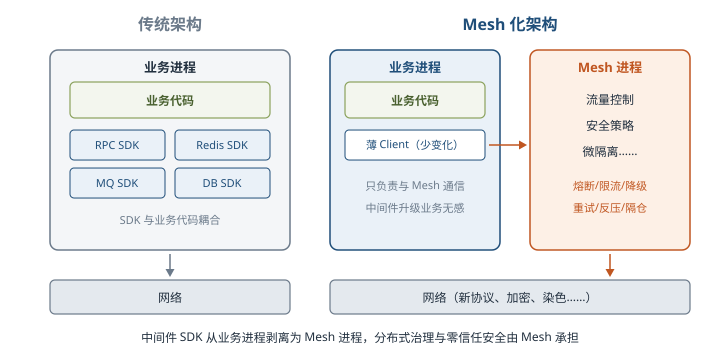

**3. Serverless 模式**：把「部署」从运维中收走，业务流量到来/事件发生时云启动或调度业务进程处理，处理完自动关闭/调度，把整个运行委托给云。【易错】**并非适用所有应用**：①有状态应用（调度不做状态同步，可能丢上下文）；②长时间后台运行的密集型计算；③频繁外部 I/O 的应用均不适合。适合事件驱动的数据计算、计算时间短的请求/响应应用、无复杂相互调用的长周期任务。

**4. 存储计算分离模式**：分布式 CAP 困难主要针对**有状态应用**；无状态应用不存在 C（一致性）维度，可获得更好的 A、P 与弹性。推荐把暂态数据（session）、结构化/非结构化持久数据交给云服务保存。若状态放远端导致交易性能下降，可用「时间日志+快照（检查点）」实现重启后快速增量恢复。

**5. 分布式事务模式** ⭐【高频考点】【易错】：微服务提倡每个服务私有数据源，跨服务大业务必然带来分布式事务问题，须按场景选型：

| 模式 | 一致性/性能特点 | 主要缺点或限制 |
| --- | --- | --- |
| XA | 一致性很强 | 性能差 |
| 基于消息的最终一致性（BASE） | 性能通常很高 | 通用性有限 |
| TCC | 应用层控制事务，隔离性可控，可做到较高效 | 业务侵入性非常强，设计开发维护成本高 |
| SAGA | 优缺点与 TCC 类似，但**没有 Try 阶段**，每个正向事务对应一个补偿事务 | 开发维护成本高 |
| SEATA 的 AT | 高性能、无代码开发工作量，可自动回滚 | 存在一些使用场景限制 |

**6. 可观测架构**：包括 **Logging、Tracing、Metrics** 三方面。Logging 提供 verbose/debug/warning/error/fatal 多级别详细信息，由开发者主动提供；Tracing 提供请求从前端到后端的完整调用链路跟踪，分布式场景尤其有用；Metrics 提供系统量化的多维度度量。落地时要选 OpenTracing、OpenTelemetry 等框架，规范上下文数据，利用 spanid/traceid 做关联分析；主要目标是度量服务 SLO（并发度、耗时、可用时长、容量等）从而优化 SLA。

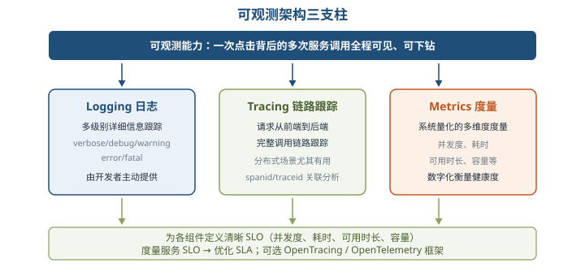

**7. 事件驱动架构（EDA）**：本质是一种应用/组件间的集成架构模式。【易错】**事件不同于传统消息**：事件具有 schema 可校验有效性，EDA 具备 QoS 保障机制，能对事件处理失败进行响应。适用场景：增强服务韧性（异步集成，下游宕机不影响上游）、CQRS（命令走事件、查询走同步 API；结合 Event Sourcing 重放事件重建状态）、数据变化通知（订单完成通知积分/信用服务）、构建开放式接口（提供者不关心订阅者）、事件流处理（如基于 Kafka 的日志处理）、基于事件触发的响应（IoT 传感器数据）。

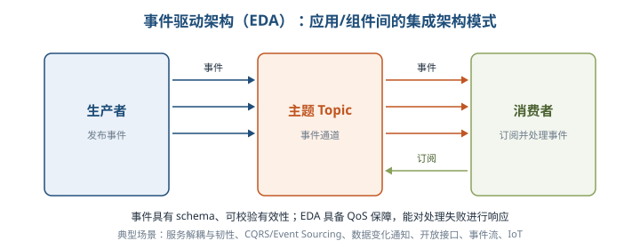

#### 14.2.4 典型的云原生架构反模式 ⭐【重点】

| 反模式 | 问题本质 | 典型表现 |
| --- | --- | --- |
| 庞大的单体应用 | 缺乏依赖隔离 | 代码耦合责任不清、变更影响扩散、发布难协调、局部不稳定拖慢整体、只能整体扩容 |
| 单体应用「硬拆」为微服务 | 拆分过度，与组织能力不匹配 | 小软件强行拆分；服务拆了但共享数据库造成数据依赖；本地调用变分布式调用，响应时间变大、链路性能急剧下降 |
| 缺乏自动化能力的微服务 | 模块数量激增而人效未提升 | 人均负责模块数直线上升；测试发布排队、多环境发布靠专家；人工运维不可重现、故障难以快速止血 |

一句话：服务化拆分要「适度」，先梳理聚合根与模块边界、让组织关系与架构关系匹配，并配套自动化与治理能力。

### 14.3 云原生架构相关技术

#### 14.3.1 容器技术 ⭐【重点】

- **容器价值**：容器是标准化软件单元，将应用及其所有依赖打包，使应用不受环境限制、在不同计算环境间快速可靠运行。2008 年 Linux 提供 Cgroups（资源管理）与 NameSpace（视图隔离），直到 **Docker 开源**才大幅降低使用复杂性。
- **Docker 特点**：基于操作系统虚拟化，**共享操作系统内核、轻量、秒级启动**，提升部署密度与弹性；创新提出 **Docker 镜像**打包规范，解耦应用与运行环境，容器镜像成为应用分发的工业标准。
- **Kubernetes 地位**：容器编排的事实标准，成为分布式资源调度和自动化运维的事实标准；屏蔽 IaaS 差异、支持多云/混合云，免厂商锁定。生态上层有 Istio（服务网格）、Kubeflow（机器学习）、Knative（无服务器框架）等。CNCF 推出 Kubernetes 一致性认证保障不同 K8s 实现兼容。
- 容器三大核心价值：**敏捷、弹性、可移植性**（可获 3～10 倍交付效率提升）。

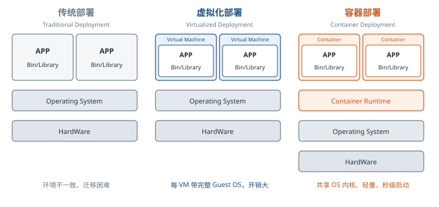

⭐【高频考点】**Kubernetes 五大核心能力**：

| 能力 | 说明 |
| --- | --- |
| 资源调度 | 按应用请求的 CPU、Memory、GPU 等资源在集群中选择合适节点运行 |
| 应用部署与管理 | 自动发布与回滚、配置管理、存储卷编排（与容器生命周期关联） |
| 自动修复 | 宿主机/OS 故障时健康检查自动迁移应用，支持应用自愈 |
| 服务发现与负载均衡 | 通过 Service 资源暴露服务，结合 DNS 与多种负载均衡机制互通 |
| 弹性伸缩 | 监测业务负载（CPU 利用率过高、响应过长）自动扩容 |

**K8s 控制平面四组件**：APIServer、Controller、Scheduler、etcd。三大架构特性：①**声明式 API**——Deployment（无状态）、StatefulSet（有状态）、Job（任务类）等资源抽象工作负载，「level-triggered」实现比「edge-triggered」更健壮；②**可扩展性架构**——组件基于一致开放 API 交互，三方可用 CRD/Operator 扩展；③**可移植性**——通过 Load Balance Service、CNI（容器网络接口）、CSI（容器存储接口）屏蔽底层差异。

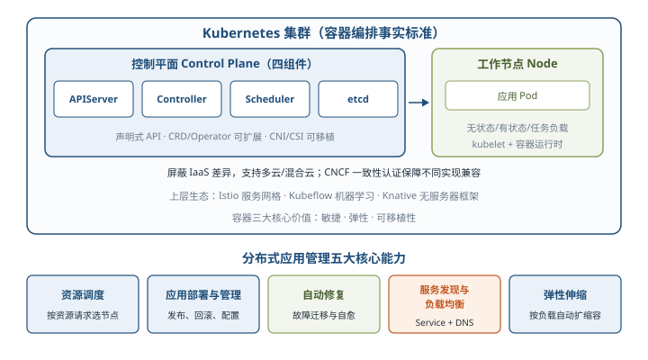

#### 14.3.2 云原生微服务

微服务模式将单体后端拆为松耦合一组子应用，物理独立但逻辑完整；通过分布式水平扩展与冗余部署解决单体扩展性、稳定性先天缺陷，但也带来远程调用、容量预估、负载均衡、集成测试、大规模部署运维等分布式挑战。⭐【重点】**微服务设计四大约束**：

| 约束 | 核心要求 | 关键词/标准 |
| --- | --- | --- |
| 微服务个体约束 | 业务域相互独立、按问题域合理拆分，正交分解、单一职责 | 「两张披萨饼」团队、「至少两周完成一次迭代」；SRP 单一职责，修改发布不影响其他服务 |
| 服务间横向关系 | 可发现性 + 可交互性 | 第三方**服务注册中心**感知发布/扩缩容；与语言无关的远程协议（REST，或高性能场景基于 IDL 的二进制协议）；独立元数据中心；面向失败设计（限流、熔断、隔仓、负载均衡标配） |
| 服务与数据层纵向约束 | 数据存储隔离 DSS，数据是微服务私有资产，只能经 API 访问 | 读写分离 CQRS；尽量无状态设计，有状态则计算存储分离、数据下沉分布式存储 |
| 全局分布式约束 | 从设计之初考虑高效运维 | 全自动化 CI/CD，蓝绿/金丝雀发布；全链路实时多维度可观测；中心化监控、多维展现，快速发现故障定位根因 |

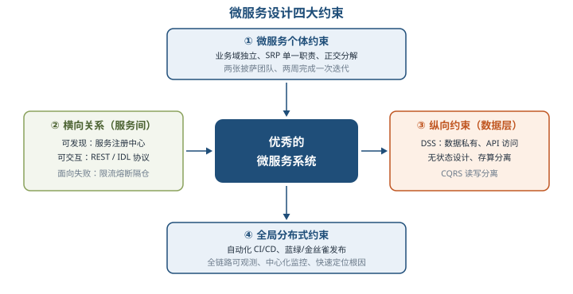

主要微服务技术（识记选型即可）：**Apache Dubbo**（阿里开源高性能 RPC 框架，透明接口 RPC、智能负载均衡、自动服务注册发现；配套 Spring Cloud Alibaba、Nacos、Sentinel、Seata、Chaosblade）；**Spring Cloud**（配置管理、服务发现、断路器、智能路由等全家桶）；**Eclipse MicroProfile**（企业 Java 微服务规范与基础编程模型）；**Tars**（腾讯开源，多语言、兼顾高性能与服务治理）；**SOFAStack**（蚂蚁金融级分布式中间件，MOSN 为 Go 语言服务网格数据平面代理，类似 Envoy）；**DAPR**（微软分布式应用运行时，可移植、事件驱动，构建云与边缘上的弹性微服务）。

#### 14.3.3 无服务器技术（Serverless）

⭐【高频考点】**Serverless 计算四特征**：①全托管计算服务，只写代码不管服务器运维；②通用性，结合云 BaaS API 支撑云上重要应用类型；③自动弹性伸缩，无需提前容量规划；④按量计费，不为闲置资源付费。

- **FaaS（函数计算）**：Serverless 最具代表性产品形态。应用逻辑拆成多个函数，由事件驱动触发执行，如对象存储 OSS 上传/删除事件自动触发函数，实现大规模数据实时并行处理。
- **普及困难**：事件驱动改变架构与研发流程；函数生态不成熟；**冷启动导致响应延迟**、按需建数据库连接成本高等新挑战【易错】。
- **容器融合形态**：以容器镜像为载体、无需修改即可部署到 Serverless 环境，如阿里云 ECI/SAE、Google Cloud Run、开源 Knative，兼享全托管免运维、自动弹性、按量计费。
- **技术关注点**：①计算资源弹性调度——以应用负载特征做「白盒」调度，放置算法要兼顾容错（跨节点/可用区分布）、资源利用率（碎片整理）、性能（复用节点与缓存加速启动）、数据驱动（离线分析优化在线调度）；②负载均衡和流控——调度分片横向扩展，多租户流量隔离；③安全性——权限、网络、数据、运行时全维度保障，轻量安全容器实现更小隔离粒度。

#### 14.3.4 服务网格（ServiceMesh）⭐【重点】

服务网格把微服务间的**连接、安全、流量控制和可观测**等通用功能下沉为平台基础设施，实现应用与平台解耦，以**无侵入**方式实现应用轻量化。服务 A 调用 B 的请求被其下服务代理（Sidecar）截获，由代理完成服务发现、熔断、限流等，策略总控在控制平面配置。

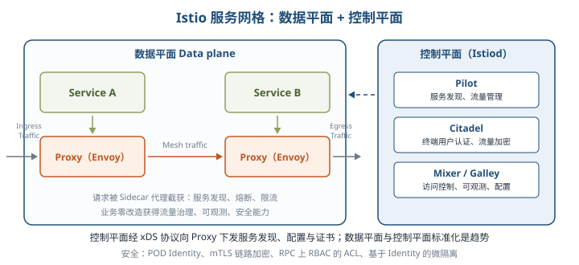

- **Istio 主要组件**：Pilot（服务发现、流量管理）、Mixer（访问控制、可观测性）、Citadel（终端用户认证、流量加密）；数据平面由 **Envoy** 承载。网格关注连接与流量控制、可观测性、安全与可运维性；额外 IPC 成本对百毫秒级业务调用延迟影响可控制在 2% 以内，整体收益远大于支出。
- **标准化趋势**：Istio 采纳 Envoy 的 **xDS** 协议作为数据平面与控制平面间标准协议；微软提出 **SMI**（Service Mesh Interface）做更高层抽象；**UDPA** 基于 xDS 发展便于各云厂商扩展。数据平面用 **Wasm** 做插件沙箱隔离并支持多语言；安全上与零信任天然结合（POD Identity、mTLS 链路加密、RPC 上 RBAC 的 ACL、基于 Identity 的微隔离）。
- **其他方案对比**：Linkerd（数据平面 Rust 实现 linkerd-proxy，控制平面 Go，时延与资源消耗优于 Istio）；Consul（控制面用 Consul Server，数据面可选 Envoy）；Conduit（K8s 超轻量网格，Rust 数据平面+Go 控制平面，倾向低资源部署）。三者功能完整度均不如 Istio。

### 14.4 云原生架构案例分析

五个案例是下午案例题的直接素材库，记住「痛点→方案→效益」链条：

| 案例 | 核心痛点 | 方案关键点 | 量化效益 |
| --- | --- | --- | --- |
| 旅行公司（14.4.1） | 合并后技术体系不统一；业务波峰波谷明显、资源利用率低 | 三阶段：私有云统一平台+IaaS/PaaS 虚拟化（KVM、Ceph、Kata 解决 Java 识别容器规格问题）→ 声明式 API、服务网格、弹性计算保稳定 → 标准云原生应用模型、跨地域跨云灾备、DevOps | 独享集群改共享后仅用 40% 机器支撑全线业务；部分单机利用率提升 20%；弹性计算扛住 300% 峰值流量 |
| 汽车公司（14.4.2） | 稳态业务与敏捷业务并存，交付周期长 | 容器云平台多租户承载互联网应用；私有云+公有云混合交付，按敏态/稳态划分部署；微服务拆分形成业务中台；DevOps 贯穿全流程 | 应用交付周期从两个月缩短到一个月 |
| 快递公司（14.4.3） | IOE 架构、Oracle 存储过程耦合，交付慢、大促资源难保障 | VMware+Oracle → K8s 云原生架构；OLTP/OLAP 数据库分离；应用容器化+按业务域微服务拆分；ACK+神龙裸金属+云数据库；Namespace 资源隔离、Ingress 统一域名转发 | 云产品 SLA 至少 5 个 9；持续集成缩短至分钟级；随用随付降成本 |
| 电商业务（14.4.4） | 大促频繁、稳定性压力大、容量评估缺常态机制 | ACK 容器化弹性扩容；链路追踪定位异常；PTS 压测+ARMS 监控做容量评估；AHAS 限流、熔断、降级与系统保护兜底 | 节约服务器成本 50% 以上，大促保障常态化 |
| 体育用品公司（14.4.5） | 63 套烟囱系统、数据 T+1 回传、高库存高缺货 | 全渠道业务中台：商品/渠道/库存/订单/营销/用户/结算等共享中心；K8s、EDAS、MQ、ARMS、PTS 云原生中间件支撑 | 核心交易链路支撑 10w/tps；售罄率提升 8%、缺货率降低 12%、周转率提升 20%；80% 前台应用跑在中台上 |

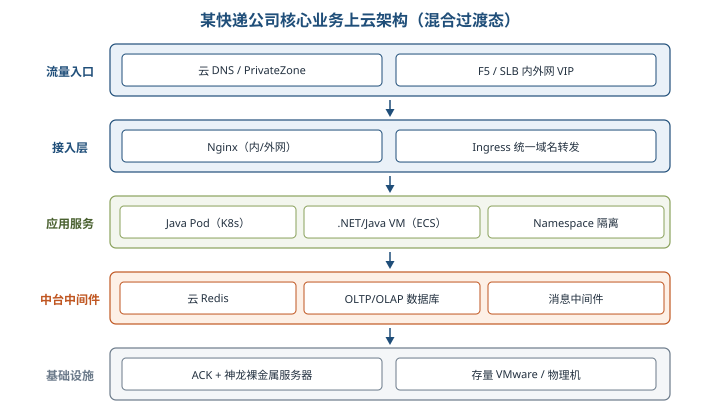

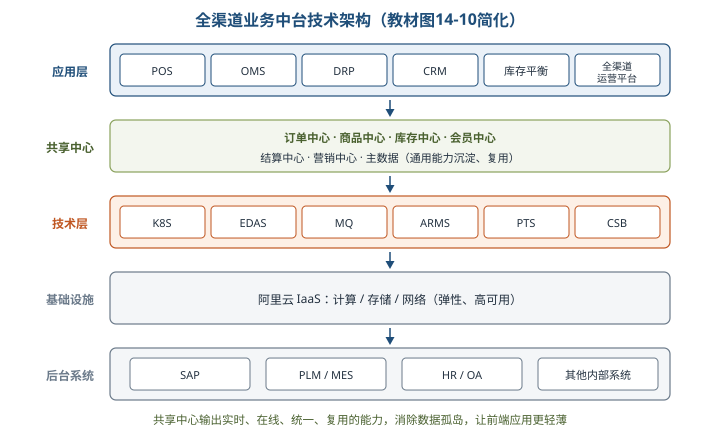

**案例题可复用结论**：混合云按「敏态用公有云弹性、稳态用私有云管控」划分；中台本质是把通用业务能力沉淀为「实时、在线、统一、复用」的共享中心，消除数据孤岛，让前端应用更轻薄。

## 三、重点与易错点

| # | 考点 | 必须记住的结论 | 易错提醒 |
| --- | --- | --- | --- |
| 1 | DevOps 内涵 | 开发、技术运营、质量保障三者的交集 | 敏捷开发只解决开发效率，未打通运维，不等于 DevOps |
| 2 | 云原生代码三部分 | 业务代码、三方软件、处理非功能特性的代码；只有业务代码是核心 | 非功能特性是「最大化剥离」而非全部剥离，易用性不能剥离 |
| 3 | 七大架构原则 | 服务化、弹性、可观测、韧性、所有过程自动化、零信任、持续演进 | 勿与七大架构模式混淆，原则与模式是两张清单 |
| 4 | 韧性原则目标 | 提升 MTBF（平均无故障时间） | 手段是异步化、重试/限流/降级/熔断/反压、容灾多活等 |
| 5 | 零信任原则 | 默认不信任内外任何人/设备/系统，以身份为中心 | IP、地理位置、内网环境都不能作为可信凭证 |
| 6 | 服务化治理本质 | 限流降级、熔断隔仓等基于「服务流量」而非「网络流量」的控制 | 服务化还为了标准化服务流量传输、跨语言治理 |
| 7 | 小服务模式 | 一组关系密切、共享数据的服务组合，用于非常大型系统 | 不是服务越小越好，颗粒度过细会增加调用损耗与治理复杂度 |
| 8 | Mesh 化架构 | 中间件 SDK 从业务进程分离为 Mesh 进程，业务只留薄 Client | 熔断限流等由 Mesh 完成，业务制品无需引入对应三方包 |
| 9 | Serverless 适用性 | 适合事件驱动、短时请求响应；不适合有状态、长时密集计算、频繁外部 I/O | 「无服务器」不是真的没有服务器，而是运维委托给云 |
| 10 | 分布式事务选型 | XA 强一致性能差；BASE 高性能通用性有限；TCC/SAGA 侵入强成本高；SEATA AT 高性能零代码侵入可自动回滚 | SAGA 没有 Try 阶段，靠补偿事务回滚 |
| 11 | 可观测三要素 | Logging、Tracing、Metrics；目标是度量 SLO 优化 SLA | Tracing 管完整调用链路，Metrics 管量化度量，别张冠李戴 |
| 12 | 事件与消息区别 | 事件有 schema 可校验，EDA 有 QoS 保障、能响应处理失败 | EDA 属集成架构模式，CQRS/Event Sourcing 常与之搭配 |
| 13 | 容器与虚拟机 | 容器共享 OS 内核、轻量、秒级启动；虚拟机带完整 Guest OS | Docker 基于操作系统级虚拟化，不是硬件虚拟化 |
| 14 | K8s 控制平面 | APIServer、Controller、Scheduler、etcd 四组件 | 工作负载抽象：Deployment 无状态、StatefulSet 有状态、Job 任务类 |
| 15 | 微服务数据约束 | DSS 数据存储隔离：数据私有、只能经本服务 API 访问 | 多服务共享数据库是「硬拆微服务」反模式 |
| 16 | 服务网格收益 | 治理功能下沉基础设施、无侵入轻量化；Istio=Envoy 数据平面+控制平面 | Pilot 管发现与流量、Mixer 管访问控制与观测、Citadel 管认证加密 |

## 四、练习与真题

以下为本章自编单选模拟题，答案集中放在全章最后。

**1.** 关于 DevOps 的理解，正确的是（ ）。
A. 仅指开发团队内部的敏捷实践  B. 开发、技术运营和质量保障三者的交集  C. 只解决版本更新速度、与运维无关  D. 一种容器编排工具

**2.** 云原生应用代码通常包括业务代码、三方软件和处理非功能特性的代码三部分，其中对业务真正带来价值的核心是（ ）。
A. 三方软件  B. 处理非功能特性的代码  C. 业务代码  D. 基础设施代码

**3.** 下列不属于云原生架构原则的是（ ）。
A. 服务化原则  B. 弹性原则  C. 零信任原则  D. 集中式单体原则

**4.** 韧性原则的核心目标是提升软件的（ ）。
A. 平均无故障时间 MTBF  B. 代码复用率  C. 单机并发连接数  D. 编译构建速度

**5.** 某系统要求「默认不信任网络内部和外部的任何人、设备与系统，访问前必须认证授权」，这体现的是（ ）。
A. 弹性原则  B. 零信任原则  C. 可观测原则  D. 服务化原则

**6.** 关于分布式事务模式，下列说法正确的是（ ）。
A. XA 模式性能很高但一致性弱  B. SAGA 模式包含 Try 阶段  C. SEATA 的 AT 模式高性能、无代码开发工作量且可自动回滚  D. TCC 模式对业务完全无侵入

**7.** 可观测架构的三要素是（ ）。
A. Logging、Tracing、Metrics  B. 监控、探活、告警  C. 缓存、消息、搜索  D. 认证、授权、审计

**8.** 与传统消息相比，事件驱动架构中「事件」的突出特点是（ ）。
A. 事件没有数据结构约束  B. 事件具有 schema 可校验有效性，且 EDA 具备 QoS 保障  C. 事件只能同步处理  D. 事件不能用于服务解耦

**9.** 下列应用最适合采用 Serverless 模式的是（ ）。
A. 需要长期保持会话状态的交易应用  B. 连续运行数天的密集型科学计算  C. 由对象存储上传事件触发的图片处理函数  D. 频繁进行大量外部 I/O 调用的应用

**10.** 关于容器与虚拟机的比较，正确的是（ ）。
A. 容器必须携带完整客户操作系统  B. 容器共享操作系统内核、轻量且可秒级启动  C. 容器属于硬件虚拟化技术  D. 容器启动速度通常慢于虚拟机

**11.** Kubernetes 控制平面的四个主要组件是（ ）。
A. APIServer、Controller、Scheduler、etcd  B. Docker、Containerd、CRI、CNI  C. Pilot、Mixer、Citadel、Envoy  D. Nacos、Sentinel、Seata、Dubbo

**12.** 微服务设计中，「数据是微服务的私有资产，对该数据的访问都必须通过当前微服务提供的 API 进行」指的是（ ）。
A. 服务注册发现原则  B. 数据存储隔离 DSS 原则  C. 蓝绿发布原则  D. 反压原则

**13.** 在 Istio 服务网格中，负责服务发现与流量管理、终端用户认证与流量加密的组件分别是（ ）。
A. Mixer、Pilot  B. Pilot、Citadel  C. Citadel、Mixer  D. Envoy、Pilot

**14.** 某团队把强耦合模块强行拆成多个微服务后，原来本地调用变成分布式调用、响应时间急剧恶化，且各服务仍共享数据库。这属于（ ）反模式。
A. 庞大的单体应用  B. 单体应用「硬拆」为微服务  C. 存储计算分离  D. 事件驱动架构

## 五、疑问与查漏补缺

1. **大纲要求但教材未充分展开**：①「云原生的特征」大纲单列，教材散落在 14.2.1（轻量、敏捷、高度自动化）与 14.3 技术特点中，复习时自行归纳为「容器化、微服务、DevOps、持续交付、弹性可观测」等通用表述；②ServiceMesh 的数据/控制平面协议（xDS、SMI、UDPA）只给了名称与定位，案例题若考细节需补充官方文档；③Knative、Kubeflow 等生态项目仅点名，无展开。
2. **教材易误读处**：①14.2.1 强调非功能特性「最大化剥离」，括号明确「不会是所有，比如易用性还不能剥离」，答题不要说成「全部剥离」；②Serverless「没有复杂相互调用的长周期任务」与「长时间后台运行的密集型计算不适合」并列，前者指事件触发、调用链简单的任务，注意限定条件；③教材称「2019 年 Istio 所发布的 1.12 版已达到小规模集群上线生产环境水平」，版本时间表述与公开时间线不完全一致，属教材原文，识记结论「早期 Istio 性能受诟病、靠架构演进改善」即可，不必纠结版本号。
3. **与其他章节衔接**：分布式事务（XA/BASE/TCC/SAGA）可对照第 13 章及数据库章节复习；微服务与 SOA 的关系对照第 15 章「面向服务的架构设计」；韧性、零信任与第 18 章「安全架构设计」呼应；业务中台案例与第 19/20 章数字化转型内容相互印证。
4. **自测留白**：七个原则与七个模式能否不看书各用一句话说清？K8s 五大能力、四组件能否默写？五个案例的量化效益数字能否对应到正确案例？

## 六、参考答案

**1.** B。DevOps 是开发、技术运营和质量保障三者的交集，促进沟通协作与整合；敏捷只解决开发效率，DevOps 也不是某个具体工具。

**2.** C。三部分中只有业务代码真正为业务带来价值，三方软件与非功能代码属附属物，应最大化剥离给云设施。

**3.** D。七大原则为服务化、弹性、可观测、韧性、所有过程自动化、零信任、架构持续演进，集中式单体恰是要改造的对象。

**4.** A。韧性从多维度诠释持续服务能力，核心目标是提升平均无故障时间 MTBF。

**5.** B。零信任默认不信任任何人/设备/系统，基于认证授权重构信任基础，以身份为中心。

**6.** C。SEATA AT 高性能、无代码开发工作量且可自动回滚；XA 强一致但性能差，SAGA 无 Try 阶段，TCC 业务侵入性强。

**7.** A。Logging 管分级详细信息、Tracing 管完整调用链路、Metrics 管量化多维度度量。

**8.** B。事件具有 schema 可校验有效性，EDA 具备 QoS 保障且能对处理失败响应，可用于异步解耦。

**9.** C。Serverless 适合事件驱动、短时计算任务；有状态、长时密集计算与频繁外部 I/O 应用均不适合。

**10.** B。容器基于操作系统级虚拟化，共享 OS 内核、轻量、秒级启动；虚拟机才携带完整 Guest OS。

**11.** A。K8s 控制平面为 APIServer、Controller、Scheduler、etcd；C 项是 Istio 组件，D 项是阿里微服务生态组件。

**12.** B。DSS 数据存储隔离要求数据私有、仅经本服务 API 访问，共享数据库属「硬拆微服务」反模式。

**13.** B。Pilot 负责服务发现与流量管理，Citadel 负责终端用户认证与流量加密，Mixer 负责访问控制与可观测性。

**14.** B。强行拆分强耦合模块导致性能下降、共享数据库造成数据依赖，是典型的「硬拆微服务」反模式。
