# 第15章 面向服务架构设计理论与实践

- 教材位置：`02.系统架构设计师第二版-教材.pdf` PDF 第 520～548 页（书页 512～540）
- 复习状态：已完成
- 复习日期：2026-11-06
- 本章地位：SOA 是下午案例分析的重要主题，常以「遗留系统集成、企业服务化或微服务改造」为背景，考查 ESB、Web 服务协议、服务设计原则与实施方法；也是理解云原生微服务架构的基础。

## 一、大纲考点

大纲（书页 54～55）「5. 面向服务的架构设计理论与实践」条目与教材小节对应如下：

| 大纲条目 | 大纲要求 | 教材对应小节 |
| --- | --- | --- |
| 5.1 面向服务的架构概述 | SOA 的定义和发展现状 | 15.1.1、15.2.1～15.2.3 |
| 5.1 面向服务的架构概述 | 面向 Web 服务的业务流程执行语言（BPEL） | 15.1.2、15.9.2 |
| 5.1 面向服务的架构概述 | SOA 参考架构：IBM WebSphere 业务集成参考架构 | 15.3（六类服务） |
| 5.1 面向服务的架构概述 | 主要协议和规范：UDDI、WSDL、SOAP、REST | 15.4.1～15.4.4 |
| 5.1 面向服务的架构概述 | SOA 的作用 | 15.6（消除信息孤岛、保护投资） |
| 5.2 面向服务的架构设计 | SOA 的设计原则 | 15.7（八项原则）、15.5（标准要求） |
| 5.2 面向服务的架构设计 | 设计模式：服务注册表、企业服务总线、微服务 | 15.8.1、15.8.2、15.8.4 |
| 5.2 面向服务的架构设计 | 设计 SOA 架构应注意的问题 | 15.9.1～15.9.2 |
| 5.3 面向服务的架构实施过程 | 选择 SOA 解决方案 | 15.10.1 |
| 5.3 面向服务的架构实施过程 | 业务流程分析：建立服务模型和建立业务流程 | 15.10.2 |

**下午案例题考查形式**：科目 2 通常给出企业多系统异构、点对点集成复杂或单体应用改造的场景，再分问：①识别信息孤岛、耦合或扩展性问题；②选择 SOA/ESB/微服务及具体微服务模式并说明理由；③匹配 UDDI、WSDL、SOAP、REST、BPEL 的职责；④说明粗粒度、无状态、松耦合等设计要求；⑤给出服务候选者发现方法、数据一致性与运维挑战的应对措施。答题宜采用「**场景问题 → 架构机制 → 直接收益 → 必要约束**」四步，不要只罗列缩写。大纲书页 61 还将「SOA 及分布式系统总体设计」列入科目 3 论文的系统设计主题，可复用本章案例素材。

## 二、知识点笔记

### 15.1 SOA 的相关概念

#### 15.1.1 SOA 的定义 ⭐【重点】

- **服务**：由服务提供者提供、满足使用者请求的业务单元；在 SOA 中泛指系统对外提供的功能集，如财务系统开放「记账、结算」接口。
- **应用角度**：SOA 是应用框架，把日常业务划分为独立业务功能和流程，使服务可构建、部署、整合，且**不依赖具体应用程序及运行平台**，目标是业务灵活、资产重用、降低成本。
- **软件原理角度**：SOA 是组件模型，不同功能单元（服务）通过**定义良好的接口和契约**联系；接口以中立方式定义，独立于硬件平台、操作系统和编程语言。架构师更应掌握这一定义。

> 教材原文：接口是采用中立的方式进行定义的，它应该独立于实现服务的硬件平台、操作系统和编程语言。

举例：财务、库存、人事系统像不同岗位的服务窗口；办事的人只按统一表单申请，不必知道窗口内部使用什么设备和语言，这就是「面向契约、隐藏实现」。

#### 15.1.2 业务流程与 BPEL ⭐【高频考点】

**BPEL**（Business Process Execution Language for Web Services）是使用 Web 服务定义和执行业务流程的语言，通过**组合、编排、协调**多个 Web 服务，自顶向下形成新的复合服务；对外界而言，复合服务仍像单个服务。

- **业务流程**：为实现业务目的而执行的一系列动作；BPEL 把流程变成可执行的服务编排描述。
- **不要混淆**：WSDL 描述单个服务「能做什么、怎样访问、在哪里」，BPEL 描述多个服务「按什么顺序协作」。

举例：「提交订单」复合服务依次调用库存检查、支付、物流服务，BPEL 就像流程指挥谱，负责各服务先后与协作，而不是代替某个服务完成具体业务。

### 15.2 SOA 的发展历史

#### 15.2.1 三个发展阶段 ⭐【高频考点】

| 阶段 | 时期与标志 | 必须掌握的技术及作用 |
| --- | --- | --- |
| 萌芽阶段 | 20 世纪 90 年代末至 21 世纪初，XML | XML 统一数据描述与交换；XSD 保证消息数据完整性和有效性；XSLT 做不同数据表达间的映射转换 |
| 标准化阶段 | 2000 年以后，Web 服务兴起 | SOAP 负责消息通信，WSDL 负责服务描述，UDDI 负责服务发布、发现与集成，合称「Web 服务三剑客」 |
| 成熟应用阶段 | 2005 年以后，关注完整 SOA 治理 | SCA/SDO 构成编程模型基础，WS-Policy 规范组件间策略与安全交互；关注点扩展到安全、流程和事务 |

> 助记：「先数据，后通信，再治理」——XML 打基础，SOAP/WSDL/UDDI 建标准，SCA/SDO/WS-Policy 促成熟。

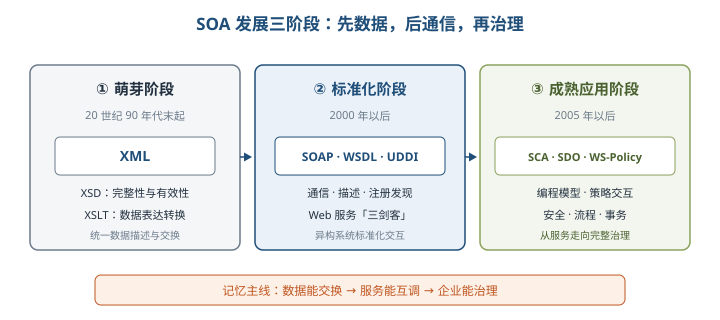

#### 15.2.2 国内外发展差异

- **美国**：历史应用积累多，关键任务是从已有系统**提取、包装功能**形成标准服务。
- **中国**：许多服务型系统尚需建设，主要任务是**新构造服务**，同时兼顾遗留系统切割封装、统一标准、ESB 注册管理与软件治理。
- 案例启示：不能照搬「全部包装遗留系统」或「全部重建」；应先盘点资产，再决定复用、封装、改造或新建。

#### 15.2.3 SOA 的微服务化发展 ⭐【重点】

微服务是 SOA 思想的扩展和优化，更强调**服务个体独立、拆分粒度更小、接口通用、去中心化部署**。

| 对比维度 | 传统 SOA | 微服务架构 |
| --- | --- | --- |
| 服务粒度与进程 | 相对较粗，服务间仍可能相互依赖 | 更细，通常以独立进程存在，独立开发、部署和扩展 |
| 集成方式 | 常以 ESB 连接各子系统，偏集中式 | 不强调重型 ESB，采用轻量通信，偏去中心化 |
| 接口 | 常见 SOAP/WSDL 等企业服务接口 | 常见 HTTP RESTful，终端与语言限制更少 |
| 数据 | 可共享企业数据资源 | 倾向每服务独立数据库、数据源唯一 |
| 主要代价 | 总线复杂、远程通信影响响应、部署协调较多 | 分布式调用、服务发现、链路追踪、最终一致性和运维复杂度上升 |

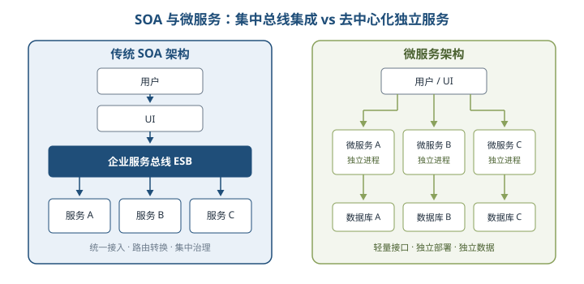

### 15.3 SOA 的参考架构 ⭐【重点】

IBM WebSphere 业务集成参考架构以**关注点分离**规划企业集成：既关注每类元素提供什么服务，也关注服务如何组合完成集成。六类服务如下：

| 类别 | 核心职责 | 典型成员/关键词 |
| --- | --- | --- |
| 业务逻辑服务 | 实现或复用业务逻辑 | 业务应用服务、伙伴服务、应用和信息资产 |
| 控制服务 | 实现人、流程和信息的集成 | 交互服务、流程服务、信息服务 |
| 连接服务 | 为分布式服务提供连接 | 企业服务总线 ESB |
| 业务创新和优化服务 | 监控业务性能并持续优化 | 公共事件框架、采集、监控、KPI |
| 开发服务 | 支持整个软件开发生命周期 | 建模、设计、实现、测试 |
| IT 服务管理 | 提供安全、高效、健康的运行环境 | 安全与目录、系统管理、资源虚拟化 |

> 助记：「业务要控制，连接促优化；开发做支撑，IT 管运行」——对应六类参考架构服务。

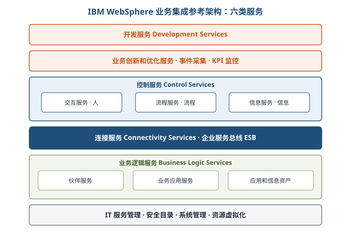

#### 1. 连接服务——企业服务总线（ESB）⭐【高频考点】

ESB 是消息中间件的发展，以「总线」模式简化集成拓扑，基于开放标准支持应用在**消息、事件和服务**级别动态互联互通。它是**架构模式，不等同于某个产品**。

- **基本能力**：服务元数据与注册管理；数据传递和转换；同步/异步交互；发现、路由、匹配和选择。
- **高级能力**：安全、QoS、可管理性、负载均衡。
- **解耦原理**：中介自动完成服务查找、消息路由、数据转换和协议转换，请求者无需知道提供者位置与实现技术，接口不变时双方可独立演进。

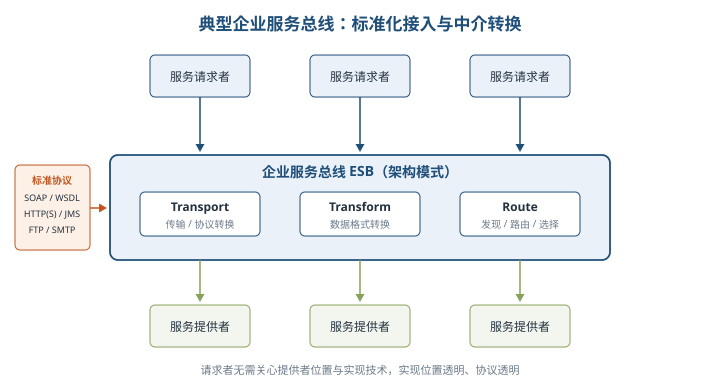

#### 2. 业务逻辑服务与控制服务

| 服务组 | 子类 | 一句话职责 |
| --- | --- | --- |
| 应用和信息访问 | 可接入服务、事件发现服务 | 包装遗留逻辑与数据供 ESB 访问；把数据或应用变化以事件发布 |
| 业务应用 | 组件、核心、接口服务 | 管理可复用组件运行；提供内存、实例、负载等运行时能力；连接其他企业系统 |
| 伙伴 | 社区、文档、协议服务 | 管理贸易伙伴；支持 EDI 等文档交换；提供认证、路由和传输 |
| 信息 | 联邦、复制、转换、搜索 | 聚合异构数据、保留本地副本、转换格式、检索结构化与非结构化数据 |
| 流程 | 编排、事务、人工服务 | 控制活动并恢复错误；短流程用两阶段提交、长流程用补偿；接入人工任务 |
| 交互 | 交付、体验、资源服务 | 多端交付；个性化、协作、单点登录；管理界面与安全配置 |

【易错】**联邦**强调数据仍按原方式管理，**复制**则在本地维护数据源副本；**流程编排**控制业务活动，**事务服务**保证 ACID，长流程通常采用补偿而不是长期锁定资源。

#### 3. 开发、优化与 IT 管理

- **开发服务**：建模 → 设计 → 实现 → 测试；相关方法/模型包括 SOMA、WSDL、BPEL、SCA、SDO。
- **业务创新和优化**：公共事件框架截获事件 → 采集服务按策略过滤与关联 → 监控服务结合上下文计算 KPI → 用指标重构或优化流程，形成闭环。
- **IT 服务管理**：安全和目录服务（用户、认证、授权、SSO）+ 系统管理和虚拟化服务（服务器、存储、网络等）。

### 15.4 SOA 主要协议和规范 ⭐【高频考点】

| 协议/规范 | 核心定位 | 必记细节 |
| --- | --- | --- |
| UDDI | 服务描述、发布、发现与集成的注册框架 | 帮消费者找到合适服务；基于 XML、HTTP、DNS、SOAP 等标准 |
| WSDL | 描述 Web 服务及通信方式的 XML 接口定义语言 | 三属性：做什么、如何访问、位于何处；文档分服务接口与服务实现 |
| SOAP | 分布式环境中基于 XML 交换信息的协议 | 信封、编码规则、RPC 表示、绑定四部分；目标是简单性和可扩展性 |
| REST | 以资源为中心的架构设计风格 | URI 标识资源，以 JSON/XML 等表述资源，通过 HTTP 方法引起状态转移，超链接驱动后续操作 |

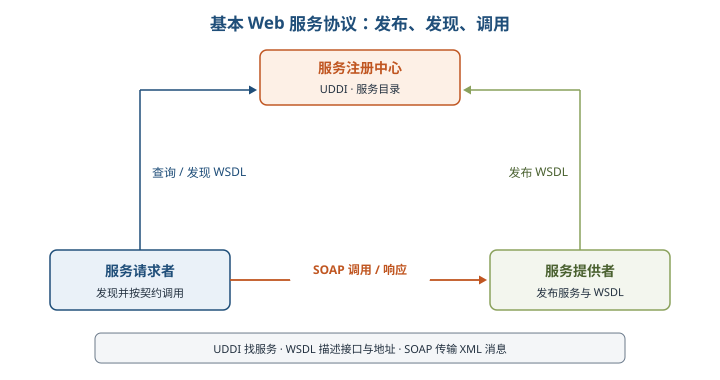

> 助记：「UDDI 找，WSDL 描，SOAP 传，REST 以资源为中心」。

#### 15.4.2 WSDL 文档结构

WSDL 文档以**端口集合**描述服务：抽象定义操作和消息，再把它们绑定到具体协议与网络端点。

| 元素 | 作用 | 记忆抓手 |
| --- | --- | --- |
| types | 定义消息使用的数据类型，通常用 XML Schema | 数据类型 |
| message | 抽象、类型化地定义通信消息结构 | 消息内容 |
| operation | 描述一个操作，常见为请求/响应消息对 | 一个动作 |
| portType | 某个访问入口类型支持的操作集合 | 抽象接口 |
| binding | 把 portType 绑定到具体数据格式和协议 | 如何通信 |
| port | binding 与具体 Web 地址组合成单个访问点 | 在哪里访问 |
| service | 相关端口的集合 | 服务总入口 |

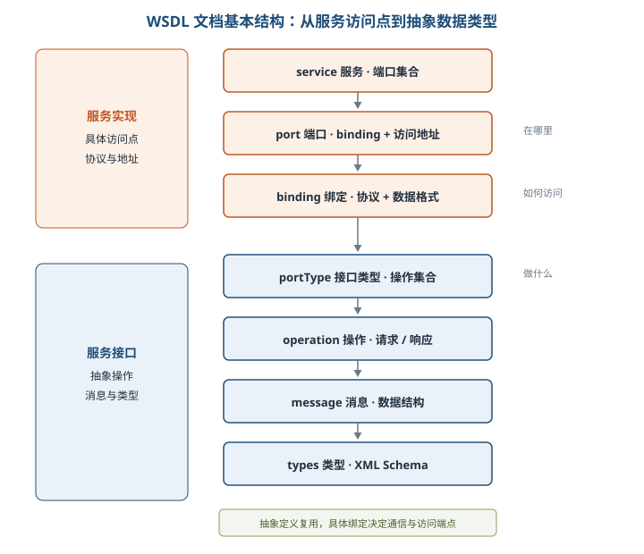

#### 15.4.3 SOAP 四部分

- **Envelope（信封）**：说明消息内容、发送者、接收处理者及处理框架。
- **Encoding Rules（编码规则）**：表示应用数据类型实例。
- **RPC Representation**：约定远程过程调用与应答。
- **Binding**：约定如何用底层协议交换信息；四部分功能相交但彼此独立，信封与编码规则位于不同 XML 命名空间。

#### 15.4.4 REST 的四个核心概念 ⭐【易错】

1. **资源（Resource）**：订单、图片等暴露给客户端的事物；URI 标识资源。一个资源可有多个 URI，但一个 URI 只对应一种资源。
2. **表述（Representation）**：资源在某一时刻状态的表现，如 HTML、JSON、XML、纯文本；传输的是「资源表述」，不是把服务端对象原样搬走。
3. **状态转移（State Transfer）**：**应用状态保存在客户端**，**资源状态保存在服务端**；借助 GET、POST、DELETE 等 HTTP 方法操作资源。
4. **超链接**：表述中附带相关资源 URI，客户端据此发现后续可执行操作，驱动应用状态转移。

举例：把订单看作「资源」，JSON 是它此刻的「照片」；客户端拿到照片和「支付、取消」链接后选择下一步，服务端只保存订单本身的状态，不必记住每个客户端看到了哪一步。

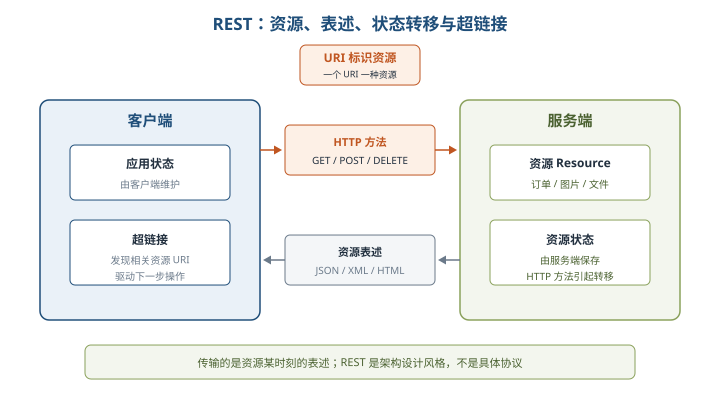

### 15.5 SOA 设计的标准要求

- **文档标准化**：服务用平台独立、自描述的 XML 文档表达，WSDL 是标准描述语言。
- **通信协议标准**：服务以消息通信，消息通常用 XML Schema（XSD）定义。
- **统一登记与集成**：通过 Registry 维护服务目录，应用查找并调用服务，UDDI 是登记标准。
- **服务质量（QoS）**：基础三协议不足以覆盖企业级安全、可靠、事务等高级需求，需要 WS-* 规范补充。

| QoS 方面 | 关键要求 | 对应规范/技术 |
| --- | --- | --- |
| 可靠性 | 保证传送、仅一次/最多一次、重复消息过滤 | WS-Reliability、WS-ReliableMessaging |
| 安全性 | 认证交换、消息完整性、消息保密 | Web 服务安全规范，可结合 SAML |
| 策略 | 以策略断言表达调用要求，一项策略可含多个断言 | WS-Policy |
| 控制 | 编排离散服务，规范异步、并行、转换与校正 | BPEL4WS/WSBPEL |
| 管理 | 跨环境统一管理不断增长的服务与流程 | WSDM |
| 协调与事务 | 合作方协调、多服务事务 | WS-Coordination、WS-Transaction |

### 15.6 SOA 的作用

⭐【重点】SOA 的核心价值是**消除信息孤岛、复用既有资产、让 IT 与业务同步**，不是简单把技术换成 Web Service。

- **点对点 EAI 的困境**：每两个应用都要适配，连接数量按 `n(n-1)/2` 增长；应用越多，「翻译」越多，维护和复用困难。
- **SOA 两步法**：①把应用和资源转换成服务；②把服务标准化，形成资源共享。
- **业务收益**：以模块化方式新增或更新服务，多渠道提供能力，保护已有 IT 投资，快速响应业务变化。

举例：零售商更换制造商时，只要双方仍遵循相同 WSDL 接口和服务级协定，就可保留内部系统，只调整外部合作伙伴连接，无需整体重构。

### 15.7 SOA 的设计原则 ⭐【重点】【高频考点】

| 原则 | 必须理解的含义 | 设计提醒 |
| --- | --- | --- |
| 无状态 | 请求不依赖提供者保存的前次调用状态 | 请求消息带齐本次处理所需信息 |
| 单一实例 | 同一功能避免重复建设 | 不是限制系统只能部署一个运行副本 |
| 明确定义的接口 | WSDL 划清公共接口与私有实现，Schema 定义消息，WS-Policy 描述规约 | 接口发布后应长期稳定，不暴露私有数据 |
| 自包含和模块化 | 服务独立部署、版本控制、自我管理和恢复 | 封装稳定、重复出现的业务活动 |
| 粗粒度 | 一次消息完成较完整业务，交互频次较低 | 不是绝对越粗越好，要控制边界与数量 |
| 松耦合 | 位置、实现技术、当前状态和私有数据对调用者透明 | 依赖契约而非内部实现 |
| 重用能力 | 服务可被多个流程和消费者复用 | 复用要靠通用边界与标准契约 |
| 互操作、兼容和策略声明 | 明确安全、费用、服务级别等技术与业务语义 | 用 WS-Policy 声明期望、约束和行为 |

> 助记：「无单明自粗，松重互策略」——无状态、单一实例、明确接口、自包含、粗粒度、松耦合、重用、互操作与策略。

### 15.8 SOA 的设计模式

#### 15.8.1 服务注册表模式

服务注册表管理服务合同、策略和元数据，是服务注册与发现的主控制点/策略执行点（PEP）；UDDI 是一种主要注册环境，但不是唯一实现。

- **服务注册**：提供者发布身份、位置、方法、绑定、配置、方案和策略，并控制谁发布、谁审批。
- **服务位置**：消费者检索合同，注册表控制访问者和可见属性。
- **服务绑定**：消费者依据合同开发调用代码，绑定相应协议与接口。
- **配置文件管理**：为开发、质量保证、生产等生命周期阶段维护不同机器和参数，服务晋级时切换配置文件并执行审查。

#### 15.8.2 企业服务总线模式 ⭐【重点】

典型过程：请求者产生并标准化消息 → ESB 按服务名或接口名查找目的组件 → 路由消息并转换数据/协议 → 目的服务处理 → 结果逆向返回。交互由直接点对点转为**事件驱动的消息交互**，实现位置透明与协议透明。

| ESB 核心功能 | 记忆要点 |
| --- | --- |
| 消息路由和寻址 | 提供位置透明性 |
| 服务注册和命名管理 | 知道服务是谁、在哪里 |
| 多种消息传递范型 | 请求/响应、发布/订阅等 |
| 多种传输协议 | 屏蔽异构通信方式 |
| 多数据格式及转换 | 让不同数据表达互相理解 |
| 日志和监控 | 支撑可管理与问题追踪 |

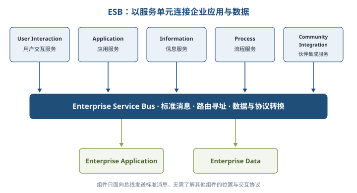

#### 15.8.3 SynchroESB 案例

SynchroESB 以 ESB 为底层，采用**分布式架构、集中式管理、事件驱动**，支持粗粒度可复用组件和可视化流程构建。自下而上为：服务总线层 → 数据转换与适配器层 → 流程整合层 → 用户交互层。

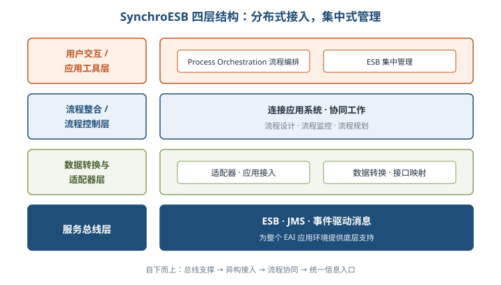

#### 15.8.4 微服务模式 ⭐【高频考点】

微服务围绕业务领域拆分应用，每个服务独立开发、测试、部署、管理和迭代，主要收益有：复杂应用解耦、独立发布、技术选型灵活、故障隔离与容错、按需独立扩展。

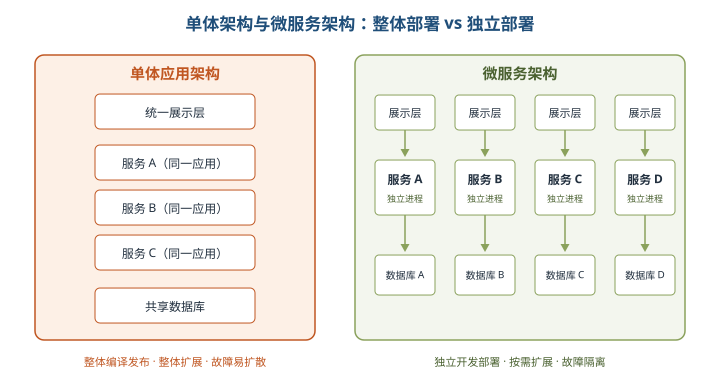

| 设计模式 | 调用方式与用途 | 关键限制/辨析 |
| --- | --- | --- |
| 聚合器 | 调用多个服务，聚合数据后直接展示，或加工后发布为高层组合服务 | 聚合器可有独立缓存和数据库 |
| 代理 | 按业务选择并委派给不同服务，只做请求委派和数据转换 | 是聚合器变种，不在客户端聚合业务数据 |
| 链式 | A 调 B、B 调 C，逐级合并结果返回 | 同步调用会阻塞，调用链不宜过长 |
| 分支 | 同时调用两条相互独立的服务链 | 聚合器的扩展，两条链互不影响 |
| 数据共享 | 过渡阶段允许多个强耦合服务共享缓存或数据库 | 违背完全自治，只宜作为单体迁移的过渡方案 |
| 异步消息传递 | 用消息队列代替不必要的同步 REST 请求 | 提升响应速度，但增加复杂性并可能影响可用性 |

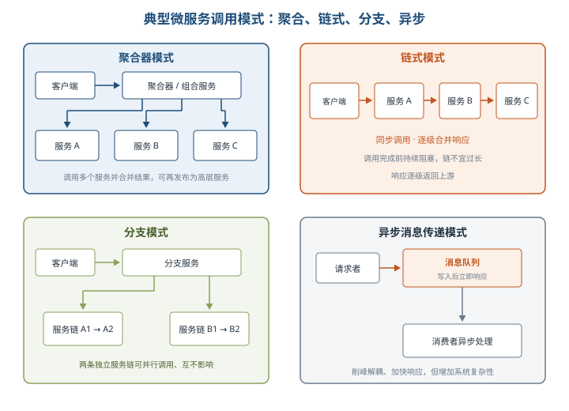

**微服务挑战【易错】**：分布式通信使服务发现和调用链跟踪更困难；分区数据库受 CAP 约束，常以最终一致性替代强一致性；集成测试需准备依赖服务；监控、管理、分发、扩容成本上升。只有当架构扩展瓶颈、业务变化和组织能力匹配时，微服务收益才可能大于成本。

### 15.9 构建 SOA 架构时应注意的问题

#### 15.9.1 原有系统架构中的集成需求

- 优先考虑**重用已有投资而不是替换遗留系统**，复用人员、语言、硬件、数据库和应用程序。
- 集成需求不能只看应用组件，还要全面分析：**应用程序集成、终端用户界面集成、流程集成、已有信息集成**。
- 能随企业演进的集成功能应由**服务**提供，而不是绑死在特定应用程序中。

#### 15.9.2 服务粒度与无状态 ⭐【高频考点】

| 设计点 | 推荐做法 | 原因 |
| --- | --- | --- |
| 外部服务接口 | 粗粒度，如「提交购买表单」 | 对外提供一致、稳定、完整的业务操作，减少频繁交互和变化影响 |
| 内部服务接口 | 可相对细粒度，如创建记录、设置地址、更新数据库 | 便于内部实现与组合，但不宜直接暴露给外部消费者 |
| 细粒度组合 | 用 BPEL 把细粒度操作编排成粗粒度流程服务 | 对内灵活，对外稳定 |
| 无状态服务 | 每次请求独立、自包含，不依赖其他服务上下文和前次状态 | 易于复用、伸缩与负载均衡；有依赖时优先定义为业务流程 |

【易错】服务接口通常包含**多个语义相关操作**；大量服务都只有单一操作，或一个服务塞入大量不相关操作，都可能说明粒度不当。无状态不等于系统没有业务数据，而是服务实例不依赖前次调用上下文。

### 15.10 SOA 实施的过程

#### 15.10.1 选择 SOA 解决方案

1. **全局规划**：评估现有系统可复用、需改造和需新建部分，规划投入、工具和演进次序。
2. **符合自身需求**：根据 IT 资产沉淀与目标层次安排进度和投资，认识共享服务带来的长期业务价值。
3. **技术考察**：平台看开放性和标准支持；实施看业务战略和流程、基础架构、构建模块、项目应用、成本效益、规划管理六方面；供应商看产品案例与专业服务能力。

#### 15.10.2 业务流程分析 ⭐【重点】

**第一步：建立服务模型——三种候选服务发现方法**

| 方法 | 从哪里出发 | 产出与价值 |
| --- | --- | --- |
| 自顶向下分解 | 业务组件模型和端到端流程，逐层分解到最小业务活动并做变化分析 | 活动树节点形成候选服务；按业务组件归为层次化服务目录；分离稳定与易变逻辑 |
| 业务目标分析 | 企业业务目标和 KPI，目标分解后分派给服务 | 形成目标服务树，叶子服务可回溯业务目标，验证并补齐候选服务 |
| 自底向上分析 | 已有系统、套装/定制应用、行业规范等资产 | 找重复与可复用功能，包装为服务；同时验证技术可行性 |

**第二步：建立业务流程——业务对象、服务接口、流程模型**

| 业务对象 | 表达内容 | 例子 |
| --- | --- | --- |
| 实体业务对象 | 人、地点、事物或概念，通常来自业务名词 | 客户、订单、物品 |
| 过程业务对象 | 处理过程或工作流任务，通常对应业务动词并依赖实体 | 审核订单、计算价格 |
| 事件业务对象 | 系统操作造成或产生的事件 | 支付完成、库存不足 |

- **服务接口**：操作应语义相关，请求消息带齐处理信息；优先无状态接口，避免 `setCustomerNumber()` 后再靠内存状态调用 `getCustomerInfo()`。
- **流程模型**：把业务流程分解为子流程，明确组件、服务、输入输出、策略和测量；控制流连接活动与决策点，决策点按业务规则选择路线，正常与异常路径都要覆盖。
- **流程元素**：把任务、决策、数据引用、策略、角色及测试封装成可复用流程段，如「登录」「购物篮定价」。

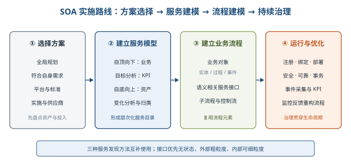

## 三、重点与易错点

| # | 考点 | 必须记住的结论 | 易错提醒 |
| --- | --- | --- | --- |
| 1 | SOA 本质 | 服务通过中立接口和契约联系，接口独立于平台、OS、语言 | SOA 是架构思想，不等于 Web Service 产品 |
| 2 | BPEL | 组合、编排、协调多个 Web 服务形成复合服务 | WSDL 描述服务，BPEL 编排流程，职责不同 |
| 3 | 三阶段规范 | XML/XSD/XSLT → SOAP/WSDL/UDDI → SCA/SDO/WS-Policy | XML 是数据交换基石，不是消息通信协议 |
| 4 | 参考架构 | 业务逻辑、控制、连接、创新优化、开发、IT 服务管理六类 | ESB 属于连接服务，不是全部参考架构 |
| 5 | ESB 定位 | 总线式架构模式，提供中介、路由、转换、注册和 QoS | 不能把 ESB 等同某个具体中间件产品 |
| 6 | 信息服务 | 联邦保留原数据管理方式，复制在本地维护副本 | 两者都用于异构数据集成，但数据存放方式不同 |
| 7 | 事务服务 | 短流程常用两阶段提交，长流程一般用补偿 | 长流程不宜靠长期资源锁定维持 ACID |
| 8 | Web 服务三剑客 | UDDI 找服务、WSDL 描述服务、SOAP 传消息 | REST 不属于这组传统三协议 |
| 9 | WSDL 三属性 | 做什么、如何访问、位于何处 | port=binding+地址，portType 才是抽象操作集合 |
| 10 | SOAP 四部分 | 信封、编码规则、RPC 表示、绑定 | SOAP 基于 XML，不等于 HTTP 本身 |
| 11 | REST 状态 | 应用状态在客户端，资源状态在服务端 | 一个资源可多 URI，一个 URI 只对应一种资源 |
| 12 | SOA 作用 | 应用资源服务化，再标准化共享，消除信息孤岛 | 点对点 EAI 连接数随应用数组合式增长 |
| 13 | 服务粒度 | 外部推荐粗粒度，内部可细粒度，用 BPEL 组合 | 不是越粗或越细越好，接口操作要语义相关 |
| 14 | 无状态 | 请求带齐处理信息，不依赖前次调用上下文 | 无状态不等于没有数据库或业务状态 |
| 15 | 注册表 | 注册、位置查询、绑定，并管理合同、策略和元数据 | UDDI 是注册环境之一，不是唯一注册表产品 |
| 16 | 微服务模式 | 链式同步阻塞；分支并行两链；异步用消息队列 | 数据共享模式只是迁移过渡，不是自治目标 |
| 17 | 微服务代价 | 分布式跟踪、最终一致性、测试和运维更复杂 | 不应脱离团队能力和业务规模盲目拆微服务 |
| 18 | 服务建模 | 自顶向下看业务、目标分析看 KPI、自底向上看资产 | 三种方法互补，候选服务还要按业务组件归类 |

## 四、练习与真题

以下为本章自编单选模拟题，答案集中放在全章最后。

**1.** 从软件基本原理看，SOA 实现异构服务统一交互的关键是（ ）。
A. 所有服务使用相同编程语言  B. 服务通过中立、定义良好的接口和契约联系  C. 所有系统部署在同一操作系统  D. 服务之间直接访问私有数据

**2.** 某企业希望把库存、支付、物流三个 Web 服务按订单流程组合成一个新的复合服务，最适合使用（ ）。
A. BPEL  B. UDDI  C. XSD  D. XSLT

**3.** SOA 标准化阶段的「Web 服务三剑客」是（ ）。
A. XML、XSD、XSLT  B. SCA、SDO、WS-Policy  C. SOAP、WSDL、UDDI  D. REST、JSON、HTTP

**4.** 在 IBM WebSphere 业务集成参考架构中，负责提供服务间连接、路由、转换和动态选择的是（ ）。
A. 业务逻辑服务  B. 连接服务  C. 开发服务  D. IT 服务管理

**5.** 关于 WSDL 元素的说法，正确的是（ ）。
A. portType 定义具体网络地址  B. binding 把抽象接口绑定到具体协议和数据格式  C. types 定义服务部署位置  D. message 只描述人工流程

**6.** 关于 REST 的理解，正确的是（ ）。
A. 应用状态由服务端统一保存  B. 一个 URI 可以同时对应多种资源  C. 资源状态保存在服务端，应用状态保存在客户端  D. REST 是一种具体消息传输协议

**7.** 某长周期业务流程涉及多个服务，教材建议保证事务性的常用方式是（ ）。
A. 始终使用两阶段提交并长期锁定资源  B. 使用补偿方法  C. 禁用所有服务调用  D. 只使用 UDDI

**8.** 关于 SOA 服务设计，下列做法最合理的是（ ）。
A. 对外暴露大量易变细粒度操作  B. 让每次调用依赖服务实例保存的上次请求状态  C. 对外提供粗粒度接口，内部细粒度操作可用 BPEL 组合  D. 公开服务私有数据以减少消息大小

**9.** 服务注册表模式的三项基本治理活动是（ ）。
A. 服务注册、服务位置查询、服务绑定  B. 数据复制、数据联邦、数据搜索  C. 建模、设计、实现  D. 采集、监控、虚拟化

**10.** 服务 A 同步调用服务 B，服务 B 再同步调用服务 C，结果逐级合并返回，且调用完成前客户端一直等待。该模式是（ ）。
A. 分支微服务  B. 链式微服务  C. 异步消息传递微服务  D. 数据共享微服务

**11.** 某团队通过盘点已有系统功能目录，找出多个系统重复实现且可复用的模块并包装成服务。这种服务建模方法是（ ）。
A. 自顶向下分解法  B. 业务目标分析法  C. 自底向上分析法  D. 事件发现法

**12.** 关于微服务架构的收益与代价，下列说法正确的是（ ）。
A. 微服务能消除分布式系统全部复杂性  B. 服务独立部署意味着不再需要集成测试  C. 分区数据库常需以最终一致性替代强一致性，并加强链路追踪与运维  D. 任何小型稳定系统都应立即拆成微服务

## 五、疑问与查漏补缺

1. **大纲要求但教材未充分展开**：①REST 只介绍资源、表述、状态转移和超链接，未系统展开统一接口、无缓存等完整约束，考试按教材四概念作答即可；②SCA/SDO、SAML、WSDM 等多为名称与定位，案例若要求落地细节需查对应标准；③微服务治理只提出挑战，限流、熔断、服务网格等可结合第 14 章补充。
2. **教材笔误或易误读处**：①表 15-1 标题写成「可修改性质量属性场景描述」，实际内容是国内 SOA 实施现状，应按上下文理解；②图 15-7 的「应用工具层、流程控制层」与正文「用户交互层、流程整合层」命名不完全一致，复习掌握四层职责对应关系；③图 15-8 右图应为微服务架构，文本提取中左右标题重复，不能据此误判；④15.4.4 先说 REST 是架构风格，后说「不是架构」，应理解为**不是某个具体系统架构或协议，而是一组设计约束/风格**；⑤UDDI 全称在不同段落出现「定义/发现」差异，按通行表述记「统一描述、发现和集成」；⑥SOAP 的 Envelop 应为 Envelope，Protocal 应为 Protocol。
3. **与其他章节衔接**：微服务原则、容器与服务网格对照第 14 章；短流程事务、CAP 和最终一致性对照第 6 章数据库及第 14 章分布式事务；SOA 安全、WS-Policy、SAML 与第 4、18 章安全机制衔接；服务候选者识别可复用第 7、8 章架构设计与质量属性评估方法。
4. **案例答题补充**：若题干强调「统一接入异构遗留系统、集中路由转换」，优先答 SOA+ESB；若强调「独立交付、按服务扩缩容、团队自治」，优先答微服务，同时补充去中心化治理、可观测性和数据一致性成本，避免把两者写成绝对对立。

## 六、参考答案

**1.** **B**。SOA 依靠平台、操作系统和语言中立的服务接口与契约实现统一交互。

**2.** **A**。BPEL 用于组合、编排和协调多个 Web 服务，形成可执行的复合业务流程。

**3.** **C**。SOAP 管通信、WSDL 管描述、UDDI 管注册发现，是标准化阶段三项核心规范。

**4.** **B**。连接服务以 ESB 为核心，提供路由、转换、发现、匹配和选择等中介能力。

**5.** **B**。binding 规定 portType 如何映射到具体协议与数据格式，port 再叠加网络地址。

**6.** **C**。REST 中资源状态在服务端，应用状态在客户端；一个 URI 只对应一种资源。

**7.** **B**。短流程常用两阶段提交，长流程通常以补偿机制处理事务失败。

**8.** **C**。外部粗粒度接口更稳定，内部细粒度操作可由 BPEL 编排成完整业务服务。

**9.** **A**。提供者注册、消费者定位并依据合同绑定，是注册表治理的基本闭环。

**10.** **B**。链式模式逐级同步调用并合并响应，链过长会导致客户端长时间阻塞。

**11.** **C**。自底向上分析从遗留资产中发现重复、可复用功能并验证服务实现可行性。

**12.** **C**。微服务带来独立部署和扩展收益，也引入最终一致性、测试、追踪及运维挑战。
