# 第16章 嵌入式系统架构设计理论与实践

- 教材位置：`02.系统架构设计师第二版-教材.pdf` PDF 第 549～606 页（书页 541～598）
- 复习状态：已完成
- 复习日期：2026-11-06
- 本章地位：本章把硬件约束、实时操作系统、基础软件与架构方法串成一条设计主线，是下午嵌入式案例题的核心知识来源。复习重点不是背产品参数，而是能围绕实时性、可靠性、资源约束和跨设备协同作出架构取舍。

## 一、大纲考点

大纲考试科目 2「系统架构设计案例分析」第 6 主题为「嵌入式系统的架构设计理论与实践」（大纲书页 55～57，PDF 第 65～67 页）。下午案例通常给出工业控制、智能终端或物联网情境，要求完成概念辨析、架构图补全与方案比较，并可能结合任务参数计算调度顺序或松弛度；答题应写出「约束—选型—机制—验证」的因果链，而非只罗列名词。

| 大纲条目 | 必须掌握的内容 | 教材对应小节 |
| --- | --- | --- |
| 6.1 嵌入式系统概述 | 定义、五个发展阶段；处理器、存储器、总线、看门狗；软件架构概述 | 16.1.1～16.1.3 |
| 6.2 架构原理与特征 | 层次化模式、递归模式；封闭层与开放层的取舍 | 16.2.1 |
| 6.2 嵌入式操作系统 | 定义、特点、分类、一般架构；内核、任务、存储、通信；EDF/LLF/RMS；典型产品 | 16.2.2 |
| 6.2 嵌入式数据库 | 特点；内存/文件/网络三类架构；核心功能；SQLite 等产品 | 16.2.3 |
| 6.2 嵌入式中间件 | 特点与分类；消息和分布式对象架构；CORBA、DDS | 16.2.4 |
| 6.2 软件开发环境 | 交叉开发；调试方式；Eclipse 层次；GCC、Workbench、MULTI | 16.2.5 |
| 6.3 架构设计方法 | ABSD、ADD、DARTS 的输入、步骤与适用场景 | 16.3.1～16.3.3 |
| 6.4 案例分析 | HarmonyOS、GENESYS；物联网操作系统及 FreeRTOS | 16.4.1～16.4.3 |

> 案例作答抓手：看到「截止期限」先想调度，看到「多核/多设备异构」先想抽象与中间件，看到「安全攸关」先想质量属性、故障隔离与确定性，看到「资源受限」先想剪裁、内存占用和功耗。

## 二、知识点笔记

### 16.1 嵌入式系统概述

#### 16.1.1 发展历程与基本特征

> 教材原文：嵌入式系统是为了特定应用而专门构建的计算机系统。

通俗地说，它不是「什么都能干的通用电脑」，而是嵌入设备中、围绕明确任务定制的计算系统；软硬件必须协同考虑功耗、成本、体积、环境和响应时限。

| 阶段 | 核心形态 | 识别特征 |
| --- | --- | --- |
| 单片微型计算机 SCM | 单片机、无操作系统、汇编 | 功能单一、资源少、几乎无用户接口 |
| 微控制器 MCU | 嵌入式处理器＋简单操作系统 | 外设和接口扩展，开销小、效率高、通用性弱 |
| 片上系统 SoC | 多部件集成到芯片 | 可运行于不同处理器，内核小、兼容性好 |
| Internet 嵌入式系统 | 处理器集成网络接口、设备入网 | 网络化 |
| 智能化与云推动 | 端侧微型传感设备＋智能服务设备 | 低能耗、高速度、高集成、高可信 |

⭐【易错】教材第二阶段标题虽写 MCU，但正文强调「嵌入式微处理器＋简单操作系统」；答题按教材语境描述，不要把五阶段机械等同于五种处理器分类。

#### 16.1.2 硬件体系结构

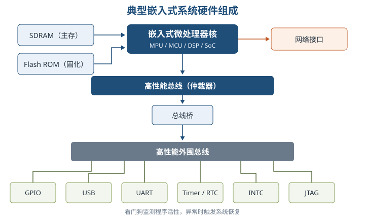

| 处理器类型 | 一句话理解 | 典型优势与用途 |
| --- | --- | --- |
| MPU 微处理器 | 处理器核心需外配存储器和外设 | 功能强，但板级器件多、可靠性与保密性受影响 |
| MCU 微控制器 | 内核、存储器和外设单片集成 | 体积小、功耗与成本低、可靠性高，适合控制 |
| DSP 数字信号处理器 | 为乘加等信号算法优化，常采用哈佛结构 | 指令执行与编译效率高，适合音视频、通信 |
| GPU 图形处理器 | 并行承担图形图像运算 | 降低 CPU 图形处理负担 |
| SoC 片上系统 | 把处理器核与多数外设集成到芯片 | 高集成、可剪裁，适合专用终端 |

⭐【重点】芯片温度等级：民用级 **0～70℃**，工业级 **−40～85℃**，军用级 **−55～150℃**；湿度、振动、加速度也属于选型约束。

| 存储器 | 核心结论 | 高频辨析 |
| --- | --- | --- |
| RAM | 断电丢失，运行时可读写 | DRAM 需刷新、成本低，常作主存；SRAM 无需刷新、更快，常作 Cache |
| ROM | 断电保留，适合固化程序 | MASK ROM 不可改；PROM 一次写；EPROM 紫外线擦除；EEPROM 电擦除；Flash 可在线改写但先擦后写 |

总线按信息分为**数据、地址、控制**三类；按连接位置分为片内、系统、局部、通信总线。通信总线连接主机外部设备或其他计算机，不能与片内总线混淆。

看门狗是系统恢复机制：正常程序周期「喂狗」使计数器复位；程序跑飞后计数器溢出，系统保存关键数据并复位重启。举例：自动售货机控制程序卡死时，看门狗像超时巡检员，强制设备重新启动，而不是一直等待人工处理。

#### 16.1.3 软件架构概述

早期只有「监控程序＋应用软件」，引入 EOS 后形成「应用软件—RTOS—BSP—硬件」层次。BSP 屏蔽目标板差异，支撑可移植性；现代嵌入式架构还吸收事件驱动、构件化、虚拟化和微服务思想，但没有脱离应用场景的万能架构。

GOA 用抽象接口解决开放性与可移植性：**直接接口**用于上下层功能调用，**逻辑接口**用于同层基于消息的引用；特点为可移植、可互操作、可剪裁、易获得。

### 16.2 嵌入式系统软件架构原理与特征

#### 16.2.1 层次化与递归模式

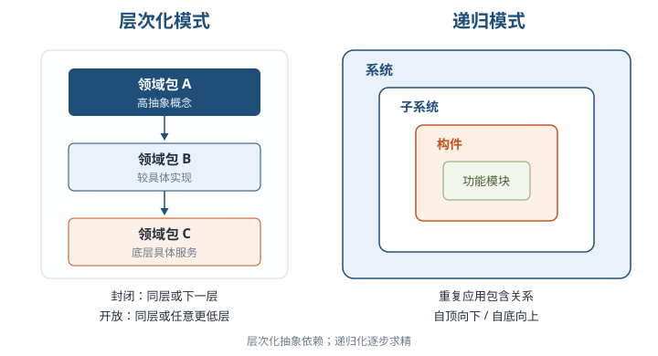

| 模式 | 核心思想 | 优点与适用 |
| --- | --- | --- |
| 层次化 | 高层抽象由低层具体概念实现 | 关注点分离；适合抽象边界清楚的系统 |
| 封闭型层次 | 只能调用同层或下一低层 | 封装、移植性好；跨层开销较大 |
| 开放型层次 | 可调用同层或任意更低层 | 性能较好；破坏封装，移植性较差 |
| 递归模式 | 重复应用包含关系，持续分解复杂系统 | 可扩展、逐步求精；每步可验证可靠性与实时性 |

递归设计可自顶向下（从系统到子系统，紧扣用例）或自底向上（从关键类和关系出发，复用领域经验）。

#### 16.2.2 嵌入式操作系统 EOS

> 教材原文：嵌入式操作系统负责嵌入式系统的全部软、硬件资源分配、任务调度、控制、协调并行活动等工作。

⭐【重点】EOS 特征可归为四组：**资源约束**（紧凑、可剪裁、可固化、可定制）、**环境适应**（可移植、硬件适应、标准接口）、**运行保障**（强实时、强确定、稳定、高质量）、**使用方式**（弱交互、操作简洁）。嵌入式操作系统通常分为面向控制通信的 RTOS 与面向消费电子的非实时 EOS，不能把「嵌入式」直接等同于「硬实时」。

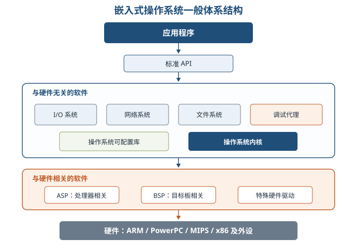

与处理器硬件相关的驱动称 ASP，与处理器外围芯片相关的称 BSP；特殊硬件驱动单独设计。内核承担任务、内存、任务间通信、时钟和中断管理，可配置库按需静态或动态剪裁。

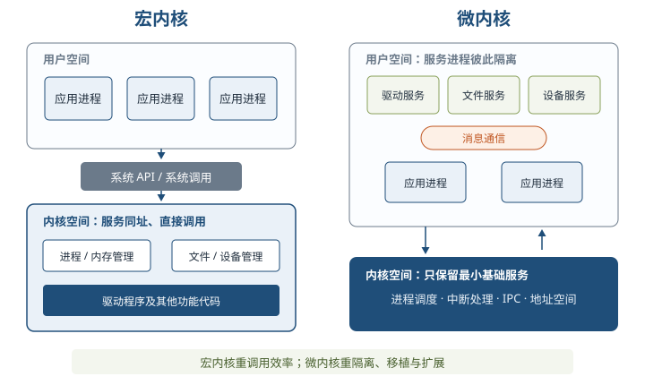

| 对比项 | 宏内核 | 微内核 |
| --- | --- | --- |
| 服务位置 | 用户服务与内核服务同在内核空间 | 多数服务移到用户空间，内核只留基础服务 |
| 调用方式 | 功能组件可直接调用 | 客户端与服务经消息通信 |
| 优势 | 路径短、性能较高 | 清晰、移植性/伸缩性/扩展性好、故障隔离较强 |
| 代价 | 耦合高、缺陷影响面大 | 消息开销大、性能相对偏低 |
| 教材示例 | VxWorks 5.5、VRTX | L4、WinCE；QNX 亦采用微内核 |

任务是调度最小单位，可记为「任务＝程序＋执行」。⭐【高频考点】三态转换没有「就绪→阻塞」和「阻塞→执行」：等待事件发生在执行态，事件完成后只回到就绪态，仍需调度器分配 CPU。

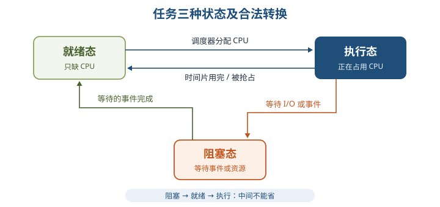

**实时调度的三个独立分类维度**：离线/在线看调度信息何时获得；抢占/非抢占看运行能否被打断；静态/动态看优先级何时确定。它们不能混成同一组互斥选项。

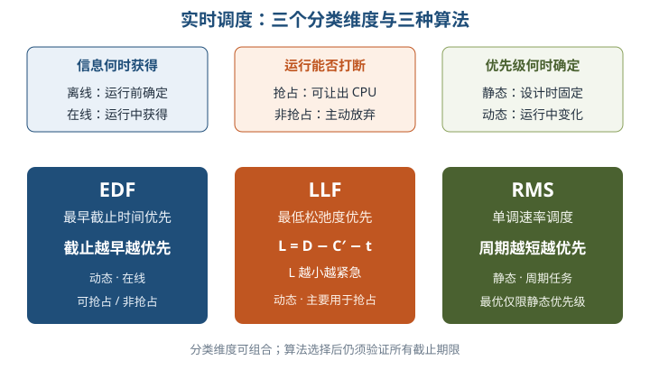

| 算法 | 优先级依据 | 类型与要点 |
| --- | --- | --- |
| EDF 最早截止时间优先 | 截止时间越早，优先级越高 | 动态、在线；可抢占也可非抢占；每次选就绪队首 |
| LLF 最低松弛度优先 | 松弛度越小，优先级越高 | 动态，主要用于抢占式；须随时间和剩余执行量更新 |
| RMS 单调速率调度 | 周期越短，优先级越高 | 静态优先级，经典周期任务算法；不等于按执行时间排序 |

> 助记：EDF 看「死线」，LLF 看「余量」，RMS 看「周期」；死线早、余量小、周期短者优先。

**LLF 公式：松弛度 L＝截止时刻 D−剩余执行时间 C′−当前时刻 t。** 举例：当前 20ms，任务须在 50ms 完成且还需 10ms，则 L＝50−10−20＝20ms；余量越小越紧急。

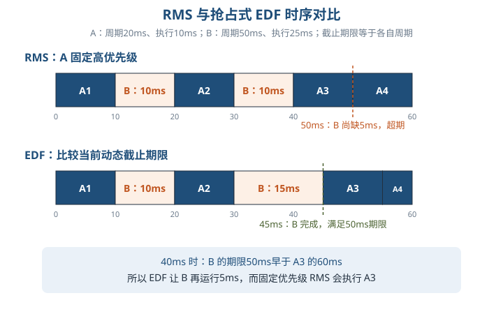

⭐【易错】RMS 的「最优」限定于**静态优先级算法**，不表示所有任务集都必然可调度；利用率上界是充分条件而非简单判定「超过就一定不可调度」，案例仍应画时间线验证截止期限。

**存储管理**目标是地址保护、地址独立、分配回收、提高利用率和扩充主存。

| 方法 | 核心机制 | 关键优缺点/碎片 |
| --- | --- | --- |
| 分区 | 连续区域分配；静态、可变、可重定位 | 简单，但有碎片与增长受限；可变分区回收时合并相邻空闲区 |
| 分页 | 逻辑页与物理页框等大，可离散存放 | 无外部碎片，有页内碎片；页表占内存 |
| 分段 | 按代码、数据、栈等逻辑单元划分，长度不等 | 便于共享保护和模块化；有外部碎片 |
| 段页 | 先分段、段内再分页 | 兼有模块化与离散分配，管理和硬件开销增加 |
| 虚拟存储 | 内存＋外存，以局部性原理按需调入 | 扩大寻址空间，支持映射、共享与保护；需硬件支持 |

可变分区算法：首次适应取顺序找到的第一个足够空闲区；最佳适应取能满足要求的最小区；最坏适应取最大区，期望剩余区仍可用。⭐【易错】最佳适应并不保证全局碎片最少。

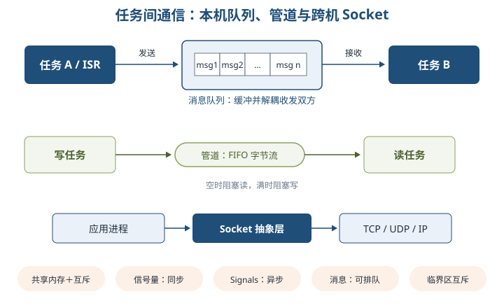

| 机制 | 主要用途 | 必须记住的特点 |
| --- | --- | --- |
| 共享内存 | 高效共享数据结构 | 直接高效，但必须另配互斥/同步保护临界区 |
| 二进制信号量 | 同步、互斥基础 | 常用于事件与任务协调 |
| 互斥信号量 | 保护共享资源 | 支持互斥、优先级继承、递归等语义 |
| 计数信号量 | 管理多个同类资源实例 | 计数随获取、释放变化 |
| 消息队列 | 任务或 ISR 与任务间带数据通信 | 缓冲区解耦收发双方；可按 FIFO、优先级等排队 |
| 管道 | 单向字节流 | 空时阻塞读、满时阻塞写，通常 FIFO |
| Socket/远程调用 | 跨机网络通信 | 抽象 TCP/IP 操作，采用打开—读写—关闭模式 |
| Signals | 异步事件通知、异常处理 | 软件层模拟中断，接收者无需主动等待 |

典型产品抓定位：VxWorks 强调高性能、可靠与广泛应用；LynxOS 强调分布式硬实时；Nucleus 内核小、组件化、易移植；QNX 为微内核 RTOS；Android/iOS 面向移动终端；ROS 提供机器人硬件抽象、消息与功能包生态。产品版本与市场份额属于时效信息，案例不宜当作固定结论背诵。

#### 16.2.3 嵌入式数据库 ERTDBS

嵌入式数据库嵌入应用程序进程，轻量、低内存、可零配置，并强调定时限制、可预知性和底层控制。**嵌入性不必然推出实时性，移动性也不必然推出嵌入性。**

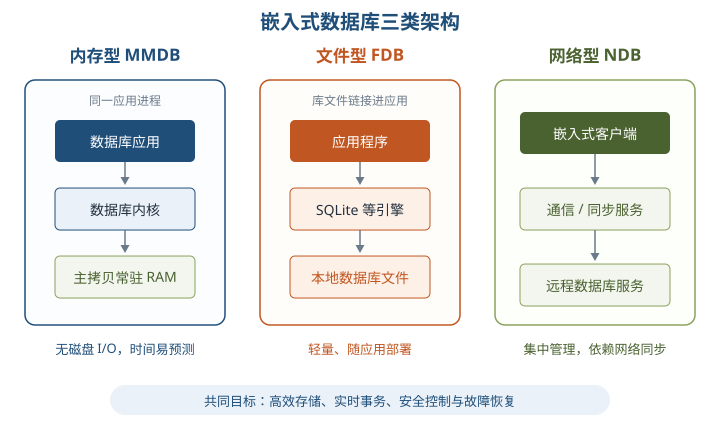

| 类型 | 数据主位置 | 优势 | 主要代价/适用 |
| --- | --- | --- | --- |
| 内存型 MMDB | 主拷贝常驻内存 | 避免磁盘 I/O，事务时间易预测，实时性好 | 内存与持久化设计要求高；如 eXtremeDB |
| 文件型 FDB | 本地文件 | 简单、轻便、随应用部署 | 文件格式可被直接读取时安全性弱；如 SQLite |
| 网络型 NDB | 远程服务器 | 客户端小、支持丰富 SQL、便于集中管理 | 依赖通信与同步；由客户端、协议、远程服务器组成 |

⭐【重点】数据库服务器通过驱动和 TCP/IP 访问独立进程，数据与程序分离；嵌入式数据库把库链接进应用，经 API 同进程访问，访问控制更多交给应用，部署也随应用一起发布。

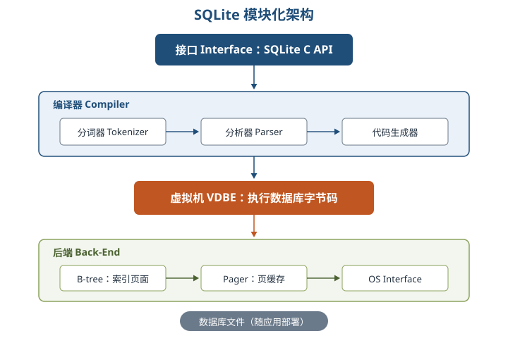

SQLite 四子系统：接口（C API）→编译器（分词、语法分析、代码生成）→虚拟机 VDBE（执行字节码）→后端（B-tree、pager、OS 接口）。举例：手机离线记账应用把 SQLite 库直接打包进 App，不启动独立数据库服务器，也能用 SQL 管理本地账务。

核心功能包括高效存储、锁与数据安全、实时事务、恢复；设计时重点关注内存空间、完整性、并发封锁粒度、变化数据转储和日志缓冲。实时数据库锁开销相对更高，教材建议常以一张关系表为封锁单位，不能照搬通用库「越细越好」的直觉。

产品比较：SQLite 小巧、支持 ACID；Berkeley DB 多语言 API、可伸缩；Firebird 嵌入版支持 SQL、事务、存储过程和触发器；eXtremeDB 是面向实时的内存数据库。

#### 16.2.4 嵌入式中间件

中间件位于操作系统、网络和数据库之上、应用之下，既实现互连，也实现互操作。嵌入式中间件屏蔽底层异构性，共性是通用、异构、分布、协议规范、接口标准，并需适应无线网络、流媒体、QoS 和环境变化。

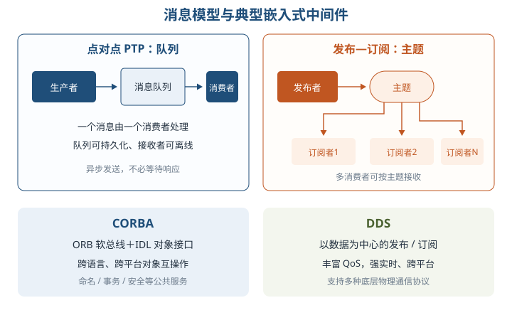

| 模型/技术 | 核心机制 | 高频结论 |
| --- | --- | --- |
| 点对点 PTP | 消息写入指定队列，由一个消费者处理 | 可持久化，接收者暂不可用时队列保存消息 |
| 发布—订阅 Pub/Sub | 发布者按主题发消息，多个订阅者接收 | 双方不必互相了解；持久订阅可补收离线消息 |
| 分布式对象/CORBA | ORB 作为软总线，IDL 定义对象接口 | 跨语言、跨平台调用；公共服务含命名、事务、安全等 |
| DDS | 以数据为中心的发布/订阅，丰富 QoS | 去中心化数据分发、强实时、跨平台、支持多种物理协议 |

消息中间件两个特点是**异步处理**与**松耦合**。举例：支付系统只把「已支付」事件写入队列，订单系统稍后消费；两端不必同时在线，也不必知道彼此内部实现。

嵌入式中间件主要功能为网络通信、存储管理和数据处理。CORBA 偏对象请求代理与分布式对象互操作，DDS 偏实时数据分发与 QoS，案例选型不要互换。

#### 16.2.5 软件开发环境

⭐【重点】交叉开发是在**宿主机**编辑、编译、链接，在**目标机**下载、运行和调试；交叉编译器运行在宿主机，却生成目标机可执行代码。

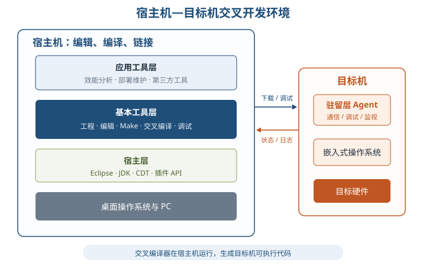

| 调试方式 | 程序运行位置/连接 | 识别点 |
| --- | --- | --- |
| 模拟器 | 调试工具与待调软件都在主机 | 纯软件模拟目标处理器 |
| 在线仿真器 ICE | 仿真仪器通过仿真头接目标板 | 目标 CPU 透明、可控 |
| 监控器 Monitor | 主机调试器＋目标板监控程序 | 经串口等通信，程序实际下载运行 |
| JTAG 仿真器 | 目标板 JTAG 边界扫描接口 | 利用芯片调试接口 |

Eclipse 环境分宿主层（Eclipse/JDK/CDT）、基本工具层（工程、编辑、编译、构建、配置、调试）、应用工具层（效能分析、交互、部署维护、第三方集成）和驻留层（目标机 Agent、通信与调试代理）。驻留层可剪裁并运行在目标机。

开发功能覆盖编码、编译、Make 构建、配置、下载、调试和运行；TCF/DSF 支撑目标机通信与调试。GCC 是开源交叉工具链；Workbench 配套 VxWorks、基于 Eclipse，支持 GCC/Diab；MULTI 配套 INTEGRITY 等系统，强调追踪、代码覆盖和静态分析。

### 16.3 嵌入式系统软件架构设计方法

| 方法 | 驱动与核心动作 | 适用判断 |
| --- | --- | --- |
| ABSD | 业务、质量、功能需求共同驱动；自顶向下、递归细化，使用架构模板 | 总体功能框架明确后迭代设计，需求抽取与设计并行 |
| ADD | 以质量属性场景为输入，递归选择模式与战术、分配功能 | 安全攸关或质量约束突出的系统 |
| DARTS | 把实时系统分解为并发任务并定义任务接口 | 工业控制、航空航天、轨道交通等并发实时系统 |

ADD 的质量场景六要素为**刺激源、刺激、环境、制品、响应、响应度量**；同一需求可能同时影响性能、安全性和可用性，不同利益相关者也应进入场景分析。举例：外部传感器（刺激源）在正常负载下提交采样数据（刺激、环境），采集服务（制品）须在 20ms 内完成处理并记录超时次数（响应、响应度量），六要素就能完整落地。

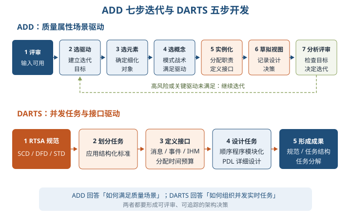

> 助记：ADD「审—驱—元—念—例—图—评」：评审输入、选驱动因子、选系统元素、选设计概念、实例化并定接口、草拟视图记录决策、分析评审是否再迭代。

DARTS 五步：RTSA 建立系统规范（SCD、DFD/CFD、STD）→划分并发任务→定义消息/事件/IHM 接口并分配时间预算→把每个任务作为顺序程序细化模块→形成 RTSA 规范、任务结构规范和任务分解。其优势是显式处理并发和接口；不足是任务仍按结构化方法拆成模块，且 RTSA 做不好会直接影响任务划分。

### 16.4 嵌入式系统软件架构案例分析

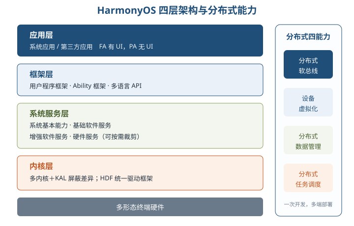

**HarmonyOS**：内核层（多内核、KAL、HDF）→系统服务层（四类子系统集，可按子系统/功能裁剪）→框架层（多语言框架、Ability 与 API）→应用层（系统/第三方应用）。⭐【重点】FA 有 UI，PA 无 UI、负责后台任务和数据访问抽象。

分布式四项能力：软总线负责发现、连接与传输；设备虚拟化融合资源形成超级虚拟终端；数据管理使数据跨设备衔接；任务调度依据设备能力、位置和负载选择执行设备。安全可概括为「正确的人—正确的设备—正确地使用数据」，结合协同认证、可信运行环境与数据分类分级。

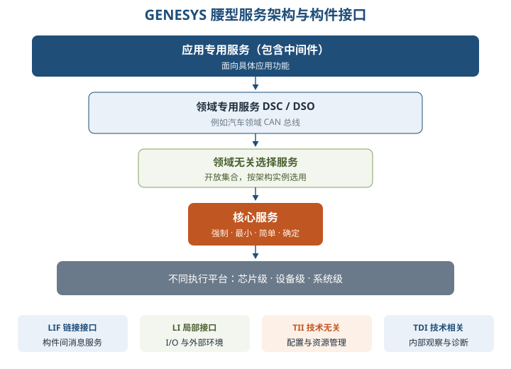

**GENESYS** 面向安全攸关、跨领域嵌入式系统，以「窄腰核心＋可选服务」控制复杂性：核心服务强制、最小、简单、确定，如全局时间和消息传输；选择服务开放扩展；领域专用服务如汽车 CAN；应用专用服务含中间件。

其关键思想是**计算与通信分离**，构件仅暴露接口，基本交往采用多播单向消息。四类接口：LIF 构件间综合服务、LI 本地 I/O 环境、TII 配置与资源管理、TDI 内部诊断。三级集成为芯片级、设备级、系统级；健壮性靠故障隔离、重启与复制，能效可通过构件迁移到 ASIC、功率门控和时间触发通信改善。

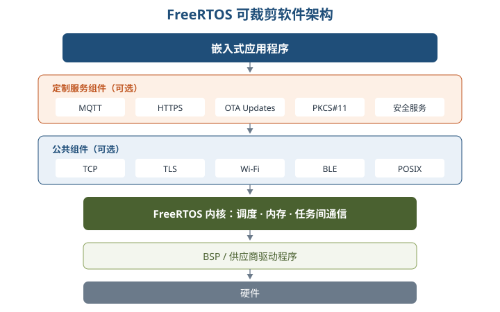

**FreeRTOS/物联网操作系统**：硬件→BSP 驱动→可剪裁内核→网络/安全/POSIX 组件→MQTT、HTTPS、OTA 等定制服务→应用。物联网操作系统还关注芯片、终端、边缘、云多层面，核心质量要求是内核与架构可伸缩、实时、高可靠、低功耗；低功耗可结合休眠、节能和降频设计。

## 三、重点与易错点

| # | 考点 | 必须记住的结论 | 易错提醒 |
| --- | --- | --- | --- |
| 1 | 处理器选型 | MCU 单片集成，DSP 面向信号算法，SoC 高集成 | MPU 不等于 MCU；DSP 不是通用 GPU |
| 2 | 温度等级 | 0～70、−40～85、−55～150℃ | 工业级下限是 −40℃，军用级上限是 150℃ |
| 3 | 存储器 | DRAM 刷新，SRAM 无需刷新；Flash 先擦后写且断电保留 | EEPROM 是电擦除，EPROM 是紫外线擦除 |
| 4 | 看门狗 | 正常喂狗，异常溢出并复位 | 看门狗不是任务调度器，也不能替代故障安全设计 |
| 5 | 层次模式 | 封闭型移植性好，开放型性能较好 | 「开放」不是无条件更优 |
| 6 | 宏/微内核 | 宏内核直接调用性能高；微内核消息通信、隔离扩展好 | 微内核并非所有服务都在内核态 |
| 7 | 任务三态 | 阻塞事件完成后进入就绪，不直接执行 | 不存在就绪直接到阻塞 |
| 8 | 调度分类 | 离在线、抢占性、静动态是三个维度 | RMS 是静态；EDF 是动态；二者不冲突于抢占维度 |
| 9 | 三种算法 | EDF 截止早，LLF 松弛小，RMS 周期短 | LLF 用剩余执行时间，不用原始总执行时间 |
| 10 | RMS 最优性 | 只在静态优先级算法范围内成立 | 利用率超上界只是不能由充分条件保证，不是必然失败 |
| 11 | 分页/分段 | 分页有页内碎片，分段有外部碎片 | 段页式不是「先分页再分段」 |
| 12 | 通信机制 | 管道空堵读、满堵写；Signals 异步；消息队列解耦 | 共享内存本身不自动保证互斥 |
| 13 | 嵌入式数据库 | 与应用同进程，经 API 访问；内存型利于时间预测 | 嵌入性不必然等于实时性 |
| 14 | 中间件 | PTP 对队列，Pub/Sub 对主题；DDS 以数据为中心且有 QoS | CORBA 的 ORB 与 DDS 的发布订阅不要混述 |
| 15 | 交叉开发 | 宿主机编译，目标机运行；驻留 Agent 在目标机 | 编译器运行位置与生成代码运行位置不同 |
| 16 | 三种设计方法 | ABSD 需求组合驱动，ADD 质量场景驱动，DARTS 并发任务驱动 | ADD 不是按功能列表分解；DARTS 不是调度算法 |
| 17 | HarmonyOS | 四层；FA 有 UI、PA 无 UI；分布式四能力 | KAL 屏蔽多内核差异，HDF 管驱动 |
| 18 | GENESYS | 核心服务最小且强制；计算通信分离；LIF/LI/TII/TDI 分工 | TII 管配置资源，TDI 才看内部诊断 |

## 四、练习与真题

以下为自编单选模拟题，答案集中在全章最后。

**1.** 某户外工业控制器要求 −30～70℃ 工作，并将处理器、存储器和外设尽量单片集成。最合理的组合是：
A. 民用级 MPU  B. 工业级 MCU  C. 军用级 GPU  D. 民用级 SoC

**2.** 关于存储器的说法，正确的是：
A. SRAM 必须周期性刷新  B. EPROM 采用电擦除  C. Flash 断电后数据丢失  D. DRAM 常利用电容存储电荷并需刷新

**3.** 某任务等待的 I/O 数据已经到达，该任务接下来应进入：
A. 执行态  B. 就绪态  C. 阻塞态  D. 终止态

**4.** 在 30ms 时，某任务截止时刻为 80ms，还需执行 20ms，其松弛度为：
A. 20ms  B. 30ms  C. 50ms  D. 70ms

**5.** 关于三种实时调度算法，下列对应关系正确的是：
A. EDF—周期最短优先  B. LLF—剩余松弛度最小优先  C. RMS—截止时刻最早优先  D. EDF—静态优先级不变

**6.** 关于 RMS 的说法，最严谨的是：
A. 是动态优先级算法  B. 周期越长优先级越高  C. 最优性限定于静态优先级调度  D. 超过利用率上界必然不可调度

**7.** 需要把一个无序单字节流从写任务传给读任务，并要求管道空时读阻塞、满时写阻塞，应选择：
A. Signals  B. 管道  C. 共享内存  D. Socket

**8.** 某离线终端希望无需独立数据库服务进程，直接把数据库库文件链接进应用，通过 API 使用 SQL。最合适的是：
A. SQLite  B. 远程 Oracle  C. 网络数据库同步服务器  D. CORBA

**9.** 多个订阅者需要按主题接收同类实时数据，并要求通过 QoS 控制可靠性、时限等分发策略，优先考虑：
A. DDS  B. 掩模 ROM  C. JTAG  D. 分页存储

**10.** 关于交叉开发环境，下列说法正确的是：
A. 编译器必须运行在目标机  B. 驻留层 Agent 通常运行在宿主机  C. 宿主机生成目标机可执行代码  D. 模拟器必须连接目标板 JTAG

**11.** 某安全攸关系统以可量化的可靠性、性能场景驱动架构递归分解，每轮选择架构模式和战术。该方法是：
A. ADD  B. DARTS  C. RMS  D. GOA

**12.** 关于本章案例，下列说法错误的是：
A. HarmonyOS 的 KAL 屏蔽多内核差异  B. GENESYS 强调计算与通信分离  C. FreeRTOS 内核和组件均可按需裁剪  D. GENESYS 的 TDI 用于构件配置和资源管理

## 五、疑问与查漏补缺

| 类型 | 发现与处理 |
| --- | --- |
| 大纲要求但教材未充分展开 | 大纲列「典型产品比较」，教材多按历史版本介绍；考试应以结构、实时性、定位为主，不把市场占有率和版本号当永恒结论。 |
| LLF 示例易误读 | 图16-12文字提取后的任务下标和若干时刻不清，且示例叙述存在跳转；复习时按 D−C′−t 自行画时间线，不死背图中数值。 |
| ADD 表格缺项 | 正文明确质量场景有六要素，但表16-4只列五项、未单列表述「环境」；答题仍按六要素完整书写。 |
| 教材表述待辨析 | 「嵌入式 Linux」被列为微内核示例易误导，通常 Linux 被视为宏内核；若题目严格按教材需结合上下文，工程论述应采用通行定义并说明版本语境。 |
| 图号/术语笔误 | DARTS 评价中把任务架构图写成 STD，通常 STD 指状态转换图，任务架构图应为 TAD；不要混淆。 |
| 与其他章衔接 | 第2章补存储与总线，第7章复习 ABSD，第8章复习质量属性和战术，第9章支撑可靠性/容错，第13章支撑层次架构，第15章连接 DDS 与 Pub/Sub，第18章支撑 TEE 与安全设计。 |
| 案例拓展 | 大纲另点明物联网操作系统软件架构，教材仅在16.4.3简述；需掌握「端—边—云」位置、可伸缩内核、实时、可靠、低功耗五项答题要点。 |

## 六、参考答案

**1.** B。工业级覆盖 −40～85℃，MCU 强调单片集成和低功耗、低成本。

**2.** D。DRAM 用电容保存电荷且需刷新；SRAM 无需刷新，EPROM 紫外线擦除，Flash 断电保留。

**3.** B。等待事件完成后只能先回就绪态，获得 CPU 后才进入执行态。

**4.** B。L＝D−C′−t＝80−20−30＝30ms。

**5.** B。LLF 选择松弛度最小者；EDF 看截止时刻且动态变化，RMS 看周期且为静态优先级。

**6.** C。RMS 的最优性只针对静态优先级算法，且周期短者优先；利用率上界是充分条件。

**7.** B。管道通常提供 FIFO 单向字节流，并具有空堵读、满堵写语义。

**8.** A。SQLite 是文件型嵌入式数据库，与应用同进程、经 API 访问，不需独立服务器。

**9.** A。DDS 采用以数据为中心的发布/订阅模型，并以丰富 QoS 支持实时分发。

**10.** C。交叉编译器在宿主机运行却生成目标机代码；驻留 Agent 在目标机，模拟器不必接 JTAG。

**11.** A。ADD 以质量属性场景驱动递归分解；DARTS 关注并发任务及接口，RMS 是调度算法。

**12.** D。GENESYS 中 TII 用于配置与资源管理，TDI 用于观察内部变量和诊断。
