# 第17章 通信系统架构设计理论与实践

- 教材位置：`02.系统架构设计师第二版-教材.pdf` PDF 第 607～640 页（书页 599～632）
- 复习状态：已完成
- 复习日期：2026-11-06
- 本章地位：通信系统是下午案例分析的重要主题，常以「园区网/广域网组网、高可用改造、IPv4 向 IPv6 演进」场景考查架构选型、协议部署与可用性计算；上午题则高频考查存储架构、SDN 接口、过渡技术等概念辨析。

## 一、大纲考点

大纲（书页 57～58）科目 2「系统架构设计案例分析」主题 7「通信系统架构的设计理论与实践」条目与教材小节对应如下：

| 大纲条目 | 大纲要求 | 教材对应小节 |
| --- | --- | --- |
| 7.1 通信系统的架构 | 局域网架构（单核心、双核心、环型、层次） | 17.2.1（图 17-1～17-4） |
| 7.1 通信系统的架构 | 局域网协议应用：主备 VRRP/HSRP/GLBP；二层 STP/LACP；三层 OSPF/RIP/BGP | 17.2.1 之「网络协议的应用」 |
| 7.1 通信系统的架构 | 广域网架构（单核心、双核心、环型、半冗余、对等子域、层次子域） | 17.2.2（图 17-5～17-10） |
| 7.1 通信系统的架构 | 移动通信网架构（5GS 与 DN 互连、5G 边缘计算等） | 17.2.3（N6、透明/非透明、MEC、SSC） |
| 7.1 通信系统的架构 | 存储网络架构（DAS、NAS、SAN） | 17.2.4 |
| 7.1 通信系统的架构 | 软件定义网络架构（SDN） | 17.2.5 |
| 7.2 网络构建的关键技术 | 网络高可用设计（定义、架构和协议配置） | 17.3.1（A 公式、五种互连拓扑） |
| 7.2 网络构建的关键技术 | IPv4 与 IPv6 融合组网（双协议栈、隧道、地址翻译） | 17.3.2 |
| 7.2 网络构建的关键技术 | SDN 技术 | 17.3.3（控制/数据平面、一致性更新） |
| 7.3 网络构建和设计方法 | 网络需求分析步骤（业务、用户、计算机平台、网络需求） | 17.4.1（教材另含「应用需求」，共 5 项） |
| 7.3 网络构建和设计方法 | 网络技术遴选（局域、广域、地址规划、路由协议、层次化模型、高可用设计） | 17.4.2 |
| 7.3 网络构建和设计方法 | 绿色网络设计方法（目的、作用和设计原则） | 17.4.4 |
| 7.4 网络安全相关技术 | 防火墙布设、VPN、访问控制、安全隔离、安全协议（SSL/SET/HTTPS） | 17.4.3 |
| 7.5 案例分析 | 高可用网络构建分析、园区网双栈构建分析、5G 网络应用 | 17.5.1～17.5.3 |

**下午案例题考查形式**：给出某单位组网场景（如园区网改造、两地三中心互连、IPv6 升级），设置若干小问题，典型问法：①为场景选择合适的网络架构（单/双核心、环型、层次、半冗余等）并说明理由；②指出方案单点故障并给出高可用改进（冗余拓扑、VRRP/STP/LACP/OSPF 部署位置）；③计算某种互连方式的可用性或比较可靠性/可用性；④选择 IPv4→IPv6 过渡技术（双栈/隧道/翻译）并说明适用条件；⑤NAS 与 SAN、SDN 南北向接口等概念辨析填空。答题套路是「架构/协议名称 + 一句话特征 + 结合场景的收益或代价」。

## 二、知识点笔记

### 17.1 通信系统概述

- **通信系统（通信网络）**：利用通信线路把地理上分散、独立功能的计算机系统和通信设备连接起来，依靠网络软件及通信协议实现**资源共享和信息传递**的系统。演进趋势（了解）：接入侧从拨号到光纤/无线/5G，核心接口从 GE/10GE 到 40GE/100GE/400GE，结构异构多层次化，移动网元走向**虚拟化、服务化**。

### 17.2 通信系统网络架构

#### 17.2.1 局域网网络架构 ⭐【重点】

- **局域网特点**：覆盖范围小（通常 2.5km 内）、速率高（10Mb/s 以上，典型 1G/10G）、误码率低可靠性高、单一机构所有；拓扑有总线型、环型、星型、树型；由计算机、交换机、路由器等组成，从二层交换发展到「二层交换+三层路由」。现代局域网多用于园区网构建，某种意义上**局域网也称园区网**。

四种典型架构对比（⭐【高频考点】，案例题常要求按场景选型）：

| 架构 | 结构要点 | 优点 | 不足 |
| --- | --- | --- | --- |
| 单核心 | 一台核心（二层/三层）+ 若干接入交换机 | 结构简单、省投资、部门接入方便 | 核心**单点故障**；地理范围受限；扩展有限；核心端口密度要求高 |
| 双核心 | 两台核心互连，接入双归属，服务器同时接两台核心 | 网关保护/负载均衡、业务路由热切换、多路径可靠性高 | 投资比单核心高；端口密度要求高 |
| 环型 | 多台核心构成**双 RPR 弹性分组环** | MAC 层 **50ms 自愈**；双向双光纤省资源；空间重用带宽利用率高；多等级 QoS | 投资高；冗余设计难、易成环；**多环之间只能经业务接口互通**，不能直接网络互通 |
| 层次（多层） | 核心层 + 汇聚层 + 接入层 + 用户设备 | 核心高速转发、汇聚互访控制并减轻核心压力、接入用户；易扩展、故障分级排查 | 层次多会带来时延，需控制层数 |

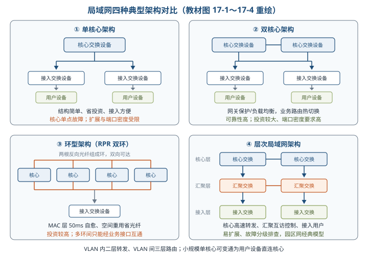

- VLAN 规则：核心用三层及以上交换机时可划分 VLAN，**VLAN 内二层转发、VLAN 间三层路由**；接入设备用二层交换机仅做二层转发；小规模单核心网可让用户设备直连核心省成本。局域网经边界路由器/防火墙接入广域网，实现跨网业务访问。

**网络协议的应用**⭐【高频考点】（按「用在哪一层、解决什么问题」记）：

| 应用位置 | 协议 | 作用 |
| --- | --- | --- |
| 互为主备的交换/路由设备之间 | VRRP、HSRP、GLBP | 网关冗余保护（HSRP/GLBP 为思科私有，GLBP 兼负载均衡） |
| 二层网络多链路保护/带宽扩展 | STP、LACP | STP 防环路；LACP 链路聚合扩带宽 |
| 三层设备动态路由 | OSPF、RIP、BGP | OSPF 链路状态（域内主流）；RIP 距离矢量；BGP 域间 |

> 助记：「主备 V 哈 G（VRRP/HSRP/GLBP），二层 S 加 L（STP/LACP），三层 O  R  B（OSPF/RIP/BGP）」。

#### 17.2.2 广域网网络架构 ⭐【重点】

- **组成**：广域网 = 通信子网 + 资源子网，通信子网可用公用分组交换网、卫星通信网、无线分组交换网构建。**多级结构**：通常由**骨干网、分布网、接入网**三级组成，规模较小时可仅骨干网+接入网。举例：省银行广域网——骨干网提供全行高速可靠通信，分布网负责数据中心与分行/支行数据交换和长途复用，接入网负责网点终端接入。

六种构建模型（能根据描述识别架构名称）：

| 架构 | 识别要点 | 主要优缺点 |
| --- | --- | --- |
| 单核心 | 一台核心路由设备 + 各局域网，局域网间访问必经核心 | 简单省投资、互访效率高；核心单点故障、扩展差 |
| 双核心 | 两台核心互连，局域网间访问经两台核心 | 多路径、热切换、可靠性高；投资高、易成路由环路 |
| 环型 | **三台以上**核心路由器构成路由环路 | 多路径、无缝热切换；占端口多、投资比双核心高 |
| 半冗余 | 多台核心网状互连，**任意核心至少两条以上链路**到其他设备；任意两核心均互连则为其特例**全冗余** | 结构灵活、多路径、适合部署 OSPF；结构零散、不便管理排障 |
| 对等子域 | 路由设备划分为**两个独立子域**，域内半冗余、域间一条或多条链路互连 | 域间路由汇总/明细匹配控制灵活；**域间链路带宽应高于域内**；适合可明显划分为两个区域且内部访问独立的场景 |
| 层次子域 | 多个子域存在**层次关系**，高层次子域连接多个低层次子域 | 扩展性好；**低层子域互访须经高层子域**；域边界路由性能要求高 |

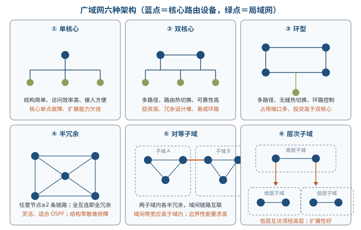

> 助记：「单双环半对层」——单核心、双核心、环型、半冗余、对等子域、层次子域；「对等两域平起平坐，层次低域必经高域」。

#### 17.2.3 移动通信网网络架构 ⭐【重点】

**1. 5GS 与 DN 互连**

- 5GS（5G System）为 UE 提供服务时通常要与 DN（Data Network，如 Internet、IMS、专网）互连；**UPF（用户面功能）网元是 DN 的接入点，5GS 与 DN 之间通过 N6 接口互连**⭐【高频考点】。
- 从 DN 看 UPF 是普通路由器，5GS 与 DN 之间是**路由关系**：UL（上行）＝UE→DN，经 UPF 上配置的路由转发；DL（下行）＝DN→UE，经与 UPF 邻近路由器上的路由转发至 UPF。5G 网络功能实体还有 AMF/SMF/PCF/NRF/NSSF 等。

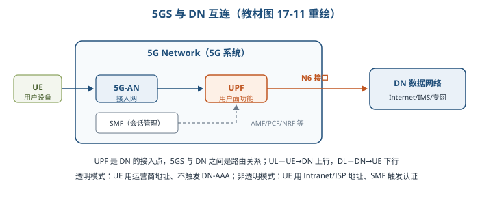

UE 接入 DN 的两种模式⭐【高频考点】【易错】：

| 对比项 | 透明模式 | 非透明模式 |
| --- | --- | --- |
| 接入路径 | UPF 经 N6 直连运营商特定 IP 网络，再经防火墙/代理到外部 DN | 直接接入 Intranet/ISP，或经 Internet 等其他 IP 网络间接接入（UPF 与 Intranet/ISP 间建专用隧道） |
| UE 地址 | **运营商规划的地址空间** | **Intranet/ISP 地址空间**，用于业务在 UPF、Intranet/ISP 中转发 |
| 认证 | 通常**不触发**外部 DN-AAA 认证 | SMF 通常向外部 **DN-AAA**（Radius/Diameter）发起认证，成功后才完成会话建立 |
| 服务要求 | 5GS 只须提供基本隧道 QoS 流服务，UE 级配置对 5GS 透明 | 安全协议由运营商与 Intranet/ISP 提供商协商，即使经过不安全的 Internet 也无妨 |

**2. 5G 网络边缘计算（MEC）**

- 5G 倡导以用户为中心、注重 QoE（体验质量）；MEC 在**靠近 UE 的移动网络边缘部署 UPF**，并结合边缘计算平台 MEP，为垂直行业提供**时间敏感、高带宽业务的就近分流**，既提升体验又降低后端压力。
- 策略生成链：运营商/第三方 **AF → NEF（能力开放）→ PCF（策略控制）→ SMF**；SMF 根据用户位置变化**动态插入/移除边缘 UPF** 并配置分流规则⭐。
- **SSC（会话与服务连续性）三种模式**【易错】：模式 1＝移动中会话 IP 接入点**始终不变**；模式 2＝**先释放旧会话、立即再建新会话**（先断后建）；模式 3＝**先建新会话、再释放旧会话**（先建后断）。

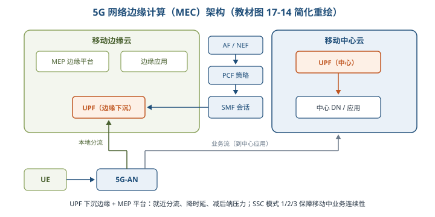

举例：MEC 就像把「快递分拣站」建到小区门口——包裹（数据）不用先运回市中心总站（中心云）再折返，楼下就能分发，所以快且省运力；SSC 模式 3 则像搬家「先入住新房再退旧房」，业务不中断。

#### 17.2.4 存储网络架构 ⭐【重点】【高频考点】

计算机访问磁盘存储的 3 种方式：

| 对比项 | DAS 直连式存储 | NAS 网络连接存储 | SAN 存储区域网络 |
| --- | --- | --- | --- |
| 访问方式 | 通过 I/O 端口直接访问存储设备 | 通过**分布式文件系统**访问 | 通过构建的**独立存储网络**访问 |
| 粒度 | 块级（逻辑数据块读写） | **文件级** | **块级**（LDU 逻辑磁盘单元，服务器分区格式化后像本地盘使用） |
| 连接 | I/O 总线（IDE/ATA 等） | 以太网（LAN/WAN/5G），RPC 远程过程调用（TCP/UDP） | 专用高速网络，**用存储协议而非网络协议**连接 |
| 协议 | 总线 I/O 指令 | **CIFS/SMB（Windows）、NFS（UNIX/Linux）** | FCP、iSCSI、FCoE、FC-NVMe |
| 特点 | 简单直连，共享扩展差 | 注重**易用、易管理、可扩展、低 TCO**，访问效率性能相对较差 | 注重**高性能、低延迟**；消除单点故障、高可用；适合高吞吐业务关键型应用 |

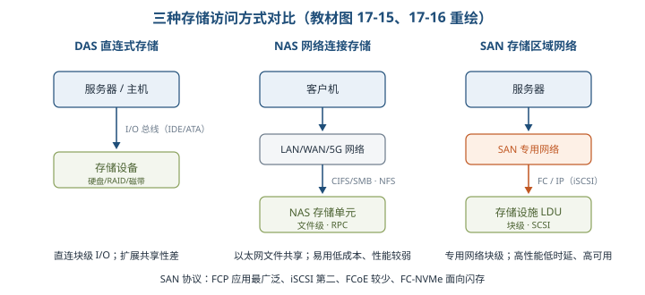

- **FC-SAN** 通过光纤通道协议转发 SCSI，**IP-SAN** 通过 TCP 协议转发 SCSI【易错】。SAN 四种协议：①**FCP（光纤通道协议）应用最广泛**，嵌入式 SCSI 命令；②**iSCSI 第二大**，SCSI 命令封装在以太网帧内经 IP 传输；③FCoE 应用较少，FC 帧封装在以太网数据报中经 IP 传输；④FC-NVMe 通过 PCIe 总线访问闪存，支持多并行队列与并发命令。
- 共同点：NAS 与 SAN 都可集中管理存储、供多主机共享；SAN 典型应用于 ISP、银行等存储量大的场景，5G 网元「业务处理与数据存储分离」架构中用 SAN 避免故障切换后业务数据丢失。

> 助记：「NAS 文件级走以太（NFS/CIFS），SAN 块级走专网（FC/iSCSI），DAS 直连总线最省事」。

#### 17.2.5 软件定义网络架构 ⭐【重点】【高频考点】

> 教材原文：软件定义网络（SDN）的核心思想是通过对网络设备的控制面与数据面进行分离，控制面集中化管控，同时对外提供开放的可编程接口；而数据面则通用化、轻量化，高效转发，以提升网络的整体运行效能。

- 由斯坦福大学 Clean State 课题组提出；控制层掌握全局信息、方便配置网络部署新协议；数据层是**哑交换机**，只按规则快速转发；两层间用开放统一接口（如 OpenFlow）交互，控制器下发标准转发规则。价值：降低转发设备复杂度与运营成本、打破传统设备封闭性。

三平面与接口（方向题高频）：

| 平面/接口 | 位置 | 职责 |
| --- | --- | --- |
| 应用平面 | 最上 | 各种 SDN 网络应用，无须关心底层细节即可编程部署 |
| **北向接口 NBI** | 应用平面与控制平面之间 | 对应用开放，允许定制开发网络管理应用，调用网络资源快速配置部署 |
| 控制平面 | 中间 | 逻辑上集中的 SDN 控制器，掌握全局信息、下发转发规则 |
| **南向接口 SBI** | 控制平面与数据平面之间 | 统一通信标准，把控制器转发规则下发至转发设备；**OpenFlow 是最主流南向协议** |
| 数据平面 | 最下 | 通用硬件转发设备，设备间由不同规则形成 SDN 数据通路 |
| **东西向接口** | 多控制器之间 | 使控制器可扩展，支撑负载均衡与性能提升 |

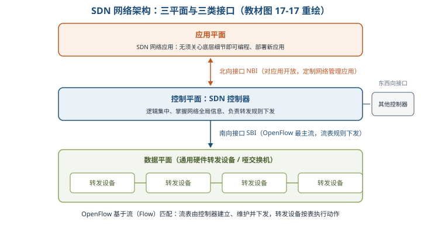

- **OpenFlow 最基本特点是基于流（Flow）匹配转发规则**：每个转发设备维护**流表**，按流表转发；**流表的建立、维护和下发都由控制器完成**⭐。

举例：SDN 像「导航打车」——司机（哑交换机）不再自己认路，只按平台（控制器）下发的路线（流表）开车；平台统一掌握全城路况（全局信息），第三方还能通过开放接口（北向）开发新的用车应用。

### 17.3 网络构建关键技术

#### 17.3.1 网络高可用设计 ⭐【重点】【高频考点】

- 衡量高可用的两个指标：**故障次数少 + 故障恢复时间短**。可用性公式：

> 教材原文：A = MTBF / (MTBF + MTTR)。MTBF 为平均无故障时间，MTTR 为平均故障修复时间。

- MTBF 取决于设备软硬件质量，提升总有限度，不能一味靠提高 MTBF；**减少 MTTR 也是有效途径**：一是快速发现故障，二是快速从故障恢复。
- 高可用是系统级概念，从三方面入手：
  1. **网络部件**：硬件高可用（主控 1+1 主备冗余、业务结点热插拔、电源风扇冗余）；软件高可用（热补丁、异常保护、数据冗余备份）。
  2. **网络连接模型**：五种互连拓扑可用性（设 NE1、NE2 在线率分别为 R1、R2）。
  3. **网络协议及配置**：基本路由 OSPF/BGP + 链路检测 **BFD/NQA** 缩短故障发现时间；另有 802.3ad（链路聚合）、VRRP、路由多下一跳等。

五种互连拓扑可用性公式⭐【高频考点】【易错】：

| 拓扑 | 别名 | 可用性公式 | 理解 |
| --- | --- | --- | --- |
| 一对一 | 单点单归 | A1 = R1×R2 | 串联：两者都正常才行 |
| 一对二 | 单点双归 | A2 = R2×[1-(1-R1)²] | 单个 NE2 直接乘，两个 NE1 并联 |
| 二对一 | 双点单归 | A3 = R1×[1-(1-R2)²] | 单个 NE1 直接乘，两个 NE2 并联 |
| 双一对一 | 双点双归 | A4 = 1-(1-R1×R2)² | 两条「R1×R2 链路」并联 |
| 双一对二 | 双归属 | A5 = [1-(1-R1)²]×[1-(1-R2)²] | 两侧各自冗余后串联 |

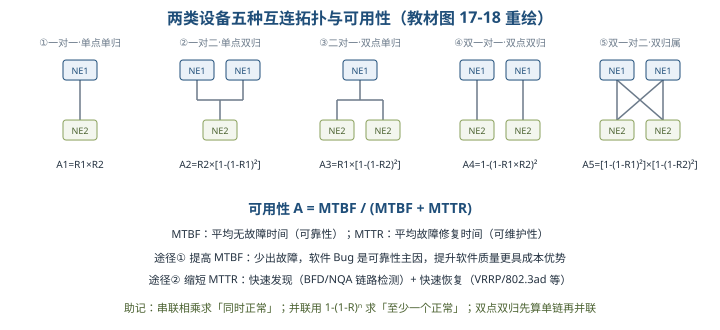

> 助记：「串联相乘、并联 1 减（1-R）ⁿ；哪类设备只有一个，就把它的 R 单独乘」。

#### 17.3.2 IPv4 与 IPv6 融合组网技术 ⭐【重点】【高频考点】

- 背景：IANA 于 2016 年建议新标准只支持 IPv6；我国 2017 年印发《推进 IPv6 规模部署行动计划》。IPv4 投资巨大、应用众多，存在较长**过渡期/共存期**，形成三种过渡技术：**双协议栈、隧道技术、地址翻译机制**。

| 技术 | 原理一句话 | 关键点/适用 |
| --- | --- | --- |
| 双协议栈 | 节点同时具有 IPv4 和 IPv6 两个协议栈，同一物理平台、共承 TCP/UDP | 既能与 v4 节点也能与 v6 节点通信；园区网双栈改造主流 |
| ISATAP 隧道 | IPv6 报文封装在 IPv4 中传送，把 IPv4 网当作 NBMA 数据链路层 | **主机间**自动隧道：IPv4 地址嵌入 IPv6 地址，通信时自动抽取建隧；无需特殊网络设备，IPv4 可达即可 |
| 6to4 隧道 | **站点间** IPv6 通信，站点出口部署 6to4 路由器 | 地址前缀 **2002:**，路由器 IPv4 地址嵌入 IPv6 前缀；需**全局合法 IPv4 地址**，不能缓解 v4 地址短缺，但无需申请 v6 地址即可快速升级 |
| 6over4 隧道 | 双栈节点在**组播使能的 IPv4 网络**中传 IPv6 分组 | 在承载网建立虚拟数据链路层（虚拟以太网） |
| 4over6 隧道 | 通信节点用 IPv4 业务交互，实际**承载在 IPv6 网络**上 | 面向纯 IPv6 主干过渡，最大程度继承 v4 应用 |
| 地址翻译 NAT | 维护 IPv4 与 IPv6 地址映射表，内/外部地址互相转换 | 涉及 **NAT-PT（RFC2766）、SIIT（RFC2765）** |

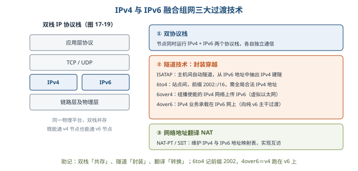

> 助记：「I 主机、6to4 站点、6over4 靠组播、4over6 反着跑」——ISATAP 用于主机间；6to4 用于站点间且记前缀 2002；6over4 依赖 IPv4 组播；4over6 是 v4 业务跑在 v6 上。

#### 17.3.3 SDN 技术

- **控制平面技术**：单一控制器性能扩展——NOX-MT（多线程）、Maestro（并行处理架构，发挥多核能力）；多控制器扩展两种模型——**扁平控制模型、层次控制模型**。
- **数据平面技术**：①硬件处理速度快但灵活性差，灵活化技术有 **RMT（可重配置匹配表，支持任意宽度深度流表）**、FlowAdapter（交换机分层实现多表流水线）；②软件处理慢但灵活，用交换机 CPU 或 NP 处理规则，**NP（网络处理器）专门处理网络任务，性能优于 CPU**。
- **转发规则一致性更新**：不同设备规则更新可能不一致，一般采用「**两段提交**」——先询问各交换机旧规则的流是否处理完，确认后统一更新，全部完成才算成功，否则撤销；缺点是需等旧流处理完、规则空间被占用。**增量式一致性更新算法**把更新分多轮、每轮对子集做两段提交，折中节省规则空间与更新时间。

### 17.4 网络构建和设计方法

#### 17.4.1 网络需求分析 ⭐【重点】

- 需求分析是网络构建的**起始环节**，作用：更准确评价现有网络、客观做出建网决策、功能更贴近用户、便于功能移植、合理使用用户资源。
- 围绕**五个方面**开展（教材 5 项，大纲列 4 项，考试以教材为准）：

| 需求 | 主要工作 | 输出物 |
| --- | --- | --- |
| 业务需求 | 确定干系人、关键时间点、投资规模；明确业务活动、预测增长率；确定可靠性/可用性/安全性/远程访问指标 | 业务需求清单 |
| 用户需求 | 观察、问卷调查、集中访谈、采访关键干系人；从碎片化模糊描述中提取真实需要；需求归档 | 用户服务表 |
| 应用需求 | 应用类型和地点、使用方法、需求增长性、可靠性可用性、响应时间；量化指标 | 应用需求表 |
| 计算机平台需求 | 明晰接入设备类型：PC、工作站、小型机、中型机、大型机 | 设备类型需求表 |
| 网络需求 | 考虑**网络管理员需求**：局域网功能、拓扑、性能、网络管理、安全、城域/广域连接方案 | 网络需求分项需求表 |

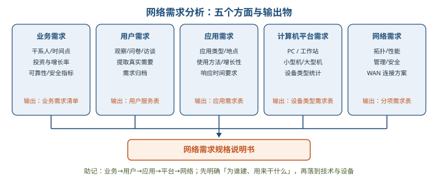

- 五项分析最终形成**网络需求规格说明书**，约束后续网络设计。

#### 17.4.2 网络技术遴选及设计 ⭐【重点】

**1. 局域网技术遴选**

- **STP**：冗余/可扩展结构易成环路，二层交换机上用 STP 防环，IEEE 802 系列有 .1d/.1w/.1s 等版本。**VLAN**：把一个物理网络划分为若干相互隔离的逻辑网络，形成不同**广播域**，实现部门/用途间访问隔离。
- **无线局域网设计四要点**：①定位 AP 实现最大覆盖率；②无线虚拟网规划（尽量所有无线接入设备划入同一虚拟网）；③冗余 AP 布放（一区多 AP 覆盖，故障接替）；④**同一园区所有 AP 设置同一 SSID**。
- **线路冗余两种方式**【易错】：**备份方式**用 STP 防环，提升可用性但冗余链路闲置、浪费资源；**负荷分担方式**设置均衡策略让业务分担到不同链路，避免闲置。
- 交换设备特殊功能：链路聚合、冗余网关、以太网供电（PoE）、多业务模块等。
- **服务器冗余/负载均衡四种方式**⭐：

| 方式 | 原理一句话 |
| --- | --- |
| 负载均衡器 | 前置负载均衡设备把服务请求均衡分发到各业务服务器 |
| 网络地址转换 | 负载均衡 NAT 网关把外部请求地址转换为多个内部服务器地址 |
| DNS 服务器 | 一组服务器（不同 IP）映射同一域名，DNS **循环返回**地址实现均衡 |
| 高可用技术 | 双机热备（高可用集群）：**单活 Active-Standby（一主一备）/ 双活 Active-Active** |

**2. 广域网技术遴选**

- 远程接入技术：PSTN、ISDN、电缆调制解调器、DSL、PON（无源光网络）、无线宽带、小区宽带、PLC（电力通信）等，按现有网络、业务需求、费用取舍。广域网互连技术：**DDN（数字数据网）、SDH（同步数字体系）、MSTP（多业务传送平台）、VPN**；性能优化可用预留带宽、数据压缩、链路聚合、优先级排序、基于协议带宽预留等。

**3. 地址规划模型（5 原则）**：①结构化（层次化）编址；②中心授权机构统一管理全局编址模型；③编址授权下发给分支机构；④移动终端用户指派**动态地址**；⑤合理使用**私有地址**（内部互访安全，访问外网需 NAT 并规划地址池）。合理地址规划便于网络管理，也有利于**路由协议收敛**。

**4. 路由协议选择**：类型（距离矢量/链路状态）、度量值设置、协议顺序、层次化与非层次化、内部与外部、分类与无类、静态路由指定。

**5. 层次化网络模型设计**⭐【高频考点】

- 优点：各层只考虑自身功能、成本最低；利用成熟模块化设备、利于稳定；需求变化时更易演化。层次局域网、层次子域广域网即其在局域网/广域网的应用，是园区网经典模型。

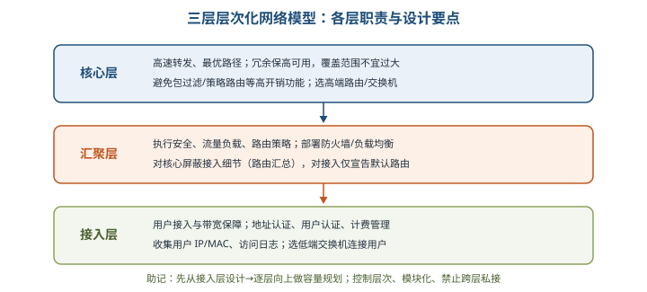

- 设计原则：①控制网络层次，避免性能下降、时延增加；②**首先从接入层设计**，据流量负荷行为逐层向上做容量规划；③模块化实现各层功能、边界清晰；④接入层严格控制网络结构，防止用户绕道获取非法带宽；⑤严格控制层次结构，**避免跨层加入额外连接**导致非法访问或异常。

**6. 网络高可用设计方法**⭐【易错】

- **可靠性**：连续无故障运行时间长短；**可用性**：较长时间里可用时间的长短。
- 教材极端例子：可靠性很高（稳定运行 10 年）但故障后恢复要 1 年 → 可用性仅 **90%**；可靠性差（平均 10 秒异常一次）但 1ms 恢复 → 可用性 **99.99%**。可见**高可靠 ≠ 高可用**。
- 两条途径：提高可靠性（**软件 Bug 是影响可靠性最主要因素**，提高软件质量比换更可靠硬件更具成本优势）；缩短恢复时间（秒级甚至毫秒级恢复）。核心思想：合理组网+冗余备份、自动检测、快速恢复并权衡成本，**不是简单叠加和无限制冗余**；网络层次越高影响面越广、可靠性可用性要求越高，分层解决不同级别问题。

#### 17.4.3 网络安全

| 技术 | 要点 |
| --- | --- |
| 恶意代码 | 共性：**目的恶意、形态为计算机程序、通过执行发生作用**；种类含病毒、蠕虫、木马、后门、DDoS 程序、僵尸进程、Rootkit、间谍/广告软件等 |
| 防火墙布设 | 网络间安全屏障，允许/拒绝/重定向数据流并审计；技术分**包过滤型、应用层网关、代理服务型**；体系结构分**双重宿主机、被屏蔽主机、被屏蔽子网** |
| VPN | 利用公共网络建立私有专用网络，数据经**安全加密通道**传送；省成本、便远程、易扩展；主要技术 **IPSec、GRE、MPLS VPN、VPDN** |
| 访问控制 | 主体依据策略/权限对客体授权访问；涉及**认证、控制策略实现、审计**三环节；实现有访问控制矩阵/表、能力表；模型有自主型、强制型、基于角色/任务/对象 |
| 网络安全隔离 | 把攻击隔离在可信网络之外且防信息外泄；分**子网隔离、VLAN 隔离、逻辑隔离、物理隔离** |
| 安全协议 | **SSL**：网景提出，位于应用层与 TCP/IP 之间，提供加密/认证/完整性，含**记录、告警、握手**三协议；**SET**：VISA/MasterCard 等推出，解决信用卡支付交易安全；**HTTPS**：基于 SSL/TLS 的 HTTP，需电子证书完成双向身份认证 |
| 安全审计 | 测试评估分析网络脆弱性；功能含自动响应、数据生成、分析、浏览、事件存储与选择 |

#### 17.4.4 绿色网络设计方法

- 思路：不仅设备节能，更要**方案级架构优化**，可能带来节能环保质的飞跃；设备侧遵循全生命周期「精简、重用、回收」设计。
- **四大设计原则**⭐【高频考点】：**标准化**（减少异构转换设备与能耗、兼容已有资源）、**集成化**（大容量高密度端口、减少层级与设备数量、集成板卡、扁平化）、**虚拟化**（设备虚拟化 + 端到端方案级虚拟化、IT 资源化）、**智能化**（统一管理、故障诊断网络自愈、减少人力与资源占用）。四原则外还需兼顾**安全性、可靠性**两指标；方案级效率优化对绿色的意义往往比设备级降耗更大。

> 助记：「标集虚智，安全可靠」——标准化、集成化、虚拟化、智能化，外加安全性、可靠性。

### 17.5 通信网络构建案例分析

#### 17.5.1 高可用网络构建分析 ⭐【重点】【高频考点】

- 可靠性靠各部件稳定连续服务（提升每个部件稳定性即可）；**可用性需各部件协同、冗余备份**，依赖复杂网络连接保证。典型高可用组网：核心层双设备、汇聚层双设备（FW/LB 等）、接入层双设备 + 服务器 NIC Teaming 集群/刀片服务器 +Switch。
- **接入层高可用特征**：冗余引擎/电源；与汇聚双归属获默认网关冗余、快速切换；链路汇聚提带宽；802.1x、动态 ARP 检查、IP 源地址保护增安全。
- **接入—汇聚四种组网模型**（表 17-1 对比，案例题常让选模型并说明理由）：

| 模型 | 二层链路特征 | 优点 | 缺点 |
| --- | --- | --- | --- |
| 一：倒 U 形 | 汇聚间二层链路，接入单上联 | 无环路不启用 STP、管理简单；VLAN 可跨汇聚、二层扩展灵活 | 汇聚故障→同侧接入用户不可达，无法高可用接入 |
| 二：U 形 | 接入间二层链路（传 VRRP 心跳），接入单上联 | 无环路不启用 STP；接入与汇聚间有冗余链路保护 | VLAN 不能跨汇聚、部署不灵活；接入间链路故障→VRRP 心跳无法传递、网络不稳定 |
| 三：矩形 | 接入间、接入汇聚间、汇聚间均二层互联（矩形环路） | 接入汇聚冗余链路保护；VLAN 可跨汇聚 | 有环路启用 STP；接入上行故障时流量全走另一侧，收敛比变小、易拥塞 |
| 四：三角形 | 汇聚间链路 + 接入双上联 | 冗余链路+冗余路径保护；VLAN 可跨汇聚、部署灵活 | 有环路启用 STP，生成树计算较矩形复杂 |

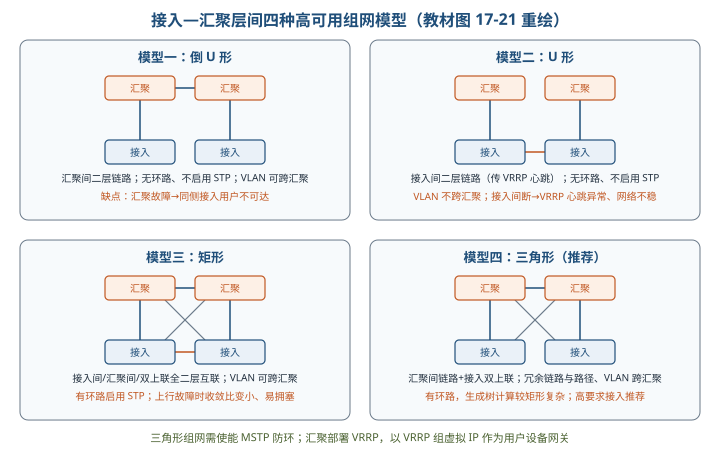

- **高要求设备接入推荐模型四（三角形）**：需使能 **MSTP（多生成树）** 防环；汇聚（或其 L4/L7 设备）部署 **VRRP**，以 VRRP 组虚拟 IP 作为用户网关。
- **汇聚—核心**：运行 OSPF 等动态路由保障路由层高可用；三角形连接（全冗余链路）故障收敛时间小但占端口多、成本高；矩形连接为非全冗余，靠路由协议重算路径。汇聚层部署 FW（三层路由模式做用户网关、攻击防御）与 LB（**单臂旁挂**，负载均衡 + 源目的地址变换），FW/LB 双机各跑 VRRP，汇聚交换机间配 Trunk 放通相关 VLAN。
- **核心层**：双核心/多核心主备或负荷分担；主控电源冗余、分布式转发；尽量**冗余点到点层 3 互连**，层 3 优于层 2（收敛更快、邻接关系更少、可用 ECMP 提高带宽利用率）。
- **高可用主要性能指标**⭐【高频考点】【易错】（记数字）：

| 指标 | 要求 |
| --- | --- |
| 核心层设备故障恢复时间 | **<500ms** |
| 汇聚层设备故障恢复时间 | **<1s** |
| 核心、汇聚设备双主控切换时间 | **<200ms** |
| 核心-汇聚、接入-汇聚链路故障恢复时间 | **<500ms** |
| 链路聚合故障恢复时间 | **<1s** |

> 助记：「核 500、汇 1 秒、主控 200、链路 500、聚合 1 秒」。

#### 17.5.2 园区网双栈构建分析

- **升级流程 5 步**：①制订网络设备升级计划；②评估现网设备对 IPv6 支持情况；③评估需升级至双栈的网络服务；④制定 IPv6 地址分配方案；⑤制定详细 IPv6 网络升级方案。双栈构建后逐步演进到纯 IPv6。
- **骨干网构建思路**：分层建网，重点关注核心/汇聚层 IPv6 部署——核心汇聚用**双栈交换机**；接入层沿用现有二层交换机或把不支持 IPv6 的三层交换机**降为二层使用**以保护投资。**IPv4/IPv6 网关均布设在汇聚三层交换机**上，同时运行两族路由协议；汇聚-核心、接入-汇聚均双归链路上联；汇聚跑 VRRP 做网关冗余，核心双活。
- **隧道选用**：预算/技术受限无法双栈时，可部署用户端到出口路由器的自动隧道（如 **ISATAP**）接入纯 IPv6 用户；大量 IPv6 用户时可**增加隧道端节点路由器数量**解决性能瓶颈。隧道部署保护投资、原拓扑路由几乎无需调整。
- **IP 地址规划 3 原则**：①地址资源全网统一分配；②分层划分（每个物理区域尽量连续地址空间），简化路由表；③考虑演进预留量、提高地址利用率。

#### 17.5.3 5G 网络应用

- 5G 特点：**高带宽、大连接、低时延、高可靠**，支撑物联网、远程控制、VR、工厂闭环控制、移动医疗、多媒体优先服务（MPS）等。智能电网架构：电源侧（新能源/传统电源智能感知）、电网侧（输变电/配用电）、用户侧（电表/电动汽车/储能）海量设备经 **5G 网络**接入 **IoT 平台**（数据采集、AI 训练推理、电网监控、边缘计算），支撑输电/配电/综合能源管理等高级应用决策。

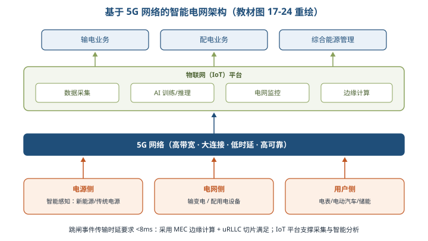

- 苛刻时延需求：任何两个通信点之间**跳闸事件传输时延应小于 8ms**⭐，采用 **MEC 边缘计算 + uRLLC 切片**技术满足。

## 三、重点与易错点

| # | 考点 | 必须记住的结论 | 易错提醒 |
| --- | --- | --- | --- |
| 1 | 局域网四架构 | 单核心省投资有单点故障；双核心热切换；环型 RPR **50ms 自愈**；层次易扩展 | 双核心是「VLAN 间访问经两台核心」，接入仅二层转发；RPR **多环间只能经业务接口互通** |
| 2 | 局域网协议 | 主备 VRRP/HSRP/GLBP；二层 STP/LACP；三层 OSPF/RIP/BGP | LACP 是链路聚合不是防环；防环靠 STP |
| 3 | 广域网六架构 | 半冗余＝任意核心≥2 条链路；全冗余是其特例 | 对等子域两域平等；层次子域**低层互访必经高层**，勿混淆 |
| 4 | 5GS 与 DN | **UPF 是 DN 接入点，N6 接口互连**，二者为路由关系 | UL＝UE→DN；DL＝DN→UE，方向别记反 |
| 5 | 透明/非透明接入 | 透明用运营商地址、不触发 DN-AAA；非透明用 Intranet/ISP 地址、SMF 触发 DN-AAA 认证 | 「透明」指对 5GS 透明，不是对 DN 透明 |
| 6 | MEC 与 SSC | AF→NEF→PCF→SMF 动态插入/移除边缘 UPF；MEC=UPF 下沉+MEP | SSC 模式 2 先断后建、模式 3 **先建后断**、模式 1 接入点不变 |
| 7 | DAS/NAS/SAN | NAS 文件级走以太网（NFS/CIFS）；SAN 块级走专网传 SCSI；**FCP 最广泛、iSCSI 第二** | NAS 重易用低 TCO，SAN 重高性能低延迟；FC-SAN 光纤通道转 SCSI、IP-SAN 走 TCP 转 SCSI |
| 8 | SDN 三接口 | 南向 SBI 下发规则（OpenFlow 最主流）；北向 NBI 对应用开放；东西向多控制器互联 | 「南北以控制器为参照」：下南上北；流表由控制器建立维护下发 |
| 9 | 可用性公式 | A=MTBF/(MTBF+MTTR)；提高 MTBF、缩短 MTTR 两途径 | **软件 Bug 是可靠性最主要因素**；高可靠≠高可用（10 年修 1 年仅 90%） |
| 10 | 五拓扑可用性 | 串联相乘、并联 1-(1-R)ⁿ；双点双归 A4=1-(1-R1R2)² | A2/A3 易混：**只有一台的那类设备，其 R 单独相乘** |
| 11 | 四种隧道 | ISATAP 主机间自动抽取；6to4 站点间前缀 2002；6over4 需组播；4over6 v4 承载于 v6 | 6to4 需全局合法 IPv4，**不能缓解 v4 地址短缺** |
| 12 | 需求分析 | 业务/用户/应用/计算机平台/网络 5 项 → 网络需求规格说明书 | 大纲只列 4 项（无应用需求），**考试以教材 5 项为准**；网络需求是最后一项 |
| 13 | 层次化模型 | 核心高速转发忌高开销功能；汇聚路由汇总+策略；接入认证计费；**从接入层开始设计** | 核心层不是功能越多越好；禁止跨层私接 |
| 14 | 四种组网模型 | 高要求推荐**三角形**（冗余链路+路径、VLAN 跨汇聚），MSTP+VRRP 配套 | 倒 U/U 无环不用 STP；矩形/三角有环用 STP；U 形 VLAN 不跨汇聚 |
| 15 | 高可用指标与绿色网络 | 核心<500ms、汇聚<1s、双主控<200ms、链路<500ms、聚合<1s；绿色四原则「标集虚智」 | 双主控切换最快（200ms）；绿色是「方案级」四原则+安全可靠，不只是设备节能 |

## 四、练习与真题

**1.** 关于双核心局域网架构，下列说法**不正确**的是（ ）。
A. 核心交换设备之间互连，可实现网关保护或负载均衡  B. 接入设备仅提供二层数据链路转发  C. 各 VLAN 之间访问只需通过其中一台核心交换设备即可完成  D. 业务服务器同时连接两台核心交换设备，通过网关保护协议保护

**2.** 某广域网由多台核心路由设备网状互连，任意核心路由设备至少存在两条以上连接至其他路由设备的链路，该架构属于（ ）。
A. 双核心广域网  B. 环型广域网  C. 半冗余广域网  D. 对等子域广域网

**3.** 5GS 与 DN（数据网络）之间互连的接口及 DN 的接入点网元分别是（ ）。
A. N6 接口、UPF  B. N6 接口、SMF  C. N3 接口、UPF  D. N4 接口、AMF

**4.** UE 通过 5GS 以非透明模式访问 Intranet/ISP 时，下列说法正确的是（ ）。
A. UE 分配运营商规划地址空间的 IP 地址  B. 5GS 通常不触发外部 DN-AAA 认证  C. SMF 通常向外部 DN-AAA 服务器发起对 UE 的认证，成功后方可建立会话  D. 5GS 只须提供基本隧道 QoS 流服务即可

**5.** 关于 NAS 与 SAN，下列说法**不正确**的是（ ）。
A. NAS 基于分布式文件系统提供文件级访问，常用 CIFS/SMB 与 NFS 协议  B. SAN 是基于块的存储，将 LDU 以逻辑磁盘形式呈现给服务器  C. iSCSI 将 SCSI 命令封装在以太网帧内经 IP 网络传输，是应用最广泛的 SAN 协议  D. SAN 注重高性能低延迟，NAS 注重易用易管理与低 TCO

**6.** 在 SDN 架构中，负责将控制器转发规则下发至转发设备的接口及其最主流协议是（ ）。
A. 北向接口、REST  B. 南向接口、OpenFlow  C. 东西向接口、BGP  D. 南向接口、OSPF

**7.** 某网络设备 MTBF 为 9990 小时，MTTR 为 10 小时，其可用性约为（ ）。
A. 90%  B. 99%  C. 99.9%  D. 99.99%

**8.** 网络设备 NE1、NE2 在线率分别为 R1、R2，采用双一对一（双点双归）连接时，网络可用性为（ ）。
A. R1×R2  B. R1×[1-(1-R2)²]  C. 1-(1-R1×R2)²  D. [1-(1-R1)²]×[1-(1-R2)²]

**9.** 关于 IPv4 向 IPv6 过渡技术，下列对应关系**不正确**的是（ ）。
A. ISATAP——主机间自动隧道，从 IPv6 地址中抽出 IPv4 地址建隧  B. 6to4——站点间隧道，地址前缀为 2002:  C. 4over6——IPv6 分组承载在 IPv4 组播网络上  D. 双协议栈——节点同时支持 IPv4 与 IPv6 协议处理

**10.** 网络需求分析的最终输出物是（ ）。
A. 业务需求清单  B. 用户服务表  C. 网络需求规格说明书  D. 应用需求表

**11.** 在层次化网络设计中，关于各层设计思路，下列说法**不正确**的是（ ）。
A. 核心层应避免使用数据包过滤、策略路由等处理开销大的特性  B. 汇聚层向核心层路由通告时可仅上报汇聚后的大子网信息  C. 接入层负责地址认证、用户认证、计费管理及收集用户信息  D. 设计时应首先从核心层开始，再依次设计汇聚层与接入层

**12.** 接入—汇聚层间四种高可用组网模型中，教材建议对高要求设备接入采用的模型及其配套协议是（ ）。
A. 倒 U 形 + VRRP  B. U 形 + LACP  C. 矩形 + OSPF  D. 三角形 + MSTP/VRRP

（答案见全章最后「六、参考答案」。）

## 五、疑问与查漏补缺

1. **大纲与教材的需求分析项数不一致**：大纲 7.3 只列「业务、用户、计算机平台、网络」4 项，教材 17.4.1 为 5 项（多「应用需求」）。复习按教材 5 项掌握，若题目严格出自大纲表述也不应判错，注意题干出处。
2. **五种拓扑公式的「一对二/二对一」命名视角易误读**：教材图 17-18 中（b）一对二（单点双归）实际为 2 个 NE1 + 1 个 NE2，（c）二对一（双点单归）为 1 个 NE1 + 2 个 NE2，公式 A2=R2×[1-(1-R1)²]、A3=R1×[1-(1-R2)²] 与图一致。不要按中文直觉把「一对二」理解成 1 个 NE1 + 2 个 NE2，抓住「单台设备乘 R、冗余两台用 1-(1-R)²」即可。
3. **U 形组网的两条结论需一起理解**：接入间二层链路既带来「接入与汇聚间冗余保护」（可绕行对侧），又因只承载 VRRP 心跳而导致「VLAN 不能跨汇聚」「链路断则心跳异常」。答题时优点缺点都要能说出。
4. **与其他章节衔接**：本章 SSL/SET/HTTPS、访问控制模型与第 4 章「信息安全技术基础知识」呼应，防火墙体系结构与 VPN 可结合第 18 章「安全架构设计理论与实践」深化；MEC、uRLLC、5G 网元服务化可对照第 11 章「未来信息综合技术」；可用性 A 公式与第 9 章「软件可靠性基础知识」的可靠性指标相互印证；SDN 控制/数据分离思想可与第 14 章云原生「控制面/数据面」类比记忆。
5. **教材未展开但大纲提及处**：HSRP/GLBP 只列名称（思科私有网关冗余协议，GLBP 额外支持负载均衡）；STP 的 .1d/.1w/.1s 版本差异教材让「参考相关资料」，复习记住 .1d＝STP、.1w＝RSTP（快速）、.1s＝MSTP（多生成树）即可；NAT-PT/SIIT 仅给出 RFC 编号，掌握「地址映射互访」原理即可。

## 六、参考答案

**1.** C。双核心网络中各 VLAN 之间访问需通过**两台**核心交换设备完成，C 错；A/B/D 均为教材原文特征。

**2.** C。半冗余定义即「任意核心至少两条以上链路」；任意两核心均互连则为其特例全冗余。

**3.** A。UPF 是 DN 的接入点，5GS 与 DN 通过 **N6** 接口互连，二者为路由关系。

**4.** C。非透明模式下 UE 用 Intranet/ISP 地址，SMF 向外部 DN-AAA（Radius/Diameter）认证成功后才建立会话；A/B/D 均为透明模式特征。

**5.** C。**FCP（光纤通道协议）才是应用最广泛的 SAN 协议**，iSCSI 居第二，C 表述颠倒。

**6.** B。南向接口 SBI 负责向数据平面下发转发规则，**OpenFlow 是最主流南向协议**，基于流表匹配转发。

**7.** C。A=MTBF/(MTBF+MTTR)=9990/(9990+10)=0.999，即 **99.9%**。

**8.** C。双点双归把每条「NE1×NE2」链路看作整体 R1×R2，两条链路并联：A4=1-(1-R1×R2)²。

**9.** C。4over6 是 **IPv4 业务承载在 IPv6 网络上**；「IPv6 分组承载在 IPv4 组播网络」描述的是 6over4，C 张冠李戴。

**10.** C。五项需求分析（业务/用户/应用/平台/网络）最终形成**网络需求规格说明书**，约束后续设计；A/B/D 为各分项输出。

**11.** D。层次化设计应**首先从接入层开始**，据流量负荷与行为逐层向上做容量规划，D 顺序颠倒。

**12.** D。三角形模型提供冗余链路+冗余路径、VLAN 可跨汇聚，推荐高要求接入；需使能 **MSTP** 防环并在汇聚部署 **VRRP** 提供网关冗余。
