# 第18章 安全架构设计理论与实践

- 教材位置：`02.系统架构设计师第二版-教材.pdf` PDF 第 641～683 页（书页 633～675）
- 复习状态：已完成
- 复习日期：2026-11-06
- 本章地位：安全架构是下午案例分析的独立主题（大纲主题 8），常以「电商/接入认证/混合云工业系统」场景考查安全模型选择、WPDRRC 体系设计与架构脆弱性分析；上午题高频考查 BLP/Biba 规则、OSI 安全服务与机制、TCSEC 分级等概念辨析。

## 一、大纲考点

大纲（书页 58～60）科目 2「系统架构设计案例分析」主题 8「安全架构的设计理论与实践」条目与教材小节对应如下：

| 大纲条目 | 大纲要求 | 教材对应小节 |
| --- | --- | --- |
| 8.1 安全架构概述 | 信息安全面临的威胁 | 18.1.1（图 18-1，19 种常见威胁） |
| 8.1 安全架构概述 | 安全架构的定义和范围（产品安全架构、安全技术体系架构、审计架构） | 18.1.2（三道安全防线、CIA） |
| 8.1 安全架构概述 | 信息安全相关的国内外标准及组织 | 18.1.3（TCSEC/ITSEC/CC/ISO 15408，图 18-2） |
| 8.1 安全架构概述 | 主要安全模型：状态机、BLP、Biba、CWM、Chinese Wall | 18.2.1～18.2.5（图 18-3～18-8） |
| 8.2 系统安全体系架构规划框架 | 安全技术体系架构；信息系统安全体系规划（技术体系、组织机构体系、管理体系） | 18.3.1（图 18-9，应用/存储/主机/网络/物理 5 层实体）、18.3.2（图 18-10） |
| 8.2 系统安全体系架构规划框架 | 信息系统安全规划框架 | 18.3.3（图 18-11，蓝图/现状/需求/措施） |
| 8.3 信息安全整体架构设计（WPDRRC 模型） | WPDRRC 模型概述（6 个环节和 3 大要素） | 18.4.1（图 18-12、表 18-1） |
| 8.3 信息安全整体架构设计 | 安全保障体系（安全策略、统一防病毒、网络安全管理）；信息安全体系架构（物理/系统/网络/应用/管理 5 方面）；面向企业安全控制系统的安全架构设计 | 18.4.2（图 18-13；图 18-14 数据层/功能层/展现层） |
| 8.4 网络安全体系架构设计 | OSI 安全体系架构概述、OSI 安全架构（7 层协议） | 18.5.1（5 类服务、8 类机制，图 18-15～18-17） |
| 8.4 网络安全体系架构设计 | 鉴别框架、访问控制框架、机密性框架、完整性框架、抗抵赖框架 | 18.5.2～18.5.6（图 18-18～18-22） |
| 8.5 数据库系统的安全设计 | 数据库安全设计的评估标准 | 18.6.1（TCSEC 4 类 7 级、TDI） |
| 8.5 数据库系统的安全设计 | 数据库的完整性设计方法（设计原则、作用和示例） | 18.6.2（6 类约束、表 18-2） |
| 8.6 系统架构的脆弱性分析 | 软件脆弱性的定义、特点和分类；生命周期；分析方法 | 18.7.1～18.7.2（图 18-23） |
| 8.6 系统架构的脆弱性分析 | 典型软件架构脆弱性分析（分层、C/S、B/S、事件驱动、MVC、微内核、微服务） | 18.7.3 |
| 8.7 案例分析 | 电子商务系统的安全性设计；基于混合云的工业安全架构设计 | 18.8.1（AAA/RADIUS，图 18-24）、18.8.2（图 18-25） |

**下午案例题考查形式**：给出具体系统背景（如宽带接入认证系统、电子商务平台、集团企业混合云生产系统），设置若干小问题，典型问法：①指出系统面临的安全威胁并对应防护措施；②根据场景选择安全模型（BLP 保机密、Biba/CWM 保完整、Chinese Wall 防利益冲突）并说明其读写规则；③用 WPDRRC 的 6 环节 3 要素补全或评价安全体系设计；④写出 OSI 5 类安全服务与 8 类安全机制的对应关系，或指出某服务应配置在哪一层；⑤分析给定架构（分层/C/S/B/S/微服务等）的脆弱性并给出改进；⑥结合数据库场景说明完整性约束类型与实现方式。答题套路是「模型/机制名称 + 核心规则一句话 + 结合场景的作用」。

## 二、知识点笔记

### 18.1 安全架构概述

#### 18.1.1 信息安全面临的威胁 ⭐【重点】

- 信息系统受到的安全威胁可归纳为 **4 大类**（图 18-1）：**人为蓄意破坏**（被动型攻击：网络监听、非法登录、信息截取；主动型攻击：数据篡改、假冒身份、拒绝服务、重放攻击、散播病毒、主观抵赖）、**灾害性攻击**（水灾、火灾、地震、雷击、战争）、**系统故障**（硬件、软件、链路、供电故障）、**人员无意识行为**（编程错误、操作错误、无意泄密）。

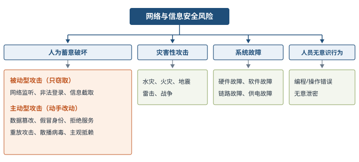

> 助记：威胁四大类——「人灾故误」：人为蓄意、灾害、故障、误操作；被动攻击只「偷看偷听」（监听、截取），主动攻击会「动手改动」（篡改、假冒、拒服、重放、病毒、抵赖）。

- 按威胁作用对象可分为物理环境、通信链路、网络系统、操作系统、应用系统、管理系统 6 个方面。常见安全威胁共 19 种，考试常考「给出描述选名称」，按理解分组记忆（每组按出现顺序对应识别要点）：

| 分组 | 威胁及一句话识别要点 |
| --- | --- |
| 窃取信息 | **信息泄露**（透露给非授权实体）；**窃听**（搭线监听、电磁泄漏截取）；**业务流分析**（长期监听+统计通信频度/流向/总量找规律）；**媒体废弃**（从废弃磁盘、打印介质恢复信息）；**窃取**（令牌、身份卡等安全物品被盗） |
| 破坏滥用 | **破坏信息完整性**（非授权增删改数据）；**拒绝服务**（合法访问被无条件阻止）；**非法使用/非授权访问**（资源被非授权使用）；**计算机病毒**（能传染+侵害：感染其他程序、损坏或植入攻击） |
| 欺骗冒充 | **假冒**（非法冒充合法、小权限冒充大权限，黑客常用）；**业务欺骗**（伪系统骗用户自愿交出敏感信息）；**重放**（截获的合法通信数据备份重新发送）；**抵赖**（否认发过消息、伪造对方来信） |
| 内部缺陷 | **旁路控制**（利用安全缺陷绕过防线获非授权特权）；**授权侵犯**（被授权者把权限用于非授权目的，又称内部攻击）；**特洛伊木马**（软件暗藏程序段，执行时破坏安全）；**陷阱门**（部件设机关，特定输入可违反安全策略） |
| 人员物理 | **人员渎职**（授权人为利益或粗心泄露信息）；**物理侵入**（绕过物理控制访问系统） |

举例：小区快递柜场景——「窃听」像有人趴墙根偷听你报取件码；「假冒」像别人冒称你家人取走包裹；「重放」像骗子录下你上次开柜门的遥控信号再按一次；「陷阱门」像厂家留了个万能后门码；「授权侵犯」像物业管理员用工作之便翻看别人包裹信息。

#### 18.1.2 安全架构的定义和范围 ⭐【重点】

- **安全架构**是架构面向安全性方向上的一种细分。体现在产品上时，**产品安全架构、安全技术体系架构、审计架构组成三道安全防线**⭐【高频考点】：

| 防线 | 构建内容 | 目标/任务 |
| --- | --- | --- |
| 产品安全架构 | 产品安全质量属性的主要组成部分及其关系 | **不依赖外部防御系统，从源头打造自身安全的产品** |
| 安全技术体系架构 | 安全技术体系的主要组成部分及其关系 | 构建通用安全技术基础设施（安全基础设施、安全工具和技术、安全组件与支持系统），系统性增强各产品防御能力 |
| 审计架构 | 独立的审计部门或其风险发现能力 | 审计范围包括安全风险在内的所有风险 |

- 安全架构三特性 **CIA**：可用性（Availability）防数据和资源**丢失**；完整性（Integrity）防未经授权**修改**；机密性（Confidentiality）防未授权**披露**（开篇另提到可控性、不可抵赖性诉求）。安全架构设计从技术角度主要包括：身份鉴别、访问控制、内容安全、冗余恢复、审计响应、恶意代码防范、密码技术等。

> 助记：三道防线「产品—技术—审计」：产品自身硬、技术底座撑、审计独立查。

#### 18.1.3 与信息安全相关的国内外标准及组织

| 标准 | 全称/别称 | 要点 |
| --- | --- | --- |
| TCSEC | 可信计算机系统评估准则，「橘皮书」 | 1985 年美国国防部，4 类 7 级（见 18.6） |
| ITSEC | 信息技术安全评估准则 | 英、法、德、荷四国联合编制（1991） |
| CC | 信息技术安全性评价通用准则 | 美国 NSA 等联合多国编制（1993），取代 TCSEC 升级版 FC(1992)、ITSEC、加拿大 CTCPEC(1993)；后被 ISO/IEC 15408-1999 替代 |
| ISO/IEC 7498-2 | OSI 基本参考模型第 2 部分：安全结构 | ISO，1989 年（对应国标 GB/T 9387.2）；另有美国 NSA 的 IATF 信息保障技术框架（1999） |
| GB 17859-1999 | 计算机信息系统安全保护等级划分准则 | 我国等级保护基础标准 |
| GB/T 18336-2015 | 信息技术安全评估准则 | 等同采用 CC |
| IEC 61508 / GB/T 20438 | 电气/电子/可编程电子安全系统的功能安全 | 功能安全标准 |

- 组织：ISO 下设 **SC27** 专门从事信息技术安全标准化（SC20 更名而来），TC68 负责银行业务安全标准；IEC 为国际电工委员会；国内为国家标准化管理委员会（SAC）与全国信息技术标准化技术委员会（信标委）。

### 18.2 安全模型 ⭐【重点】【高频考点】

- 信息系统安全目标是控制和管理**主体**（用户和进程）对**客体**（数据和程序）的访问。**安全策略**勾画的安全目标宽泛、模糊而抽象；**安全模型**提供实现目标该做什么、不该做什么，给出策略的形式，具有实践指导意义。模型分类见图（图 18-3）：基本模型 HRU（访问控制矩阵）；访问控制分 MAC 强制（BLP、Chinese Wall）、DAC 自主、RBAC 角色；机密性相关 BLP；完整性相关 Biba、Clark-Wilson；另有信息流模型（非干扰性、非观察性）。BLP 既是 MAC 也是机密性模型。

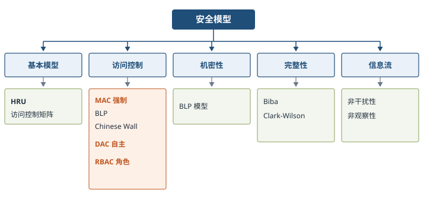

五种典型模型总览（先记这张表，再看细节）：

| 模型 | 保护目标 | 核心规则一句话 | 典型应用 |
| --- | --- | --- | --- |
| 状态机模型 | 系统始终处于安全状态 | 安全状态启动，所有迁移保持安全 | 抽象描述其他模型的基础 |
| BLP（1973） | **机密性**（多级安全） | **不上读、不下写** | 军方密级文档系统 |
| Biba | **完整性** | **不下读、不上写**（与 BLP 相反） | 防低完整性数据污染高完整性 |
| CWM（1987） | **完整性**（事务处理） | CDI/UDI + IVP/TP + 职责隔离 + 审计 | 银行账务系统 |
| Chinese Wall | 防**利益冲突** | 访问过某客户后，同利益冲突组内其他客户不可访问 | 投行、咨询机构 |

#### 18.2.1 状态机模型

- 用状态语言将安全系统描述为抽象状态机：**状态变量**表述系统状态，**转换规则**描述变量变化过程；状态是系统在特定时刻的快照。工作原理（图 18-4）：①状态变量默认值必须安全→②用户试图使用默认值→③系统检查主体身份验证→④系统确保变更不会使系统置于不安全状态→⑤允许变量值变更，发生状态改变→⑥重复①～⑤导致另一次状态变化。即**总是从安全状态启动，并在所有迁移中保持安全状态**。

#### 18.2.2 Bell-LaPadula（BLP）模型 ⭐【高频考点】【易错】

> 教材原文：Bell-LaPadula 模型是 David Bell 和 Len LaPadula 于 1973 提出的第一个正式的安全模型。该模型属于强制访问控制模型，以敏感度来划分安全级别。

- 多级安全系统：主体、客体、访问操作（读/写/读写）、安全级别（绝密＞机密＞秘密）；第一个提供分级别数据机密性保障的安全策略模型。
- 四条安全规则：

| 规则 | 内容 | 口诀对应 |
| --- | --- | --- |
| 简单安全规则 | 低级别主体**不能读**高级别客体（No Read Up） | 不上读 |
| 星属性安全规则（*-property） | 高级别主体**不能写**低级别客体（No Write Down） | 不下写 |
| 强星属性安全规则 | 不允许对另一级别进行读写（同级才可读写） | 跨级禁读写 |
| 自主安全规则 | 用访问控制矩阵定义自主存取控制，体现内容相关和上下文相关 | 叠加 DAC |

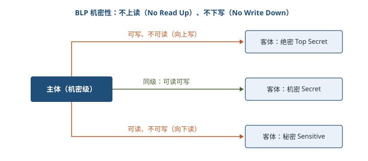

举例：部队里「机密级」参谋不能读「绝密级」作战计划（不上读），也不能把自己知道的机密内容写进会发给普通士兵的「秘密级」通报里（不下写）——目的是让秘密只能「向上流动」，绝不向下泄露。

#### 18.2.3 Biba 模型 ⭐【高频考点】【易错】

- 解决**完整性**问题，访问控制建立在**完整性级别**上而非机密性级别上。完整性三目标：保护数据不被未授权用户更改；保护数据不被授权用户越权修改；维持数据内部和外部一致性。主要针对**外部威胁**（一个子系统企图用错误数据/不正确调用修改另一个子系统）。
- 三条安全规则（与 BLP 镜像相反）：

| 规则 | 内容 | 口诀对应 |
| --- | --- | --- |
| 星完整性规则（*-integrity） | 低完整性主体**不能写**高完整性客体（No Write Up） | 不上写 |
| 简单完整性规则 | 高完整性主体**不能读**低完整性客体（No Read Down） | 不下读 |
| 调用属性规则 | 低完整性主体不能调用高级别客体的程序或服务 | 不向上调用 |

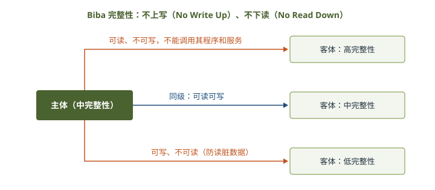

> 助记：「BLP 怕泄密：不上读、不下写；Biba 怕污染：不下读、不上写」——机密性防「往下看、往下写」，完整性防「读脏数据、写脏数据」。

#### 18.2.4 Clark-Wilson（CWM）模型 ⭐【重点】

- 1987 年提出的**完整性模型**，实现成型的事务处理机制，常用于**银行系统**。核心概念：**CDI**（受约束数据项）需完整性保护，**UDI**（不受约束数据项）不需保护（如用户输入订单）；**IVP**（完整性验证过程）确认 CDI 处于有效状态；**TP**（转换过程）将数据项从一种有效状态改变至另一种有效状态，可把 UDI 转换为 CDI。
- 模型特征：①Subject/Program/Object 三元素，**主体访问客体只能通过程序（TP）进行**；②**权限分离原则**：要害功能分由 2 个或多个 Subject 完成；③要求具有**审计能力**。对 CDI 执行 TP 须授权认证；TP 分为多个子过程授权给不同用户（职责隔离），但若子过程用户结成利益同盟仍可能欺骗。

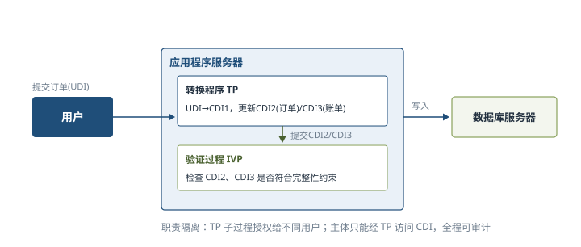

举例：银行转账——柜员（Subject）不能直接改账本（CDI），必须走「转账交易」程序（TP）；录入员和复核员分属两人（职责隔离）；系统留痕可审计，这就是 CWM 的日常形态。

#### 18.2.5 Chinese Wall 模型 ⭐【重点】

- 又名 **Brewer and Nash 模型**，应用于多边安全系统，防止部门之间出现有损客户利益的**利益冲突**；最初为**投资银行**设计。同时包括 DAC 和 MAC 属性，是 MAC 的一种**混合策略模型**：银行家可自由选择为谁工作（DAC），一旦选定就只能为该客户工作（MAC）。三级信息结构：企业单位信息 **C** → 企业全部信息集合 **CD** → 利益冲突类 **COI**。每个 C 唯一对应一个 CD；每个 CD 唯一对应一个 COI；一个 COI 可包含多个 CD。访问规则：①与主体曾访问过的信息属同一公司数据集的（墙内信息）可访问；②属于完全不同利益冲突组的可访问；③写的前提是主体未对任何其他公司数据集进行过访问。两个定理⭐【高频考点】：**定理 1**——主体一旦访问过某客体，就只能访问同一公司数据集或不同利益组的客体；**定理 2**——在一个利益冲突组中，一个主体最多只能访问一个公司数据集。

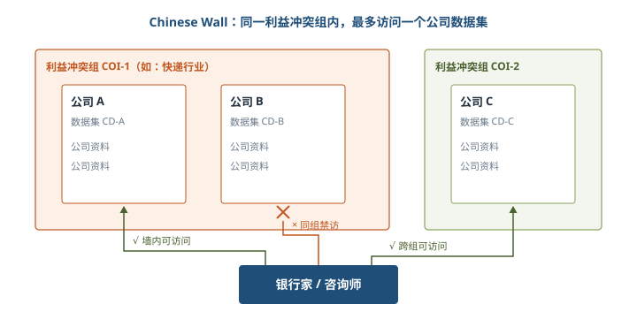

举例：投资顾问同时服务 A、B 两家互为竞争对手的快递公司。一旦他查阅了 A 的成本数据，Chinese Wall 就禁止他再访问 B 的数据——就像在两家公司之间砌了一堵「中国墙」，防止有意无意的泄密造成利益冲突。

### 18.3 系统安全体系架构规划框架

#### 18.3.1 安全技术体系架构

- 安全技术体系架构是对组织机构信息技术系统安全体系结构的整体描述，目标是**建立可持续改进的安全技术体系架构的能力**。信息技术系统分析模型（图 18-9）：按网络中风险威胁存在的实体划分出 **5 个层次的实体对象：应用、存储、主机、网络、物理**⭐。主机和存储虽属应用层，因评估工作量大、重要性高而单独列为层次。

#### 18.3.2 信息系统安全体系规划 ⭐【重点】

> 教材原文：信息系统安全体系主要是由技术体系、组织机构体系和管理体系三部分共同构成的。

| 体系 | 构成 | 要点 |
| --- | --- | --- |
| 技术体系 | 物理安全技术 + 系统安全技术两大类 | 全面提供信息系统安全保护的技术保障 |
| 组织机构体系 | 机构、岗位、人事三模块 | 机构分领导决策层、日常管理层、具体执行层；岗位负责一个或几个安全事务；人事负责在职/待职/离职员工的素质教育、业绩考核和安全监管 |
| 管理体系 | 法律管理、制度管理、培训管理三部分 | 法律为体系规范/ISO 标准，制度为实施细则，培训提升意识 |

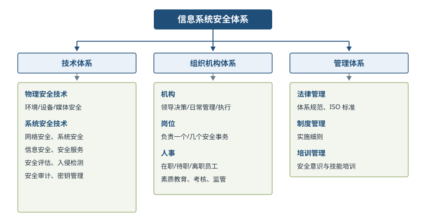

#### 18.3.3 信息系统安全规划框架

- 规划框架（图 18-11）三条主线：①**依托企业信息化战略规划**（远景、目标、使命、战略），安全规划目标与信息化目标一致且更具体、更贴近安全；②围绕**技术安全、管理安全、组织安全**全面考虑，内容涵盖物理安全、网络安全、系统安全、运营安全、人员安全；③**以信息系统与信息资源的安全保护为核心**，规划包括**蓝图、现状、需求、措施** 4 个方面⭐。

> 助记：规划四件事「蓝图—现状—需求—措施」：想去哪、现在哪、缺什么、怎么补。

### 18.4 信息安全整体架构设计（WPDRRC 模型）⭐【重点】【高频考点】

#### 18.4.1 WPDRRC 模型

- **WPDRRC**（Warning/Protect/Detect/React/Restore/Counterattack）是我国「八六三」信息安全专家组提出的适合中国国情的安全保障体系建设模型，在 **PDRR**（保护、检测、响应、恢复，强调自动故障恢复能力）基础上**前后增加预警（W）和反击（C）**。美国经典模型有 PDRR、P2DR 等。
- **6 个环节**（有时序性和动态性）：

| 环节 | 含义 | 主要技术内容 |
| --- | --- | --- |
| W 预警 | 模拟攻击检查薄弱环节，分析风险趋势与严重风险点 | 远程安全评估、风险报告与解决建议 |
| P 保护 | 采用成熟安全技术实现网络与信息安全 | 加密、数字签名、访问控制、认证、信息隐藏、防火墙 |
| D 检测 | 发现新威胁和弱点，强制执行安全策略 | 入侵检测、系统脆弱性检测、数据完整性检测、攻击性检测 |
| R 响应 | 检测到漏洞/事件后及时响应，把系统调整回安全状态 | 应急策略/机制/手段、封堵隔离报告、入侵过程分析 |
| R 恢复 | 受攻击破坏后尽快恢复正常，强调自动故障恢复能力 | 容错、冗余、备份、替换、修复、恢复 |
| C 反击 | 侦察提取犯罪线索与证据，依法打击 | 取证能力、依法打击手段 |

- **3 大要素：人员（核心）、策略（桥梁）、技术（保证）**⭐【高频考点】，落实在 6 环节的各个方面，将安全策略变为安全现实。

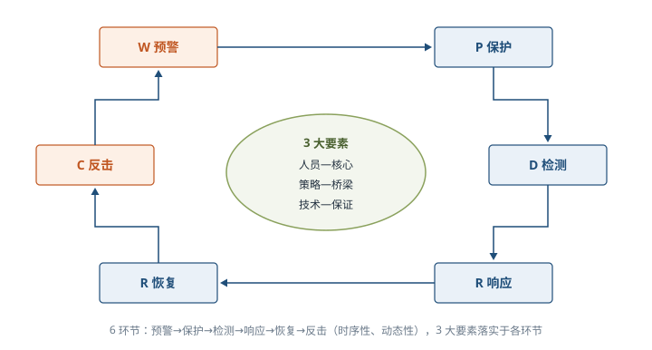

- 模型演进功能对照（表 18-1，记「谁多了什么」）：

| 模型 | 预警 | 保护 | 检测 | 响应 | 恢复 | 反击 | 管理 |
| --- | --- | --- | --- | --- | --- | --- | --- |
| PDR | 无 | 有 | 有 | 有 | 无 | 无 | 无 |
| PPDR | 无 | 有 | 有 | 有 | 无 | 无 | 无 |
| PDRR | 无 | 有 | 有 | 有 | 有 | 无 | 无 |
| MPDRR | 无 | 有 | 有 | 有 | 有 | 无 | 有 |
| WPDRRC | 有 | 有 | 有 | 有 | 有 | 有 | 有 |

> 助记：「PDRR 加恢复，M 加管理，WPDRRC 预警反击全都有」；六环节口诀「预保检响恢反」。

#### 18.4.2 信息安全体系架构设计

- 设计重点两方面：**系统安全保障体系** + **信息安全体系架构**。系统安全保障体系由**安全服务、协议层次、系统单元**三个层面组成，每层都涵盖安全管理（图 18-13）。安全服务含数据完整性、访问控制、数据保密、抗抵赖、可用性、认证、审计；系统单元含通信平台、网络平台、系统平台、应用平台、物理环境。保障体系设计三要点：①**安全区域策略的确定**（分区域制定定时审计评估、入侵检测、统一授权认证等策略）；②**统一配置和管理防病毒系统**（全面性、易用性、实时性、可扩展性）；③**网络安全管理**（遵循 ISO 17799，至少成立一个安全运行组织、制定一套安全管理制度、建立一个应急响应机制；制度遵循多人负责、任期有限、职责分离原则）。面向企业的安全控制系统架构（图 18-14）分**数据层、功能层、展现层**：数据层统一管理数据（自动/人工采集，按安全特性存储隔离保护）；功能层含可信性监控、服务支持、安全性监控；展现层面向运维人员、管理人员、客户完成使用、维护、决策。
- 信息安全体系架构从 **5 个方面**开展⭐【高频考点】：

| 方面 | 主要内容 |
| --- | --- |
| 物理安全 | 环境安全、设备安全、媒体安全（整个网络系统安全的前提） |
| 系统安全 | 网络结构安全（拓扑合理、线路/路由冗余、防单点失败）、操作系统安全（安全配置+安全扫描）、应用系统安全（关闭不常用协议端口、加强登录认证） |
| 网络安全 | 访问控制（制度+防火墙隔离）、通信保密、入侵检测（控制台+探测器/网络引擎）、安全扫描、防病毒（预防/检测/杀毒三种技术） |
| 应用安全 | 资源共享（不轻易开放共享目录、共享须口令认证）、信息存储（少开网络服务、数据库安全备份/远程备份） |
| 安全管理 | 健全安全管理体制、构建安全管理平台（安全管理子网、集中统一管理软件）、增强人员安全防范意识 |

### 18.5 网络安全体系架构设计 ⭐【重点】【高频考点】

#### 18.5.1 OSI 的安全体系架构概述

- OSI 安全体系结构（ISO 7498-2，等同国标 GB/T 9387.2—1995）核心：**定义 5 大类安全服务、提供这些服务的 8 类安全机制及相应的 OSI 安全管理**，可配置于 OSI 7 层协议中（图 18-15 三维安全空间：安全服务×协议层次×安全机制）。**5 类安全服务：鉴别（认证）、访问控制、数据机密性、数据完整性、抗抵赖性**⭐；**8 类安全机制：加密、数字签名、访问控制、数据完整性、鉴别交换、业务流填充、路由控制、公证**⭐【易错】（注意「数据完整性」既是服务名也是机制名）。服务—机制对应关系见下图（图 18-16），其中公证机制主要支撑抗抵赖服务。
- 配置层次【易错】：**除第 5 层（会话层）外每一层均能提供安全服务；最适合配置安全服务的是物理层、网络层、运输层及应用层**，其他层不宜配置。OSI 定义**分层多点安全技术体系架构（深度防御）**，通过三种方式将防御能力分布至整个信息系统（见下图）：**多点技术防御**（防御网络和基础设施、边界、计算环境三个核心区域）、**分层技术防御**（对手和目标间多重防御机制，每种机制是唯一障碍并同时包括保护和检测，典型为内外边界嵌套防火墙+入侵检测）、**支撑性基础设施**（PKI 公钥基础设施+检测和响应基础设施）。信息保障不仅依赖技术，还需人员、管理、技术和过程的综合。

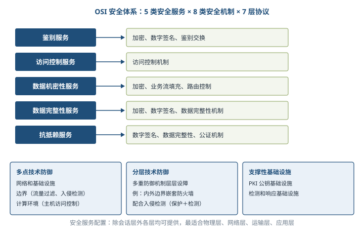

#### 18.5.2 认证（鉴别）框架

- 鉴别目的是防止其他实体占用和独立操作被鉴别实体的身份，提供实体声称其身份的保证；两种关系背景：申请者—验证者通信（实体鉴别）、实体为验证者提供数据项来源。鉴别服务共 9 阶段：安装→修改鉴别信息→分发→获取→传送→验证→停活（暂时不能被鉴别）→重新激活（终止停活）→取消安装（实体拆除）。**5 种鉴别方式**⭐：①已知的（口令）；②拥有的（IC 卡、令牌）；③不改变的特性（生物特征）；④可信第三方建立的鉴别（递推）；⑤环境（主机地址等）。**3 种鉴别信息（AI）**：申请鉴别信息（申请 AI）、验证鉴别信息（验证 AI）、交换鉴别信息（交换 AI）。申请者持申请 AI，验证者持验证 AI，两者之间传送交换 AI；可信第三方可持有验证 AI 或传递交换 AI（图 18-18）。
#### 18.5.3 访问控制框架 ⭐【高频考点】

- 访问控制决定开放系统环境中允许使用哪些资源、在什么地方阻止未授权访问。涉及 **4 个功能实体**：

| 实体 | 全称 | 职责 |
| --- | --- | --- |
| 发起者 | Initiator | 访问或试图访问目标的人/计算机实体 |
| AEF | 访问控制实施功能 | **确保只有对目标允许的访问才由发起者执行**（递交访问请求、执行判决） |
| ADF | 访问控制判决功能 | 通过访问请求、ADI 及上下文使用**访问控制策略规则**做出允许/禁止判决 |
| 目标 | Target | 被试图访问的实体（OSI 实体、文件、系统等） |

- 关键概念：**ACI**（访问控制信息）=用于访问控制目的的任何信息（含上下文信息）；**ADI**（访问控制判决信息）=做出特定判决时可供 ADF 使用的部分或全部 ACI。三种 ADI：发起者 ADI、目标 ADI、访问请求 ADI；ADF 其他输入还有策略规则与上下文信息（位置、时间、通信路径），以及以前判决保留的 ADI。流程（图 18-19/18-20）：发起者向 AEF 递交访问请求→AEF 向 ADF 发判决请求（附三种 ADI+策略+上下文）→ADF 判决→AEF 执行（允许访问目标或采取其他行动）。

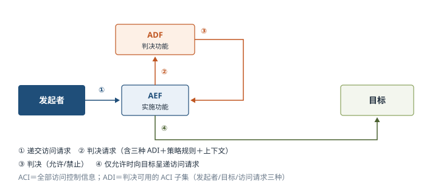

#### 18.5.4 机密性框架

- 目的：确保信息仅对被授权者可用。信息可从数据值、数据属性（存在性/大小/更新日期）、上下文关系、动态变化中导出，因此保护须覆盖多种推导途径。**被保护的环境**中所有数据以类似方法受保护；**被交叠保护的环境**中交叠数据能被多重保护，数据跨环境连续保护必然涉及交叠保护环境。机密性机制：①**通过禁止访问**（访问控制、物理媒体保护、路由选择控制——只有可信安全设施才能路由数据）；②**通过加密**（对称/非对称）；另有数据填充、虚假事件（隐藏信息流总量）、保护 PDU 头、时间可变域。存储机密性可加密或**数据分片**；传输机密性可禁止访问、隐藏语义或分散数据（如跳频）。

#### 18.5.5 完整性框架

- 完整性=数据不以未经授权方式进行改变或损毁的特征。按违规操作分未授权的修改、创建、删除、插入、重放；按保护方法分阻止型和检测型；按是否支持恢复分带恢复与不带恢复。保护强度 5 级：不作保护→探测修改和创建→探测修改/创建/删除/重复→探测修改和创建并带恢复→探测修改/创建/删除/重复并带恢复。机制两类：①**阻止对媒体访问**（物理隔离不受干扰信道、路由控制、访问控制）；②**探测非授权修改**（密封、数字签名、数据重复、与密码变换结合的数字指纹、消息序列号）。

#### 18.5.6 抗抵赖框架

- 抗抵赖服务包括**证据的生成、验证和记录**，以及解决纠纷时的证据恢复和再次验证；目的是提供有关特定事件或行为的证据。原发证明须确认**数据原发者身份+数据完整性**；递交证明须确认**接收者身份+数据完整性**；有时还需日期、时间、地点等上下文证据。**4 个独立阶段**⭐：①证据生成（证据生成请求者请求生成者生成，可由证据实体、可信第三方或共同生成）；②证据传输、存储及恢复；③证据验证（证据验证者在证据使用者请求下验证）；④解决纠纷（仲裁者评估确定行为是否发生）。

### 18.6 数据库系统的安全设计 ⭐【重点】

#### 18.6.1 数据库安全设计的评估标准

- 数据库安全策略一般包括：**用户管理、存取控制、数据加密、审计跟踪、攻击检测**，目标是实现数据库的完整性、机密性、可用性。**TCSEC（桔皮书，DoD85）**：1985 年美国国防部颁布，将安全系统分为 **4 大类 7 个等级**⭐【高频考点】（由低到高）：

| 类别 | 等级 | 名称 | 要点 |
| --- | --- | --- | --- |
| D | D | 最小保护 | 基本没有安全保护措施 |
| C | C1 | 自主安全保护 | 自主存取控制（DAC） |
| C | C2 | 受控存取保护 | 更细粒度 DAC+审计 |
| B | B1 | 标记安全保护 | 引入安全标记，**开始强制存取控制（MAC）** |
| B | B2 | 结构化保护 | 形式化安全策略、结构化设计 |
| B | B3 | 安全域 | 高抗渗透、可信恢复 |
| A | A1 | 验证设计 | 形式化验证，最高级 |

> 教材原文：D 类产品是基本没有安全保护措施的产品，C 类产品只提供了安全保护措施，一般不称为安全产品。B 类以上产品是实行强制存取控制的产品，也是真正意义上的安全产品。所谓安全产品均是指安全级别在 B1 以上的产品。

- **TDI**（可信数据库管理系统解释）：1991 年美国 NCSC 颁布，是 TCSEC 在数据库管理系统方面的扩充和解释，从**安全策略、责任、保护和文档 4 个方面**描述每级安全标准；我国 1994 年发布《计算机信息系统安全保护条例》。

#### 18.6.2 数据库的完整性设计

- 数据库完整性=数据的**正确性和相容性**，由完整性约束保证；约束可通过 **DBMS**（作为模式一部分存入数据库）或**应用程序**实现。一般**静态约束尽量包含在数据库模式中，动态约束由应用程序实现**⭐。设计原则要点：①按约束类型确定实现层次并考虑性能；②**实体完整性、引用完整性是关系数据库最重要的完整性约束**，不影响关键性能时尽量应用；③**慎用触发器**（性能开销大、多级触发难控制，非用不可时用 **Before 型语句级**触发器）；④需求分析阶段制定约束命名规范（如 PK_EMPLOYEE）；⑤按业务规则细致测试；⑥专职数据库设计小组全程负责；⑦采用 CASE 工具。
- **6 类完整性约束**：列级/元组级/关系级 × 静态/动态⭐【高频考点】。Oracle 支持的基于 DBMS 的完整性约束（表 18-2）：

| Oracle 约束 | 对应约束类型 | 备注 |
| --- | --- | --- |
| 非空约束 Not Null | 列级静态约束 | |
| 唯一码约束 Unique Key | 列级静态约束 | 通过唯一性索引实现 |
| 主键约束 Primary Key | 元组级静态约束 | |
| 引用完整性约束 Referential | 关系级静态约束 | 可定义 5 种动作：Restrict、Set to Null、Set to Default、Cascade、No Action |
| 检查约束 Check | 列级静态约束、元组级静态约束 | 可定义在列或表上 |
| 触发器实现的约束 | 全部 6 类 | 关系级动态约束可调用含事务的存储过程实现，性能问题则改由应用软件实现 |

- 设计阶段：需求分析（确定业务规则并分类）→概念结构设计（ERD，实体关系将转化为实体/引用完整性约束）→逻辑结构设计（逐条选择实现方式，选**对数据库性能影响最小**的一种）。作用：防止合法用户添加不合语义数据；基于 DBMS 集中管理业务规则、降低应用复杂度；兼顾完整性与效能（大批量装载前临时使约束失效、装载后恢复）；有助于尽早发现应用软件错误。

### 18.7 系统架构的脆弱性分析 ⭐【重点】【高频考点】

#### 18.7.1 概述

- **木桶理论**：系统安全性不取决于最新加密算法或最先进设备，而由系统**最薄弱之处（漏洞）**决定。脆弱性覆盖物理装备、软件（OS/协议簇/DBMS/应用程序）、人员管理、规章制度、安全策略等各方面。漏洞技术来源 4 方面：①**软件设计时的瑕疵**（如协议设计瑕疵，实现再完美也有漏洞）；②**软件实现中的弱点**（设计完美但实现引入漏洞）；③**软件本身的瑕疵**（不检查数据内容大小、不检查成功失败、不能处理资源耗尽、不做运行环境完整性检查、不正确使用系统调用）；④**系统和网络的错误配置**（如沿用默认配置）。

#### 18.7.2 软件脆弱性

- 定义（理解即可）：Krsul 基于访问控制（引起系统执行违反安全策略的做法）；Bishop 基于状态控制（经一系列**授权**状态转换却能达到某个**非授权状态**，则起始状态为脆弱状态）。通俗理解：**软件脆弱性是由软件缺陷客观存在形成的、可被攻击者利用的实例**；每个脆弱性至少由一个缺陷引起，但缺陷不一定产生脆弱性，不同缺陷可能导致相同脆弱性。**4 个特点**：①隐藏弱点，本身不引起危害，被利用后产生严重后果；②开发中自觉/不自觉引入的**逻辑错误**是大多数脆弱性根本来源；③与具体系统环境密切相关；④修补旧脆弱性可能引入新脆弱性，**长期存在**。典型分类法（记「谁提出、按什么分」）：

| 分类法 | 分类视角 |
| --- | --- |
| ISOS | 面向信息系统的安全和隐私 |
| PA | 操作系统中与保护相关的缺陷，模式指导让外行人发现安全问题 |
| Landwehr | 三维度：**起因（有意/无意）、引入时间（开发/维护/运行）、位置（软件/硬件）** |
| Aslam | 针对 Unix，按软件生命周期分**编码故障和突发故障**，用决策树判定 |
| Bishop | 针对 Unix 和网络，**6 个轴线**：性质、引入时间、利用率、影响域、最小数量、来源 |
| IBM | 以 Landwehr 为框架扩充，多层次分类，面向检测工具开发者（图 18-23：有意（恶意：陷阱/逻辑时间炸弹/隐蔽通道；非恶意）与无意（验证错误、抽象错误、异步错误等）） |

- **生命周期**：引入（输入验证错误、权限检查错误、操作序列化错误、边界检出错误、设计缺陷等）→产生破坏效果（非法执行代码、非法修改目标对象、访问数据对象、拒绝服务）→被修补（删除伪造实体、增加新实体、改正实体不正确位置等）→消失。分析方法三方面：分析软件**故障现象**（总结脆弱性模式）、分析软件**开发**（发现管理技术薄弱环节）、分析软件**使用**（避免脆弱性转化为安全故障）；分析对象分**脆弱性数据**和**软件系统**两类。常用工具为**扫描器**：主流是**基于特征的扫描**（又称基于知识/违规扫描，依赖脆弱性特征库的规模与完善程度），另有基于行为的扫描。

#### 18.7.3 典型软件架构的脆弱性分析 ⭐【高频考点】

| 架构 | 主要脆弱性 |
| --- | --- |
| 分层架构 | ①**层间脆弱性**：底层出错整个程序无法正常运行（数据溢出、空指针、错误结果）；②**层间通信脆弱性**：大量细粒度对象层层传递消息，性能下降 |
| C/S 架构 | ①**客户端软件脆弱性**：客户端程序易被分析、数据被截取；②**网络开放性脆弱性**：二层结构客户端直连数据库，客户端含用户名密码等致命信息，服务器对 Internet 开放；③**网络协议脆弱性**：数据分布特性使客户端灾害/病毒成为数据杀手 |
| B/S 架构 | 使用 HTTP 协议时相对 C/S **更容易被病毒入侵**，最新 HTTP 安全性有所提升但仍弱于 C/S |
| 事件驱动架构 | ①组件脆弱性（触发后不能确定响应组件及执行顺序）；②组件间交换数据脆弱性（大数据量传递难）；③组件间逻辑关系复杂；④**易进入死循环**；⑤高并发导致响应问题、数据不正确/丢失；⑥固定流程脆弱性 |
| MVC 架构 | ①复杂性带来脆弱性（过多更新操作降低效率）；②视图与控制器紧密连接妨碍独立重用；③视图对模型数据低效率访问；总体上**缺少对调用者的安全验证、数据传输不够安全** |
| 微内核架构 | ①难以整体化优化；②**进程间通信开销大**；③通信损失率高（效率损失小于结构收益） |
| 微服务架构 | ①分布式系统复杂结构；②须自行设计服务间通信机制、处理局部失效；③**服务管理复杂性**（多实例需全局统筹） |

### 18.8 安全架构设计案例分析

#### 18.8.1 电子商务系统的安全性设计（AAA + RADIUS）⭐【重点】

- **AAA = 认证 Authentication + 授权 Authorization + 审计 Accounting**：认证验证用户是否可获得访问权（用户名、密码、认证结果）；授权决定用户可以使用哪些服务（服务类型及信息）；审计记录用户使用网络资源情况（IP、MAC 等），AAA 提供对三种安全功能进行配置的一致框架。**RADIUS** 流程：用户经 BAS（宽带接入服务器）拨入→BAS 按配置的验证方式（PPP/PAP/CHAP 等）获取用户名密码→BAS 把信息传给 RADIUS 服务器→RADIUS 完成验证并返回配置信息→BAS 决定是否授予服务。BAS 与 RADIUS 之间验证信息传递通过**密钥**参与完成，**用户密码加密后才在网上传递**。RADIUS 软件架构分**三层**（图 18-24）：

| 层 | 职责 |
| --- | --- |
| 协议逻辑层 | 实现 RFC 框架内容，处理通信协议建立/通信/停止；相当于**转发引擎**，实现协议与业务处理分层 |
| 业务逻辑层 | **架构设计核心**：协议进程初步分析并分发包到认证/计费/授权三类业务逻辑进程；转发进程与协议进程间用**共享内存**通信，协议进程与业务逻辑进程间用**进程+线程**（线程由 UNIX 系统管理） |
| 数据逻辑层 | **数据库代理池**统一连接数据库，减少数据库压力与依赖 |

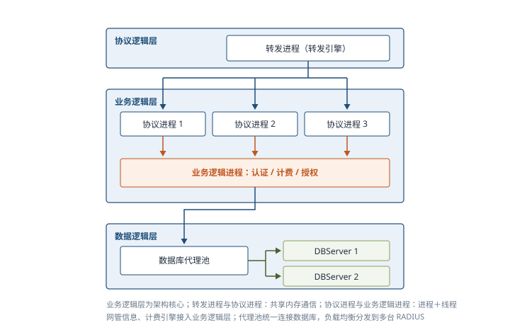

- 高性能手段：**负载均衡**（代理转发把 BAS 数据包平均分发到多台 RADIUS 服务器，解决拥塞、就近服务、避免单点失效、提高响应与资源利用率）+ 自我管理（UNIX 守护管理监控、进程管理监控、SNMP 代理管理）；加密方式从 MD5/PAP/CHAP 扩展到 EAP-tls、P-ttls、EAP-sim 等。

#### 18.8.2 基于混合云的工业安全架构设计 ⭐【重点】

- 混合云融合公有云和私有云：企业出于安全考虑把数据放**私有云**，同时希望获得**公有云**计算资源，达到「既省钱又安全」。案例架构：集团由多个跨区域智能工厂+公司总部组成，**智能工厂内部用私有云**实现产品设计、数据共享、生产集成；**总部与工厂间用公有云**实现业务管理、协调和统计分析。系统四层（教材表述为「三层组成」但实列 4 层，见查漏补缺）：**设备层**（智能传感器、工业机器人、智能仪器）→**控制层**（SCADA、DCS、FCS、PLC、HMI）→**设计/管理层**（MES、CAx、SCM、ERP、CRM、BI、PLM）→**应用层**（工业云平台：数据管理处理+定制业务、协同业务、产品服务）。**5 个安全重点**⭐【高频考点】：

| 安全重点 | 保障技术 |
| --- | --- |
| 设备安全 | 维护、保养、检测 |
| 网络安全 | 防火墙、入侵检测系统部署、漏洞扫描系统、网络版杀毒产品部署 |
| 控制安全 | 冗余、容错、（降级）备份、容灾 |
| 应用安全 | 服务器报警策略、用户密码策略、用户安全策略、访问控制策略、时间策略 |
| 数据安全 | 数据本身安全（密码算法：数据保密、完整性、双向强身份认证）+数据防护安全（磁盘阵列、数据备份、异地容灾）；分布于各层数据交换与公有云数据存储 |

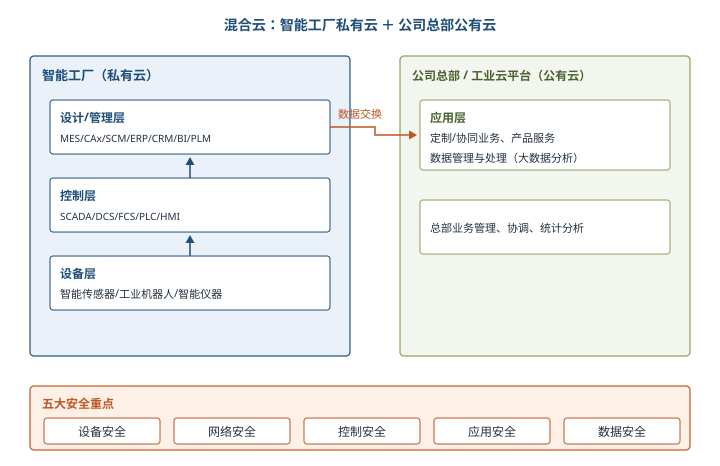

## 三、重点与易错点

| # | 考点 | 必须记住的结论 | 易错提醒 |
| --- | --- | --- | --- |
| 1 | 三道安全防线 | 产品安全架构、安全技术体系架构、审计架构 | 产品安全架构强调「不依赖外部防御、从源头打造」，不是堆砌外部安全设备 |
| 2 | CIA 三特性 | 可用性防丢失、完整性防未授权修改、机密性防未授权披露 | 「可控性、不可抵赖性」是另外提出的保障诉求，不属于 CIA 三字母 |
| 3 | 被动/主动攻击 | 被动=监听、非法登录、信息截取；主动=篡改、假冒、拒服、重放、病毒、抵赖 | 重放是主动攻击，不要因「只是重发旧数据」误判为被动 |
| 4 | BLP 规则 | 机密性：不上读（No Read Up）、不下写（No Write Down） | 强星属性是「不允许对另一级别读写」，比星属性更严格；自主安全规则用访问控制矩阵 |
| 5 | Biba 规则 | 完整性：不上写、不下读，另加「调用属性」（低级不能调用高级程序服务） | 与 BLP 恰好镜像相反，考试常互换规则设错 |
| 6 | CWM 要素 | CDI/UDI、IVP 验证、TP 转换、职责隔离、审计；主体只能经程序访问客体 | CWM 管完整性不管机密性；TP 子过程用户结盟仍可能破坏完整性 |
| 7 | Chinese Wall | COI 可含多个 CD；同利益冲突组内主体最多访问一个公司数据集 | 「墙内可访问」指同一公司数据集；写前提是从未访问其他公司数据集 |
| 8 | WPDRRC | 6 环节「预保检响恢反」；3 要素人（核心）、策略（桥梁）、技术（保证）；中国 863 提出 | 是在 PDRR 上「前加 W、后加 C」；PDRR 比 PDR 多恢复，MPDRR 再多管理，WPDRRC 独有预警反击 |
| 9 | OSI 5 服务 8 机制 | 服务：鉴别/访问控制/机密性/完整性/抗抵赖；机制：加密/数字签名/访问控制/数据完整性/鉴别交换/业务流填充/路由控制/公证 | 「数据完整性」既是服务也是机制；公证机制主要支撑抗抵赖 |
| 10 | 安全服务配置层次 | 除会话层外均可提供；最适合物理、网络、运输、应用层 | 不是「7 层全配」也不是「只有应用层」 |
| 11 | 访问控制框架 | AEF 实施、ADF 判决；ACI 是全部访问控制信息，ADI 是判决可用子集 | 判决由 ADF 做，AEF 只执行；三种 ADI=发起者/目标/访问请求 |
| 12 | TCSEC 分级 | 4 类 7 级 D→C1→C2→B1→B2→B3→A1；B1 起强制存取控制，B1 以上才叫安全产品 | TDI 是 TCSEC 在数据库上的解释，从安全策略/责任/保护/文档 4 方面描述 |
| 13 | 数据库完整性 | 静态约束入模式、动态约束由应用程序实现；慎用触发器，非用不可选 Before 型语句级 | 实体/引用完整性最重要；主键是元组级静态约束，引用完整性是关系级 |
| 14 | 架构脆弱性 | B/S 用 HTTP 比 C/S 更易被病毒入侵；微内核进程间通信开销大；事件驱动易死循环；缺陷不一定产生脆弱性，修补旧漏洞可能引入新漏洞 | C/S 二层结构客户端直连数据库且存用户名密码，是开放性隐患而非优势 |

## 四、练习与真题

**1.** 在安全架构的三道安全防线中，强调「在不依赖外部防御系统的情况下，从源头打造自身安全的产品」的是（ ）。
A. 审计架构  B. 产品安全架构  C. 安全技术体系架构  D. 安全管理架构

**2.** Bell-LaPadula 模型中，安全级别为「机密」的主体对安全级别为「绝密」的客体可以进行的操作是（ ）。
A. 可写不可读  B. 可读不可写  C. 可读可写  D. 不可读不可写

**3.** 下列关于 Biba 模型的说法，正确的是（ ）。
A. 低完整性主体可以读取高完整性客体，但不能写入  B. 高完整性主体不能从低完整性客体读取数据  C. 低完整性主体可以调用高级别客体的程序和服务  D. Biba 模型以敏感度划分安全级别，保障数据机密性

**4.** Clark-Wilson 模型中，将数据项从一种有效状态改变至另一种有效状态的过程称为（ ）。
A. IVP  B. CDI  C. TP  D. UDI

**5.** 某投资银行的咨询师已为甲公司提供服务，甲与乙同属一个利益冲突组。按照 Chinese Wall 模型，该咨询师后续还可以访问的信息是（ ）。
A. 乙公司的全部资料  B. 与甲同利益冲突组内任意公司资料  C. 甲公司数据集内的资料  D. 任何公司资料均不可访问

**6.** WPDRRC 模型与 PDRR 模型相比，新增的两个环节是（ ）。
A. 预警和反击  B. 预警和恢复  C. 策略和反击  D. 管理和反击

**7.** OSI 安全体系结构定义的 5 类安全服务不包括（ ）。
A. 鉴别  B. 访问控制  C. 数据机密性  D. 业务流填充

**8.** 访问控制框架中，负责「通过对访问请求、ADI 及上下文使用访问控制策略规则做出访问控制判决」的功能实体是（ ）。
A. AEF  B. ADF  C. ACI  D. 发起者

**9.** 按照 TCSEC 标准，真正意义上的安全产品（实行强制存取控制）的最低级别是（ ）。
A. C2  B. B1  C. B2  D. A1

**10.** 下列关于软件架构脆弱性的描述，错误的是（ ）。
A. 分层架构中底层出错可能导致整个程序无法正常运行  B. B/S 架构使用 HTTP 协议时比 C/S 架构更易被病毒入侵  C. 微内核架构的进程间通信开销比单一内核小  D. 事件驱动架构容易因编程逻辑进入死循环

> 以上题目答案与解析见本笔记最后「六、参考答案」。

## 五、疑问与查漏补缺

1. **大纲条目排版疑问**：大纲 8.1「主要安全模型」下印有「状态机模型（BLP）模型」与「Bell-LaPadula 模型」两行，疑为排版冗余，实际即教材的 5 种模型：状态机、BLP、Biba、CWM、Chinese Wall，按教材掌握即可。
2. **教材 18.4.1 英文展开笔误**：PDRR 被写为「Protect/Detect/React/React/Restore」，第二个 React 应为 Restore 之前的笔误，正确展开为 Protect/Detect/React/Restore（保护/检测/响应/恢复）；另 WPDRRC 首字母原文作「Waring」，应为 Warning（预警）。
3. **教材图 18-6 与表 18-2 笔误**：Biba 一节写「图 18-6 对 Bell-LaPadula 模型基本原理进行描述」，应为对 **Biba 模型**基本原理的描述；表 18-2 引用完整性 5 种动作中的「Wet to Null」应为「Set to Null」。
4. **18.8.2 层次表述不一致**：正文写「整个安全生产管理系统架构由三层组成」，随后实际列出设备层、控制层、设计/管理层、应用层共 **4 层**，且图 18-25 也是 4 层，按 4 层记忆。
5. **TCSEC 各级名称教材未展开**：本章仅给出「4 大类 7 个等级」及 D/C/B 类说明，各级名称（D、C1、C2、B1、B2、B3、A1）为通用常识补充，可结合第 4 章信息安全技术基础知识对照复习。
6. **与其他章节衔接**：鉴别、访问控制、加密等机制的技术细节（对称/非对称、PKI、数字签名原理）在第 4 章；防火墙布设、VPN、安全协议（SSL/SET/HTTPS）在第 17 章 17.4.3；分层/C/S/B/S/MVC/微服务架构本身的设计原理分别在第 13、14、15 章，本章只考其**脆弱性**视角，答题时不要把架构优缺点与安全脆弱性混写。
7. **大纲要求但教材展开较浅处**：深度防御的「分层多点」图 18-17 仅示意，案例答题时需能自行展开「网络和基础设施、边界、计算环境 + PKI/检测响应基础设施」的文字要点；抗抵赖 4 阶段建议能结合「数字签名+公证」举例说明。

## 六、参考答案

**1.** 答案 B。三道防线中产品安全架构负责从源头打造自身安全的产品，安全技术体系架构构建通用安全基础设施，审计架构提供独立风险发现能力。

**2.** 答案 A。BLP 不上读、不下写：机密级主体对绝密级客体「可写不可读」（No Read Up），信息只能向上流动。

**3.** 答案 B。Biba 保完整性：高完整性主体不能读低完整性客体（不下读）；A 错在低级可写高级才是允许的、读高并不受限的说法与规则表述错位；C 违反调用属性；D 描述的是 BLP。

**4.** 答案 C。TP（转换过程）改变有效状态；IVP 负责验证 CDI 是否有效，CDI 是受约束数据项，UDI 是不受约束数据项。

**5.** 答案 C。定理 1：访问过某客体后只能访问同一公司数据集或不同利益组的客体；乙与甲同组，乙的资料不可访问。

**6.** 答案 A。WPDRRC 在 PDRR 基础上前加预警（W）、后加反击（C），恢复（R）是 PDRR 已有环节。

**7.** 答案 D。5 类服务为鉴别、访问控制、数据机密性、数据完整性、抗抵赖；业务流填充是 8 类安全机制之一。

**8.** 答案 B。ADF（访问控制判决功能）负责判决，AEF 负责实施执行，ACI 是访问控制信息而非功能实体。

**9.** 答案 B。B 类以上实行强制存取控制，B1（标记安全保护）是安全产品的最低级别；C 类仅自主保护，一般不称安全产品。

**10.** 答案 C。微内核架构的进程间通信开销较单一内核大得多，通信损失率高，其效率损失小于结构收益但并非开销更小。
