# 第19章 大数据架构设计理论与实践

- 教材位置：`02.系统架构设计师第二版-教材.pdf` PDF 第 684～709 页（书页 676～701）
- 复习状态：已完成
- 复习日期：2026-11-06
- 本章地位：大数据架构是下午案例分析的独立主题，核心是围绕「实时性、历史数据、容错与成本」选择 Lambda 或 Kappa，并能说明各层职责、组件落地及瓶颈演进；上午题常考三层职责、不可变数据、Monoid 与两种架构对比。

## 一、大纲考点

大纲（书页 60）科目 2「系统架构设计案例分析」主题 9「大数据架构设计理论与实践」与教材对应如下：

| 大纲条目 | 大纲要求 | 教材对应小节 |
| --- | --- | --- |
| 9.1 大数据处理系统概述 | 传统数据处理系统存在的问题 | 19.1（队列、分区、读写分离及局限） |
| 9.1 大数据处理系统概述 | 大数据处理系统面临的挑战 | 19.2.1（三大挑战、一次/二次挖掘） |
| 9.1 大数据处理系统概述 | 大数据处理系统的定义、范围和特征 | 19.2.2（八项架构特征） |
| 9.2 典型的大数据架构 | Lambda 的来源、定义、应用场景和优缺点 | 19.3.1、19.3.2、19.3.5 |
| 9.2 典型的大数据架构 | Lambda 体系结构：Batch、Speed、Serving | 19.3.3、19.3.4（图 19-4～19-9） |
| 9.2 典型的大数据架构 | Kappa 的来源、定义、应用场景和优缺点 | 19.4.1～19.4.4 |
| 9.2 典型的大数据架构 | Kappa 体系结构与常见变形 | 19.4.2、19.4.3、19.4.5 |
| 9.3 案例分析 | 奥运转播、广告平台、证券日志、电商智能决策 | 19.6.1～19.6.4 |
| 大纲延伸 | 两种架构的特性对比与设计选择 | 19.5（表 19-1 与四类选择因素） |

**下午案例题考查形式**：通常给出视频、广告、日志或物联网场景，设置若干小问题：①识别 Lambda/Kappa 并补全批处理层、加速层、服务层或 Kafka/Flink 等组件；②根据「秒级实时 + 海量历史」「统一代码」「频繁重算」等需求选型并说明理由；③比较两套链路的开发维护成本、计算开销与历史数据能力；④针对服务层聚合过重、消息队列长期存储压力大等瓶颈提出改进；⑤解释不可变数据、视图合并、重新计算和版本切换。答题宜采用「架构/组件名称 + 职责 + 场景收益 + 代价」结构。

## 二、知识点笔记

### 19.1 传统数据处理系统存在的问题

数据从 MB/GB 增长到 TB/PB 后，单靠关系数据库难以承载。传统优化是在原有架构上不断「打补丁」，能缓解局部压力，却把路由、复制和运维复杂度推给应用。

| 演进手段 | 解决的问题 | 仍未解决/新增的问题 |
| --- | --- | --- |
| Web 与数据库间加异步队列 | 削峰缓冲，工作层可每次批量取消息 | 消费跟不上仍会积压；数据库最终仍可能过载 |
| 增加多个工作处理层 | 提高消息消费并发 | 数据库再次成为瓶颈 |
| Hash 水平分区、分库分表 | 分散单库存储与访问压力 | 应用须知道 key 到分区的路由和 schema |
| 扩容后 reshard | 重新均衡分区 | 数据迁移、地址与代码更新复杂；在线迁移易写错分区 |
| Master-Slave 读写分离 | 分担读压力、提高读扩展能力 | 复制、分区、分布式查询仍需应用协调 |
| Hadoop MapReduce 管道 | 用不可变主数据和批视图支撑海量计算 | 批任务完成前新数据已进入，视图容易过时 |

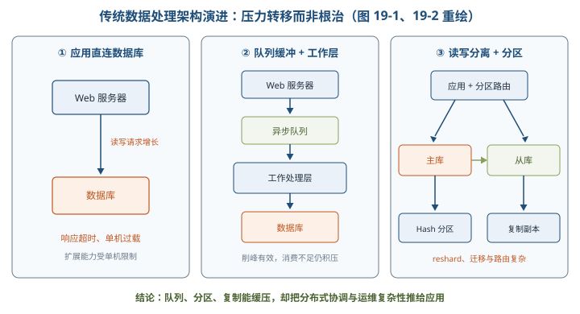

- 根本短板：**数据库并不天然替应用处理分区、复制和分布式查询**；仅靠备份也不能限制人为错误造成的破坏。
- 架构启示：大数据系统应把**容错、扩容、低延迟查询和可追溯**作为内生能力，而非外围脚本堆叠。

### 19.2 大数据处理系统架构分析

#### 19.2.1 三项挑战 ⭐【重点】

| 挑战 | 核心含义 | 记忆抓手 |
| --- | --- | --- |
| 非结构化/半结构化处理 | 文本、图像、社交与电商数据难直接套用二维表；一种表示只呈现数据的一个侧面 | 数据「怎么表示、怎么挖掘」 |
| 复杂性与不确定性建模 | 高维、多变、强随机，需研究统一描述、转换原则及知识度量 | 知识「怎么建模、怎么评价」 |
| 数据异构与决策异构 | 数据来源和结构多样，决策者经验、情境、偏好也不同 | 数据知识「怎么进入决策」 |

- **一次挖掘**：从数据中提取结构化「粗糙知识」；**二次挖掘**：把粗糙知识与经验、常识、情境、偏好等主观知识结合，形成可支撑决策的「智能知识」。
- 举例：一次挖掘发现「某商品雨天销量上升」，二次挖掘再结合当地天气、库存和经理经验，决定「是否补货、补多少」，后者才直接服务决策。

> 助记：三大挑战＝「非结构、难建模、双异构」；知识跃迁＝「一次出粗糙，二次融主观」。

#### 19.2.2 八项架构特征 ⭐【高频考点】

| 特征 | 必须理解的含义 |
| --- | --- |
| 鲁棒性和容错性 | 机器宕机、程序 Bug、人为误操作发生时仍行为正确并能恢复；人为容错尤其重要 |
| 低延迟读取和更新 | 在鲁棒前提下支持毫秒至数百毫秒级读写 |
| 横向扩容 Scalable | 负载增长时增加机器维持性能，优先 scale out 而非单纯 scale up |
| 通用性 General | 能支持金融、社交、电商等多类应用 |
| 延展性 Extensible | 能添加新功能，并支持大规模迁移 |
| 即席查询 Ad Hoc | 用户可按临时组合条件查询，而非只能跑固定报表 |
| 最少维护 Minimal Maintenance | 用简单机制和算法降低底层复杂度、错误率与繁重操作 |
| 可调试性 Debuggable | 每个结果值都能追踪来源并解释其产生过程 |

> 助记：「鲁、低、横、通、延，即、少、调」——鲁棒低延，横向通用可延展，即席少维护可调试。

### 19.3 Lambda 架构

#### 19.3.1～19.3.2 定义与场景

> 教材原文：Lambda 是用于同时处理离线和实时数据的、可容错的、可扩展的分布式系统，具备强鲁棒性，提供低延迟和持续更新。

- 提出者是 Storm 之父 **Nathan Marz**；核心手段是整合离线与实时计算，融合**不可变性、读写分离、复杂性隔离**。
- 机器学习可利用其处理后的数据做模式识别；物联网传感器则是典型的海量实时输入源。
- 速度层追求最新数据的低延迟视图，允许暂时近似；后续批视图覆盖相同数据后，系统达到**最终精度**。

#### 19.3.3 三层体系结构 ⭐【重点】【高频考点】

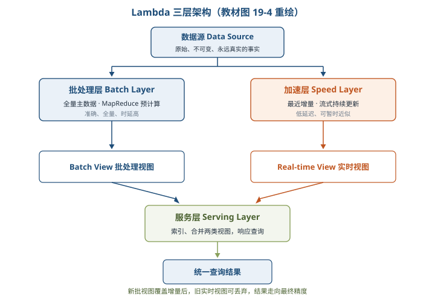

| 层次 | 输入与职责 | 输出/特点 |
| --- | --- | --- |
| Batch Layer 批处理层 | 管理全量主数据集，预计算业务查询 | Batch View；精准、全量，但时延高 |
| Speed Layer 加速层/流处理层 | 只处理最近增量数据流，持续增量更新 | Real-time View；低延迟，可能暂时不精确或不完整 |
| Serving Layer 服务层 | 响应查询，合并两类视图并建立必要索引 | 最终查询结果；要求随机读、批量写、可伸缩、容错 |

> 助记：「批全量、速增量、服合并」；「批求准确速求快，服务对外统一看」。

**主数据集三属性**：数据是**原始的、不可变的、永远真实的**。它保存事实，不随视图算法错误而被覆盖。

**1. Monoid（幺半群）与视图合并**⭐【易错】

- 关键性质是**结合律**：`(a+b)+c=a+(b+c)`，因此可分组并行计算，再合并部分结果；部分结果还能复用。
- 加法、求和满足结合律；平均值不能直接合并两个平均值，但可拆成「总和与计数」分别合并，最后再相除。
- 举例：两班平均成绩不能直接取平均；应分别汇总「总分、人数」，相加后用「全部总分÷全部人数」得到总平均。

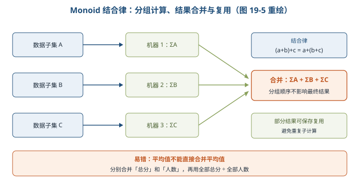

**2. 批视图预计算与实时视图滚动更新**

- Batch Layer 按业务可能需要的有限查询，在全量数据上预先构建 View；查询时直接读取或简单加工，避免每次全量重算。
- Speed Layer 接收新数据便更新 Real-time View；当新的 Batch View 已覆盖这些增量数据，旧实时视图可丢弃。

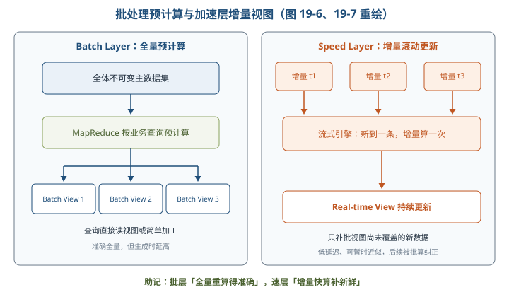

**3. 服务层合并与复杂性隔离**

- 查询函数满足 Monoid 性质时可直接合并两类结果；不满足时先拆成可合并的中间结果，或按明确业务规则合并。
- 新数据同时进入批、速两条链路，实时误差会由后续全量重算修正，体现教材所述的**最终一致性**。
- 离线与实时拆开，把高复杂度的增量算法隔离在 Speed Layer，提高整体鲁棒性；代价是两套计算逻辑。

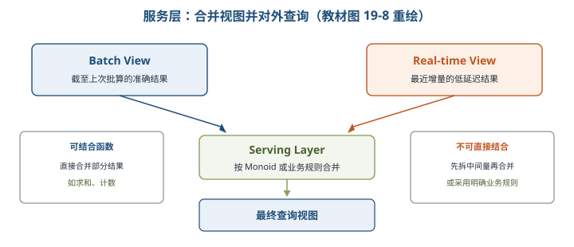

#### 19.3.4 技术实现

| 角色 | 教材常见选型 | 选择理由 |
| --- | --- | --- |
| 主数据集/分布式存储 | Hadoop HDFS | 通用硬件、高容错、高吞吐，适合大规模数据集 |
| 批处理与批视图 | MapReduce、Hive | 全量离线计算，构建可查询 Batch View |
| 实时计算 | Spark 或 Storm | 处理最近增量；Spark 中间结果可留内存，适合迭代计算 |
| 服务存储 | HBase 或 Cassandra | 面向列、可伸缩的分布式存储，支持低延迟查询 |

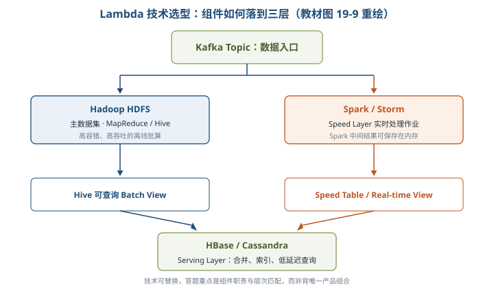

#### 19.3.5～19.3.6 优缺点与相关模式

| 方面 | 内容 |
| --- | --- |
| 优点 | 容错好，可修复算法后重算；批层支持灵活查询；各层可分布式扩展；新增视图较容易 |
| 缺点 | 全场景覆盖编码开销大；具体场景反复离线重训收益未必高；重新部署和迁移成本高 |
| 与事件溯源相同点 | 都以事件/事实为核心，业务视图由事实产生；出错可定位事件并重算恢复 |
| 与 CQRS 相同点 | 写入负责把数据加工成 View，查询直接读 View，属于读写职责分离 |

> 助记：Lambda 优点「容错、灵活、好扩、易加视图」，代价牢记「两套代码、两套系统、迁移重」。

### 19.4 Kappa 架构

#### 19.4.1 数据本质与不可变存储 ⭐【重点】

- 数据系统可概括为「**数据 + 查询**」。数据的 **When** 是发生时间，决定全局先后；**What** 是数据事实本身，过去发生的事实不可更改。
- 因而逻辑上只读取或追加新事实；Update/Delete 也可用一条新的事实记录表达，而不是抹掉历史。
- 不可变存储只需追加，避免更新索引的复杂性；原始错误数据仍在，修复算法后可按时间顺序**重新计算**，不会因覆盖而失去恢复依据。
- 举例：账本写错不撕掉原页，而是追加一张更正单；月底按单据时间顺序重算，既能得到正确余额，也能解释每笔结果从何而来。

#### 19.4.2～19.4.3 体系结构与重放切换 ⭐【高频考点】

Kappa 由 **Jay Kreps** 提出，删除独立 Batch Layer，以一条流计算链路处理实时与历史数据。历史日志可长期保存；需要离线分析或算法升级时，再经消息队列重放进入同一流引擎。

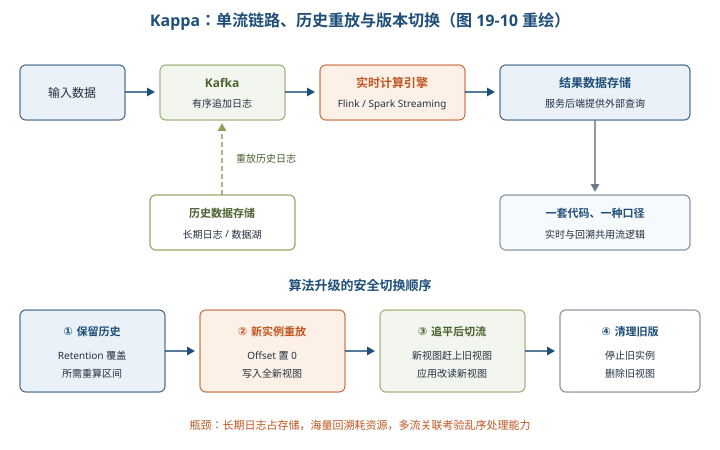

版本切换四步：

1. 设置日志保留期，使其覆盖需要重算的历史区间。
2. 启动作业新实例，将 Log Offset 置 0，从头计算并写入**新视图**。
3. 新视图追平旧视图后，应用切换读取新视图。
4. 停止旧实例并删除旧视图。

#### 19.4.4～19.4.5 优缺点与变形

| 方面 | Kappa 的特点 |
| --- | --- |
| 优点 | 实时与离线共用一套代码和口径；维护较简单；无须合并批、实时两类视图；历史查询可重放 |
| 缺点 1 | 长期日志占用消息中间件，海量回溯消耗大且存在性能瓶颈 |
| 缺点 2 | 多实时流关联依赖流引擎能力，乱序与算法逻辑可能导致数据丢失 |
| 缺点 3 | 删除独立离线模块，也失去其稳定可靠、擅长大规模批处理的优势 |

| 变形 | 核心改进 | 仍有限制 |
| --- | --- | --- |
| Kappa+ | 用 HDFS/Hudi 保存仓库数据，流框架直接读实时与历史分区完成 backfill | 依赖分区、窗口与 watermark 等设计 |
| 混合分析系统 | Kafka + Flink 后接 ElasticSearch，增强热点数据检索分析 | ES 只适合合理量级的热点数据，不能覆盖全部批分析 |

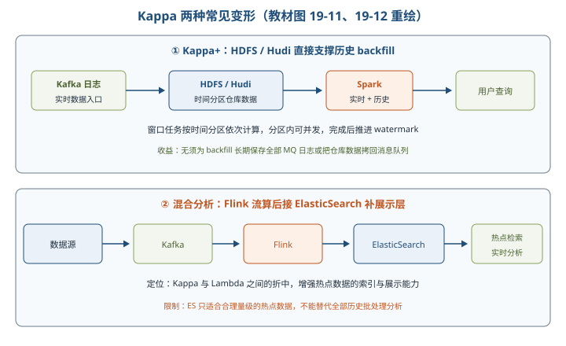

### 19.5 Lambda 与 Kappa 的对比和选择 ⭐【重点】【高频考点】

| 对比维度 | Lambda | Kappa |
| --- | --- | --- |
| 系统/代码 | 批、实时两套系统与代码 | 一套流式系统与代码 |
| 开发维护成本 | 高，部署测试和口径一致性工作多 | 相对低，算法修改只改一处 |
| 计算开销 | 持续运行批与实时计算，教材认为较大 | 平时单流，必要时才全量重算，教材认为相对较小 |
| 实时性 | 能满足；实时视图与批视图结合 | 能满足；直接由流处理产出结果 |
| 历史数据能力 | 批式全量吞吐大，能力强 | 流式全量吞吐相对低，受日志保留和回溯能力制约 |
| 典型优势场景 | 海量历史探索分析 + 实时查询；批流逻辑无法统一 | 增量时序数据、天然时间窗口、统一流式代码 |

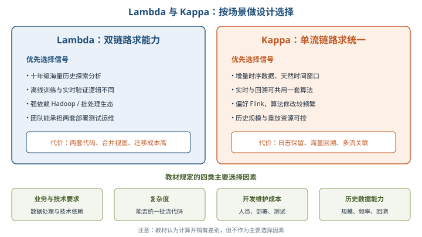

设计选择看四项：**业务与技术要求、复杂度、开发维护成本、历史数据处理能力**。教材明确说计算开销虽有差别但不作为主要选择因素。

- 依赖 Hadoop/Spark/Storm，或必须先离线训练模型再实时验证，选 **Lambda**。
- 偏好 Flink、希望一份代码同时承担实时和回溯，且数据规模与重放资源可控，选 **Kappa**。
- 频繁修改算法时 Lambda 要改两套；长期海量历史分析时 Kappa 的消息缓存和回溯压力更突出。

> 助记：「历史重、批流异，Lambda；增量流、求一统，Kappa」；选型四看「业务、复杂、成本、历史」。

### 19.6 大数据架构设计案例分析

#### 19.6.1 奥运视频平台：Lambda 同时满足秒级与历史统计

- 当日概览要求秒级刷新在线人数、浏览量、播放次数等，采用 Spark Streaming 增量计算；赛事回顾要求自定义时段的历史峰值与排行，采用不可变主数据和离线批算。
- 采集 PC/App/TV 数据，实时链路经 Nginx、Flume、Kafka，离线链路经 Sqoop；存储含 HDFS、HBase、MemSQL；计算分离线、实时、合并三部分，最终服务当日概览与赛事回顾。

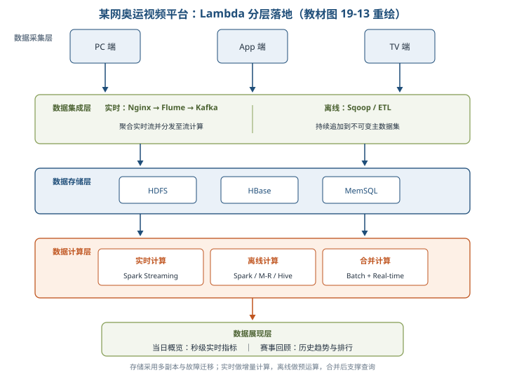

#### 19.6.2 广告平台：把工作从查询端前移 ⭐【案例高频】

| 版本 | 主要做法 | 暴露瓶颈/下一步改进 |
| --- | --- | --- |
| 第一版 | Hive/Spark 离线结果入 MySQL，Spark Streaming 实时结果入 Redis，Java 查询时多源关联合并 | Java 服务逻辑重、性能差；第三方曝光等数据不够实时 |
| 第二版 | 定时同步第三方报表，离线预先 join 并导出结果 | Java 压力下降，但 Redis 键关联聚合成为瓶颈；离线依赖链长 |
| 第三版 | 单一 MySQL 统计表，当天行存实时、历史行存离线；下单处理时提前完成业务关联 | 服务层只读一表；将关联工作前移到数据收集/计算阶段 |

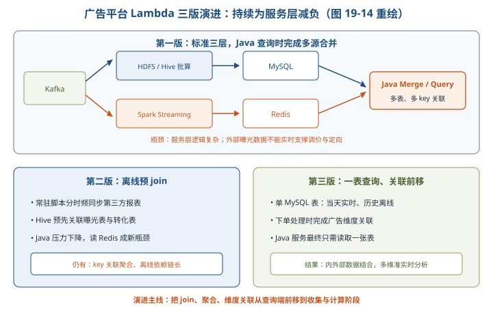

案例结论：标准分层不是终点；当服务层成为瓶颈，应把**可预先完成的 join、聚合和维度关联前移**，让查询端保持简单。

#### 19.6.3～19.6.4 两类 Kappa 实践

| 案例 | 流式链路 | 业务价值 |
| --- | --- | --- |
| 证券实时日志 | Filebeat → Kafka → Flink 清洗解析 → ElasticSearch 存日志、OpenTSDB 存指标 | 智能搜索、可视化、全息监控、异常预警与故障溯源 |
| 电商智能决策 | B 端事件 → Kafka → Flink 窗口聚合 → Tair/Hive → 决策服务计算参数 | 实时数据参与模型迭代；Zookeeper 通知客户端拉取参数并本地保存，业务读取无网络延迟 |

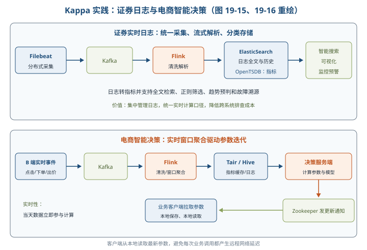

**案例题通用分析路径**：先找数据特征（全量/增量、结构化程度、历史跨度），再找质量属性（延迟、准确、容错、成本），然后映射架构层次与组件，最后检查存储、重放、合并和查询瓶颈。

## 三、重点与易错点

| # | 考点 | 必须记住的结论 | 易错提醒 |
| --- | --- | --- | --- |
| 1 | 传统架构根因 | 队列、分区、读写分离只是缓压，应用复杂性持续上升 | 队列不能根治数据库过载 |
| 2 | 八项特征 | 容错、低延迟、横扩、通用、延展、即席、少维护、可调试 | 横向扩容是加机器，不是只升级单机 |
| 3 | 二次挖掘 | 粗糙知识融合主观知识形成智能知识 | 一次挖掘不等同最终管理决策 |
| 4 | Lambda 提出者 | Nathan Marz | Kappa 才是 Jay Kreps |
| 5 | Batch Layer | 管全量主数据并生成 Batch View，准确但慢 | 不负责毫秒级增量刷新 |
| 6 | Speed Layer | 处理最近增量并更新 Real-time View，快但可暂时近似 | 不是长期保存全量主数据之处 |
| 7 | Serving Layer | 合并批/实时视图并对查询提供低延迟访问 | 不是重新执行全量计算的层 |
| 8 | 主数据三性 | 原始、不可变、永远真实 | 不可变不等于不能追加更正事实 |
| 9 | Monoid | 结合律支持分组并行、部分结果合并与复用 | 平均值须拆成总和与计数，不能直接平均平均值 |
| 10 | 最终精度 | 后续批视图覆盖并纠正实时近似结果 | 不代表实时视图永远精确 |
| 11 | Lambda 成本 | 两套代码、两套系统，维护与迁移成本高 | 查询灵活不代表实现简单 |
| 12 | Kappa 本质 | 删除独立批层，用同一流链路处理实时与历史重放 | 不是 Lambda 的全场景替代品 |
| 13 | Kappa 切换 | 新实例从 Offset 0 重放，新视图追平后切换，再停旧删旧 | 不能直接覆盖唯一生产视图 |
| 14 | Kappa 短板 | 长周期日志存储、海量回溯、多流关联压力大 | 一套代码不等于资源消耗一定低 |
| 15 | Kappa+ | HDFS/Hudi 支撑直接 backfill，减少长期日志和回拷 MQ | 仍需处理时间分区、窗口和 watermark |
| 16 | 混合分析 | ES 补强热点检索，是折中而非全量批分析替代 | 不要把 ES 当作无限容量历史仓库 |
| 17 | 选型因素 | 看业务技术、复杂度、维护成本、历史能力 | 按教材，计算开销不列为主要选择因素 |
| 18 | 广告演进 | 将 join、聚合、关联从服务查询端前移 | 分层正确不代表查询端可以无限复杂 |

## 四、练习与真题

以下 12 题为自编单选模拟题，答案与解析集中放在全章最后。

**1.** 在 Web 服务器与数据库之间增加异步队列后，仍无法根本解决什么问题？
A. 请求削峰  B. 数据库最终过载  C. 消息批量消费  D. 短时流量缓冲

**2.** 大数据知识发现中，将粗糙知识与经验、情境和用户偏好结合的过程称为什么？
A. 一次挖掘  B. 数据清洗  C. 二次挖掘  D. 数据分区

**3.** 下列哪一项最能体现大数据系统的横向扩容？
A. 更换更高主频 CPU  B. 增加机器维持性能  C. 扩大单机内存  D. 删除历史数据

**4.** Lambda 架构中，负责管理全量主数据集并生成 Batch View 的是哪一层？
A. 服务层  B. 加速层  C. 批处理层  D. 展现层

**5.** 关于 Speed Layer 的说法，正确的是哪一项？
A. 只处理最近增量并低延迟更新实时视图  B. 永久保存全部原始事实  C. 每次查询都全量重算  D. 负责合并批视图和实时视图

**6.** 两个分组已知平均值和样本数，要合并求总平均值，最符合 Monoid 思路的做法是哪一项？
A. 直接平均两个平均值  B. 只保留样本数较多组  C. 分别合并总分与总人数后相除  D. 任选一个组的平均值

**7.** 当新的 Batch View 已覆盖 Speed Layer 处理过的数据后，通常可以怎样处理旧 Real-time View？
A. 永久归档为主数据  B. 丢弃并由批视图承接  C. 转成消息队列  D. 必须再复制三份

**8.** 在 Lambda 技术选型中，HBase 或 Cassandra 通常用于承担什么角色？
A. 服务层分布式存储  B. 数据采集传感器  C. 日志保留期配置  D. 主数据不可变证明

**9.** Kappa 架构相对 Lambda 最突出的结构变化是什么？
A. 增加第三个批处理层  B. 删除独立批层并统一为一条流计算链路  C. 禁止保存历史数据  D. 只允许离线计算

**10.** Kappa 升级计算逻辑时，正确的版本切换顺序是哪一项？
A. 先删旧视图再启动新实例  B. 新实例从头重放，追平后切换，再停旧删旧  C. 直接修改主数据  D. 只修改旧视图索引

**11.** 某业务需要对十年海量历史数据频繁做探索性批分析，同时提供实时查询，优先考虑哪种架构？
A. Lambda  B. Kappa  C. 单库单表  D. 仅异步队列

**12.** 广告平台第三版将实时关联工作提前到下单处理阶段，主要解决了什么瓶颈？
A. 传感器采集精度  B. 服务层查询时多键关联聚合过重  C. HDFS 无法保存文件  D. 批处理层数据不可变

## 五、疑问与查漏补缺

- **大纲中的「定义、范围」**：教材 19.2 更侧重挑战与八项特征，没有另起严格定义；复习时可用「数据 + 查询」及 Lambda/Kappa 的分布式容错、低延迟、可扩展目标补全理解。
- **教材 19.3.3 加速层首句易误读**：「对加速层批处理视图建立索引」上下文不一致；按三层职责，应理解为实时层维护实时视图，服务层为查询视图建立索引。
- **教材 Monoid 平均值表述有笔误**：应拆为「总和÷计数」，不是「分母除以分子」；合并时先分别求和，再做除法。
- **教材 When 示例中的加法不成立**：先 +2 后 +3 与先 +3 后 +2 结果相同；说明顺序重要性可改用「先 ×2 再 +3」与「先 +3 再 ×2」。
- **Hadoop 与 HDFS 要区分**：HDFS 是分布式文件系统，Hadoop 是包含存储、计算等能力的生态/平台，答题不要把二者完全等同。
- **与第 6、8 章衔接**：分库分表、读写分离承接数据库设计；容错、可伸缩、低延迟和可维护性可结合质量属性与架构评估作答。
- **实践边界**：教材按当时技术背景比较开销，现实选型还需验证 exactly-once、乱序处理、状态后端、保留周期、存储成本与团队能力，但考试作答先以教材结论为准。

## 六、参考答案

**1.** **B**。队列只能削峰缓冲，消费或数据库处理能力不足时仍会积压和过载。

**2.** **C**。二次挖掘把一次挖掘所得粗糙知识与主观知识融合，形成智能知识。

**3.** **B**。scale out 通过增加机器数量扩展，另外三项属于升级单机或缩减数据。

**4.** **C**。批处理层保存全量主数据并预计算批视图。

**5.** **A**。加速层处理最近增量并持续更新 Real-time View，以低延迟弥补批视图滞后。

**6.** **C**。总和与计数都可结合合并，全部总分除以全部人数才是总平均。

**7.** **B**。批视图覆盖同一批数据后，临时实时视图可丢弃，实时误差也被重算纠正。

**8.** **A**。HBase/Cassandra 常作为服务层可伸缩存储，支撑低延迟查询。

**9.** **B**。Kappa 去掉独立批处理层，以统一流处理及日志重放承担实时和历史计算。

**10.** **B**。先让新实例安全地产出并追平新视图，再切流和清理旧版本，避免服务中断。

**11.** **A**。Lambda 的批处理层擅长大规模历史全量分析，加速层同时满足实时需求。

**12.** **B**。把业务关联从查询阶段前移到事件处理阶段，服务层只需读取一张统计表。
