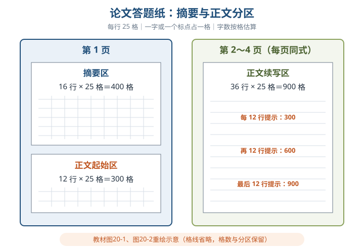
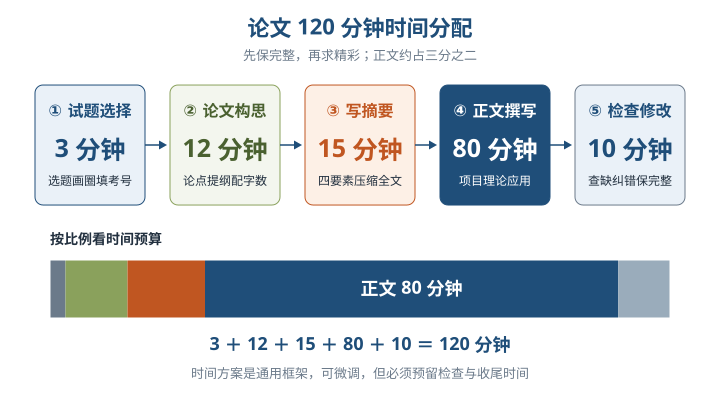
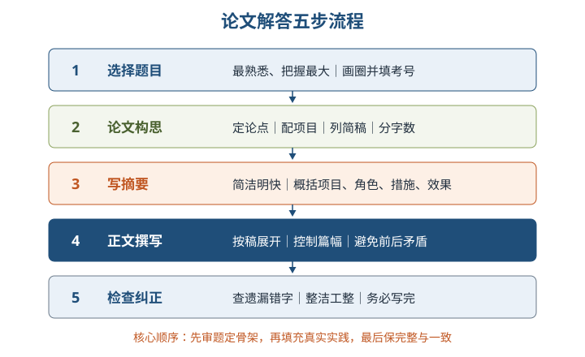
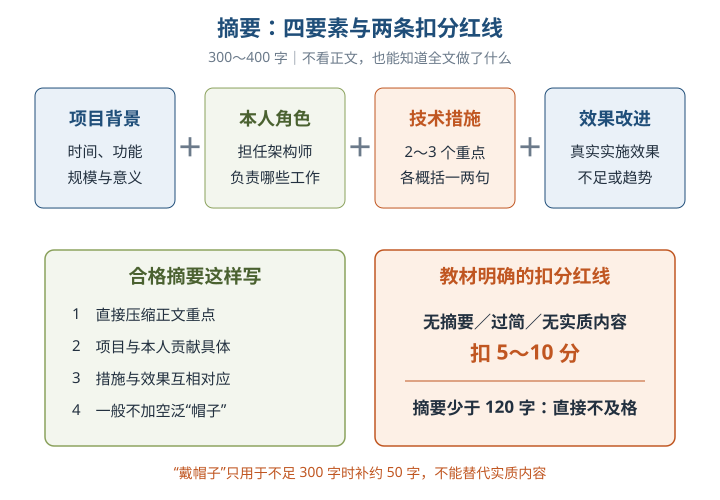
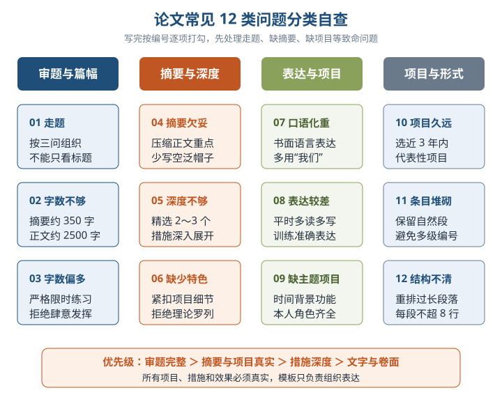
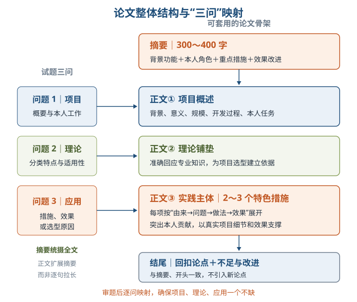

# 第20章 系统架构设计师论文写作要点

- 教材位置：`02.系统架构设计师第二版-教材.pdf` PDF 第 710～721 页（书页 702～712，第 721 页为封底）
- 复习状态：已完成
- 复习日期：2026-11-06
- 本章地位：本章是教材收官的实战章，直接服务考试科目 3「系统架构设计论文」。前 19 章解决「写什么」的知识储备，本章解决「怎样在 120 分钟内写完、写准、写出个人实践」的方法问题。

## 一、大纲考点

大纲（书页 61～62）**考试科目 3「系统架构设计论文」**要求：根据给出的与系统架构设计有关的若干专题，选择一个专题，按规定要求撰写论文。大纲规定主题范围，教材本章补齐写作方法，对应如下：

| 大纲主题（科目 3） | 大纲条目要点 | 教材对应位置 |
| --- | --- | --- |
| 1. 系统建模 | 定义问题与归结模型；结构化/面向对象建模；数据库、可靠性、系统评估建模 | 第 5～9 章；20.2.2 实例一「论软件系统建模方法及其应用」 |
| 2. 软件架构设计 | 架构风格与设计；特定领域架构；ABSD/ADD/DARTS；架构演化、质量评估、脆弱性分析 | 第 7、8、10 章；20.2.2 实例二「论软件架构风格」 |
| 3. 系统设计 | 总体框架、大数据流程、SOA/分布式、人机界面、嵌入式、数据库、文件/存储、网络、运行环境、性能、安全可靠性、中间件构件化 | 第 12～19 章各专业主题 |
| 4. 系统的可靠性分析与设计 | 故障与可靠性模型；提高可靠性措施；故障对策、备份恢复；分析、预计与评估 | 第 9 章 |
| 5. 系统的安全性和保密性设计 | 访问控制；数据完整性；数据与文件加密；抗攻击；通信安全；安全评估与认证 | 第 4、18 章 |
| 写作方法与应试要求 | 大纲样题（书页 64）为「论系统设计中对用户需求的把握」，要求依次回答三个问题 | 20.1～20.4：准备、格式、步骤、写作方法、常见问题 |

**论文科目考试形式与评分相关要求**⭐【高频考点】：

- **考查形式（教材 20.1.2）**：下午考试，**120 分钟**，通常 **4 道备选题任选 1 题**；选最熟悉、把握最大的题，并在答题卷上画圈、填考号。
- **篇幅要求**：**摘要 300～400 字，正文 2000～3000 字**，分开写在指定区域；教材建议正文约 2500 字。
- **三问结构**：①项目概要与本人工作；②论题专业知识；③结合本项目说明应用、效果或选型原因。大纲样题和教材两个实例均体现这一结构。
- **评分规则（教材明确给出的部分）**：无摘要、摘要过简或无实质内容扣 **5～10 分**；摘要少于 **120 字**直接不及格。大纲未给出完整量化评分表，其余应按实践经验、独立分析解决问题能力、表达能力三项考查目标准备，不臆造分值权重。

## 二、知识点笔记

### 20.1 写作注意事项

#### 20.1.1 做好准备工作 ⭐【重点】

论文试题的 3 个考查目的：①是否具有架构设计**实践经验**；②分析与解决问题、特别是**独立工作**的能力；③**表达能力**——抓住要点、重点突出、用词准确、易读易理解。通俗地说，阅卷者想确认「你真做过架构、能独立扛事、还讲得清楚」。

| 考生类型 | 主要短板 | 备考重心 |
| --- | --- | --- |
| 经验丰富者 | 经验零散、未提炼 | 从技术、管理、经济多角度对项目**归纳、剖析、抽象、升华**，结合专业知识分类梳理 |
| 经验欠缺的在职人员 | 项目阅历不足 | 整理单位文档与案例，参考历届题，可**临摹范文**，培养架构师视角 |
| 学生 | 实践少、内容易空洞 | 阅读相关文章与范文，学习他人经验并**强化练习**，避免脱离实际 |

- **平时积累**：高级资格靠考前突击行不通。盘点项目中的方法、技术、架构手段和经验教训；可把不同项目中与论题相关的真实经验组织到一个主题项目中，还要多读同行文章、多交流。
- **提高写作速度**：考前 **2～3 个月**起，按答题纸格式进行 **2 小时限时实战**，每周至少 1 次、最好 2 次。举例：平时打字很快的人，手写「缓存」「适配器」也可能停顿；卡壳有时不是不会设计，而是写不快、提笔忘字。
- **以不变应万变**⭐【高频考点】：「不变」是考前选定并总结好**近 3 年内、规模足以证明实力的代表性项目**及其概要、本人角色；「万变」是不同论题，靠全面积累应对。论文考共性、通用性问题，不是炫耀某个行业项目。

#### 20.1.2 论文写作格式 ⭐【高频考点】【易错】

> 教材原文：「论文考试的时间为下午（120 分钟），且备选的论文题目通常包含 4 道题目……摘要需要 300～400 字，正文需要 2000～3000 字。」

- **答题纸（教材笔试场景）**：共 4 页方格纸，每行 25 格。第 1 页摘要 **16 行＝400 格**、正文 **12 行＝300 格**；第 2～4 页每页 **36 行＝900 格**，每 12 行标有 300/600/900 字数提示。一字（含标点）一格，英文字母不受格子限制。
- **用笔**：建议**黑色中性笔**，避免钢笔洇透纸背，影响速度与卷面。

- 字数本质是**按格子估算**，标点、图形都占格。举例：摘要写满 14～16 行约为 350～400 字，看行数即可快速判断篇幅，不必逐字计数。

### 20.2 如何解答试题

#### 20.2.1 论文解答步骤 ⭐【重点】【高频考点】

| 环节 | 时间 | 关键动作 |
| --- | --- | --- |
| 试题选择 | 3 分钟 | 选最熟悉、把握最大的题；**画圈标记所选题目并填考号** |
| 论文构思 | 12 分钟 | 定论点与下过功夫之处；项目结合论点；定摘要内容；列简草稿；分配字数 |
| 写摘要 | 15 分钟 | 用语简洁明快，阐明论点 |
| 正文撰写 | 80 分钟 | 按草稿追忆项目素材；控制篇幅；调整时避免前后矛盾 |
| 检查修改 | 10 分钟 | 查漏、查错字；卷面整洁、格式整齐；**力求写完，切忌有头无尾** |

> 助记：「选三构十二，摘要一刻钟，正文八十攻，检查十分终」（3＋12＋15＋80＋10＝120）。

- 上述步骤是**通用框架而非死规矩**，可按题目与自身情况微调；若试题与准备内容出入大，仍选把握最大的论题，按平时节奏写，不临场慌乱。

#### 20.2.2 论文解答实例 ⭐【重点】

两个实例都展示「三问结构」，问题 1、2、3 分别对应「**项目—理论—应用**」：

| 问题 | 考查意图 | 作答要点 |
| --- | --- | --- |
| 问题 1：项目与工作 | 实践经验真实性 | 简述背景、功能、规模，明确**本人主要任务**；项目必须与论题相符 |
| 问题 2：专业知识 | 理论掌握程度 | 列出常用方法/风格，阐述特点、含义或适用范围，体现完整与准确 |
| 问题 3：项目应用 | 理论联系实际 | 说明实际采用的方法/风格、实施效果，以及为何这样选择 |

实例一「论软件系统建模方法及其应用」问题 2 的建模方法清单：

| 建模方法 | 核心思想一句话 |
| --- | --- |
| 功能分解法 | 以功能为中心分而治之，逐层拆分子功能并定义接口，再按功能需求设计数据结构 |
| 数据流法（结构化分析） | 跟踪数据流动，把问题域映射为数据流、加工、数据存储，画数据流图并配数据字典 |
| 信息工程建模法 | 在实体关系图基础上识别实体及关系；发展后以对象为实体、关系属性归入关系对象 |
| 面向对象建模法 | 用对象完整映射问题域，以封装、继承、消息机制控制复杂性 |

实例二「论软件架构风格」问题 2 列出 9 种风格：**管道/过滤器、数据抽象和面向对象、基于事件的隐式调用、分层系统、仓库系统及知识库、C2、客户/服务器、三层 C/S、浏览器/服务器**。其中黑板三要素是**知识源、黑板数据结构、控制**；问题 3 要说明本项目采用的风格并**分析选择原因**，不能只报名称。

### 20.3 论文写作方法

#### 20.3.1 如何写好摘要 ⭐【重点】【高频考点】【易错】

- **摘要四要素**：**项目背景与功能＋本人角色＋采用的技术/方法/措施（各用一两句概括）＋效果与不足/改进/趋势**。标准是「读者不看正文，就知道文章的全部内容」。
- **扣分红线**：没写摘要、摘要过简或无实质内容，扣 **5～10 分**；少于 **120 字**直接不及格。只谈大道理、不写具体内容，也是「无实质性内容」。

可直接套用的摘要模板：

> 教材原文（模板 3）：「……年……月，我参加了……项目的开发，担任……（作者的工作角色）。该项目……（项目背景、简单功能介绍）。本文结合作者的实践，以……项目为例，讨论……（论文主题），包括……（技术、方法、工具、措施、手段）。」

- **「戴帽子」规则**【易错】：一般不在开头堆砌「某某很重要」的空话；只有字数可能不足 300 字时，才可适当加约 50 字「帽子」。教材虽给出戴帽子模板，但正文建议少用。
- 举例：写「本文讨论架构，架构很重要」没有项目、角色和措施；改成「2025 年我担任某订单系统架构师，采用服务拆分与缓存降级……」才有实质信息。

#### 20.3.2 如何写好正文 ⭐【重点】【高频考点】

- **正文 2000～3000 字，最佳约 2500 字**：少于 2000 显得没内容，多于 3000 答题纸写不完。

| # | 写作技巧 | 核心要求 |
| --- | --- | --- |
| 1 | 以自我为中心 | 写清「我」做事的由来、问题、方法与效果；写明体制、规模、任务和贡献，**不罗列课本、不炫耀项目** |
| 2 | 站在架构师角度 | 从全局把握架构优缺点、设计过程、层间接口，**不停留在代码细节** |
| 3 | 忠实于论点 | 仔细审题，按试题问题展开，**绝对服从论点、不节外生枝** |
| 4 | 条理清晰、开门见山 | 先列提纲；项目概述精炼；不追求覆盖全部内涵、不懂装懂 |
| 5 | 标新立异、有主见 | 不刻意猎奇，也不拘泥教科书，写出个人见识与体会 |
| 6 | 图文并茂 | 紧要处画简洁草图；图不过草、不过大，线条箭头整洁 |
| 7 | 首尾一致 | 开头结尾呼应，**忌中途变卦**；写完检查错字漏字 |

> 助记：「我站论点上，条理新图尾」：我＝自我中心，站＝架构师角度，论点＝忠实论点，条理＝清晰，新＝有主见，图＝图文并茂，尾＝首尾一致。

- **正文措施段模板**：「在……阶段，我们遇到……（真实问题/约束）。我负责……，比较……后选择……；实施时先……再……，通过……验证，最终……（真实效果）。该措施仍受……限制，后续……。」每个措施都按「由来→问题→做法→效果」展开。
- **结尾模板**：「综上所述，……项目通过……解决了……。实践表明，……（回扣论点）。目前……仍有不足，后续将……。」结尾不引入新论点，与摘要和开头一致。
- **专业知识素材库**：经典架构风格及场景（面向对象、面向过程、SOA、微服务等）；质量属性及提升策略；架构评估过程、方法与技术；架构建模和描述方式。具体理论回看前面章节。

#### 20.3.3 摘要和正文的关系 ⭐【易错】

先写摘要还是先写正文**没有固定法则**：

| 顺序 | 适合人群 | 优点 | 风险 |
| --- | --- | --- | --- |
| 先正文后摘要 | 写作快、把握大 | 正文充分发挥，写完归纳摘要水到渠成 | 时间不够会缺摘要，可能直接不及格 |
| 先摘要后正文 | 写作慢、担心时间 | 时间不足可收束正文，避免正文完成而摘要缺失 | 可能限制正文，只在摘要圈子里扩写 |

- **正文不是摘要的延伸，而是摘要的扩展；摘要不是正文的一部分，而是正文的抽象**。举例：摘要像楼盘一页总览，正文是完整沙盘与样板间；沙盘不是把广告词逐句拉长，而是把每个卖点展开成实景。

### 20.4 常见问题及解决办法 ⭐【重点】【高频考点】

| # | 常见问题 | 解决办法 |
| --- | --- | --- |
| 1 | 走题：只看标题就套写 | 认真读 **3 个问题**并逐一回应；同主题每次侧重点不同，背文不能硬套 |
| 2 | 字数不够 | 摘要 350 字以上、正文约 2500 字；含标点与图形，按格估算 |
| 3 | 字数偏多 | 严格 2 小时限时练习；正文超 3000、摘要超 350 即需警惕，最多不超 400 |
| 4 | 摘要归纳欠妥 | 直接压缩正文重点，少加帽子性语句 |
| 5 | 深度不够 | 只选**最有特色的 2～3 个措施**深入展开，不面面俱到 |
| 6 | 缺少特色、泛泛而谈 | 所有措施紧扣主题项目的具体内容，写经验而非理论罗列 |
| 7 | 口语化、满篇是「我」 | 用书面语言，以「我们」替代部分「我」；本人贡献仍要写清 |
| 8 | 文字表达差 | 平时多读文章、多写文档 |
| 9 | 缺乏主题项目 | 写明某年某月参加的具体项目、背景功能与本人角色 |
| 10 | 项目年代久远 | 主题项目应为**近 3 年内**完成 |
| 11 | 数字条目堆砌 | 可用数字标识顺序，但避免全文多级编号，保持自然段表达 |
| 12 | 结构不清、段落太长 | **每个自然段最好不超过 8 行**，必要时重排段落 |

### 本章可直接套用的应试清单

- **整体框架**：摘要四要素 → 项目概述（背景、意义、规模、过程、角色）→ 理论铺垫（回应问题 2）→ 实践主体（2～3 个特色措施，回应问题 3）→ 结尾（呼应、不足与改进）。
- **临场自查 6 问**：①选题画圈填考号了吗？②摘要够 300 字且有实质内容吗？③三个问题逐一回应了吗？④项目具体且近 3 年吗？⑤正文约 2500 字、段落不超 8 行吗？⑥首尾一致、无错字、写完了吗？

## 三、重点与易错点

| # | 考点 | 必须记住的结论 | 易错提醒 |
| --- | --- | --- | --- |
| 1 | 考试形式 | 下午 120 分钟，通常 4 题选 1 | 不是写 4 篇；选题后画圈并填考号 |
| 2 | 字数要求 | 摘要 300～400；正文 2000～3000、最佳约 2500 | 摘要宜 350 字左右；正文超 3000 反而写不完 |
| 3 | 摘要扣分红线 | 无摘要/过简/无实质内容扣 5～10 分；少于 120 字不及格 | 先正文后摘要者尤其要防没时间写摘要 |
| 4 | 时间分配 | 选题 3＋构思 12＋摘要 15＋正文 80＋检查 10＝120 分钟 | 正文独占 80 分钟，构思不能无限延长 |
| 5 | 三问结构 | 项目概要 → 理论知识 → 项目应用与效果/原因 | 问题 2 与问题 3 都要答，不可只写项目故事 |
| 6 | 走题 | 按试题 3 个问题组织内容，而非按标题套文 | 同主题不同次考试侧重点不同，硬套最高危 |
| 7 | 项目选取 | 近 3 年内、规模足以证明实力的代表性项目 | 「不变」的是项目概要与角色，不是同一篇范文 |
| 8 | 摘要与正文关系 | 正文是摘要的扩展；摘要是正文的抽象 | 不要把正文接着摘要逐句拉长 |
| 9 | 戴帽子 | 一般不加空话；不足 300 字时可加约 50 字 | 教材有帽子模板不等于推荐空谈重要性 |
| 10 | 深度与广度 | 选 2～3 个有特色措施深入展开 | 罗列七八个措施、每个蜻蜓点水是典型低分文 |
| 11 | 人称与语体 | 书面语言，用「我们」替代部分「我」 | 「以自我为中心」指突出本人贡献，不是满篇写我 |
| 12 | 段落与卷面 | 自然段不超 8 行；字迹工整、首尾一致 | 中途改论点会被疑造假；有头无尾是大忌 |
| 13 | 答题纸格数 | 每行 25 格；摘要 16 行 400 格；后续每页 36 行 900 格 | 字数按格估算，标点图形都占格 |
| 14 | 备考节奏 | 考前 2～3 个月起，每周 1～2 次 2 小时限时实战 | 高级资格靠突击行不通，功夫在平时 |

## 四、练习与真题

以下 8 道为自编单选模拟题，覆盖本章高频考点。答案集中在本笔记最后「六、参考答案」。

**1.** 系统架构设计师论文科目的考试时长与选题方式，正确的是（ ）。
A. 120 分钟，通常 4 题选 1  B. 150 分钟，通常 4 题选 2  C. 120 分钟，4 题全部作答  D. 90 分钟，随机分配 1 题

**2.** 关于论文摘要与正文的字数要求，下列说法正确的是（ ）。
A. 摘要 200～300 字，正文 1500～2000 字  B. 摘要 300～400 字，正文 2000～3000 字  C. 摘要不少于 500 字，正文不少于 3000 字  D. 摘要与正文合计 2000～3000 字

**3.** 某考生正文内容优秀，但摘要仅写了约 100 字。按教材所述规则，最可能的处理结果是（ ）。
A. 仅扣 1～2 分  B. 扣 5～10 分后照常评分  C. 给予不及格  D. 补写摘要后重新评分

**4.** 按教材推荐的时间分配方案，「正文撰写」环节应安排（ ）。
A. 60 分钟  B. 70 分钟  C. 80 分钟  D. 100 分钟

**5.** 关于「以不变应万变」的备考策略，下列理解正确的是（ ）。
A. 不变的是同一篇范文  B. 不变的是代表性项目概要与本人角色，万变的是论题  C. 不变的是摘要，正文随意换  D. 不变的是论题，项目随意换

**6.** 论文试题通常要求依次论述三个方面，其标准结构是（ ）。
A. 行业趋势 → 研究现状 → 未来展望  B. 项目与本人工作 → 专业知识 → 项目应用与效果/原因  C. 摘要 → 关键词 → 参考文献  D. 问题定义 → 代码实现 → 测试报告

**7.** 关于摘要与正文的写作顺序及二者关系，下列说法正确的是（ ）。
A. 必须先写摘要，否则无效  B. 正文是摘要的延伸，应逐句拉长  C. 写作慢者可先写摘要，正文是摘要的扩展  D. 先正文后摘要没有风险，适合所有人

**8.** 下列做法中，符合教材对论文正文写作要求的是（ ）。
A. 将用过的 8 种技术各写一段简介  B. 通篇口语化并处处以「我」开头  C. 选 2～3 个特色措施深入展开，自然段不超 8 行  D. 全文用多级数字条目组织

## 五、疑问与查漏补缺

- **大纲主题广，本章不重复专业知识**：科目 3 的 5 大主题须回看第 4～19 章笔记；为每个主题准备「项目＋2～3 个特色措施」的可复用素材，不能只背写作模板。
- **大纲未列完整量化评分表**：本章只把教材明确的摘要扣分规则当硬性结论，其他备考重心依据三项考查目标归纳；遇到网络流传的详细分值权重，应以当次官方说明为准。
- **教材按纸笔考试描述**：答题纸、黑色中性笔、练字等要求基于笔试场景；近年软考已推行计算机化考试，具体作答应以当次官方公告为准。机考可把「练字提速」转为「练打字与结构化表达」，时间、篇幅和内容要求仍须按当次规则核对。
- **教材易误读处**：①图 20-1「正方」为「正文」的排版笔误；②模板 4 戴帽子与「一般不要戴帽子」并存，以后者为原则、前者为凑字例外；③20.4「摘要超 350 字即偏多」与「300～400 字」并存，稳妥写约 350 字且不超 400；④「350 字以上」是建议值，「少于 120 字」才是不及格红线。
- **后续行动建议**：①选定 1 个近 3 年代表性项目，写好项目概要底稿；②按大纲 5 大主题各拟 1 份「三问」提纲；③每周至少 1 次 120 分钟全真限时写作，并按 12 类问题自查；④建立个人摘要、措施段与结尾模板，考场只做有真实素材支撑的组装；⑤每篇练习复盘字数、跑题、深度和完整性，不虚构项目或效果数据。

## 六、参考答案

**1.** A。教材 20.1.2：论文考试下午 120 分钟，备选通常 4 题、任选 1 题作答。

**2.** B。摘要 300～400 字、正文 2000～3000 字，教材建议正文最佳约 2500 字。

**3.** C。摘要少于 120 字论文「给予不及格」；无摘要、过简或无实质内容对应扣 5～10 分。

**4.** C。时间分配为选题 3、构思 12、摘要 15、正文 80、检查 10 分钟，合计 120 分钟。

**5.** B。「不变」是代表性项目概要与所任角色，「万变」是共性论题，项目应近 3 年内完成。

**6.** B。三问结构为「项目—理论—应用」，先概述项目与本人工作，再写专业知识，最后结合项目说明应用。

**7.** C。顺序无固定法则，慢者先摘要以保完整；正文是摘要的扩展而非延伸，先正文有缺摘要风险。

**8.** C。深度优先，选 2～3 个特色措施深入展开且段落不超 8 行；其余分别犯深度不够、口语化、条目堆砌问题。
